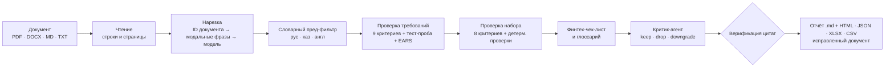

<p align="center"></p>

<p align="center">
  
  
  
  
</p>

# ReqLens — ИИ-агент статической проверки требований

ReqLens читает готовый документ требований (PDF, DOCX, Markdown, TXT), выделяет отдельные требования, проверяет каждое
из них и весь набор целиком по критериям **ISO/IEC/IEEE 29148:2018 (п. 5.2.5, 5.2.6)** и **IEEE Std 830-1998 (п. 4.3)**
и записывает отчёт на русском языке. Это ревью требований **до разработки**: агент ищет дефекты формулировок
(двусмысленность, непроверяемость, противоречия, пропуски, лишние проектные решения), а не запускает тесты программы.

**Чем ReqLens отличается от обычного «LLM-ревьюера»:**

| | |
|---|---|
| 🧪 **Тест-проба** | К каждому требованию агент пытается написать приёмочный тест Given/When/Then. Не получилось — это *доказательство* непроверяемости с цитатой блокирующего фрагмента. |
| 🔍 **Интерактивный отчёт** | «Grammarly для требований»: дефекты подчёркнуты прямо в тексте документа, клик — объяснение, пункт стандарта и готовая формулировка. Один офлайн-файл HTML, светлая и тёмная темы, печать в PDF. |
| 🪄 **Автоисправление** | Исправленный документ с сохранённой структурой и сносками + diff «было → стало»; с `--rescore` — повторная оценка: балл до и после. |
| 🛡️ **Защита от галлюцинаций** | Каждое замечание содержит дословную цитату; агент проверяет её по тексту и отбрасывает выдуманное. Критик-агент перепроверяет замечания и выставляет уверенность. |
| 🏦 **Финтех-экспертиза** | Чек-лист полноты для банковских продуктов (2FA, лимиты, идемпотентность, AML, персональные данные, SLA…) — только с подтверждающими цитатами. |
| 📊 **Метрики** | Балл документа 0–100, индекс готовности к разработке, радар по критериям, «цена дефекта», бенчмарк точности на документе с известными дефектами. |
| 🔒 **Офлайн-режим** | Профиль `offline` работает с локальной моделью через Ollama: документ банка не покидает контур. |
| 🧰 **Для команды** | Excel-трассировка, CSV для импорта в Jira, `report.json`, вопросы заказчику, сравнение версий документа, веб-студия, Docker, GitHub Action. |

---

## Быстрый старт

```bash
# 1. Python 3.10+ и зависимости
python -m venv .venv
source .venv/bin/activate          # Windows: .venv\Scripts\activate
pip install -r requirements.txt

# 2. Ключ LLM
cp .env.example .env               # Windows: copy .env.example .env
# откройте .env и впишите GEMINI_API_KEY=<ваш ключ>

# 3. Прогон: путь к документу требований и путь к отчёту
python review.py docs/requirements.md reports/report.md
```

**Куда ляжет отчёт.** Основной отчёт — файл, указанный вторым аргументом (в примере `reports/report.md`, папка создаётся
автоматически). Рядом появляются дополнительные артефакты:

| Файл | Что внутри |
|---|---|
| `reports/report.md` | **Основной отчёт на русском** (все разделы по ТЗ) |
| `reports/report.html` | Интерактивный отчёт — откройте двойным кликом (работает офлайн) |
| `reports/report.json` | Машиночитаемый результат (`schema_version: 2.0`) |
| `reports/report_requirements_fixed.md` | Исправленная версия документа со сносками |
| `reports/report_traceability.xlsx` | Требования, нарушения, тест-кейсы, матрица трассировки, вопросы |
| `reports/report_jira_import.csv` | Дефекты для импорта в Jira |

Поддерживаемые входные форматы: `.pdf`, `.docx`, `.md`, `.txt`:

```bash
python review.py docs/requirements.pdf reports/report.md --open      # открыть HTML-отчёт после прогона
```

## Как получить ключ LLM

По умолчанию используется бесплатный **Gemini API (Google AI Studio)**, модель **`gemini-2.5-flash`**.

1. Откройте <https://aistudio.google.com/apikey> и войдите в Google-аккаунт.
2. Нажмите **Create API key** и скопируйте ключ.
3. Положите ключ в файл `.env` в корне репозитория (создаётся из `.env.example`):
   ```
   GEMINI_API_KEY=ваш_ключ
   GEMINI_MODEL=gemini-2.5-flash
   ```

Файл `.env` указан в `.gitignore` и в репозиторий не попадает. В репозитории лежит только `.env.example` без ключа.
Платный ключ не нужен: профиль `fast` (по умолчанию) укладывается в лимиты бесплатного тарифа — проверка требований
идёт пакетами по 8, тест-проба и тип EARS запрашиваются в том же запросе, а повторные прогоны берутся из кэша.

## Флаги и профили

```
python review.py <вход> <отчёт.md> [--profile fast|full|offline] [--domain fintech|none] [--compare СТАРЫЙ]
                                   [--critic | --no-critic] [--rescore] [--no-tests]
                                   [--no-html] [--no-fixed] [--no-xlsx] [--no-jira] [--no-json] [--open] [--quiet]
```

| Профиль | Что включено | Когда использовать |
|---|---|---|
| `fast` (по умолчанию) | проверка требований + тест-проба + EARS, проверка набора, финтех-чек-лист и глоссарий | бесплатный тариф Gemini, итоговый прогон |
| `full` | + критик-агент, уверенность замечаний, `--rescore` (повторная оценка исправленного документа) | демо «было → стало» |
| `offline` | как `full` без rescore, модель — локальная через Ollama | конфиденциальные документы банка |

| Флаг | Назначение |
|---|---|
| `--domain fintech\|none` | доменный чек-лист полноты (`req_review/domains/*.yaml` — можно добавить свой домен без кода) |
| `--compare old.md` / `--compare report.json` | динамика относительно прошлой версии: исправлено ✅ / новое ⚠️ / ухудшилось 🔻 |
| `--critic`, `--no-critic` | включить/выключить критик-агента независимо от профиля |
| `--rescore` | прогнать исправленный документ повторно и показать балл «было → стало» |
| `--no-tests` | не показывать тест-пробу |
| `--no-html`, `--no-fixed`, `--no-xlsx`, `--no-jira`, `--no-json` | не создавать соответствующий артефакт |
| `--open` | открыть HTML-отчёт в браузере |

### Настройки (`.env`)

| Переменная | По умолчанию | Назначение |
|---|---|---|
| `LLM_PROVIDER` | `gemini` | `gemini`, `openai` (любой OpenAI-совместимый API) или `mock` (офлайн-заглушка для тестов) |
| `GEMINI_API_KEY` | — | ключ Google AI Studio |
| `GEMINI_MODEL` | `gemini-2.5-flash` | модель Gemini |
| `OPENAI_BASE_URL`, `OPENAI_API_KEY`, `OPENAI_MODEL` | — | OpenAI-совместимые API (OpenRouter, Groq, Ollama и др.) |
| `LLM_BATCH_SIZE` | `8` | требований в одном запросе |
| `LLM_MIN_INTERVAL` | `6` | пауза между запросами, с (≈10 запросов/мин) |
| `LLM_MAX_RETRIES` | `6` | повторы при 429/5xx (учитывается `retryDelay`) |
| `LLM_TEMPERATURE` | `0` | температура |
| `LLM_CACHE` | `1` | кэш ответов модели в `.cache/llm` |
| `REQLENS_PROFILE`, `REQLENS_DOMAIN` | `fast`, `fintech` | профиль и домен по умолчанию |
| `OFFLINE_MODEL` | `qwen2.5:14b` | модель Ollama для профиля `offline` |

## Запуск без интернета (банковский контур)

```bash
ollama pull qwen2.5:14b
python review.py docs/requirements.md reports/report.md --profile offline
```

В паспорте отчёта будет строка «Режим: офлайн: документ не передавался третьим лицам».

## Веб-интерфейс ReqLens Studio

```bash
python -m req_review.web        # → http://localhost:8000
```

Перетащите документ, выберите профиль — шаги прогона показываются вживую, в конце открывается интерактивный отчёт
и кнопки скачивания всех артефактов. Ключ модели берётся только из `.env` сервера и в браузер не передаётся.
CLI остаётся основным способом запуска по ТЗ.

## Docker

```bash
docker build -t reqlens .
docker run --rm -v "$PWD:/work" --env-file .env reqlens docs/requirements.md reports/report.md
docker compose up studio        # веб-студия на http://localhost:8000
```

## Как устроен прогон



1. **Чтение.** PDF — через `pdfplumber` (с номерами страниц), DOCX — абзацы, заголовки и таблицы, MD/TXT — как есть.
2. **Нарезка.** Идентификаторы документа (`FR-01`, `REQ-1.2`, `НФТ-3`, `3.1.2` …), в том числе в таблицах; без ID —
   пункты с модальными словами, агент присваивает номера `R-001…` и сохраняет цитату; если и так ничего нет — нарезка моделью.
3. **Пред-фильтр правил** — словарь размытых формулировок на русском, казахском и английском.
4. **Проверка каждого требования** по 9 критериям 29148 §5.2.5 / IEEE 830 §4.3; в том же запросе — **тест-проба** и тип **EARS**.
5. **Проверка набора** по 29148 §5.2.6 и IEEE 830 §4.3 + детерминированные проверки (дубли ID, почти-дубли, утверждения без ID, приоритеты).
6. **Финтех-чек-лист и глоссарий** — один запрос; покрытие засчитывается только с цитатами.
7. **Критик-агент** (`full`/`offline`) — подтверждает, понижает или отклоняет замечания, выставляет уверенность.
8. **Верификация цитат.** Замечание с несуществующей цитатой отбрасывается и показывается в приложении.
9. **Отчёты.**

## Состав отчёта

1. **Паспорт прогона** — документ, файл и SHA-256, дата, модель, версия агента (git-коммит/тег), профиль и режим,
   число обращений к модели, **балл документа** и **готовность к разработке**.
2. **Нарезка требований** — «ID в отчёте — ID в документе — место — краткая формулировка».
3. **Проверка каждого требования** — цитата, балл, тип EARS, таблица нарушений (критерий, цитата, проблема, серьёзность,
   как исправить, источник), предлагаемая формулировка, результат тест-пробы.
4. **Проверка набора** — статус по каждому критерию, замечания со ссылками, доменная полнота, глоссарий.
5. **Сводка** — числа требований и нарушений, профиль качества по критериям, покрытие тест-пробой, критичные дефекты.
6. **Итог** — можно ли начинать разработку и тестирование, что исправить в первую очередь, цена дефекта, вопросы
   заказчику, исправленный документ, граф связей (Mermaid), динамика к прошлой версии.
7. **Приложения** — критерии, отброшенные и отклонённые замечания, методика оценки.

Каждое нарушение привязано к конкретному месту: ID требования, раздел, строка/страница и дословная цитата.

## Почему этому можно доверять

- **Цитаты проверяются кодом**: замечание без точной цитаты из документа не попадает в оценку.
- **Тест-проба** превращает «непроверяемо» из мнения в факт: тест не составлен — показан фрагмент, который мешает.
- **Критик-агент** перепроверяет замечания; отклонённое не исчезает, а уходит в приложение с причиной.
- **Все числа считает код** (`req_review/scoring.py`, методика — в приложении отчёта), а не модель.
- **Бенчмарк** на документе с заранее известными дефектами:

```bash
python bench/run.py              # → bench/RESULTS.md и bench/results.html
```

`bench/inject.py` внедряет 13 известных дефектов (размытые слова, TBD, «и/или», открытые перечисления, проектные решения,
составные требования, противоречие, дубль…) в вымышленный документ `bench/clean.md`; `bench/run.py` считает recall,
precision и F1. Цифры в `bench/RESULTS.md` получены прогоном, а не вписаны руками; для итоговых цифр запустите с ключом модели.

## Версия агента в отчёте

Версия берётся из git (`git rev-parse --short HEAD`, `git describe --tags`). Закоммитьте изменения перед финальным
прогоном (иначе к версии добавится `-dirty`):

```bash
git tag v2.0.0
python review.py docs/requirements.md reports/report.md
```

## Дизайн-система

Все поверхности (HTML-отчёт, студия, бенчмарк, слайды) построены на единых токенах `design/tokens.json`.
Витрина токенов и компонентов в обеих темах:

```bash
python -m req_review.ui.styleguide    # → design/styleguide.html
```

## Тесты

```bash
pytest -q
ruff check .
```

Тесты не требуют ключа и сети: используется офлайн-заглушка `LLM_PROVIDER=mock` и подменённый HTTP-клиент.
`tests/fixtures/sample_requirements.md` и `bench/*.md` — **вымышленные примеры** только для проверки агента, это не документ
организаторов. Отчёт, полученный в режиме `mock`, помечается как тестовый и для сдачи не подходит.

## Структура репозитория

```
review.py               — точка входа (python review.py <вход> <отчёт>)
req_review/
  pipeline.py           — оркестрация прогона (общая для CLI и веб-студии)
  reader.py             — чтение PDF/DOCX/MD/TXT
  splitter.py           — нарезка на требования
  rules.py              — словарный пред-фильтр (рус/каз/англ)
  criteria.py           — критерии ISO/IEC/IEEE 29148 и IEEE 830
  llm.py                — клиенты Gemini / OpenAI-совместимого API, лимиты, повторы, кэш
  checker.py            — проверка требований (+ тест-проба, EARS) и набора, верификация
  critic.py             — критик-агент и уверенность
  extras.py             — финтех-чек-лист и глоссарий; domains/fintech.yaml
  scoring.py            — баллы, готовность, радар, цена дефекта
  questions.py          — вопросы заказчику
  fixer.py              — исправленный документ и diff
  graph.py              — граф связей и Mermaid
  exports.py            — JSON, Excel, Jira CSV, сравнение версий
  report.py             — Markdown-отчёт
  html_report.py        — интерактивный HTML-отчёт
  console.py            — оформление консоли (rich)
  ui/                   — дизайн-система: токены, иконки, CSS/JS, шаблоны
  web/                  — ReqLens Studio (FastAPI)
  mock_llm.py           — офлайн-заглушка для тестов
bench/                  — бенчмарк точности
design/                 — tokens.json и styleguide
docs/                   — DECISIONS.md, PITCH.md, slides.html, баннер
examples/               — GitHub Action «requirements as code»
tests/                  — тесты
```

## Ограничения

- PDF из сканов (без текстового слоя) нужно сначала распознать (OCR).
- Результат зависит от модели; при `LLM_TEMPERATURE=0` повторные прогоны дают близкие, но не обязательно идентичные результаты.
- Финтех-чек-лист — подсказка для проверки полноты, а не юридическое заключение.
- «Цена дефекта» — ориентировочная иллюстрация по множителям из литературы, а не бюджетная оценка.
