<p align="center"></p>

<p align="center">
  
  
  
  
</p>

# ReqLens — ИИ-агент статической проверки требований

ReqLens читает готовый документ требований (PDF, DOCX, Markdown, TXT), выделяет отдельные требования, проверяет каждое
из них и весь набор целиком по критериям **ISO/IEC/IEEE 29148:2018 (п. 5.2.5, 5.2.6)** и **IEEE Std 830-1998 (п. 4.3)**
и записывает отчёт на русском языке. Это ревью требований **до разработки**: агент ищет дефекты формулировок
(двусмысленность, непроверяемость, противоречия, пропуски, лишние проектные решения), а не запускает тесты программы.

## Видео: ReqLens за 60 секунд

[`docs/assets/demo-60s.mp4`](docs/assets/demo-60s.mp4) — живой прогон по документу организаторов, «Итог за 30 секунд», аудит цитат, документ с подсветкой, матрица критериев, «До / После». Записано скриптом по настоящему прогону: `python scripts/demo_video.py reports/video/report.json docs/assets/demo-60s.mp4`.

## Соответствие ТЗ хакатона

**27 из 27 пунктов ТЗ (§1–§7) выполнены** — проверено кодом, у каждого пункта ссылка на файл и строку: [`docs/TZ_COMPLIANCE.md`](docs/TZ_COMPLIANCE.md). Повторить самопроверку: `python scripts/tz_check.py`. Краткая карта репозитория для проверяющих (в т. ч. ИИ-ассистентов): [`llms.txt`](llms.txt).

## Результат на документе организаторов

| | |
|---|---|
| Документ | «Уведомление о расходах по карте» (`bench/real/notifications.md`, копия документа организаторов) |
| Отчёт для сдачи | [`reports/requirements-report.md`](reports/requirements-report.md) · [`report.json`](reports/requirements-report.json) · интерактивный HTML — `reports/requirements-report.html.gz` (на сайте — раздел «Отчёт») |
| Прогон | ReqLens v9.0.0, профиль `deep`, **свежий прогон**: все 36 ответов модели получены во время прогона (кэш выключен, `--no-cache`), код — **чистый коммит** `b76ae21` (строка «Подлинность прогона» в паспорте), 820 с |
| Модель | цепочка Gemini (бесплатный тариф): старт на `gemini-3.8-flash`, при перегрузке (503) и исчерпании квоты (429) — автоматический переход на резервные модели; завершён на `gemini-3.5-flash-lite` (переключения — в паспорте отчёта) |
| Что выделено | **16 требований**; ещё 23 элемента спецификации API, 3 строки критериев приёмки и 1 незаполненное место проверены, но требованиями не считаются |
| Замечания | 69 подтверждённых: 🔴 7 критичных, 🟠 52 существенных, 🟡 10 незначительных; каждое — с дословной цитатой: 89 из 89 цитат найдены в документе кодом, выдуманных отброшено — 1 |
| Вердикт | ❌ разработку начинать нельзя · ❌ тестировать нельзя |
| Ожидаемые дефекты | **26 из 26**, критичных **7 из 7** (`bench/real_eval.py`; v4 — 15 из 26) |
| Бенчмарк | 5 документов, 67 дефектов: **recall 100 %, precision 98 %** (`bench/RESULTS.md`); независимая разметка — `bench/external/` |

Запуск одной строкой (ключ Gemini в `.env`; без ключа — `LLM_PROVIDER=rules`, только правила):

```bash
python review.py bench/real/notifications.md reports/report.md --profile deep --no-cache
```

**Сайт и Studio:** сайт собирается `scripts/build_site.py` и выкладывается на Cloudflare Pages, Studio и API — на
Render (`render.yaml`); оба передеплоиваются сами после каждого push в `main` — см. [`docs/DEPLOY.md`](docs/DEPLOY.md).
**Оценить без установки:** кнопка на сайте ведёт в Studio, если она отвечает (`/api/health` = 200), иначе — в
интерактивный отчёт; в Studio «Открыть готовый пример» (`/?example=1`) показывает отчёт по документу организаторов без
прогона и без квоты.

**Чем ReqLens отличается от обычного «LLM-ревьюера»:**

| | |
|---|---|
| 🧪 **Тест-проба** | К каждому требованию агент пытается написать приёмочный тест Given/When/Then. Не получилось — это *доказательство* непроверяемости с цитатой блокирующего фрагмента. |
| 🔍 **Интерактивный отчёт** | «Grammarly для требований»: дефекты подчёркнуты прямо в тексте документа, клик — объяснение, пункт стандарта и готовая формулировка. Один офлайн-файл HTML, светлая и тёмная темы, печать в PDF. |
| 🪄 **Автоисправление** | Исправленный документ с сохранённой структурой и сносками + diff «было → стало»; с `--rescore` — повторная оценка: балл до и после. |
| 🛡️ **Защита от галлюцинаций** | Каждое замечание содержит дословную цитату; агент проверяет её по тексту и отбрасывает выдуманное. Критик-агент перепроверяет замечания и выставляет уверенность. |
| 🏦 **Финтех-экспертиза** | Чек-лист полноты для банковских продуктов (2FA, лимиты, идемпотентность, AML, персональные данные, SLA…) — только с подтверждающими цитатами. |
| 📊 **Метрики** | Балл документа 0–100, индекс готовности к разработке, радар по критериям, «цена дефекта», бенчмарк точности на документе с известными дефектами. |
| 🔒 **Офлайн-режим** | Профиль `offline` работает с локальной моделью через Ollama: документ банка не покидает контур. |
| 🧰 **Для команды** | Excel-трассировка, CSV для импорта в Jira, `report.json`, вопросы заказчику, сравнение версий документа, веб-студия, Docker, GitHub Action. |
| 🕸️ **3D-граф требований** | Противоречия (красные рёбра), зависимости (серые) и дубликаты (пунктир); клик по узлу — детали и цепочка конфликта. 2D-вид — запасной вариант и fallback без WebGL. |
| 🤖 **Studio: живой прогон и ассистент** | Перетащите файл — шаги и требования появляются вживую (SSE); AI-ассистент отвечает на «Почему R-006 критичное?» со ссылками; экран «До / После» для новой версии. |

## Как это выглядит

<p align="center">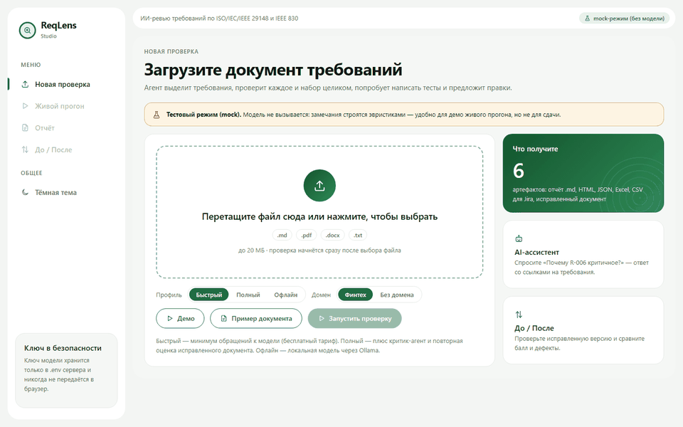</p>

| Документ: дефекты подчёркнуты в тексте | 3D-граф: противоречия и цепочка конфликта |
|---|---|
|  | 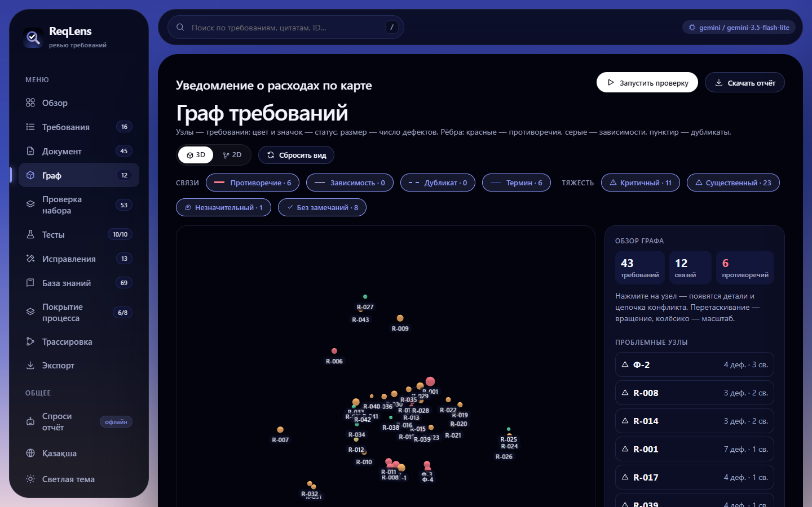 |
| **Тесты: Gherkin и покрытие «тестируемо X из N»** | **Исправления: diff «было → стало» и вопросы аналитику** |
| 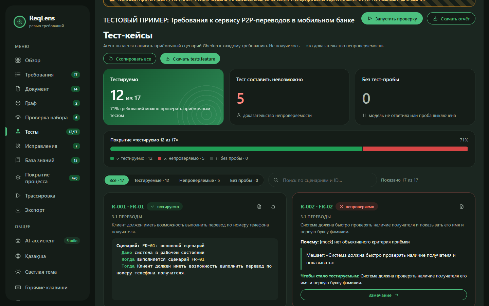 | 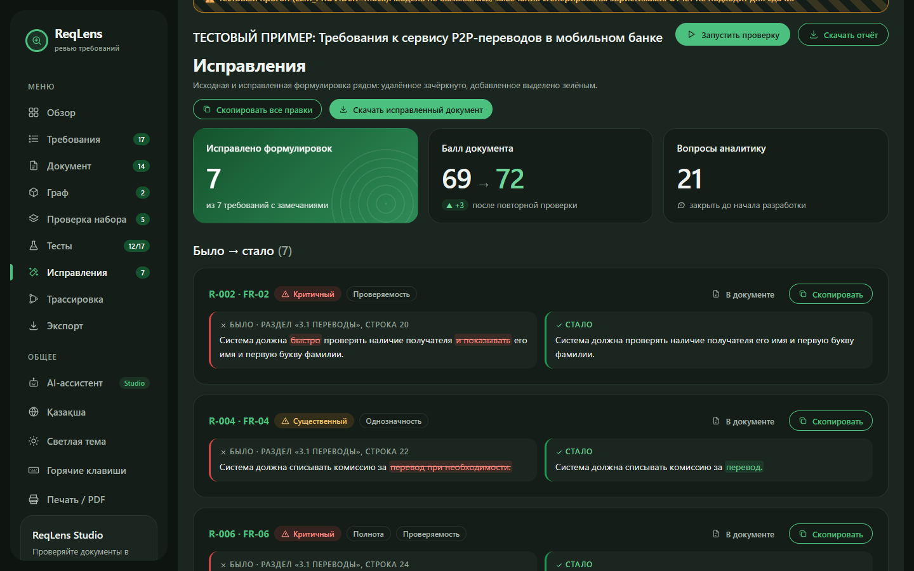 |
| **Studio: AI-ассистент рядом с отчётом** | **Studio: «До / После» для новой версии** |
| 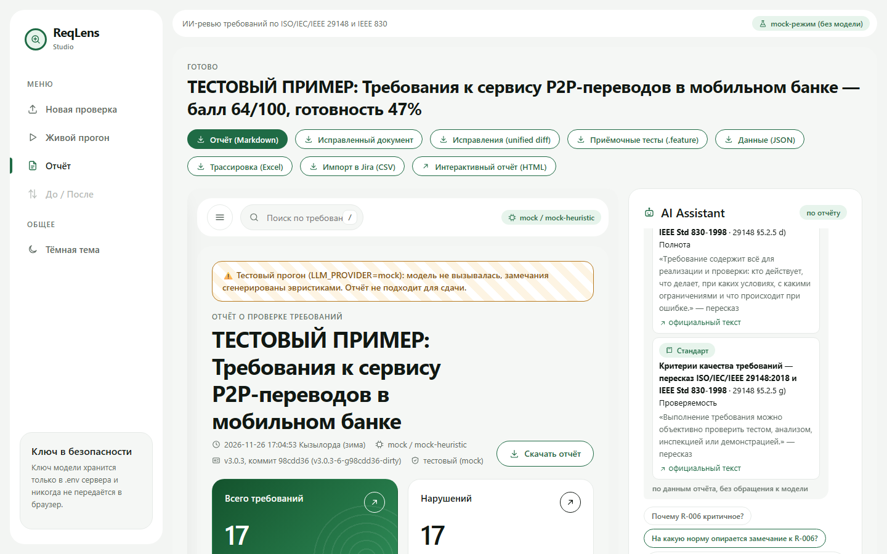 |  |

<details><summary>Ещё скриншоты: обзор, требования, набор, трассировка, экспорт, светлая тема, мобильный вид</summary>

| | |
|---|---|
|  | 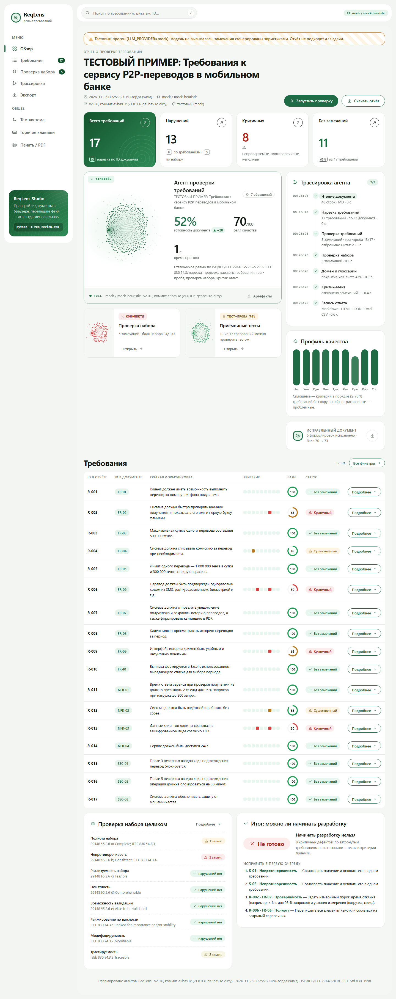 |
| 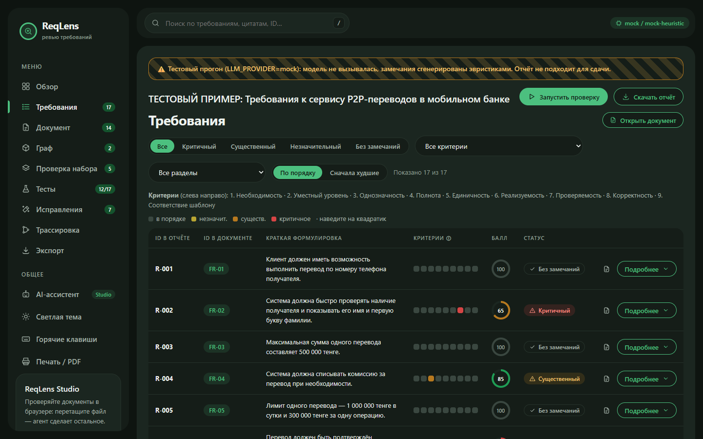 | 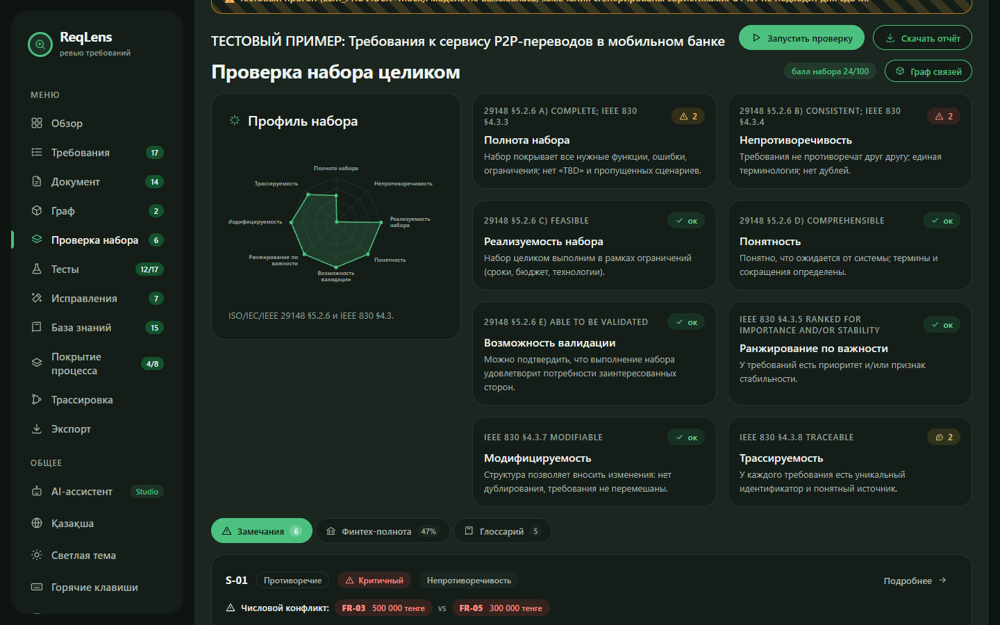 |
| 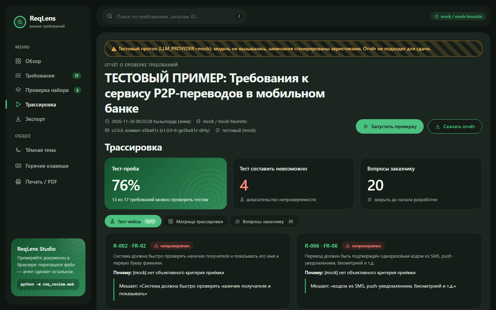 | 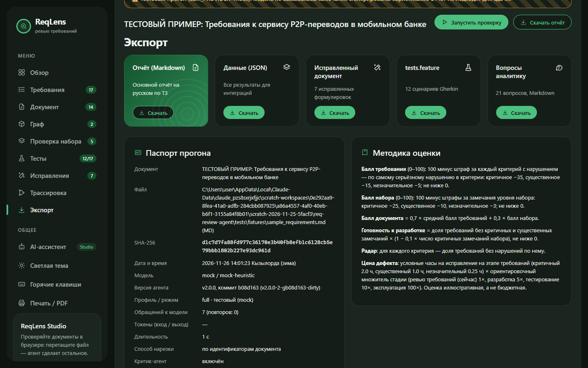 |
| 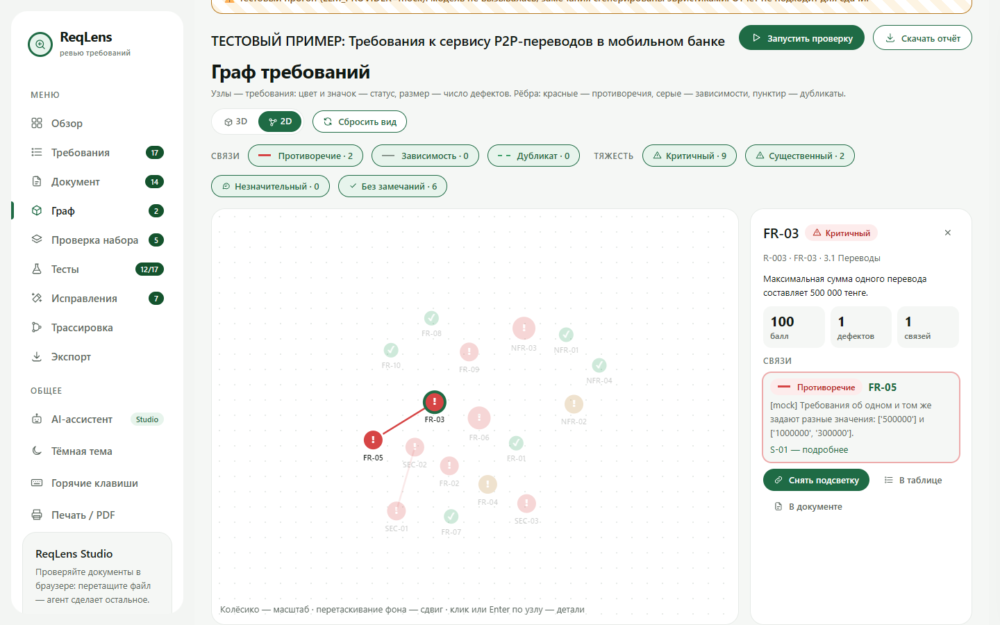 | 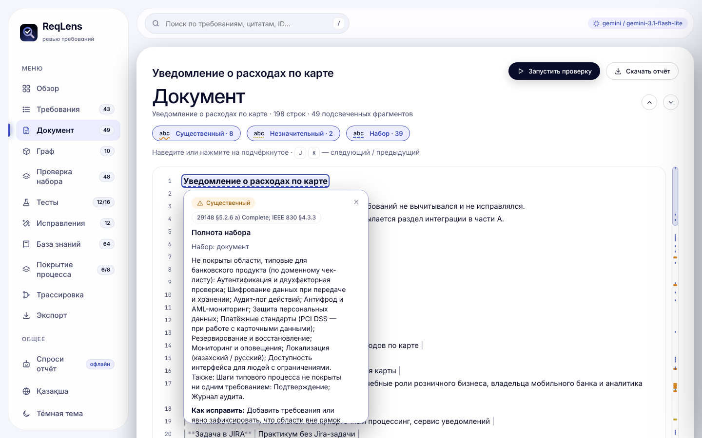 |
|  |  |
|  | 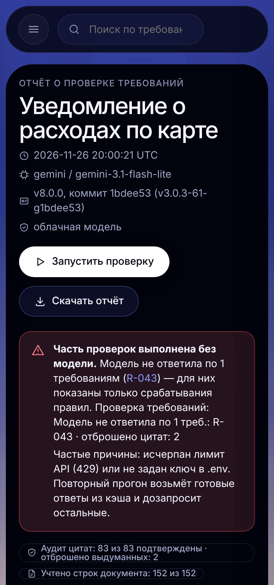 |
|  | 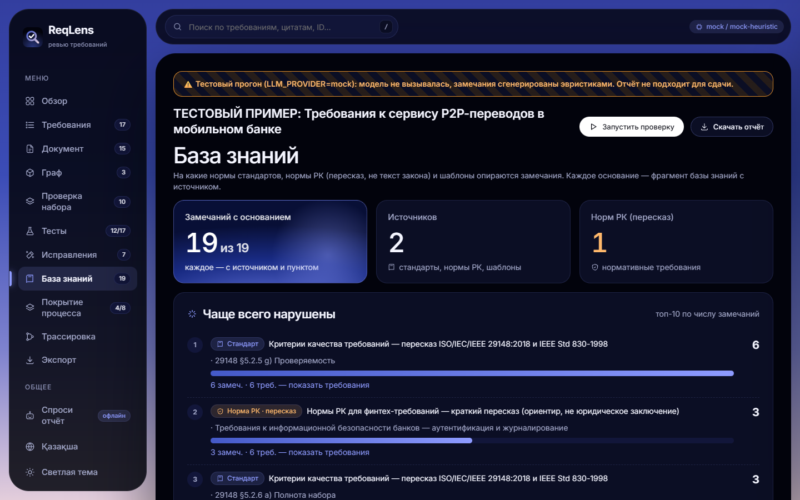 |
|  | 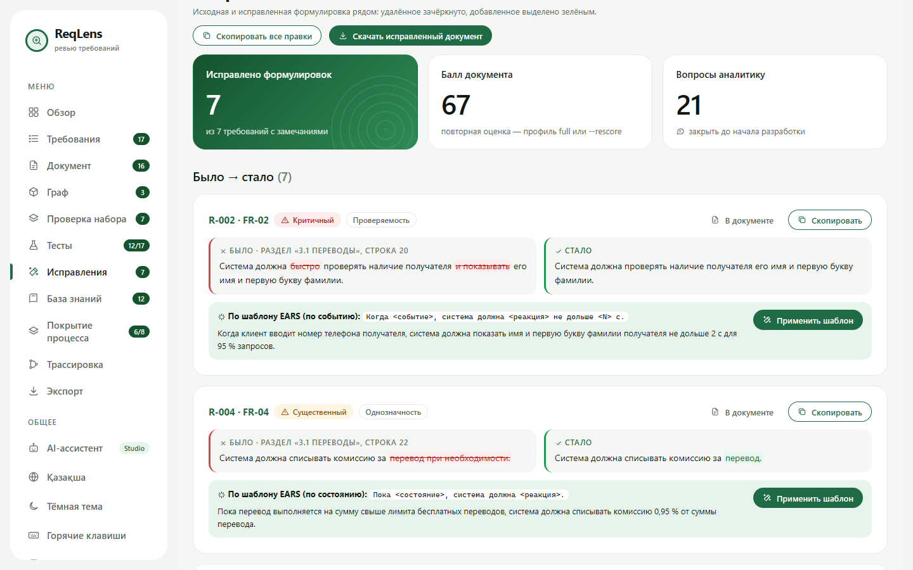 |
| 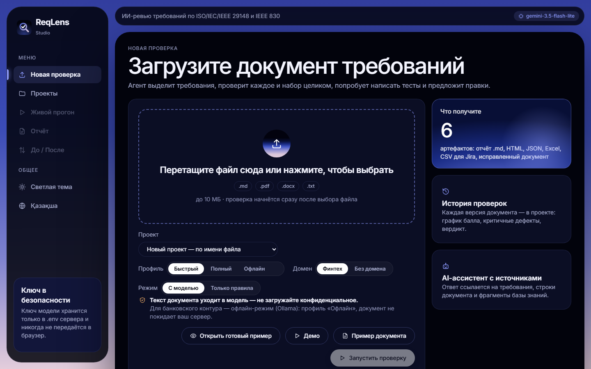 |  |
| 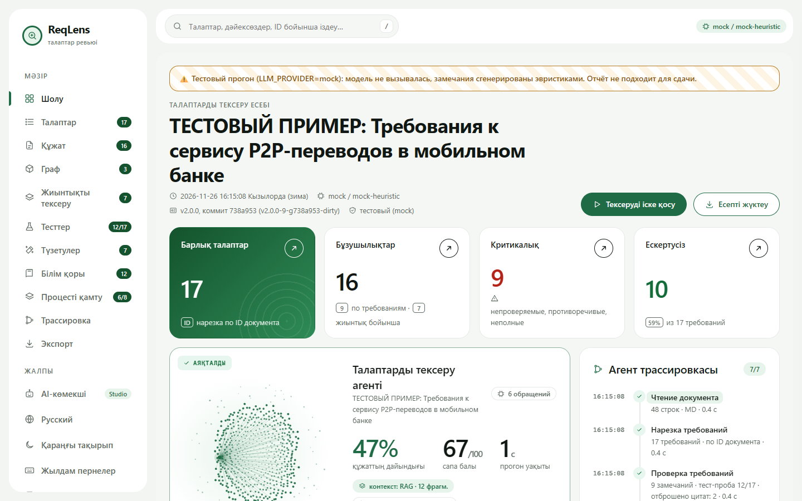 | |

</details>

Скриншоты и GIF снимаются автоматически: `pip install playwright pillow && playwright install chromium`,
затем `python scripts/screenshots.py` (mock-прогон, ключ не нужен; скрипт завершается с ошибкой, если в консоли браузера есть ошибки).

---

## Быстрый старт

```bash
# 1. Python 3.10+ и зависимости
python -m venv .venv
source .venv/bin/activate          # Windows: .venv\Scripts\activate
pip install -r requirements.txt

# 2. Ключ LLM
cp .env.example .env               # Windows: copy .env.example .env
# откройте .env и впишите GEMINI_API_KEY=<ваш ключ>

# 3. Положите выданный организаторами документ в docs/requirements.md (в репозитории его нет — по ТЗ он
#    сдаётся отдельно) и запустите прогон: путь к документу требований и путь к отчёту
python review.py docs/requirements.md reports/report.md
# финальный отчёт для сдачи (все проходы, критик на всё, PDF): добавьте --profile deep
```

### Повторить прогон в один клик (для жюри)

1. **Settings → Secrets and variables → Actions → New repository secret**: `GEMINI_API_KEY` (бесплатный ключ
   [Google AI Studio](https://aistudio.google.com/apikey)). Без ключа агент работает в режиме «только правила».
2. **Actions → Generate report → Run workflow**: документ по умолчанию — копия документа организаторов
   (`bench/real/notifications.md`), можно указать свой путь, провайдера и модель.
3. Через 5–15 минут скачайте артефакт **requirements-report**: `.md`, `.html`, `.json`, `.pdf`.

**Куда ляжет отчёт.** Основной отчёт — файл, указанный вторым аргументом (в примере `reports/report.md`, папка создаётся
автоматически). Рядом появляются дополнительные артефакты:

| Файл | Что внутри |
|---|---|
| `reports/report.md` | **Основной отчёт на русском** (все разделы по ТЗ) |
| `reports/report.html` | Интерактивный отчёт — откройте двойным кликом (работает офлайн) |
| `reports/report.json` | Машиночитаемый результат (`schema_version: 2.3`, описание — `docs/SCHEMA.md`) |
| `reports/report.pdf` | PDF-версия основного отчёта (`--pdf`; в профиле `deep` — по умолчанию) |
| `reports/report_requirements_fixed.md` | Исправленная версия документа со сносками |
| `reports/report_traceability.xlsx` | Требования, нарушения, тест-кейсы, матрица трассировки, вопросы |
| `reports/report_jira_import.csv` | Дефекты для импорта в Jira |
| `reports/report_tests.feature` | Приёмочные тесты Gherkin (1–3 сценария на проверяемое требование) |
| `reports/report_fixed.diff` | Unified diff: исходный документ → исправленный |

Формат `report.json` (версия 2.3: позиции цитат, уверенность, учёт строк, матрица критериев, покрытие приёмкой,
вердикты, план исправлений, аудит цитат) — в `docs/SCHEMA.md`.

**Аудит цитат.** Первая строка отчёта: сколько цитат в замечаниях и сколько из них код нашёл в документе дословно
(или с пропусками «…»), сколько замечаний модели отброшено как выдуманные. Отчёт без подтверждённой цитаты не бывает.

Поддерживаемые входные форматы: `.pdf`, `.docx`, `.md`, `.txt`:

```bash
python review.py docs/requirements.pdf reports/report.md --open      # открыть HTML-отчёт после прогона
```

## Как получить ключ LLM

По умолчанию используется бесплатный **Gemini API (Google AI Studio)**, модель **`gemini-3.8-flash`**.

1. Откройте <https://aistudio.google.com/apikey> и войдите в Google-аккаунт.
2. Нажмите **Create API key** и скопируйте ключ.
3. Положите ключ в файл `.env` в корне репозитория (создаётся из `.env.example`):
   ```
   GEMINI_API_KEY=ваш_ключ
   GEMINI_MODEL=gemini-3.8-flash
   ```

**Другие провайдеры** (выбираются `LLM_PROVIDER` или автоматически — по найденному ключу):

| Провайдер | Переменные | Модель по умолчанию |
|---|---|---|
| `gemini` | `GEMINI_API_KEY`, `GEMINI_MODEL`, `GEMINI_FALLBACK_MODELS` | `gemini-3.8-flash` → резерв `gemini-3.5-flash-lite` |
| `anthropic` (Claude, Messages API) | `ANTHROPIC_API_KEY` (или `CLAUDE_API_KEY`), `ANTHROPIC_MODEL` | `claude-opus-5-5` |
| `openrouter` (один ключ к Claude, Gemini, GPT, DeepSeek) | `OPENROUTER_API_KEY`, `OPENROUTER_MODEL` | `anthropic/claude-opus-5.5` |
| `ollama` (локально, без интернета) | `OLLAMA_MODEL`, `OLLAMA_BASE_URL` | `qwen2.5:14b` |
| `openai` (любой OpenAI-совместимый API) | `OPENAI_API_KEY`, `OPENAI_MODEL`, `OPENAI_BASE_URL` | `gpt-4o-mini` |
| `rules` | — | без модели: только детерминированные правила |

Файл `.env` указан в `.gitignore` и в репозиторий не попадает. В репозитории лежит только `.env.example` без ключа.
Платный ключ не нужен: профиль `fast` (по умолчанию) укладывается в лимиты бесплатного тарифа — проверка требований
идёт пакетами по 20, тест-проба и тип EARS запрашиваются в том же запросе, а повторные прогоны берутся из кэша.

## Флаги и профили

```
python review.py <вход> <отчёт.md> [--profile fast|full|offline|deep] [--domain fintech|none] [--compare СТАРЫЙ]
                                   [--critic | --no-critic] [--rescore | --no-rescore] [--no-tests]
                                   [--no-html] [--no-fixed] [--no-xlsx] [--no-jira] [--no-json] [--open] [--quiet]
```

| Профиль | Что включено | Когда использовать |
|---|---|---|
| `fast` (по умолчанию) | проверка требований + тест-проба + EARS, проверка набора, финтех-чек-лист и глоссарий | бесплатный тариф Gemini, итоговый прогон |
| `full` | + критик-агент, уверенность замечаний, `--rescore` (повторная оценка исправленного документа) | демо «было → стало» |
| `offline` | как `full` без rescore, модель — локальная через Ollama | конфиденциальные документы банка |
| `deep` | пакеты по 6 требований, критик на все замечания (объединение дублей из разных проходов, калибровка серьёзности), rescore | финальный отчёт для сдачи, сильная модель |

Во всех профилях работают проверки глубины v5 (`req_review/depth.py`): метод чтения в API, контракт события
интеграции, НФТ без перцентиля и нагрузки, состояние после ответа 500, тексты сообщений, предусловия критериев
приёмки, незаполненный шаблон, учёт каждой строки документа, покрытие правил приёмкой, два вердикта (разработка /
тестирование) и план исправлений с примером формулировки. При модели добавляются проход полноты по чек-листу
(1 запрос) и «дорезка» строк, не вошедших в нарезку.

| Флаг | Назначение |
|---|---|
| `--domain fintech\|none` | доменный чек-лист полноты (`req_review/domains/*.yaml` — можно добавить свой домен без кода) |
| `--compare old.md` / `--compare report.json` | динамика относительно прошлой версии: исправлено ✅ / новое ⚠️ / ухудшилось 🔻 |
| `--critic`, `--no-critic` | включить/выключить критик-агента независимо от профиля |
| `--rescore`, `--no-rescore` | прогнать исправленный документ повторно и показать балл «было → стало» (или не прогонять — экономит квоту) |
| `--no-tests` | не показывать тест-пробу |
| `--no-html`, `--no-fixed`, `--no-xlsx`, `--no-jira`, `--no-json` | не создавать соответствующий артефакт |
| `--open` | открыть HTML-отчёт в браузере |
| `--fix-loop` | «исправил → проверил заново»: агент правит формулировки, проверяет исправленный документ и пишет `<отчёт>_before_after.md` (балл, готовность, критичные до/после, что осталось решить аналитику) |
| `--ensemble M1,M2` | ансамбль двух моделей: два прогона, объединение подтверждённых замечаний; в паспорте — сколько нашла каждая и сколько совпало (или `LLM_ENSEMBLE`) |
| `--pdf`, `--no-pdf` | PDF-версия отчёта рядом с `.md` (в профиле `deep` — по умолчанию) |
| `--answers ответы.md` | v9: перепроверка с учётом ответов аналитика (шаблон `<отчёт>_answers_template.md`) — см. «Ответы аналитика» |
| `--decisions-llm` | v9: модель перефразирует «Решения для владельца продукта» на бизнес-язык (без флага — формулировки кода) |
| `--cascade FAST,STRONG` | v9: каскад моделей — быстрая проверяет всё, сильная — подозрительные требования и набор (или `LLM_CASCADE`) |
| `--no-cache` | свежий прогон: ответы модели не берутся из кэша, но записываются в него (повтор по тому же документу квоту не тратит) |

### Настройки (`.env`)

| Переменная | По умолчанию | Назначение |
|---|---|---|
| `LLM_PROVIDER` | `gemini` | `gemini`, `openai` (любой OpenAI-совместимый API), `rules` (без модели: только детерминированные правила) или `mock` (офлайн-заглушка для тестов) |
| `GEMINI_API_KEY` | — | ключ Google AI Studio |
| `GEMINI_MODEL` | `gemini-3.8-flash` | модель Gemini |
| `OPENAI_BASE_URL`, `OPENAI_API_KEY`, `OPENAI_MODEL` | — | OpenAI-совместимые API (OpenRouter, Groq, Ollama и др.) |
| `ANTHROPIC_API_KEY`, `ANTHROPIC_MODEL` | —, `claude-opus-5-5` | Claude через Anthropic Messages API |
| `OPENROUTER_API_KEY`, `OPENROUTER_MODEL` | —, `anthropic/claude-opus-5.5` | OpenRouter |
| `OLLAMA_MODEL`, `OLLAMA_BASE_URL` | `qwen2.5:14b`, `http://localhost:11434/v1` | локальная модель |
| `GEMINI_API` | `native` | `openai` — OpenAI-совместимый эндпоинт Gemini (ключ в `Authorization: Bearer`; для облачных сред, где ключ подставляет прокси) |
| `LLM_FALLBACK_AFTER` | `3` | после стольких повторов при 503 переходить на резервную модель; при исчерпанной квоте (429) — сразу |
| `REQLENS_GAPS` | `1` | проход полноты по чек-листу (1 запрос); `0` — выключить |
| `REQLENS_RECOVER` | `1` | «дорезка» строк вне нарезки моделью; `0` — выключить |
| `LLM_BATCH_SIZE` | `20` | требований в одном запросе (явное значение важнее профиля; `deep` — 6) |
| `LLM_RPM` | — | ограничение запросов в минуту (берётся строже из `LLM_RPM` и `LLM_MIN_INTERVAL`) |
| `REQLENS_CRITIC_CRITICAL` | `1` | в профиле `fast` перепроверять критичные замечания критиком (1 запрос); `0` — выключить |
| `LLM_MAX_WAIT` | `180` | если API просит ждать дольше (исчерпана дневная квота) — агент останавливается с понятным сообщением, ответы остаются в кэше |
| `LLM_MIN_INTERVAL` | `6` | пауза между запросами, с (≈10 запросов/мин) |
| `LLM_CONCURRENCY` | `3` | запросов к модели одновременно (v12); частота стартов по-прежнему ограничена `LLM_RPM` / `LLM_MIN_INTERVAL` |
| `LLM_MAX_RETRIES` | `6` | повторы при 429/5xx (учитывается `retryDelay`) |
| `LLM_TEMPERATURE` | `0` | температура |
| `LLM_CACHE` | `1` | кэш ответов модели в `.cache/llm` |
| `REQLENS_PROFILE`, `REQLENS_DOMAIN` | `fast`, `fintech` | профиль и домен по умолчанию |
| `OFFLINE_MODEL` | `qwen2.5:14b` | модель Ollama для профиля `offline` |
| `REQLENS_DATA` | `data/` | ReqLens App: папка истории проверок (SQLite и файлы прогонов), в `.gitignore` |
| `MAX_JOBS` | `2` | ReqLens App: сколько прогонов идёт одновременно, остальные ждут в очереди |

## Запуск без интернета (банковский контур)

```bash
ollama pull qwen2.5:14b
python review.py docs/requirements.md reports/report.md --profile offline
```

В паспорте отчёта будет строка «Режим: офлайн: документ не передавался третьим лицам».

## Веб-интерфейс ReqLens Studio

```bash
python -m req_review.web        # → http://localhost:8000
```

- **Живой прогон.** Перетащите документ (или нажмите «Демо-документ») — проверка стартует сразу. Таймлайн шагов
  обновляется через SSE, а требования появляются в таблице по мере проверки пакетов: сначала «проверяется…»,
  затем предварительный статус по ответу модели, в конце — итоговый балл после проверки цитат.
- **Отчёт + AI-ассистент.** Интерактивный отчёт открывается рядом с чатом. Подсказки-вопросы («Почему R-006 критичное?»,
  «Что исправить первым?», «Какие есть противоречия?») разбираются по `report.json` без обращения к модели и без расхода
  квоты; свободные вопросы — моделью, если она доступна. Ссылки на требования в ответах открывают их в отчёте.
  В статическом HTML-отчёте есть офлайн-ассистент **«Спроси отчёт»**: вопрос → ответ по данным отчёта (без модели и
  без сети) со ссылками на замечания, требования и строки документа; поиск по замечаниям и тексту документа для свободных вопросов.
- **До / После.** «Проверить исправленный агентом» или загрузить свою новую версию — экран сравнения: балл и готовность
  до → после (анимированные счётчики), исправленные и новые дефекты, статус каждого требования.
- **Понятные ошибки.** Нет ключа — предупреждение ещё на экране загрузки (`/api/health`, сам ключ не передаётся);
  лимит API (429) или ошибка ключа — отдельные экраны с шагами решения и кнопкой «Попробовать снова».
- **Готовый пример** (v9): кнопка «Открыть готовый пример» на стартовом экране или адрес `/?example=1` — отчёт по
  документу организаторов сразу, без прогона и без квоты; офлайн-ассистент отвечает по данным отчёта.
- **Ответить на вопросы** (v9): на экране отчёта — «Вопросы аналитику» → список вопросов `Q-xx` с полями ответов
  (черновик хранится в браузере), «Скачать шаблон ответов», «Перепроверить» (`POST /api/v1/runs/{id}/answers`) →
  живой прогон → экран «Было → стало»: критичные, существенные, готовность, вердикты и таблица «вопрос → тип ответа →
  что закрыто / осталось» с цитатой-основанием.
- **Публичный демо-сервер** (v9): перед загрузкой — предупреждение «текст документа уходит в модель — не загружайте
  конфиденциальное» (для банковского контура — профиль «Офлайн», Ollama); при дневном лимите (429) — экран с временем
  сброса и кнопками «Открыть готовый пример» и «Проверить без модели». «Сломанный» файл (скан без текста, защищённый
  PDF, старый .doc) — экран «Файл не читается» с блоком «Что сделать».
- **Қазақша** (v9): переключатель языка в меню Studio; язык общий с HTML-отчётом во фрейме.
- **Режим «Демо»** (страховка на защите): `python -m req_review.web --demo reports/report.json [--demo-after reports/v2/report.json]`
  — Studio проигрывает сохранённый реальный прогон (шаги, пакеты, таблица, тайминги) без сети и без обращения к модели;
  кнопка «Демо» на стартовом экране. Сценарий на 3 минуты — [docs/DEMO.md](docs/DEMO.md).

Ключ модели берётся только из `.env` сервера и в браузер не передаётся. Для демо без ключа: `LLM_PROVIDER=mock`
(у mock-модели ответы мгновенные, поэтому Studio делает паузу 0,6 с на пакет; настраивается `STUDIO_DEMO_DELAY`).
CLI остаётся основным способом запуска по ТЗ.

## Приложение ReqLens App (история, версии, установка на телефон)

```bash
python -m req_review.web        # → http://localhost:8000  (то же приложение, что и Studio)
docker compose up studio        # то же в Docker; история сохраняется в ./data
```

- **Проекты и история.** Проверки сохраняются: проект → версии документа → прогоны с баллом, вердиктом и всеми
  отчётами (SQLite + файлы в `data/`, папка в `.gitignore`). После перезапуска сервера история остаётся.
- **Тот же файл не тратит квоту.** Повторная загрузка того же документа (по SHA-256) открывает прошлый результат;
  проверить заново — явно (`force=true`).
- **Версии и динамика.** Новая версия документа автоматически сравнивается с прошлой: что исправлено, что новое,
  что осталось; балл и число критичных по версиям — для графика.
- **Очередь и отмена.** Одновременно идёт `MAX_JOBS` прогонов, остальные «в очереди» с номером; прогон можно отменить.
  SSE-события шагов несут название этапа и процент.
- **Квота закончилась (429)** — понятная ошибка и предложение запустить проверку **без модели («только правила»)**:
  размытые формулировки, плейсхолдеры, числовые конфликты, правила API и набора. Паспорт отчёта это честно указывает.
- **Безопасная загрузка.** До 10 МБ, только PDF/DOCX/MD/TXT, проверка содержимого (а не только расширения);
  файлы отчёта отдаются только из списка артефактов прогона.
- **Ассистент с источниками.** Типовые вопросы — по отчёту; остальные — по источникам трёх видов: требование, строка
  документа, фрагмент базы знаний `kb/` (нормы РК помечены «пересказ, не текст закона»). Модель отвечает только по ним.
- **Установка как приложение (PWA).** В Chrome/Edge — значок «Установить» в адресной строке; на Android — «Добавить на
  главный экран»; на iPhone — «Поделиться → На экран „Домой“». Без интернета открываются история и уже открытые
  отчёты; новая проверка офлайн честно сообщает, что нужна сеть. Для телефона сервер должен быть доступен по сети
  (`STUDIO_HOST=0.0.0.0`) — установка PWA требует HTTPS или `localhost`.
- **API v1** для интеграций и интерфейса: [docs/API.md](docs/API.md), интерактивно — `http://localhost:8000/docs`.

## Docker

```bash
docker compose run --rm review docs/requirements.md reports/report.md   # прогон одной командой
docker compose up studio                                                 # веб-студия на http://localhost:8000
# или без compose:
docker build -t reqlens .
docker run --rm -v "$PWD:/work" --env-file .env reqlens docs/requirements.md reports/report.md
```

## Как устроен прогон

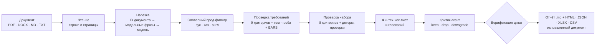

1. **Чтение.** PDF — через `pdfplumber` (с номерами страниц), DOCX — абзацы, заголовки и таблицы, MD/TXT — как есть.
2. **Нарезка.** Идентификаторы документа (`FR-01`, `REQ-1.2`, `НФТ-3`, `3.1.2` …), в том числе в таблицах; без ID —
   пункты с модальными словами, агент присваивает номера `R-001…` и сохраняет цитату; если и так ничего нет — нарезка моделью.
3. **Пред-фильтр правил** — словарь размытых формулировок на русском, казахском и английском.
4. **Проверка каждого требования** по 9 критериям 29148 §5.2.5 / IEEE 830 §4.3; в том же запросе — **тест-проба** и тип **EARS**.
5. **Проверка набора** по 29148 §5.2.6 и IEEE 830 §4.3 + детерминированные проверки (дубли ID, почти-дубли, утверждения без ID, приоритеты).
6. **Финтех-чек-лист и глоссарий** — один запрос; покрытие засчитывается только с цитатами.
7. **Критик-агент** (`full`/`offline`) — подтверждает, понижает или отклоняет замечания, выставляет уверенность.
8. **Верификация цитат.** Замечание с несуществующей цитатой отбрасывается и показывается в приложении.
9. **Отчёты.**

## Состав отчёта

1. **Паспорт прогона** — документ, файл и SHA-256, дата, модель, версия агента (git-коммит/тег), профиль и режим,
   число обращений к модели, **балл документа** и **готовность к разработке**.
2. **Нарезка требований** — «ID в отчёте — ID в документе — место — краткая формулировка».
3. **Проверка каждого требования** — цитата, балл, тип EARS, таблица нарушений (критерий, цитата, проблема, серьёзность,
   как исправить, источник), предлагаемая формулировка, результат тест-пробы.
4. **Проверка набора** — статус по каждому критерию, замечания со ссылками, доменная полнота, глоссарий.
5. **Сводка** — числа требований и нарушений, профиль качества по критериям, покрытие тест-пробой, критичные дефекты.
6. **Итог** — можно ли начинать разработку и тестирование, что исправить в первую очередь, цена дефекта, вопросы
   заказчику, исправленный документ, граф связей (Mermaid), динамика к прошлой версии.
7. **Приложения** — критерии, отброшенные и отклонённые замечания, методика оценки.

Каждое нарушение привязано к конкретному месту: ID требования, раздел, строка/страница и дословная цитата.

## Почему этому можно доверять

- **Цитаты проверяются кодом**: замечание без точной цитаты из документа не попадает в оценку.
- **Тест-проба** превращает «непроверяемо» из мнения в факт: тест не составлен — показан фрагмент, который мешает.
- **Критик-агент** перепроверяет замечания; отклонённое не исчезает, а уходит в приложение с причиной.
- **Все числа считает код** (`req_review/scoring.py`, методика — в приложении отчёта), а не модель.
- **Числовые противоречия ищет детерминированный код** (`req_review/numbers.py`): «3 неверных ввода» vs «5 неверных
  вводов», «500 000 тенге» vs «300 000 тенге» за операцию — с цитатами обоих значений. Разные периоды («в сутки» и
  «за операцию») противоречием не считаются; на чистых документах ложных срабатываний нет (проверено тестом).
- **Уверенность 0–1** у каждого замечания (`docs/SCHEMA.md`); критичные замечания перепроверяются критиком даже в профиле `fast`.
- **Бенчмарк**: 5 вымышленных документов (`bench/docs/`: оплата услуг, онлайн-кредит, открытие счёта; онлайн-депозит
  **на казахском языке**; перевыпуск карты — **DOCX с требованиями в таблицах Word**) с **67 заранее известными
  дефектами** 14 типов. v5 на `gemini-3.5-flash-lite`: **recall 97 %, precision 100 %**, 0 ложных существенных замечаний
  к 29 чистым требованиям (v4 на той же модели — 93 % / 100 %):

```bash
python bench/run.py                              # → bench/RESULTS.md, bench/results.html, bench/results.json
python bench/run.py --save bench/baseline.json   # сохранить как «было»; следующие прогоны покажут «было → стало»
```

`bench/inject.py` внедряет дефекты (размытые слова, TBD, «и/или», открытые перечисления, проектные решения, составные
требования, абсолюты, цели без механизма, пассив, числовые противоречия, дубли…) и пишет `bench/ground_truth.json`;
`bench/run.py` считает recall, precision и F1 — по каждому документу и итог. Цифры в `bench/RESULTS.md` получены
прогоном, а не вписаны руками; повторные прогоны берутся из кэша и квоту не тратят.

- **Реальный бенчмарк** — документ организаторов (`bench/real/notifications.md`) и 26 ожидаемых дефектов, составленных
  командой своими словами (`bench/real/notifications.json`). На той же модели v4 находил 15 из 26 (критичных 6 из 7),
  v5 профилем `deep` — **25 из 26, критичных 7 из 7**; без модели (только правила) — 24 из 26:

```bash
python bench/real_eval.py v4=reports/v4.json v5=reports/v5.json   # таблица «найдено / нет» по каждому дефекту
python bench/real_eval.py --run                                    # прогнать агента профилем deep и оценить
```

## База знаний и RAG

- **Основание у каждого замечания.** `kb/standards` — пересказ критериев ISO/IEC/IEEE 29148 и IEEE 830 по пунктам,
  `kb/law_kz` — пересказ норм РК для финтеха (персональные данные, банковская тайна, платежи, ИБ; помечено как пересказ),
  `kb/patterns` — шаблоны хороших требований «плохо → хорошо». В отчёте: «**Основание:** 29148 §5.2.5 g) Проверяемость — «…»».
  Цитата основания всегда дословно есть в файле `kb/` — это проверяет код.
- **Шаблон правки:** предложенная формулировка опирается на ближайший шаблон из `kb/patterns`.
- **Длинные документы:** если документ длиннее `RAG_CONTEXT_THRESHOLD` (15 000 символов), в запрос идут оглавление,
  термины и релевантные фрагменты, а не весь текст — запросы короче, PDF на сотни страниц помещается в лимиты.
- **Категории и покрытие процесса:** у требований есть категория; в сводке — карта шагов процесса и непокрытые шаги.
- **Поиск:** гибрид эмбеддингов Gemini (`gemini-embedding-001`, кэш в `.cache/emb`) и BM25; без сети — только BM25.

```bash
python -m req_review.rag build                       # собрать индекс базы знаний
python -m req_review.rag search "порог уведомления"  # найти фрагменты
python bench/run.py --rag both                       # бенчмарк с базой знаний и без
RAG=off python review.py docs/requirements.md reports/report.md   # прогон без RAG — как раньше
```

## Ответы аналитика → перепроверка (v9)

Рядом с отчётом лежит `<отчёт>_answers_template.md` — все вопросы с заголовками `### Q-01`, `### Q-02`… и тем, какие
замечания закроет ответ. Аналитик вписывает ответы, затем:

```bash
python review.py bench/real/notifications.md reports/report.md --answers reports/report_answers_template.md
```

| Тип ответа | Что делает агент |
|---|---|
| конкретный (значение, перечень, решение) | связанные замечания закрыты: уходят в отклонённые с причиной «закрыто ответом Q-xx», в исправленный документ — формулировка со значением из ответа |
| уклончивый («уточним позже», TBD) | замечания остаются открытыми с пометкой |
| противоречивый (значение расходится с документом или одному случаю даны два разных HTTP-кода / метода) | замечания остаются + новое замечание «ответ противоречив» с дословной цитатой ответа |

Ничего не закрывается без дословной цитаты ответа. Тип определяют правила, модель (задача `answers`) может уточнить —
но цитата модели обязана быть подстрокой ответа, а противоречие по числам и «уточним позже» без значения решают
правила. В отчёте — раздел «Ответы аналитика» в «6. Итог»: таблица и «было → стало» (критичные, готовность, вердикты);
в `report.json` — поле `answers`. Пример на документе организаторов — [`examples/answers/`](examples/answers/README.md):
10 ответов (6 конкретных, 2 уклончивых, 2 противоречивых). В Studio / API — `POST /api/v1/runs/{id}/answers`.

## Исправленное ТЗ после ответов (v12)

С `--answers` агент, кроме перепроверки, пишет `<отчёт>_revised.md` (в профиле deep — и PDF) — исправленную редакцию:

- **Изменённые требования** — «Было» (дословно) → «Стало»: значение из конкретного ответа вписано в формулировку,
  строка «Устраняет: R-xxx.N, S-xx · по ответу Q-xx» с дословной цитатой ответа. «Стало» пишет модель, а код
  проверяет: каждое число есть в исходном тексте или в ответе, иначе формулировка отклоняется (шаблонная подстановка).
- **Новые требования** `NEW-xx` — пропуски набора, закрытые ответом (метод, адрес, контракт…), с источником Q-xx.
- **Новые критерии приёмки** — Дано / Когда / Тогда к изменённым и новым требованиям (с моделью).
- **Осталось уточнить** — уклончивые, противоречивые ответы и критичные вопросы без ответа: плейсхолдер
  `[уточнить: Q-xx …]` прямо в тексте требования. Правки агента без ответа — отдельно, «предложение агента».

В шаблоне ответов у вопросов с повесткой решений или противоречием двух значений есть варианты «а) … б) … в) свой
ответ» — можно ответить буквой («б» или «б, но …»). В отчёте перед разделом 1 — блок **«Кратко»**: вердикт до → после,
«закрыто блокеров N из M» с цитатой ответа на каждый, сколько замечаний осталось. Поля — `answers.revised`,
`answers.summary` (docs/SCHEMA.md). Пример и цифры — [examples/answers/README.md](examples/answers/README.md).

## Трассировка (v12)

Граф строится кодом, без модели: требования, критерии приёмки, поля экрана (из описания UI), методы API, параметры,
HTTP-статусы. Связи «в документе» (ID правила в строке приёмки, название поля в требовании) и «выведено кодом»
(общие термины, поле экрана ↔ описание параметра, операция ↔ метод чтения / записи). Разрывы — замечания к набору с
дословной цитатой: правило без критерия приёмки, поле экрана без параметра API, операция без метода, статус без описания
и примера, параметр без типа. Уже найденное не дублируется — разрыв ссылается на существующее S-xx. В отчёте —
подраздел «Трассировка» в разделе 4, в report.json — `traceability` (узлы, связи, разрывы). Отключить: `REQLENS_TRACE=0`.

## Скорость: параллельные вызовы (v12)

Независимые запросы к модели идут параллельно: пакеты проверки требований, проверка набора (одновременно с проверкой
требований), перекрёстная проверка, узкие проходы, пакеты критика. Одновременно — до `LLM_CONCURRENCY` (по умолчанию
3) запросов; старты разносятся общим ограничителем, поэтому `LLM_RPM` соблюдается. Отчёт собирается в фиксированном
порядке и не зависит от порядка ответов (тест: последовательный и параллельный прогон дают одинаковый report.json).
В паспорте и журнале — время каждого этапа и «критический путь» (`passport.stages`, `passport.critical_path`).

Замер на документе организаторов (27.11.2026, профиль `fast`, без кэша, код `d9c42ad`): **12 запросов к модели,
127 с, 26/26 и 7/7, цитаты 77 из 77**. Проверка требований и проверка набора шли параллельно (106 и 111 с). Часть
времени ушла на ожидание: gemini-3.8-flash ответила «квота исчерпана», и после 9 повторов прогон перешёл на
gemini-3.5-flash-lite. Подробности — `bench/RESULTS.md`, раздел «Замер v12».

## Коды выхода для CI (v12)

| Код | Когда |
|---|---|
| 0 | отчёт готов; без `--gate` — при любом вердикте, с `--gate` — разработку можно начинать (или «с оговорками») |
| 1 | только с `--gate`: разработку начинать нельзя — есть критичные замечания (NO-GO) |
| 2 | файл не найден или формат не поддерживается; ошибка настройки модели (нет ключа) |
| 3 | файл не читается (повреждён, скан без текста, старый .doc) или в нём нет требований |
| 4 | ошибка обращения к модели во время прогона |

```bash
python review.py docs/requirements.md reports/report.md --gate || echo "NO-GO: см. reports/report.md"
```

## Решения для владельца продукта (v9)

`<отчёт>_decisions.md` и раздел в «6. Итог»: 3–8 реальных развилок документа — какое решение принять, где расходится
(требования и строки), что меняется для клиента и разработки, варианты. Пункты собирает код из подтверждённых
противоречий и критичных пропусков; `--decisions-llm` — модель только перефразирует заголовок и последствия (новые
числа отклоняются). На документе организаторов: Ф-2 / пример приёмки (строки 38, 64), Ф-3 / Ф-4 (39, 40), API —
пример ошибки в ответе 200 против кода 400 (163, 171).

## Понятные ошибки и журнал прогона (v9)

«Сломанный» вход — сообщение по-русски, что сделать и код возврата, без трейсбека (примеры — `tests/fixtures/broken/`):

| Вход | Сообщение | Что сделать | Код |
|---|---|---|---|
| пустой файл | файл пустой | выбрать нужный файл | 3 |
| PDF под паролем | защищён паролем | снять пароль («Печать → Сохранить как PDF») или DOCX/MD | 3 |
| скан без текстового слоя | текст не извлечён | OCR (Acrobat, ABBYY, ocrmypdf) или PDF с текстом | 3 |
| «.docx», который не Word; старый `.doc` | не документ Word / старый формат | сохранить как .docx или PDF | 3 / 2 |
| двоичные данные в `.md` | не похож на текст | выбрать правильный файл | 3 |
| нет требований | не найдено ни одного требования | проверить, что это ТЗ; запустить с моделью | 3 |

Рядом с отчётом — журнал `<отчёт>.log`: этапы и их длительность, модель, обращения / кэш / повторы, токены,
переключения моделей, отброшенные цитаты (до 60 символов). Ключи вычищаются, полного текста документа в журнале нет;
при ошибке журнал тоже пишется. Имя журнала — в паспорте отчёта и в `passport.log`.

## Каскад моделей (v9)

`--cascade gemini-3.5-flash-lite,gemini-3.8-flash` (или `LLM_CASCADE`): быстрая модель проверяет все требования,
сильная — только подозрительные (существенное или критичное замечание, тест составить невозможно, сработало правило)
и проходы по набору, критик, ответы и решения. В паспорте — сколько требований ушло на сильную модель и обращения
каждой модели (`passport.cascade`).

## Слепая оценка (v9)

Документы, которые пишет человек вне команды, и ключ дефектов от их автора — правила в
[`bench/blind/README.md`](bench/blind/README.md): ключ хранится отдельно (`bench/blind/keys/` в `.gitignore`), агент на
документы не настраивается, прогон один. `python bench/blind_eval.py --results` — раздел «Слепые документы» в
`bench/RESULTS.md`. Цифры появятся после получения документов.

## Чем ReqLens лучше «голой» модели

Те же документы, та же модель Gemini, тот же код оценки. «Голая» модель получает весь документ и список критериев
одним запросом. Промпт целиком лежит в `bench/baseline/prompt.md`. Подробности и оговорки — в разделе
«Сравнение с «голой» моделью» файла `bench/RESULTS.md`, пересчёт — `python bench/baseline_eval.py`.

| | Только правила | «Голая» модель | ReqLens |
|---|---|---|---|
| Бенчмарк: F1 (найдено из 67) | 86 % (51) | 83 % (48) | 99 % (67) |
| Документ организаторов: найдено из 26 (критичных из 7) | 25 (6) | 4 (1) | 26 (7) |
| Дословные цитаты | 100 % | 84 % | 100 % |

У «голой» модели примерно каждая шестая цитата не совпадает с текстом документа. У ReqLens цитату без совпадения отбрасывает
код. Даже без модели, на одних правилах, ReqLens находит на документе организаторов больше, чем модель одним
запросом.

## Сравнение прогонов

```bash
python -m req_review.compare reports/v1.json reports/v2.json --md reports/compare.md
```

Без обращений к модели: балл и готовность «было → стало», число критичных, исправленные / новые / ухудшившиеся
требования, снятые и появившиеся дефекты. Новую версию документа можно проверить и сразу сравнить:
`python review.py docs/requirements_v2.md reports/v2.md --compare reports/v1.json`.

## Требования как код: бот в Pull Request (v10)

Workflow `.github/workflows/requirements-review.yml` проверяет изменённые документы `docs/*.md|pdf|docx` в каждом PR
и оставляет один обновляемый комментарий. В нём вердикт и критичные дефекты было → стало, новые и исправленные
дефекты с цитатой и строкой, ссылка на полный отчёт. Без секрета `GEMINI_API_KEY` бот работает только на правилах и
честно пишет об этом. С переменной `REQ_GATE=1` новый критичный дефект делает проверку PR красной. Комментарий строит
`scripts/pr_comment.py`. Подключение в репозитории банка за 3 шага и пример комментария —
[docs/REQUIREMENTS_AS_CODE.md](docs/REQUIREMENTS_AS_CODE.md).

## Свой чек-лист банка (v10)

Внутренний стандарт банка можно задать файлом YAML, без программирования. Пример на 10 правил для финтеха лежит в
`req_review/domains/fintech.rules.yaml`. В нём проверяется:

- у сумм указана валюта;
- у лимитов указан период;
- у переводов есть идемпотентность и сценарии отказа;
- для платёжного вызова описаны таймаут и повтор;
- для персональных данных задан срок хранения;
- у уведомлений указаны канал и срок доставки;
- у API описаны коды 401/403/404/500;
- в нефункциональных требованиях нет «быстро/удобно».

```bash
python review.py docs/requirements.md reports/report.md --rules fintech            # пример
python review.py docs/requirements.md reports/report.md --rules my_bank.rules.yaml # свой файл (или REQLENS_RULES=…)
```

```yaml
rules:
  - id: BR-01
    title: Сумма без валюты
    severity: major                 # critical | major | minor
    criterion: complete             # ключ критерия из req_review/criteria.py
    scope: requirement              # requirement — каждое требование; document — один раз на документ
    when: '(?:сумм|лимит|комисси)\w*[^.;:]{0,30}?\d{1,3}(?:[  ]\d{3})+'   # к каким требованиям применимо
    require: {any: ['тенге|тиын|kzt|₸']}   # что должно быть (any / all); forbid — чего быть не должно
    message: Денежное значение указано без валюты.
    fix: Указать валюту рядом с числом, например «500 000 тенге».
    reference: 'Стандарт банка §4.2'  # необязательно
```

Каждое срабатывание — замечание с дословной цитатой и источником «правило банка: <id>». В отчёте есть подраздел
«Чек-лист банка»: сколько правил сработало, выполнено и не применимо. В `report.json` это поле `bank_rules`
(docs/SCHEMA.md). Ошибки в файле, например неизвестный критерий или битая регулярка, выводятся одной понятной строкой
до прогона, без трейсбека.

Как проверено:

- **Чистые документы бенчмарка.** Ложных срабатываний нет. Единственное замечание — CR-13: push-уведомление без
  срока доставки. Это настоящий пропуск по стандарту банка.
- **Документы с внедрёнными дефектами.** Каждое срабатывание приходится на размеченный дефект.
- **Документ организаторов.** Результат прежний: 26/26 и 7/7.

Правила написаны по-русски, поэтому на казахском документе они пока не применимы.

## Экономия времени в отчёте (v10)

В паспорте и в «Сводке» есть строка «Экономия времени (оценка)», например «ручное ревью ≈ 3,8 ч аналитика, агент —
< 1 мин». Формула: строки документа ÷ норма ручного ревью. Норма по умолчанию — 40 строк в час, это около 1 страницы
в час, как в ориентире для инспекций документов. Банк задаёт свою норму в `.env`: `REVIEW_LINES_PER_HOUR`. Время
агента — фактическая длительность прогона. Формула и источник нормы есть в «Методике». Это оценка, а не замер, и она
так и подписана.

## Если упёрлись в лимит бесплатного тарифа (HTTP 429)

- Уже полученные ответы лежат в `.cache/llm` — повторный запуск продолжит с того же места без расхода квоты.
- При дневном лимите агент сразу останавливается с понятным сообщением (не ждёт часами).
- Меньше запросов: `LLM_BATCH_SIZE=20` (по умолчанию), профиль `fast`, `--domain none`; ограничение частоты — `LLM_RPM=8`.
- Можно сменить модель (`GEMINI_MODEL`) или использовать любой OpenAI-совместимый API (`LLM_PROVIDER=openai`).

## Версия агента в отчёте

Версия берётся из git (`git rev-parse --short HEAD`, `git describe --tags`). Закоммитьте изменения перед финальным
прогоном (иначе к версии добавится `-dirty`):

```bash
git tag v2.0.0
python review.py docs/requirements.md reports/report.md
```

## Интерактивный HTML-отчёт

Один самодостаточный файл: CSS, JS, иконки, данные и библиотеки встроены, внешних запросов нет — открывается офлайн.

| Раздел | Что внутри |
|---|---|
| Обзор | KPI, вердикт «можно ли начинать», профиль качества, трассировка агента |
| Требования | таблица с фильтрами; у каждой строки — «Показать в документе» |
| Документ | исходный текст с номерами строк; дефекты подчёркнуты цветом и стилем линии по тяжести; наведение/клик — карточка (критерий, объяснение, правка); миникарта справа; `J`/`K` — следующий/предыдущий дефект; значок у строки — переход в таблицу |
| Граф | 3D (three.js + 3d-force-graph): цвет — статус, размер — число дефектов; фильтры по типу связи и тяжести; цепочка конфликта; кнопка «2D» |
| Проверка набора | критерии 29148 §5.2.6, финтех-полнота, глоссарий |
| Тесты | Gherkin-сценарии с подсветкой синтаксиса, покрытие «тестируемо X из N», скачать `tests.feature` |
| Исправления | side-by-side diff, «Скопировать», «Скачать исправленный документ», вопросы аналитику с экспортом в `.md` |
| Трассировка, Экспорт | шаги агента, матрица трассировки, паспорт прогона и методика; v9 — «Каскад моделей», ссылка на журнал прогона, шаблон ответов и повестка решений (если файлы лежат рядом с отчётом), «Закрыты ответами аналитика» отдельно от отклонённых критиком |
| Обзор *(v9)* | «Ответы аналитика»: было → стало (критичные, существенные, готовность, вердикты), таблица «вопрос → тип ответа → что закрыто / осталось» с цитатой-основанием; «Решения для владельца продукта»: развилка, где расходится (переход к строке документа), что меняется для клиента и разработки, варианты, основание. Блоки скрыты, если полей `answers` / `decisions` нет |
| База знаний, Покрытие процесса *(при RAG)* | на какие нормы (стандарт, закон РК, шаблон) опираются замечания; шаги процесса и покрывающие их требования |

С RAG (схема 2.2) у каждого замечания появляется блок **«Основание»**: пункт стандарта, закон РК со ссылкой на adilet.zan.kz
или шаблон — дословный фрагмент базы знаний; в «Исправлениях» — подсказка «по шаблону EARS». Без RAG эти блоки скрыты.
Переключатель **«Қазақша»** в меню переводит подписи интерфейса; содержание отчёта остаётся на русском (ТЗ).
Поля, которые читает интерфейс, — `docs/SCHEMA_2.2_UI.md`; предпросмотр на фикстуре — `python -m req_review.ui.preview`.

3D-движок (≈1,4 МБ) хранится в отчёте сжатым (gzip + base64, ≈0,5 МБ) и распаковывается только при открытии раздела
«Граф»; без WebGL или без `DecompressionStream` автоматически включается 2D-вид. Анимации появления карточек
и счётчиков отключаются при `prefers-reduced-motion`; печать (`Ctrl+P`) раскрывает все разделы в версию для A4.
Лицензия встроенной библиотеки — `req_review/ui/assets/vendor/LICENSE-3d-force-graph.txt` (MIT).

## Дизайн-система и слайды

Все поверхности (HTML-отчёт, студия, бенчмарк, слайды) построены на единых токенах `design/tokens.json`.
Витрина токенов и компонентов в обеих темах и слайды питча (`docs/slides.html`, 10 слайдов: проблема, решение,
архитектура, демо, метрики бенчмарка из `bench/RESULTS.md`, отличия, команда из `docs/team.yaml`):

```bash
python -m req_review.ui.styleguide    # → design/styleguide.html, docs/slides.html
```

## Тесты

```bash
pytest -q
ruff check .
```

Тесты не требуют ключа и сети: используется офлайн-заглушка `LLM_PROVIDER=mock` и подменённый HTTP-клиент.
`tests/fixtures/sample_requirements.md` и `bench/*.md` — **вымышленные примеры** только для проверки агента, это не документ
организаторов. Отчёт, полученный в режиме `mock`, помечается как тестовый и для сдачи не подходит.

## Структура репозитория

```
review.py               — точка входа (python review.py <вход> <отчёт>)
req_review/
  pipeline.py           — оркестрация прогона (общая для CLI и веб-студии)
  reader.py             — чтение PDF/DOCX/MD/TXT
  splitter.py           — нарезка на требования
  rules.py              — словарный пред-фильтр (рус/каз/англ)
  criteria.py           — критерии ISO/IEC/IEEE 29148 и IEEE 830
  llm.py                — клиенты Gemini / OpenAI-совместимого API, лимиты, повторы, кэш
  checker.py            — проверка требований (+ тест-проба, EARS) и набора, верификация
  critic.py             — критик-агент и уверенность
  extras.py             — финтех-чек-лист и глоссарий; domains/fintech.yaml
  scoring.py            — баллы, готовность, радар, цена дефекта
  questions.py          — вопросы заказчику
  fixer.py              — исправленный документ и diff
  graph.py              — граф связей и Mermaid
  exports.py            — JSON, Excel, Jira CSV, сравнение версий
  report.py             — Markdown-отчёт
  html_report.py        — интерактивный HTML-отчёт
  console.py            — оформление консоли (rich)
  ui/                   — дизайн-система: токены, иконки, CSS/JS (report.js, report-graph.js), шаблоны, vendor/ (3D)
  web/                  — ReqLens Studio (FastAPI): app.py, live.py (живой прогон), assistant.py, compare.py
  mock_llm.py           — офлайн-заглушка для тестов
bench/                  — бенчмарк точности
design/                 — tokens.json и styleguide
docs/                   — DECISIONS.md, PITCH.md, slides.html, team.yaml, скриншоты и GIF (assets/)
scripts/screenshots.py  — скриншоты всех разделов и GIF живого прогона (Playwright)
examples/               — GitHub Action «requirements as code»
tests/                  — тесты
```

## Ограничения

- PDF из сканов (без текстового слоя) нужно сначала распознать (OCR).
- Результат зависит от модели; при `LLM_TEMPERATURE=0` повторные прогоны дают близкие, но не обязательно идентичные результаты.
- Финтех-чек-лист — подсказка для проверки полноты, а не юридическое заключение.
- «Цена дефекта» — ориентировочная иллюстрация по множителям из литературы, а не бюджетная оценка.
