<p align="center">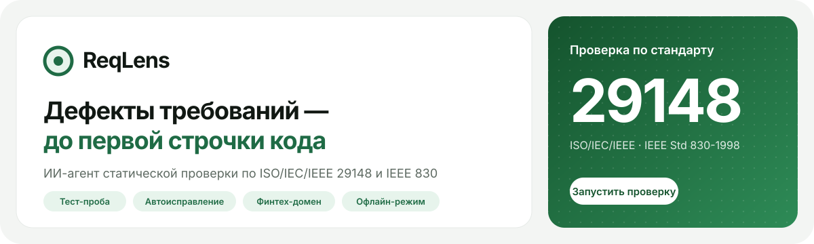</p>

<p align="center">
  
  
  
  
</p>

# ReqLens — ИИ-агент статической проверки требований

ReqLens читает готовый документ требований (PDF, DOCX, Markdown, TXT), выделяет отдельные требования, проверяет каждое
из них и весь набор целиком по критериям **ISO/IEC/IEEE 29148:2018 (п. 5.2.5, 5.2.6)** и **IEEE Std 830-1998 (п. 4.3)**
и записывает отчёт на русском языке. Это ревью требований **до разработки**: агент ищет дефекты формулировок
(двусмысленность, непроверяемость, противоречия, пропуски, лишние проектные решения), а не запускает тесты программы.

**Чем ReqLens отличается от обычного «LLM-ревьюера»:**

| | |
|---|---|
| 🧪 **Тест-проба** | К каждому требованию агент пытается написать приёмочный тест Given/When/Then. Не получилось — это *доказательство* непроверяемости с цитатой блокирующего фрагмента. |
| 🔍 **Интерактивный отчёт** | «Grammarly для требований»: дефекты подчёркнуты прямо в тексте документа, клик — объяснение, пункт стандарта и готовая формулировка. Один офлайн-файл HTML, светлая и тёмная темы, печать в PDF. |
| 🪄 **Автоисправление** | Исправленный документ с сохранённой структурой и сносками + diff «было → стало»; с `--rescore` — повторная оценка: балл до и после. |
| 🛡️ **Защита от галлюцинаций** | Каждое замечание содержит дословную цитату; агент проверяет её по тексту и отбрасывает выдуманное. Критик-агент перепроверяет замечания и выставляет уверенность. |
| 🏦 **Финтех-экспертиза** | Чек-лист полноты для банковских продуктов (2FA, лимиты, идемпотентность, AML, персональные данные, SLA…) — только с подтверждающими цитатами. |
| 📊 **Метрики** | Балл документа 0–100, индекс готовности к разработке, радар по критериям, «цена дефекта», бенчмарк точности на документе с известными дефектами. |
| 🔒 **Офлайн-режим** | Профиль `offline` работает с локальной моделью через Ollama: документ банка не покидает контур. |
| 🧰 **Для команды** | Excel-трассировка, CSV для импорта в Jira, `report.json`, вопросы заказчику, сравнение версий документа, веб-студия, Docker, GitHub Action. |
| 🕸️ **3D-граф требований** | Противоречия (красные рёбра), зависимости (серые) и дубликаты (пунктир); клик по узлу — детали и цепочка конфликта. 2D-вид — запасной вариант и fallback без WebGL. |
| 🤖 **Studio: живой прогон и ассистент** | Перетащите файл — шаги и требования появляются вживую (SSE); AI-ассистент отвечает на «Почему R-006 критичное?» со ссылками; экран «До / После» для новой версии. |

## Как это выглядит

<p align="center"></p>

| Документ: дефекты подчёркнуты в тексте | 3D-граф: противоречия и цепочка конфликта |
|---|---|
|  | 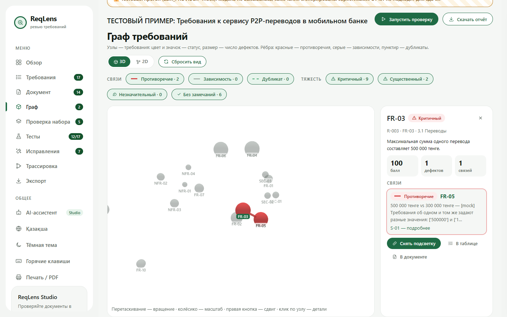 |
| **Тесты: Gherkin и покрытие «тестируемо X из N»** | **Исправления: diff «было → стало» и вопросы аналитику** |
| 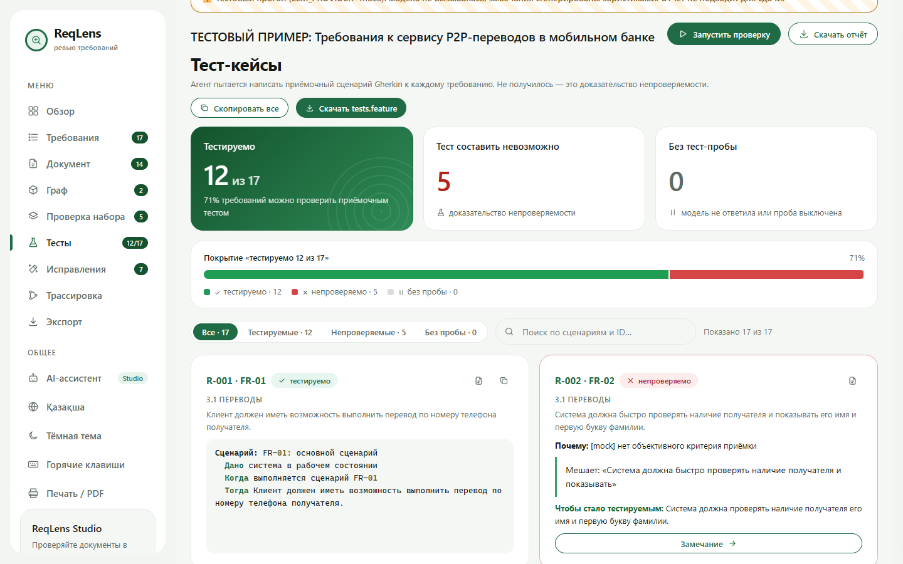 | 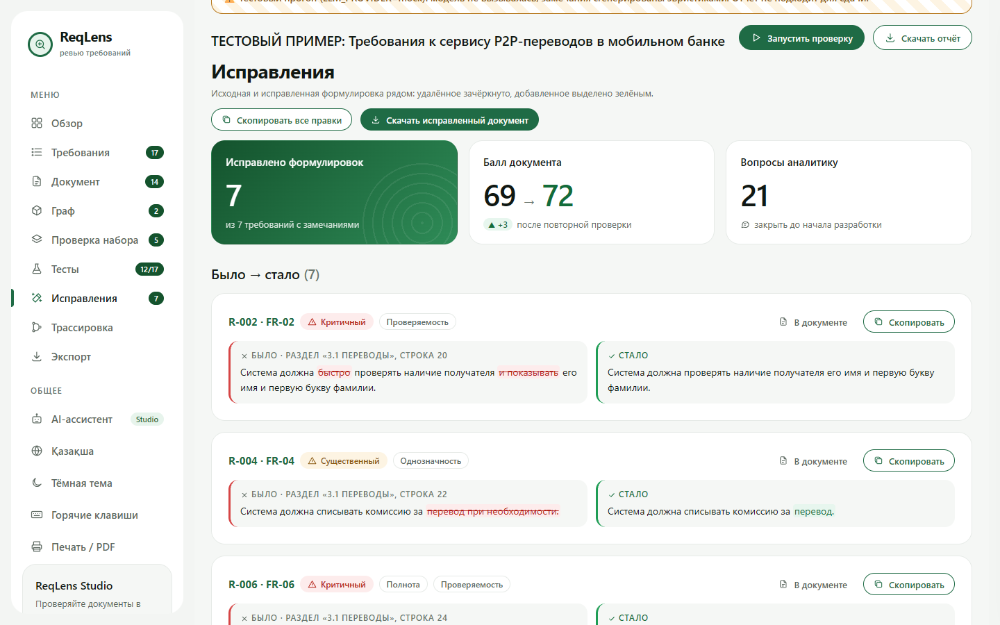 |
| **Studio: AI-ассистент рядом с отчётом** | **Studio: «До / После» для новой версии** |
|  | 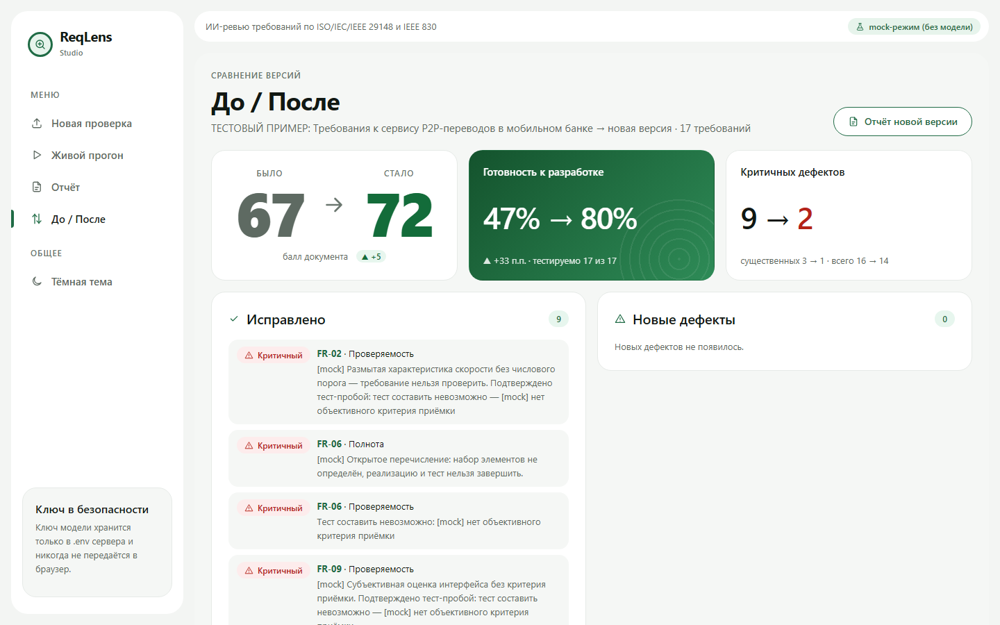 |

<details><summary>Ещё скриншоты: обзор, требования, набор, трассировка, экспорт, тёмная тема, мобильный вид</summary>

| | |
|---|---|
|  | 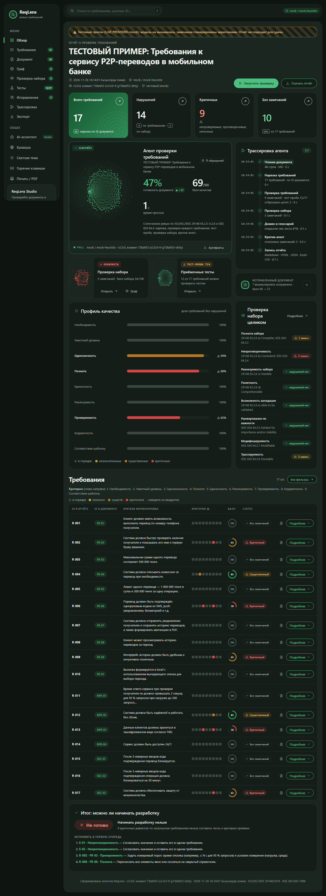 |
| 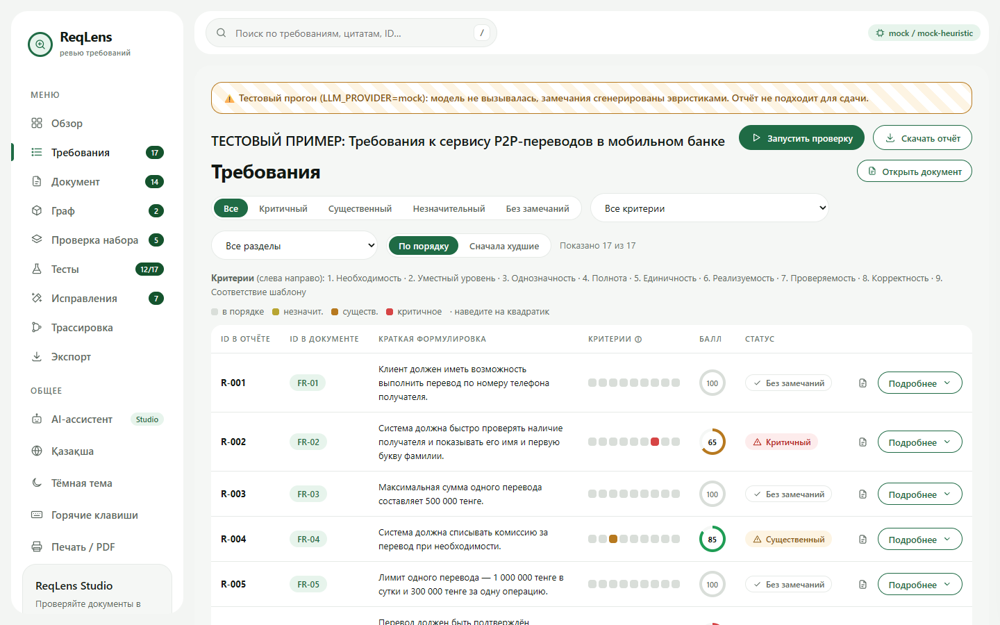 | 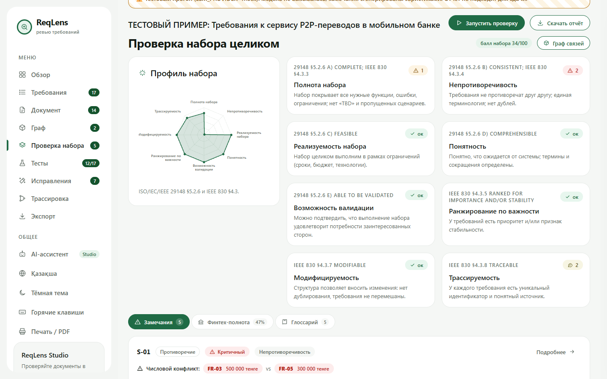 |
| 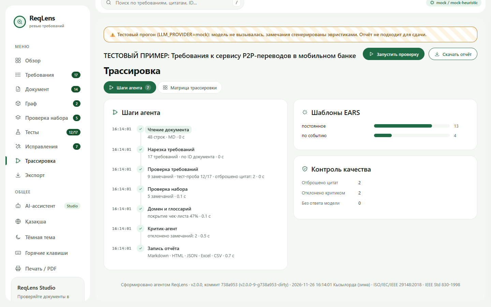 | 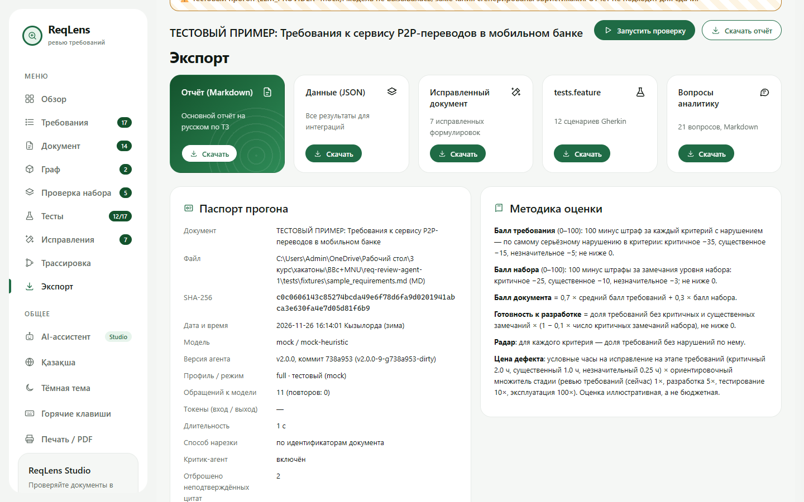 |
|  | 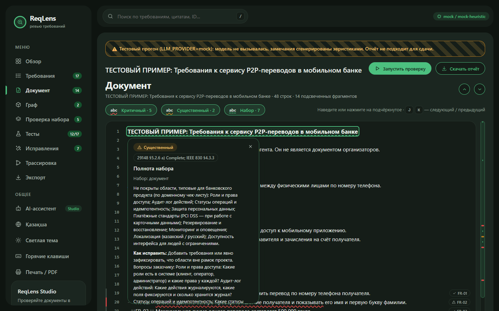 |
| 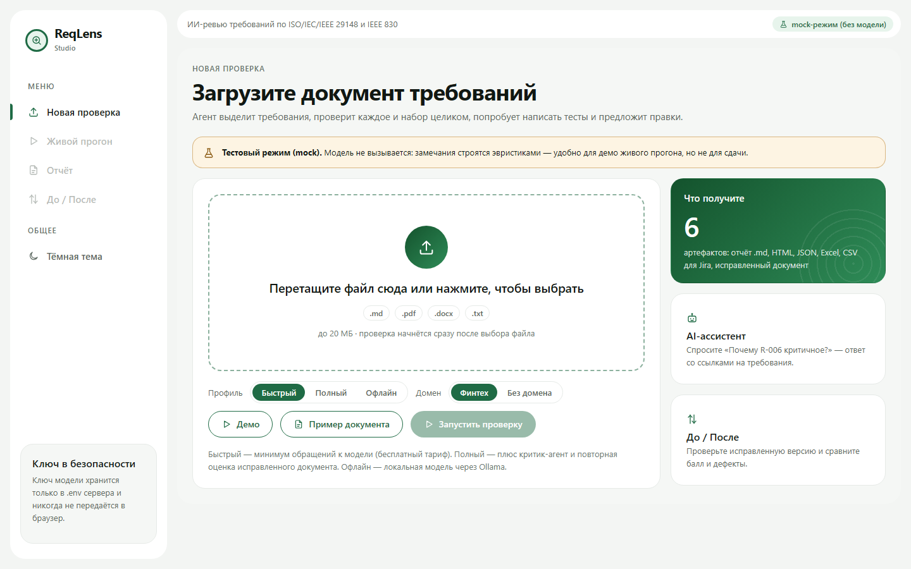 | 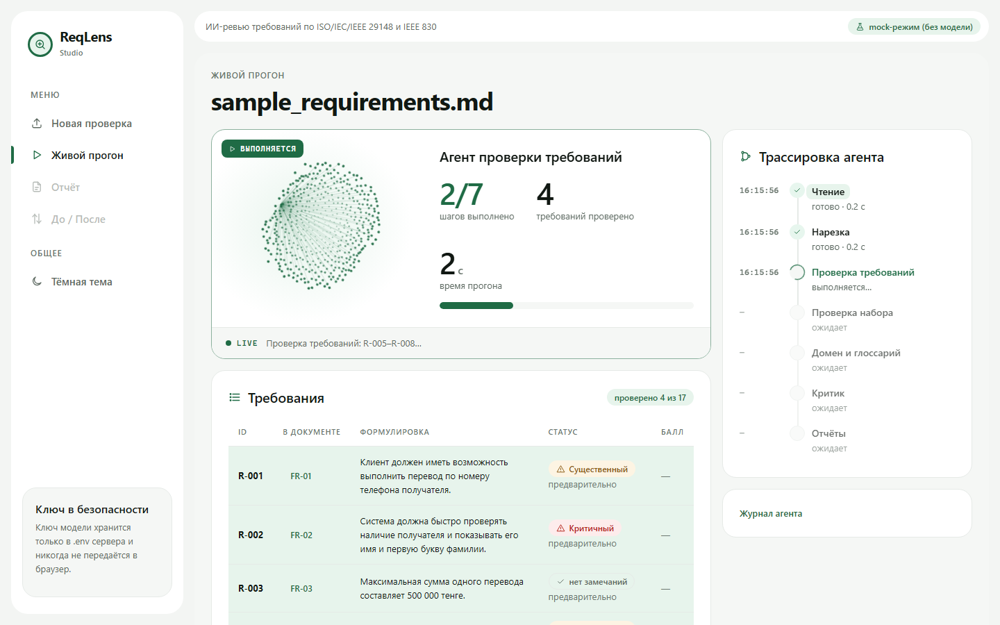 |
| 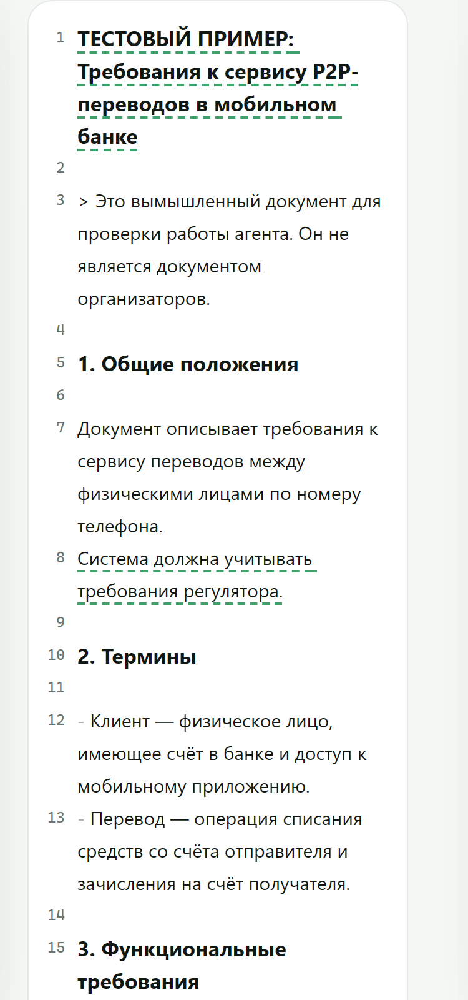 |  |
| 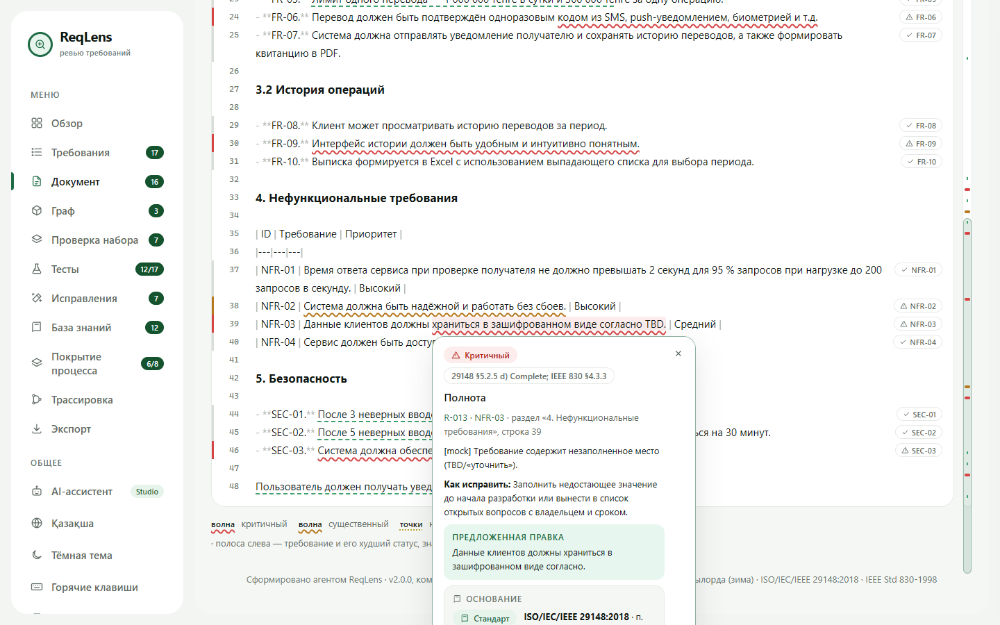 |  |
| 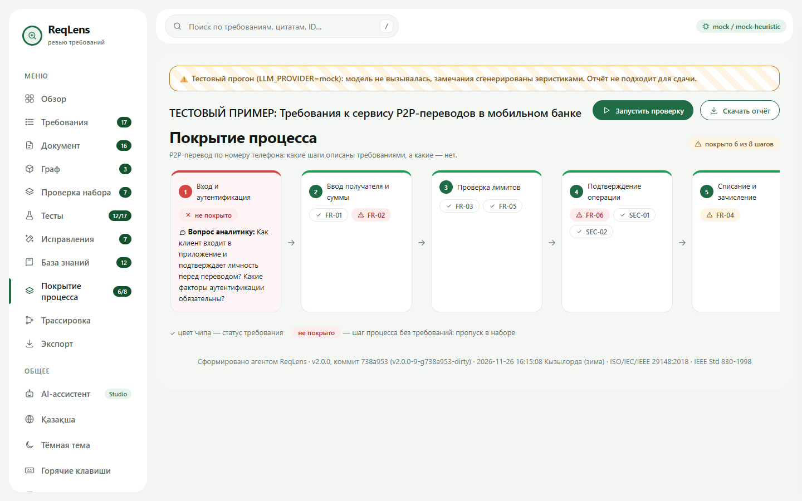 |  |
|  | 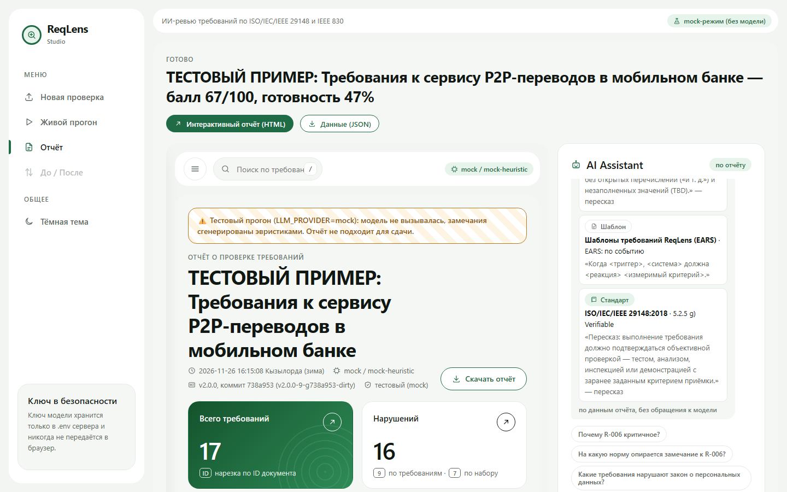 |
|  | |

</details>

Скриншоты и GIF снимаются автоматически: `pip install playwright pillow && playwright install chromium`,
затем `python scripts/screenshots.py` (mock-прогон, ключ не нужен; скрипт завершается с ошибкой, если в консоли браузера есть ошибки).

---

## Быстрый старт

```bash
# 1. Python 3.10+ и зависимости
python -m venv .venv
source .venv/bin/activate          # Windows: .venv\Scripts\activate
pip install -r requirements.txt

# 2. Ключ LLM
cp .env.example .env               # Windows: copy .env.example .env
# откройте .env и впишите GEMINI_API_KEY=<ваш ключ>

# 3. Прогон: путь к документу требований и путь к отчёту
python review.py docs/requirements.md reports/report.md
```

**Куда ляжет отчёт.** Основной отчёт — файл, указанный вторым аргументом (в примере `reports/report.md`, папка создаётся
автоматически). Рядом появляются дополнительные артефакты:

| Файл | Что внутри |
|---|---|
| `reports/report.md` | **Основной отчёт на русском** (все разделы по ТЗ) |
| `reports/report.html` | Интерактивный отчёт — откройте двойным кликом (работает офлайн) |
| `reports/report.json` | Машиночитаемый результат (`schema_version: 2.0`) |
| `reports/report_requirements_fixed.md` | Исправленная версия документа со сносками |
| `reports/report_traceability.xlsx` | Требования, нарушения, тест-кейсы, матрица трассировки, вопросы |
| `reports/report_jira_import.csv` | Дефекты для импорта в Jira |
| `reports/report_tests.feature` | Приёмочные тесты Gherkin (1–3 сценария на проверяемое требование) |
| `reports/report_fixed.diff` | Unified diff: исходный документ → исправленный |

Формат `report.json` (версия 2.1: позиции цитат, уверенность 0–1, конфликтующие значения) — в `docs/SCHEMA.md`.

Поддерживаемые входные форматы: `.pdf`, `.docx`, `.md`, `.txt`:

```bash
python review.py docs/requirements.pdf reports/report.md --open      # открыть HTML-отчёт после прогона
```

## Как получить ключ LLM

По умолчанию используется бесплатный **Gemini API (Google AI Studio)**, модель **`gemini-3.8-flash`**.

1. Откройте <https://aistudio.google.com/apikey> и войдите в Google-аккаунт.
2. Нажмите **Create API key** и скопируйте ключ.
3. Положите ключ в файл `.env` в корне репозитория (создаётся из `.env.example`):
   ```
   GEMINI_API_KEY=ваш_ключ
   GEMINI_MODEL=gemini-3.8-flash
   ```

Файл `.env` указан в `.gitignore` и в репозиторий не попадает. В репозитории лежит только `.env.example` без ключа.
Платный ключ не нужен: профиль `fast` (по умолчанию) укладывается в лимиты бесплатного тарифа — проверка требований
идёт пакетами по 20, тест-проба и тип EARS запрашиваются в том же запросе, а повторные прогоны берутся из кэша.

## Флаги и профили

```
python review.py <вход> <отчёт.md> [--profile fast|full|offline] [--domain fintech|none] [--compare СТАРЫЙ]
                                   [--critic | --no-critic] [--rescore] [--no-tests]
                                   [--no-html] [--no-fixed] [--no-xlsx] [--no-jira] [--no-json] [--open] [--quiet]
```

| Профиль | Что включено | Когда использовать |
|---|---|---|
| `fast` (по умолчанию) | проверка требований + тест-проба + EARS, проверка набора, финтех-чек-лист и глоссарий | бесплатный тариф Gemini, итоговый прогон |
| `full` | + критик-агент, уверенность замечаний, `--rescore` (повторная оценка исправленного документа) | демо «было → стало» |
| `offline` | как `full` без rescore, модель — локальная через Ollama | конфиденциальные документы банка |

| Флаг | Назначение |
|---|---|
| `--domain fintech\|none` | доменный чек-лист полноты (`req_review/domains/*.yaml` — можно добавить свой домен без кода) |
| `--compare old.md` / `--compare report.json` | динамика относительно прошлой версии: исправлено ✅ / новое ⚠️ / ухудшилось 🔻 |
| `--critic`, `--no-critic` | включить/выключить критик-агента независимо от профиля |
| `--rescore` | прогнать исправленный документ повторно и показать балл «было → стало» |
| `--no-tests` | не показывать тест-пробу |
| `--no-html`, `--no-fixed`, `--no-xlsx`, `--no-jira`, `--no-json` | не создавать соответствующий артефакт |
| `--open` | открыть HTML-отчёт в браузере |

### Настройки (`.env`)

| Переменная | По умолчанию | Назначение |
|---|---|---|
| `LLM_PROVIDER` | `gemini` | `gemini`, `openai` (любой OpenAI-совместимый API) или `mock` (офлайн-заглушка для тестов) |
| `GEMINI_API_KEY` | — | ключ Google AI Studio |
| `GEMINI_MODEL` | `gemini-3.8-flash` | модель Gemini |
| `OPENAI_BASE_URL`, `OPENAI_API_KEY`, `OPENAI_MODEL` | — | OpenAI-совместимые API (OpenRouter, Groq, Ollama и др.) |
| `LLM_BATCH_SIZE` | `20` | требований в одном запросе |
| `LLM_RPM` | — | ограничение запросов в минуту (берётся строже из `LLM_RPM` и `LLM_MIN_INTERVAL`) |
| `REQLENS_CRITIC_CRITICAL` | `1` | в профиле `fast` перепроверять критичные замечания критиком (1 запрос); `0` — выключить |
| `LLM_MAX_WAIT` | `180` | если API просит ждать дольше (исчерпана дневная квота) — агент останавливается с понятным сообщением, ответы остаются в кэше |
| `LLM_MIN_INTERVAL` | `6` | пауза между запросами, с (≈10 запросов/мин) |
| `LLM_MAX_RETRIES` | `6` | повторы при 429/5xx (учитывается `retryDelay`) |
| `LLM_TEMPERATURE` | `0` | температура |
| `LLM_CACHE` | `1` | кэш ответов модели в `.cache/llm` |
| `REQLENS_PROFILE`, `REQLENS_DOMAIN` | `fast`, `fintech` | профиль и домен по умолчанию |
| `OFFLINE_MODEL` | `qwen2.5:14b` | модель Ollama для профиля `offline` |

## Запуск без интернета (банковский контур)

```bash
ollama pull qwen2.5:14b
python review.py docs/requirements.md reports/report.md --profile offline
```

В паспорте отчёта будет строка «Режим: офлайн: документ не передавался третьим лицам».

## Веб-интерфейс ReqLens Studio

```bash
python -m req_review.web        # → http://localhost:8000
```

- **Живой прогон.** Перетащите документ (или нажмите «Демо-документ») — проверка стартует сразу. Таймлайн шагов
  обновляется через SSE, а требования появляются в таблице по мере проверки пакетов: сначала «проверяется…»,
  затем предварительный статус по ответу модели, в конце — итоговый балл после проверки цитат.
- **Отчёт + AI-ассистент.** Интерактивный отчёт открывается рядом с чатом. Подсказки-вопросы («Почему R-006 критичное?»,
  «Что исправить первым?», «Какие есть противоречия?») разбираются по `report.json` без обращения к модели и без расхода
  квоты; свободные вопросы — моделью, если она доступна. Ссылки на требования в ответах открывают их в отчёте.
  В статическом HTML-отчёте ассистента нет — пункт меню подсказывает, что он доступен в Studio.
- **До / После.** «Проверить исправленный агентом» или загрузить свою новую версию — экран сравнения: балл и готовность
  до → после (анимированные счётчики), исправленные и новые дефекты, статус каждого требования.
- **Понятные ошибки.** Нет ключа — предупреждение ещё на экране загрузки (`/api/health`, сам ключ не передаётся);
  лимит API (429) или ошибка ключа — отдельные экраны с шагами решения и кнопкой «Попробовать снова».
- **Режим «Демо»** (страховка на защите): `python -m req_review.web --demo reports/report.json [--demo-after reports/v2/report.json]`
  — Studio проигрывает сохранённый реальный прогон (шаги, пакеты, таблица, тайминги) без сети и без обращения к модели;
  кнопка «Демо» на стартовом экране. Сценарий на 3 минуты — [docs/DEMO.md](docs/DEMO.md).

Ключ модели берётся только из `.env` сервера и в браузер не передаётся. Для демо без ключа: `LLM_PROVIDER=mock`
(у mock-модели ответы мгновенные, поэтому Studio делает паузу 0,6 с на пакет; настраивается `STUDIO_DEMO_DELAY`).
CLI остаётся основным способом запуска по ТЗ.

## Docker

```bash
docker compose run --rm review docs/requirements.md reports/report.md   # прогон одной командой
docker compose up studio                                                 # веб-студия на http://localhost:8000
# или без compose:
docker build -t reqlens .
docker run --rm -v "$PWD:/work" --env-file .env reqlens docs/requirements.md reports/report.md
```

## Как устроен прогон

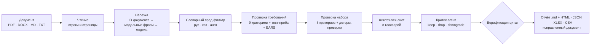

1. **Чтение.** PDF — через `pdfplumber` (с номерами страниц), DOCX — абзацы, заголовки и таблицы, MD/TXT — как есть.
2. **Нарезка.** Идентификаторы документа (`FR-01`, `REQ-1.2`, `НФТ-3`, `3.1.2` …), в том числе в таблицах; без ID —
   пункты с модальными словами, агент присваивает номера `R-001…` и сохраняет цитату; если и так ничего нет — нарезка моделью.
3. **Пред-фильтр правил** — словарь размытых формулировок на русском, казахском и английском.
4. **Проверка каждого требования** по 9 критериям 29148 §5.2.5 / IEEE 830 §4.3; в том же запросе — **тест-проба** и тип **EARS**.
5. **Проверка набора** по 29148 §5.2.6 и IEEE 830 §4.3 + детерминированные проверки (дубли ID, почти-дубли, утверждения без ID, приоритеты).
6. **Финтех-чек-лист и глоссарий** — один запрос; покрытие засчитывается только с цитатами.
7. **Критик-агент** (`full`/`offline`) — подтверждает, понижает или отклоняет замечания, выставляет уверенность.
8. **Верификация цитат.** Замечание с несуществующей цитатой отбрасывается и показывается в приложении.
9. **Отчёты.**

## Состав отчёта

1. **Паспорт прогона** — документ, файл и SHA-256, дата, модель, версия агента (git-коммит/тег), профиль и режим,
   число обращений к модели, **балл документа** и **готовность к разработке**.
2. **Нарезка требований** — «ID в отчёте — ID в документе — место — краткая формулировка».
3. **Проверка каждого требования** — цитата, балл, тип EARS, таблица нарушений (критерий, цитата, проблема, серьёзность,
   как исправить, источник), предлагаемая формулировка, результат тест-пробы.
4. **Проверка набора** — статус по каждому критерию, замечания со ссылками, доменная полнота, глоссарий.
5. **Сводка** — числа требований и нарушений, профиль качества по критериям, покрытие тест-пробой, критичные дефекты.
6. **Итог** — можно ли начинать разработку и тестирование, что исправить в первую очередь, цена дефекта, вопросы
   заказчику, исправленный документ, граф связей (Mermaid), динамика к прошлой версии.
7. **Приложения** — критерии, отброшенные и отклонённые замечания, методика оценки.

Каждое нарушение привязано к конкретному месту: ID требования, раздел, строка/страница и дословная цитата.

## Почему этому можно доверять

- **Цитаты проверяются кодом**: замечание без точной цитаты из документа не попадает в оценку.
- **Тест-проба** превращает «непроверяемо» из мнения в факт: тест не составлен — показан фрагмент, который мешает.
- **Критик-агент** перепроверяет замечания; отклонённое не исчезает, а уходит в приложение с причиной.
- **Все числа считает код** (`req_review/scoring.py`, методика — в приложении отчёта), а не модель.
- **Числовые противоречия ищет детерминированный код** (`req_review/numbers.py`): «3 неверных ввода» vs «5 неверных
  вводов», «500 000 тенге» vs «300 000 тенге» за операцию — с цитатами обоих значений. Разные периоды («в сутки» и
  «за операцию») противоречием не считаются; на чистых документах ложных срабатываний нет (проверено тестом).
- **Уверенность 0–1** у каждого замечания (`docs/SCHEMA.md`); критичные замечания перепроверяются критиком даже в профиле `fast`.
- **Бенчмарк**: 3 вымышленных документа (`bench/docs/`: оплата услуг, онлайн-кредит, открытие счёта) с **41 заранее
  известным дефектом** 14 типов:

```bash
python bench/run.py              # → bench/RESULTS.md и bench/results.html (по типам и по документам)
```

`bench/inject.py` внедряет дефекты (размытые слова, TBD, «и/или», открытые перечисления, проектные решения, составные
требования, абсолюты, цели без механизма, пассив, числовые противоречия, дубли…) и пишет `bench/ground_truth.json`;
`bench/run.py` считает recall, precision и F1. Цифры в `bench/RESULTS.md` получены прогоном, а не вписаны руками.
Сейчас в репозитории — прогон в режиме mock (только правила); для итоговых цифр запустите с ключом модели —
повторные прогоны берутся из кэша и квоту не тратят.

## Сравнение прогонов

```bash
python -m req_review.compare reports/v1.json reports/v2.json --md reports/compare.md
```

Без обращений к модели: балл и готовность «было → стало», число критичных, исправленные / новые / ухудшившиеся
требования, снятые и появившиеся дефекты. Новую версию документа можно проверить и сразу сравнить:
`python review.py docs/requirements_v2.md reports/v2.md --compare reports/v1.json`.

## Если упёрлись в лимит бесплатного тарифа (HTTP 429)

- Уже полученные ответы лежат в `.cache/llm` — повторный запуск продолжит с того же места без расхода квоты.
- При дневном лимите агент сразу останавливается с понятным сообщением (не ждёт часами).
- Меньше запросов: `LLM_BATCH_SIZE=20` (по умолчанию), профиль `fast`, `--domain none`; ограничение частоты — `LLM_RPM=8`.
- Можно сменить модель (`GEMINI_MODEL`) или использовать любой OpenAI-совместимый API (`LLM_PROVIDER=openai`).

## Версия агента в отчёте

Версия берётся из git (`git rev-parse --short HEAD`, `git describe --tags`). Закоммитьте изменения перед финальным
прогоном (иначе к версии добавится `-dirty`):

```bash
git tag v2.0.0
python review.py docs/requirements.md reports/report.md
```

## Интерактивный HTML-отчёт

Один самодостаточный файл: CSS, JS, иконки, данные и библиотеки встроены, внешних запросов нет — открывается офлайн.

| Раздел | Что внутри |
|---|---|
| Обзор | KPI, вердикт «можно ли начинать», профиль качества, трассировка агента |
| Требования | таблица с фильтрами; у каждой строки — «Показать в документе» |
| Документ | исходный текст с номерами строк; дефекты подчёркнуты цветом и стилем линии по тяжести; наведение/клик — карточка (критерий, объяснение, правка); миникарта справа; `J`/`K` — следующий/предыдущий дефект; значок у строки — переход в таблицу |
| Граф | 3D (three.js + 3d-force-graph): цвет — статус, размер — число дефектов; фильтры по типу связи и тяжести; цепочка конфликта; кнопка «2D» |
| Проверка набора | критерии 29148 §5.2.6, финтех-полнота, глоссарий |
| Тесты | Gherkin-сценарии с подсветкой синтаксиса, покрытие «тестируемо X из N», скачать `tests.feature` |
| Исправления | side-by-side diff, «Скопировать», «Скачать исправленный документ», вопросы аналитику с экспортом в `.md` |
| Трассировка, Экспорт | шаги агента, матрица трассировки, паспорт прогона и методика |
| База знаний, Покрытие процесса *(при RAG)* | на какие нормы (стандарт, закон РК, шаблон) опираются замечания; шаги процесса и покрывающие их требования |

С RAG (схема 2.2) у каждого замечания появляется блок **«Основание»**: пункт стандарта, закон РК со ссылкой на adilet.zan.kz
или шаблон — дословный фрагмент базы знаний; в «Исправлениях» — подсказка «по шаблону EARS». Без RAG эти блоки скрыты.
Переключатель **«Қазақша»** в меню переводит подписи интерфейса; содержание отчёта остаётся на русском (ТЗ).
Поля, которые читает интерфейс, — `docs/SCHEMA_2.2_UI.md`; предпросмотр на фикстуре — `python -m req_review.ui.preview`.

3D-движок (≈1,4 МБ) хранится в отчёте сжатым (gzip + base64, ≈0,5 МБ) и распаковывается только при открытии раздела
«Граф»; без WebGL или без `DecompressionStream` автоматически включается 2D-вид. Анимации появления карточек
и счётчиков отключаются при `prefers-reduced-motion`; печать (`Ctrl+P`) раскрывает все разделы в версию для A4.
Лицензия встроенной библиотеки — `req_review/ui/assets/vendor/LICENSE-3d-force-graph.txt` (MIT).

## Дизайн-система и слайды

Все поверхности (HTML-отчёт, студия, бенчмарк, слайды) построены на единых токенах `design/tokens.json`.
Витрина токенов и компонентов в обеих темах и слайды питча (`docs/slides.html`, 10 слайдов: проблема, решение,
архитектура, демо, метрики бенчмарка из `bench/RESULTS.md`, отличия, команда из `docs/team.yaml`):

```bash
python -m req_review.ui.styleguide    # → design/styleguide.html, docs/slides.html
```

## Тесты

```bash
pytest -q
ruff check .
```

Тесты не требуют ключа и сети: используется офлайн-заглушка `LLM_PROVIDER=mock` и подменённый HTTP-клиент.
`tests/fixtures/sample_requirements.md` и `bench/*.md` — **вымышленные примеры** только для проверки агента, это не документ
организаторов. Отчёт, полученный в режиме `mock`, помечается как тестовый и для сдачи не подходит.

## Структура репозитория

```
review.py               — точка входа (python review.py <вход> <отчёт>)
req_review/
  pipeline.py           — оркестрация прогона (общая для CLI и веб-студии)
  reader.py             — чтение PDF/DOCX/MD/TXT
  splitter.py           — нарезка на требования
  rules.py              — словарный пред-фильтр (рус/каз/англ)
  criteria.py           — критерии ISO/IEC/IEEE 29148 и IEEE 830
  llm.py                — клиенты Gemini / OpenAI-совместимого API, лимиты, повторы, кэш
  checker.py            — проверка требований (+ тест-проба, EARS) и набора, верификация
  critic.py             — критик-агент и уверенность
  extras.py             — финтех-чек-лист и глоссарий; domains/fintech.yaml
  scoring.py            — баллы, готовность, радар, цена дефекта
  questions.py          — вопросы заказчику
  fixer.py              — исправленный документ и diff
  graph.py              — граф связей и Mermaid
  exports.py            — JSON, Excel, Jira CSV, сравнение версий
  report.py             — Markdown-отчёт
  html_report.py        — интерактивный HTML-отчёт
  console.py            — оформление консоли (rich)
  ui/                   — дизайн-система: токены, иконки, CSS/JS (report.js, report-graph.js), шаблоны, vendor/ (3D)
  web/                  — ReqLens Studio (FastAPI): app.py, live.py (живой прогон), assistant.py, compare.py
  mock_llm.py           — офлайн-заглушка для тестов
bench/                  — бенчмарк точности
design/                 — tokens.json и styleguide
docs/                   — DECISIONS.md, PITCH.md, slides.html, team.yaml, скриншоты и GIF (assets/)
scripts/screenshots.py  — скриншоты всех разделов и GIF живого прогона (Playwright)
examples/               — GitHub Action «requirements as code»
tests/                  — тесты
```

## Ограничения

- PDF из сканов (без текстового слоя) нужно сначала распознать (OCR).
- Результат зависит от модели; при `LLM_TEMPERATURE=0` повторные прогоны дают близкие, но не обязательно идентичные результаты.
- Финтех-чек-лист — подсказка для проверки полноты, а не юридическое заключение.
- «Цена дефекта» — ориентировочная иллюстрация по множителям из литературы, а не бюджетная оценка.
