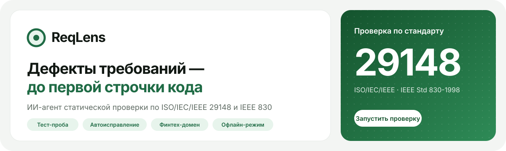

# Дизайн-система ReqLens v3 «Ecliptic Dawn»

Одна система для сайта, приложения (Studio), HTML-отчёта и слайдов. Образ — **ночь → рассвет**: тёмные панели
лежат на градиенте неба от индиго к розовому, над ними «парят» экраны продукта в перспективе, типографика крупная,
плотная, вес 500. Тёмная тема — основная, светлая — вторичная (и тема печати отчёта).

Витрина со всеми токенами и компонентами в обеих темах — `design/styleguide.html`.

<p align="center"></p>

## Источник правды

| Что | Где | Как пересобрать |
|---|---|---|
| Токены (палитра, цвета тем, градиенты, стекло, перспектива, шрифт, отступы, радиусы, тени, движение, слои) | `design/tokens.json` (v4.0.0) | `python -m req_review.ui.styleguide` → `req_review/ui/tokens.css`, витрина, слайды |
| Компоненты (CSS-классы) | `req_review/ui/assets/base.css` | — |
| Иконки (24×24, линия 1.75, `currentColor`) | `req_review/ui/icons.py` | — |
| Логотип, favicon, иконки PWA | `req_review/ui/brand.py` → `design/brand/`, `req_review/web/static/`, `site/favicon.svg` | `python -m req_review.ui.brand` (PNG — нужен Pillow) |
| Сайт | `site/` (HTML/CSS/JS без сборщика) | `python scripts/build_site.py` → `public/` |
| Скриншоты README и картинки сайта | `docs/assets/`, `site/img/` | `python scripts/screenshots.py [report.html]`, затем `python scripts/site_images.py` |

`tokens.css` руками не правят. Тест `tests/test_design.py` падает, если он разошёлся с `tokens.json`.
Сайт подключает тот же `tokens.css`; свои значения по умолчанию у него объявлены в `:where(:root)` (нулевая
специфичность), поэтому токены проекта всегда главнее.

## Палитра

| Шкала | Опорные значения | Роль |
|---|---|---|
| `--night-50…950` | `#02030C` (950) · `#0B0E24` · `#12163A` · … · `#F5F6FC` (50) | Панели, фон, текст. `#02030C` — цвет панели и `theme_color` |
| `--indigo-50…950` | `#3B4CB6` (700, кобальт) · `#4459C8` (600) · `#8E9BFF` (400, перивинкл) | Бренд, ссылки, активные состояния |
| `--dawn-100…800` | `#E3CDDB` · `#D9C6DA` · `#9191D3` · … · `#02020E` | Только градиенты неба |

Компоненты используют **семантические** токены, а не шкалы напрямую.

### Семантика (тёмная / светлая)

| Токен | Тёмная | Светлая |
|---|---|---|
| `--bg`, `--panel` | `#02030C` | `#F5F6FC`, `#FFFFFF` |
| `--brand` | `#8E9BFF` | `#3B4CB6` |
| `--primary` / `--on-primary` (главная кнопка) | белая `#FFFFFF` / ночь | ночь `#0A0D2A` / белый |
| `--critical` | `#FF7B8A` | `#C0263A` |
| `--major` | `#FFB86B` | `#9A5A00` |
| `--minor` | `#F3DE8A` | `#7A6A00` |
| `--ok` | `#5EE6B0` | `#0E7A52` |
| `--info` | `#8E9BFF` | `#3B4CB6` |

У каждой серьёзности есть `-accent` и `-soft`. Также: `--surface`, `--surface-2`, `--border`, `--border-strong`,
`--text`, `--text-2`, `--text-3`, `--brand-hover/-dark/-light/-soft`, `--danger`, `--focus`, `--overlay`,
`--glass-bg`, `--glass-border`, `--glow`, `--grad-hero`.

**Контраст.** Каждая пара «текст / фон» проходит WCAG AA (≥ 4.5) в обеих темах; таблица — в витрине, проверка — тест.

## Градиенты, стекло, перспектива

- `--grad-dawn` — небо «ночь → рассвет» внутри панели. Привязывается **к низу панели в пикселях**
  (`background: #02020E var(--grad-dawn) bottom / 100% 1000px no-repeat`), чтобы заголовок всегда был на ночи,
  а светлая полоса рассвета — под тёмным текстом внизу.
- `--grad-page` — фон страницы вокруг панелей (индиго → розовый).
- `--grad-glow` — кобальтовое свечение под парящими экранами и KPI.
- `--glass-blur` (14px) + `--glass-bg` / `--glass-border` — капсула навигации, боковая панель, топбар.
- `--persp-depth` (1600px), `--persp-angle` (18°), `--persp-tilt` (14°) — парящие экраны:
  `transform: perspective(var(--persp-depth)) rotateX(var(--persp-angle)) rotateY(…)`, нижний край растворяется
  `mask-image`, у картинок `aspect-ratio: 16/10; object-fit: cover`.

## Типографика

Inter Variable, локально (`site/fonts/`, латиница + кириллица + расширенная кириллица для казахского; SIL OFL 1.1).
Внешних шрифтов и трекеров нет.

| Роль | Значение | Где |
|---|---|---|
| `--t-display` | 500 72/74, трекинг −0.035em | Заголовок экрана; в приложении `clamp(32px, 3.8vw, 56px)` |
| `--t-kpi` | 500 48/52 | Цифры KPI |
| `--t-h1` | 500 40/44 | Разделы |
| `--t-h2`, `--t-h3` | 600 22/28, 600 17/24 | Карточки |
| `--t-body`, `--t-small`, `--t-caption` | 400 16/26, 400 14/20, 500 12/16 | Текст, подписи, надзаголовки (UPPERCASE) |

## Форма и движение

- **Радиусы:** `--r-panel` / `--r-hero` 36px (панели), `--r-card` 20px, `--r-field` 14px, кнопки и чипы — капсула `--r-full`.
- **Тени** `--shadow-sm/md/lg/xl`; `xl` (0 40px 120px) — только парящие экраны.
- **Отступы** `--s-1…8` = 4 / 8 / 12 / 16 / 24 / 32 / 48 / 64 px.
- **Движение:** `--motion-fast` 120 мс, `--motion-base` 200 мс, `--motion-slow` 280 мс. Появление блоков и
  параллакс hero — только при `prefers-reduced-motion: no-preference`; иначе всё видно сразу и неподвижно.
- **Слои** `--z-*`: sticky < sidebar < overlay < drawer < popover < modal < tooltip < toast. Числа в `z-index`
  больше 9 в `base.css` запрещены тестом.

## Правила композиции

1. **Один источник света на экран.** Либо рассвет внизу панели, либо кобальтовое свечение — не оба в одном кадре.
2. **Не больше трёх парящих экранов** в одной сцене (hero сайта — ровно три).
3. **Одна белая кнопка на экран.** `.btn-primary` — главное действие; остальное — `.btn-secondary` / `.btn-ghost`.
4. Текст на рассвете — тёмный (`--night-950`), на ночи — светлый; середину градиента под текст не ставить.
5. Цвет серьёзности — только для серьёзности. Бренд-синий не используется как «критично» и наоборот.
6. Отчёт — **один офлайн-файл**: токены, CSS, JS, знак и favicon встроены; печать — всегда светлая тема.
7. Ширина 360–1440 px без горизонтальной прокрутки; сайт работает без JS (вкладки — на `radio`, тема и язык — улучшение).

## Компоненты (классы `base.css`)

Имена классов с v2 не менялись — v3 меняет только оформление.

| Компонент | Классы |
|---|---|
| Кнопки | `.btn` + `.btn-primary` (белая капсула) / `-secondary` / `-ghost` / `-danger`; `.btn-sm` / `.btn-lg`; `.btn-icon`, `.btn-round`; `.loading`, `[disabled]` |
| Поля | `.field` > `label` + `.input` + `.hint` / `.err`; ошибка — `.field.invalid` и `aria-invalid` |
| Загрузка файла | `.dropzone` (свечение снизу; `.is-over`, когда файл над зоной), `.dz-ic`, `.formats` |
| Бейджи и чипы | `.chip` + `.sev-critical` / `-major` / `-minor` / `-ok` / `-info`, `.chip-brand`, `.chip-outline`, `.kbd`, `.status`, `.verdict-badge` |
| Карточки | `.card`, `.kpi`, `.kpi-hero` (кобальтовое свечение) |
| Каркас приложения | `.sidebar`, `.topbar` (стекло), `.content` (ночная панель `--r-panel` со свечением снизу) |
| Таблица | `.table-wrap` > `.tbl` |
| Вкладки, переключатели | `.tabs` > `.tab[aria-selected]`; `.seg` > `button[aria-pressed]` — активный пункт белый |
| Drawer, модальное окно | `.overlay` + `.drawer.open`; `.modal.open` > `.modal-box` (`role="dialog"`, `aria-modal`) |
| Тост | `.toast.show` + `.toast-ok` / `-err` / `-info` |
| Тултип | `data-tip="…"` (наведение и фокус с клавиатуры) |
| Прогресс этапов | `.stages` (`--p`) > `.stages-bar` (градиент кобальт → перивинкл) + `ol > li.done / .run / .fail`; `.stepper` |
| Пустое состояние, загрузка | `.empty`, `.skel*` |
| 3D-граф | `.graph-wrap`, `.g-stage` — прозрачный WebGL на ночном «тумане»; цвета узлов читаются из `--critical/--major/--minor/--ok` |

## Бренд и PWA

- **Знак** — линза-кольцо с градиентом кобальт → лаванда и белая галочка на ночной плитке. В SVG у каждой копии
  свой `id` градиента, поэтому знаки на одной странице не конфликтуют.
- **Иконки** в `design/brand/` (и копии в `req_review/web/static/`): `icon-192.png`, `icon-512.png` (`any`),
  `icon-maskable-512.png` (`maskable`, глиф в безопасной зоне 80 %), `apple-touch-icon.png` (180), `favicon-32.png`, `favicon.svg`.
- **`design/brand/brand.json`** — фрагмент для `manifest.webmanifest`: `theme_color` `#02030C`, `background_color`
  `#F5F6FC`, `background_color_dark` `#02030C`, массив `icons`.
- **Офлайн-отчёт.** В шаблонах favicon встраивается через `favicon_href()`, знак — через `logo_mark(size)`.
- **Баннер** README — `docs/assets/banner.svg`; бейджи shields — в цветах палитры на ночной подложке (`labelColor=02030C`).

## Как проверять

```bash
python -m pytest -q tests/test_design.py
```

```bash
python scripts/build_site.py --out public && python -m http.server 8765 -d public
```

Глазами: сайт, Studio и отчёт в тёмной и светлой темах на 390 и 1440 px; без ошибок в консоли; с
`prefers-reduced-motion: reduce`; отчёт открывается из файла без сети.
