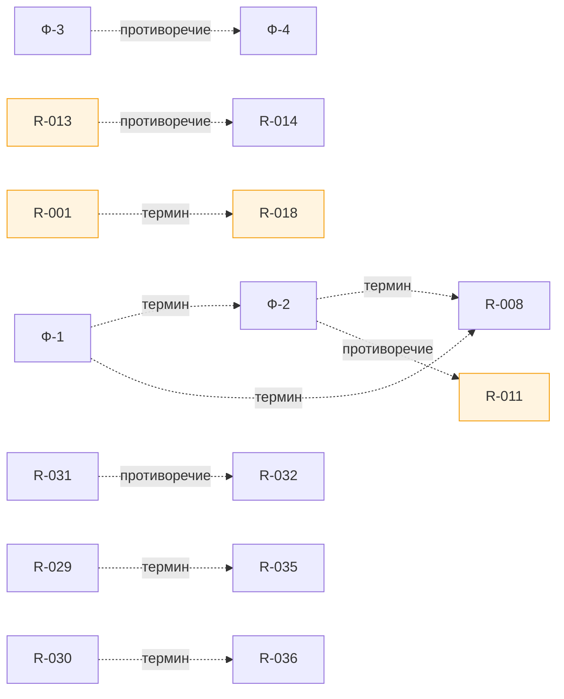

# Отчёт о проверке требований: Уведомление о расходах по карте

> 🔎 **Аудит цитат (проверено кодом):** цитат в замечаниях — 83, подтверждено в тексте документа — **83** (дословно 83, с пропусками «…» 0), не найдено — 0; отброшено как выдуманные моделью — 2. Учтено строк документа: 152 из 152.

<!-- reqlens:summary:start -->

**Итог за 30 секунд**

| Разработка | Тестирование | 🔴 Критичных | 🟠 Существенных | 🟡 Незначительных |
|---|---|---|---|---|
| ❌ нельзя | ❌ нельзя | 6 | 51 | 7 |

**Что исправить первым:**

1. 🔴 [S-01](#s-01) — Метод объявлен как GET («REST type \| GET»), но выполняет изменение данных («Сохранение») *Пример:* «PUT /alerts/limit»
2. 🔴 [S-02](#s-02) — В разделе успешного ответа 200 приведён пример с ошибкой ({"result":"ERROR","message":"Проверьте сумму"}), а для неверных параметров описан…
3. 🔴 [S-03](#s-03) — В спецификации API описан только метод изменения данных (/alerts/saveLimit), а метода чтения нет *Пример:* «GET /alerts/limit?cardId=…»
4. 🔴 [S-04](#s-04) — Расчёт строится на событиях внешней системы, но контракт события не описан: нет состава полей (карта, операция, тип операции, сумма и… *Пример:* «Система должна обеспечивать идемпотентность обработки событий процессинга: повторная доставка одного и того же события не должна изменять накопленный итог расходов.»
5. 🔴 [S-05](#s-05) — Ф-3 ограничивает частоту («максимум один такой push за календарный месяц»), а Ф-4 требует отправки «независимо от истории» *Пример:* «При изменении порога признак отправки в текущем месяце сбрасывается; лимит Ф-3 считается от последнего изменения порога»
6. 🔴 [S-06](#s-06) — Для продуктивной среды не указано значение («Prod: —») — реализацию нельзя развернуть и проверить в Prod.
7. 🟠 [S-07](#s-07), [S-09](#s-09), [S-10](#s-10), [S-15](#s-15) … — Полнота набора: замечаний — 16 *Пример:* «Проведённая покупка — транзакция в статусе клиринга (окончательного списания средств со счёта)»
8. 🟠 [S-08](#s-08), [S-11](#s-11), [S-12](#s-12), [S-13](#s-13) … — Непротиворечивость: замечаний — 11 *Пример:* «Расходы относятся к месяцу по дате совершения покупки (транзакции). При проведении покупки 1 февраля, совершенной 31 января, сумма учитывается в расходах января.»

Подробности: разделы 3–4 (разбор по каждому требованию и набору), раздел 6 (итог и план), приложения.

<!-- reqlens:summary:end -->

## 1. Паспорт прогона

| Параметр | Значение |
|---|---|
| Документ | Уведомление о расходах по карте |
| Файл | `bench/real/notifications.md` (MD) |
| SHA-256 файла | `e7dae55e5453a250…` |
| Дата и время прогона | 2026-11-26 20:00:21 UTC |
| Модель | gemini / gemini-3.1-flash-lite |
| Версия агента | v8.0.0, коммит 1bdee53 (v3.0.3-61-g1bdee53) |
| Обращений к модели | 31 (повторов: 0) |
| Подлинность прогона | ✅ свежий прогон: все 31 ответов модели получены сейчас; ✅ код агента — чистый коммит `1bdee53` |
| Профиль / режим | deep / облачная модель |
| Контекст запросов | полный текст · ≈3800 токенов на запрос (документ 8434 симв.) |
| База знаний (RAG) | 33 фрагментов · поиск: BM25 · основания у 64 замечаний |
| Критик-агент | включён |
| **Балл документа** | **64 / 100** `██████░░░░ 64` |
| **Готовность к разработке** | **7 %** `█░░░░░░░░░ 7` |
| Токены (вход / выход) | 166605 / 33351 |
| Длительность | 183 с |
| Способ нарезки | по идентификаторам документа |
| Отброшено неподтверждённых цитат модели | 2 |
| Учтено строк документа | 152 из 152 (100 %) — в требованиях или исключены с причиной |
| Аудит цитат | 83 из 83 подтверждены в документе (100 %), отброшено выдуманных — 2 |
| Самопроверка | предложено 92, подтверждено 64, отклонено критиком 26, без подтверждённой цитаты 2 |
| Критерии | ISO/IEC/IEEE 29148:2018 п. 5.2.5, 5.2.6; IEEE Std 830-1998 п. 4.3 |

Обозначения серьёзности: 🔴 критичный — требование непроверяемо, противоречиво или неполно настолько, что реализация и тестирование невозможны; 🟠 существенный; 🟡 незначительный. Источник «LLM» — замечание модели с проверенной цитатой; «правило» — словарный пред-фильтр агента.

## 2. Нарезка требований

| ID в отчёте | ID в документе | Вид | Место в документе | Краткая формулировка |
|---|---|---|---|---|
| R-001 | — (присвоен агентом) | требование | раздел «Дизайн процесса UI», строка 29 | Карты → Расходы → Уведомления. На экране видны переключатель, поле «Порог, ₸», сумма за месяц и кнопка «Сохранить». При ошибке ввода сооб… |
| R-002 | Ф-1 | требование | раздел «Функциональные требования», строка 37 | Держатель активной карты KZT задаёт целый порог от 1 000 до 1 000 000 ₸ включительно. По умолчанию уведомление выключено. |
| R-003 | Ф-2 | требование | раздел «Функциональные требования», строка 38 | Месяц определяется по дате совершения покупки в Алматы. В расходы входят проведённые покупки. Возврат уменьшает расходы месяца исходной п… |
| R-004 | Ф-3 | требование | раздел «Функциональные требования», строка 39 | Когда расходы переходят от суммы ниже порога к сумме, равной порогу или выше, клиент получает push. На карту приходится максимум один так… |
| R-005 | Ф-4 | требование | раздел «Функциональные требования», строка 40 | При изменении порога накопленная сумма сохраняется. Если она ниже нового порога, следующее достижение вызывает push независимо от истории… |
| R-006 | — (присвоен агентом) | требование | раздел «Нефункциональные требования», строка 46 | Сервис передаёт push на отправку в течение минуты после получения события. |
| R-007 | — (присвоен агентом) | требование | раздел «Требования к данным», строка 49 | Хранить идентификатор карты, месяц, идентификатор операции, сумму покупки в тиынах, признак отправки и порог в тенге. |
| R-008 | — (присвоен агентом) | требование | раздел «Требования к интеграции», строка 52 | Приложение читает и сохраняет настройки через дочерний документ «Уведомление о расходах по карте — REST API». Повторная доставка одного с… |
| R-009 | — (присвоен агентом) | незаполненное место | раздел «Тестирование требований», строка 57 | заполняются тестировщиками |
| R-010 | — (присвоен агентом) | критерий приёмки | раздел «Критерии приемки», строка 63 | Расходы 48 500 ₸, порог 50 000 ₸ \| Провести покупку на 1 500 ₸ \| Итог 50 000 ₸ и один push |
| R-011 | — (присвоен агентом) | критерий приёмки | раздел «Критерии приемки», строка 64 | Покупка 31 января в 23:58 на 4 000 ₸ \| Провести 1 февраля в 00:03 по Алматы \| Февральский счётчик вырос на 4 000 ₸ |
| R-012 | — (присвоен агентом) | критерий приёмки | раздел «Критерии приемки», строка 65 | Расходы 19 900 ₸, порог 20 000 ₸ \| Перевести 500 ₸ \| Счётчик показывает 19 900 ₸ |
| R-013 | — (присвоен агентом) | элемент спецификации API | раздел «Общие параметры», строка 103 | Description \| Сохранение порога. Функциональные требования: чтение порога |
| R-014 | — (присвоен агентом) | элемент спецификации API | раздел «Общие параметры», строка 104 | REST type \| GET |
| R-015 | — (присвоен агентом) | элемент спецификации API | раздел «Общие параметры», строка 105 | Authorization \| Bearer, сессия владельца карты |
| R-016 | — (присвоен агентом) | элемент спецификации API | раздел «Общие параметры», строка 107 | URL type \| Dev / Prod |
| R-017 | — (присвоен агентом) | элемент спецификации API | раздел «Общие параметры», строка 108 | Request URL \| Dev: /alerts/saveLimit . Prod: — |
| R-018 | — (присвоен агентом) | элемент спецификации API | раздел «Общие параметры», строка 109 | CURL \| curl -G "$BASE/alerts/saveLimit" -H "Authorization: Bearer $TOKEN" --data 'cardId=demo-42&amount=50000&enabled=1' |
| R-019 | — (присвоен агентом) | требование | раздел «Логика работы метода», строка 117 | Проверить пользовательскую сессию. |
| R-020 | — (присвоен агентом) | требование | раздел «Логика работы метода», строка 118 | Проверить принадлежность карты клиенту. |
| R-021 | — (присвоен агентом) | требование | раздел «Логика работы метода», строка 119 | Проверить сумму и переключатель. |
| R-022 | — (присвоен агентом) | требование | раздел «Логика работы метода», строка 120 | Заменить настройку и вернуть результат сохранения. |
| R-023 | — (присвоен агентом) | требование | раздел «Логика работы метода», строка 121 | При отклонении суммы вернуть прежнее состояние и результат ERROR. |
| R-024 | — (присвоен агентом) | требование | раздел «Особые правила», строка 124 | Целое число тенге, обе границы включены. |
| R-025 | — (присвоен агентом) | требование | раздел «Особые правила», строка 125 | Повторное сохранение заменяет действующую настройку. |
| R-026 | — (присвоен агентом) | требование | раздел «Особые правила», строка 126 | Изменение порога сохраняет накопленные расходы. |
| R-027 | — (присвоен агентом) | элемент спецификации API | раздел «Path-параметры», строка 136 | Не используются. |
| R-028 | — (присвоен агентом) | элемент спецификации API | раздел «Query-параметры», строка 142 | cardId \| string \| 1–64 \| Да \| Карта клиента \| Идентификатор карты \| card_id |
| R-029 | — (присвоен агентом) | элемент спецификации API | раздел «Query-параметры», строка 143 | amount \| integer \| 32 bit \| Да \| 1 000–1 000 000 \| Порог в тенге \| limit_kzt |
| R-030 | — (присвоен агентом) | элемент спецификации API | раздел «Query-параметры», строка 144 | enabled \| integer \| 1 знак \| Да \| 0 или 1 \| Признак включения \| enabled |
| R-031 | — (присвоен агентом) | элемент спецификации API | раздел «Request body», строка 147 | Content-Type: application/json . |
| R-032 | — (присвоен агентом) | элемент спецификации API | раздел «Request body», строка 148 | Тело не используется. |
| R-033 | — (присвоен агентом) | элемент спецификации API | раздел «Ответ», строка 151 | Если результат 200 или 201 — успешный. Если результат 400, 401 и далее — неуспешный. |
| R-034 | — (присвоен агентом) | элемент спецификации API | раздел «Ответ», строка 155 | result \| string \| OK / ERROR \| Исход сохранения \| — |
| R-035 | — (присвоен агентом) | элемент спецификации API | раздел «Ответ», строка 156 | amount \| string \| При успехе \| Порог в тенге \| limit_kzt |
| R-036 | — (присвоен агентом) | элемент спецификации API | раздел «Ответ», строка 157 | enabled \| string \| «0» или «1» \| Признак включения \| enabled |
| R-037 | — (присвоен агентом) | элемент спецификации API | раздел «Ответ», строка 158 | message \| string \| При ошибке \| Описание ошибки \| — |
| R-038 | — (присвоен агентом) | элемент спецификации API | раздел «Статусы», строка 162 | 200. Ответ в случае успешного выполнения метода. |
| R-039 | — (присвоен агентом) | элемент спецификации API | раздел «Статусы», строка 163 | 400. Ответ в случае, если параметры запроса заполнены неверно. |
| R-040 | — (присвоен агентом) | элемент спецификации API | раздел «200. Successful — Created», строка 174 | 401. Ответ в случае, если запрос выполнен без необходимой авторизации. |
| R-041 | — (присвоен агентом) | элемент спецификации API | раздел «200. Successful — Created», строка 175 | 403. Ответ в случае, если на указанный ресурс доступ запрещен. |
| R-042 | — (присвоен агентом) | элемент спецификации API | раздел «200. Successful — Created», строка 176 | 500. Ответ в случае, если произошла внутренняя ошибка сервера. |
| R-043 | — (присвоен агентом) | элемент спецификации API | раздел «403. Unsuccessful — Forbidden», строка 189 | Для чужой карты возвращается 404, как и для отсутствующей карты. |

Всего выделено требований: **16**. Кроме них проверены 1 незаполненное место, 3 строки критериев приёмки, 23 элемента спецификации API — они не считаются требованиями (не входят в число требований и готовность), но замечания к ним в отчёте есть.

## 3. Проверка каждого требования

Подробный разбор — у требований с критичными и существенными замечаниями (10). Требования только с мелкими замечаниями (3) — в таблице ниже, без замечаний (30) — списком. Полный текст каждого требования приведён один раз — в его разборе; приёмочные тесты — в приложении «Тест-пробы».

<a id="r-001"></a>

### R-001 — 🟠 требует доработки

*Место:* раздел «Дизайн процесса UI», строка 29 · *Балл:* `████████░░ 85` · *Тип (EARS):* постоянное

> Карты → Расходы → Уведомления. На экране видны переключатель, поле «Порог, ₸», сумма за месяц и кнопка «Сохранить». При ошибке ввода сообщение появляется под полем.

| № | Критерий | Цитата | Проблема | Серьёзность | Как исправить | Источник |
|---|---|---|---|---|---|---|
| 1 | Проверяемость | «На экране видны переключатель, поле «Порог, ₸», сумма за месяц и кнопка «Сохранить»» | Тест составить невозможно: Требование описывает UI-дизайн, а не функциональность системы. | 🟠 Существенный | Переформулировать так, чтобы появился объективный критерий приёмки (число, условие, ожидаемый результат). | тест-проба |

**Основание:** стандарт: 29148 §5.2.5 g) Проверяемость (`kb/standards/iso29148_ieee830.md`)

**Предлагаемая формулировка:** Система должна предоставлять возможность сохранения настроек порога уведомлений.

*Шаблон из базы знаний (Порог и пересечение порога, `kb/patterns/fintech_ears.md`):* Шаблон: Когда накопленная сумма за период переходит от значения ниже порога к значению, равному порогу или выше, система должна выполнить <действие>; изменение порога внутри периода должно <правило> для уже отправленных уведомлений.

🧪 **Тест-проба: тест составить невозможно** — Требование описывает UI-дизайн, а не функциональность системы. Мешает фрагмент: «На экране видны переключатель, поле «Порог, ₸», сумма за месяц и кнопка «Сохранить»».

<a id="r-007"></a>

### R-007 — 🟠 требует доработки

*Место:* раздел «Требования к данным», строка 49 · *Балл:* `███████░░░ 70` · *Тип (EARS):* постоянное

> Хранить идентификатор карты, месяц, идентификатор операции, сумму покупки в тиынах, признак отправки и порог в тенге.

| № | Критерий | Цитата | Проблема | Серьёзность | Как исправить | Источник |
|---|---|---|---|---|---|---|
| 1 | Полнота | «Хранить идентификатор карты, месяц, идентификатор операции, сумму покупки в тиынах, признак отправки и порог в тенге.» | Отсутствует указание на то, где именно (в какой БД или сервисе) должны храниться данные, и каков жизненный цикл этих данных (например, удаляются ли они по истечении месяца). | 🟠 Существенный | Уточнить место хранения и правила очистки данных по истечении календарного месяца. | LLM ×2 |
| 2 | Проверяемость | «Хранить идентификатор карты, месяц» | Тест составить невозможно: Не определено место хранения и критерии очистки данных, что делает невозможным проверку полноты реализации. | 🟠 Существенный | Переформулировать так, чтобы появился объективный критерий приёмки (число, условие, ожидаемый результат). | тест-проба |

**Основание:** стандарт: 29148 §5.2.5 d) Полнота (`kb/standards/iso29148_ieee830.md`); норма РК, пересказ: Закон РК «О банках и банковской деятельности» — банковская тайна (`kb/law_kz/fintech_norms.md`); стандарт: 29148 §5.2.5 g) Проверяемость (`kb/standards/iso29148_ieee830.md`); норма РК, пересказ: Закон РК «О персональных данных и их защите» — хранение и защита (`kb/law_kz/fintech_norms.md`)

**Предлагаемая формулировка:** Система должна хранить идентификатор карты, месяц, идентификатор операции, сумму покупки в тиынах, признак отправки и порог в тенге в БД сервиса расходов в течение текущего календарного месяца.

*Шаблон из базы знаний (Хранение и удаление данных, `kb/patterns/fintech_ears.md`):* Шаблон: Система должна хранить <данные> в <единицах> не более <срок> и удалять их по истечении срока.

🧪 **Тест-проба: тест составить невозможно** — Не определено место хранения и критерии очистки данных, что делает невозможным проверку полноты реализации. Мешает фрагмент: «Хранить идентификатор карты, месяц».

<a id="r-011"></a>

### R-011 — 🟠 требует доработки

*Место:* раздел «Критерии приемки», строка 64 · *Балл:* `████████░░ 85` · *Тип (EARS):* по событию

> Покупка 31 января в 23:58 на 4 000 ₸ \| Провести 1 февраля в 00:03 по Алматы \| Февральский счётчик вырос на 4 000 ₸

| № | Критерий | Цитата | Проблема | Серьёзность | Как исправить | Источник |
|---|---|---|---|---|---|---|
| 1 | Корректность | «Покупка 31 января в 23:58 на 4 000 ₸ \| Провести 1 февраля в 00:03 по Алматы \| Февральский счётчик вырос на 4 000 ₸» | Согласно Ф-2, месяц определяется по дате совершения покупки. Покупка 31 января должна относиться к январскому счетчику, а не к февральскому. | 🟠 Существенный | Исправить ожидаемый результат: январский счётчик должен вырасти на 4 000 ₸. | LLM ×2 |

**Основание:** стандарт: 29148 §5.2.5 h) Корректность (`kb/standards/iso29148_ieee830.md`)

**Предлагаемая формулировка:** Покупка 31 января в 23:58 на 4 000 ₸ \| Провести 1 февраля в 00:03 по Алматы \| Январский счётчик вырос на 4 000 ₸

*Шаблон из базы знаний (Лимит суммы, `kb/patterns/fintech_ears.md`):* Шаблон: Система должна принимать операцию на сумму от <MIN> до <MAX> <валюта> включительно; при выходе за границы система должна отклонить операцию с кодом <код> и сообщением «<текст>».

<a id="r-013"></a>

### R-013 — 🟠 требует доработки

*Место:* раздел «Общие параметры», строка 103 · *Балл:* `████████░░ 85` · *Тип (EARS):* постоянное

> Description \| Сохранение порога. Функциональные требования: чтение порога

| № | Критерий | Цитата | Проблема | Серьёзность | Как исправить | Источник |
|---|---|---|---|---|---|---|
| 1 | Однозначность | «Функциональные требования: чтение порога» | В спецификации REST API для метода saveLimit отсутствует описание метода чтения порога (GET), хотя поле Description ссылается на него. | 🟠 Существенный | Добавить описание метода чтения порога или удалить упоминание из описания метода сохранения. | LLM ×2 |

**Основание:** стандарт: 29148 §5.2.5 c) Однозначность (`kb/standards/iso29148_ieee830.md`)

**Предлагаемая формулировка:** Система должна сохранять порог расходов по карте.

*Шаблон из базы знаний (Порог и пересечение порога, `kb/patterns/fintech_ears.md`):* Шаблон: Когда накопленная сумма за период переходит от значения ниже порога к значению, равному порогу или выше, система должна выполнить <действие>; изменение порога внутри периода должно <правило> для уже отправленных уведомлений.

<a id="r-018"></a>

### R-018 — 🟠 требует доработки

*Место:* раздел «Общие параметры», строка 109 · *Балл:* `████████░░ 85` · *Тип (EARS):* постоянное

> CURL \| curl -G "$BASE/alerts/saveLimit" -H "Authorization: Bearer $TOKEN" --data 'cardId=demo-42&amount=50000&enabled=1'

| № | Критерий | Цитата | Проблема | Серьёзность | Как исправить | Источник |
|---|---|---|---|---|---|---|
| 1 | Корректность | «curl -G "$BASE/alerts/saveLimit"» | Использование флага -G в curl принудительно превращает запрос в GET, что противоречит логике сохранения данных (см. R-014). | 🟠 Существенный | Убрать флаг -G и использовать метод POST для передачи данных в теле запроса. | LLM ×2 |

**Основание:** стандарт: 29148 §5.2.5 h) Корректность (`kb/standards/iso29148_ieee830.md`)

**Предлагаемая формулировка:** Система должна принимать параметры сохранения порога через POST-запрос в формате JSON.

<a id="r-019"></a>

### R-019 — 🟠 требует доработки

*Место:* раздел «Логика работы метода», строка 117 · *Балл:* `███████░░░ 70` · *Тип (EARS):* постоянное

> Проверить пользовательскую сессию.

| № | Критерий | Цитата | Проблема | Серьёзность | Как исправить | Источник |
|---|---|---|---|---|---|---|
| 1 | Полнота | «Проверить пользовательскую сессию.» | Отсутствует описание реакции системы на невалидную сессию (какой код ответа, какое сообщение). | 🟠 Существенный | Указать, что при невалидной сессии система должна возвращать код 401 с сообщением 'Требуется вход'. | LLM ×2 |
| 2 | Проверяемость | «Проверить пользовательскую сессию.» | Тест составить невозможно: Не определено поведение при ошибке. | 🟠 Существенный | Переформулировать так, чтобы появился объективный критерий приёмки (число, условие, ожидаемый результат). | тест-проба |

**Основание:** стандарт: 29148 §5.2.5 d) Полнота (`kb/standards/iso29148_ieee830.md`); стандарт: 29148 §5.2.5 g) Проверяемость (`kb/standards/iso29148_ieee830.md`)

**Предлагаемая формулировка:** Система должна проверять пользовательскую сессию и возвращать 401 Unauthorized с сообщением 'Требуется вход', если сессия невалидна.

🧪 **Тест-проба: тест составить невозможно** — Не определено поведение при ошибке. Мешает фрагмент: «Проверить пользовательскую сессию.».

<a id="r-020"></a>

### R-020 — 🟠 требует доработки

*Место:* раздел «Логика работы метода», строка 118 · *Балл:* `███████░░░ 70` · *Тип (EARS):* постоянное

> Проверить принадлежность карты клиенту.

| № | Критерий | Цитата | Проблема | Серьёзность | Как исправить | Источник |
|---|---|---|---|---|---|---|
| 1 | Полнота | «Проверить принадлежность карты клиенту.» | Отсутствует описание реакции системы, если карта не принадлежит клиенту. | 🟠 Существенный | Указать, что при несовпадении владельца система должна возвращать код 404 с сообщением 'Карта не найдена'. | LLM ×2 |
| 2 | Проверяемость | «Проверить принадлежность карты клиенту.» | Тест составить невозможно: Не определено поведение при ошибке. | 🟠 Существенный | Переформулировать так, чтобы появился объективный критерий приёмки (число, условие, ожидаемый результат). | тест-проба |

**Основание:** стандарт: 29148 §5.2.5 d) Полнота (`kb/standards/iso29148_ieee830.md`); норма РК, пересказ: Закон РК «О банках и банковской деятельности» — банковская тайна (`kb/law_kz/fintech_norms.md`); стандарт: 29148 §5.2.5 g) Проверяемость (`kb/standards/iso29148_ieee830.md`)

**Предлагаемая формулировка:** Система должна проверять принадлежность карты клиенту и возвращать 404 Not Found с сообщением 'Карта не найдена', если карта не принадлежит клиенту.

🧪 **Тест-проба: тест составить невозможно** — Не определено поведение при ошибке. Мешает фрагмент: «Проверить принадлежность карты клиенту.».

<a id="r-021"></a>

### R-021 — 🟠 требует доработки

*Место:* раздел «Логика работы метода», строка 119 · *Балл:* `████████░░ 85` · *Тип (EARS):* постоянное

> Проверить сумму и переключатель.

| № | Критерий | Цитата | Проблема | Серьёзность | Как исправить | Источник |
|---|---|---|---|---|---|---|
| 1 | Однозначность | «Проверить сумму и переключатель.» | Формулировка 'проверить' не определяет критерии валидности для суммы и переключателя. | 🟠 Существенный | Уточнить, что сумма должна соответствовать диапазону 1 000–1 000 000, а переключатель — значениям 0 или 1. | LLM ×2 |

**Основание:** стандарт: 29148 §5.2.5 c) Однозначность (`kb/standards/iso29148_ieee830.md`)

**Предлагаемая формулировка:** Система должна проверять, что сумма находится в диапазоне от 1 000 до 1 000 000 включительно, а переключатель имеет значение 0 или 1.

<a id="r-023"></a>

### R-023 — 🟠 требует доработки

*Место:* раздел «Логика работы метода», строка 121 · *Балл:* `████████░░ 85` · *Тип (EARS):* по событию

> При отклонении суммы вернуть прежнее состояние и результат ERROR.

| № | Критерий | Цитата | Проблема | Серьёзность | Как исправить | Источник |
|---|---|---|---|---|---|---|
| 1 | Однозначность | «При отклонении суммы вернуть прежнее состояние и результат ERROR.» | Не определено, что именно является 'прежним состоянием' (значение в БД или в памяти) и формат ответа при ошибке. | 🟠 Существенный | Уточнить, что при ошибке валидации система возвращает 400 Bad Request с JSON-объектом, содержащим 'result': 'ERROR' и 'message': 'Проверьте сумму'. | LLM ×2 |

**Основание:** стандарт: 29148 §5.2.5 c) Однозначность (`kb/standards/iso29148_ieee830.md`)

**Предлагаемая формулировка:** Если сумма не проходит валидацию, система должна возвращать 400 Bad Request с телом {"result":"ERROR","message":"Проверьте сумму"} и не изменять текущие настройки.

*Шаблон из базы знаний (Идемпотентность и повторная доставка, `kb/patterns/fintech_ears.md`):* Шаблон: Если событие с тем же идентификатором <id> получено повторно в течение <T>, то система должна вернуть исходный результат и не изменять состояние повторно.

<a id="r-033"></a>

### R-033 — 🟠 требует доработки

*Место:* раздел «Ответ», строка 151 · *Балл:* `████████░░ 85` · *Тип (EARS):* постоянное

> Если результат 200 или 201 — успешный. Если результат 400, 401 и далее — неуспешный.

| № | Критерий | Цитата | Проблема | Серьёзность | Как исправить | Источник |
|---|---|---|---|---|---|---|
| 1 | Корректность | «Если результат 200 или 201 — успешный.» | Метод описан как GET, однако в документации указано, что он сохраняет настройки (POST/PUT поведение). Код 201 (Created) не является стандартным для GET-запросов. | 🟠 Существенный | Уточнить метод (изменить на POST) или привести коды ответов в соответствие с REST (для GET использовать только 200). | LLM ×2 |

**Основание:** стандарт: 29148 §5.2.5 h) Корректность (`kb/standards/iso29148_ieee830.md`)

**Предлагаемая формулировка:** Система должна возвращать статус 200 при успешном выполнении запроса.

*Шаблон из базы знаний (Метод REST API, меняющий состояние, `kb/patterns/fintech_ears.md`):* Шаблон: Метод <назначение> должен использовать <POST \| PUT> на <URL>; параметры передаются в теле <формат>; ответы: <код> — <смысл> для каждого исхода, включая ошибки валидации и чужой ресурс.

### Требования с мелкими замечаниями

| Требование | Критерий | Цитата | Проблема | Как исправить | Источник |
|---|---|---|---|---|---|
| <a id="r-008"></a>R-008 | Единичность (атомарность) | «Приложение читает и сохраняет настройки через дочерний документ «Уведомление о расходах по карте — REST API». Повторная доставка одного события процессинга сохраняет исходный итог.» | Требование объединяет два разных аспекта: взаимодействие с API настроек и идемпотентность обработки событий процессинга. | Разделить на два отдельных требования: одно про API, другое про идемпотентность обработки событий. | LLM ×2 |
| <a id="r-027"></a>R-027 | Необходимость | «Не используются.» | Требование описывает отсутствие чего-либо, что не является функциональным требованием к системе. | Удалить данный пункт из спецификации. | LLM ×2 |
| <a id="r-037"></a>R-037 | Полнота | «message \| string \| При ошибке \| Описание ошибки \| —» | Не определен формат или перечень возможных значений для поля message при ошибке, что затрудняет обработку на стороне клиента. | Добавить перечень возможных кодов ошибок или ссылочный справочник сообщений. | LLM ×2 |

### Требования без замечаний

<a id="r-002"></a>R-002 (Ф-1), <a id="r-003"></a>R-003 (Ф-2), <a id="r-004"></a>R-004 (Ф-3), <a id="r-005"></a>R-005 (Ф-4), <a id="r-006"></a>R-006, <a id="r-009"></a>R-009, <a id="r-010"></a>R-010, <a id="r-012"></a>R-012, <a id="r-014"></a>R-014, <a id="r-015"></a>R-015, <a id="r-016"></a>R-016, <a id="r-017"></a>R-017, <a id="r-022"></a>R-022, <a id="r-024"></a>R-024, <a id="r-025"></a>R-025, <a id="r-026"></a>R-026, <a id="r-028"></a>R-028, <a id="r-029"></a>R-029, <a id="r-030"></a>R-030, <a id="r-031"></a>R-031, <a id="r-032"></a>R-032, <a id="r-034"></a>R-034, <a id="r-035"></a>R-035, <a id="r-036"></a>R-036, <a id="r-038"></a>R-038, <a id="r-039"></a>R-039, <a id="r-040"></a>R-040, <a id="r-041"></a>R-041, <a id="r-042"></a>R-042, <a id="r-043"></a>R-043 — нарушений критериев не найдено (проверены моделью и правилами).

## 4. Проверка набора требований

| Критерий набора | Источник | Замечаний | Статус |
|---|---|---|---|
| Полнота набора | 29148 §5.2.6 a) Complete; IEEE 830 §4.3.3 | 20 | 🔴 критичный |
| Непротиворечивость | 29148 §5.2.6 b) Consistent; IEEE 830 §4.3.4 | 16 | 🔴 критичный |
| Реализуемость набора | 29148 §5.2.6 c) Feasible | 0 | ✅ нарушений не найдено |
| Понятность | 29148 §5.2.6 d) Comprehensible | 3 | 🟠 существенный |
| Возможность валидации | 29148 §5.2.6 e) Able to be validated | 8 | 🟠 существенный |
| Ранжирование по важности | IEEE 830 §4.3.5 Ranked for importance and/or stability | 1 | 🟠 существенный |
| Модифицируемость | IEEE 830 §4.3.7 Modifiable | 0 | ✅ нарушений не найдено |
| Трассируемость | IEEE 830 §4.3.8 Traceable | 0 | ✅ нарушений не найдено |

<a id="s-01"></a>

#### S-01. Противоречие — 🔴 Критичный (Непротиворечивость; 29148 §5.2.6 b) Consistent; IEEE 830 §4.3.4)

- R-014, раздел «Общие параметры», строка 104: «REST type \| GET»
- R-013, раздел «Общие параметры», строка 103: «Description \| Сохранение порога. Функциональные»

**Проблема:** Метод объявлен как GET («REST type \| GET»), но выполняет изменение данных («Сохранение»). GET по смыслу безопасен и не меняет состояние: такие запросы кэшируются, повторяются браузером и прокси, параметры попадают в логи и историю — сохранение порога через GET приведёт к непредсказуемым изменениям.

**Как исправить:** Использовать POST/PUT (например, PUT /alerts/limit), параметры передать в теле JSON; GET оставить только для чтения настройки.

**Основание:** стандарт: 29148 §5.2.6 b) Непротиворечивость (`kb/standards/iso29148_ieee830.md`); норма РК, пересказ: Закон РК «О платежах и платёжных системах» — информирование и безопасность (`kb/law_kz/fintech_norms.md`)


*Источник: правило*

<a id="s-02"></a>

#### S-02. Противоречие — 🔴 Критичный (Непротиворечивость; 29148 §5.2.6 b) Consistent; IEEE 830 §4.3.4)

- Текст документа: «{"result":"ERROR","message":"Проверьте сумму"}»
- R-039, раздел «Статусы», строка 163: «400. Ответ в случае, если параметры запроса заполнены неверн»

**Проблема:** В разделе успешного ответа 200 приведён пример с ошибкой ({"result":"ERROR","message":"Проверьте сумму"}), а для неверных параметров описан код 400. Непонятно, каким кодом сервис сообщает об отклонённой сумме — клиент может принять ошибку за успех.

**Как исправить:** Возвращать ошибку валидации суммы только кодом 400 с телом {"message": …}; в разделе 200 оставить только успешный ответ.

**Основание:** стандарт: 29148 §5.2.6 b) Непротиворечивость (`kb/standards/iso29148_ieee830.md`)


*Источник: правило*

<a id="s-03"></a>

#### S-03. Пропуск — 🔴 Критичный (Полнота набора; 29148 §5.2.6 a) Complete; IEEE 830 §4.3.3)

- R-017, раздел «Общие параметры», строка 108: «Request URL \| Dev: /alerts/saveLimit . Prod: —»
- R-001, раздел «Дизайн процесса UI», строка 29: «→ Расходы → Уведомления. На экране видны переключатель, поле «Порог, ₸», сумма за месяц и кнопка»
- Текст документа: «Сервис расходов → настройки: получить порог карты. Сервис расходов →»

**Проблема:** В спецификации API описан только метод изменения данных (/alerts/saveLimit), а метода чтения нет. При этом документ на чтение опирается: экран показывает текущие значения, интеграция «читает» настройки. Приложение не сможет показать сохранённый порог и сумму за месяц — функцию нельзя реализовать целиком. Также: The API description mentions 'reading the limit' as a functional requirement, but the provided API documentation only describes a 'saveLimit' method (POST/PUT logic via GET).

**Как исправить:** Добавить метод чтения (например, GET /alerts/limit?cardId=…): ответ — порог, признак включения, сумма расходов за текущий месяц; коды ответа и пример тела — как у метода сохранения.

**Основание:** стандарт: 29148 §5.2.6 a) Полнота набора (`kb/standards/iso29148_ieee830.md`); норма РК, пересказ: Закон РК «О банках и банковской деятельности» — банковская тайна (`kb/law_kz/fintech_norms.md`)


*Источник: правило+LLM*

<a id="s-04"></a>

#### S-04. Пропуск — 🔴 Критичный (Полнота набора; 29148 §5.2.6 a) Complete; IEEE 830 §4.3.3)

- Текст документа: «→ сервис настроек. Карточный процессинг → учёт расходов → сервис»
- R-006, раздел «Нефункциональные требования», строка 46: «минуты после получения события.»
- R-008, раздел «Требования к интеграции», строка 52: «Повторная доставка одного события процессинга сохраняет»

**Проблема:** Расчёт строится на событиях внешней системы, но контракт события не описан: нет состава полей (карта, операция, тип операции, сумма и валюта, время с часовым поясом, ссылка на исходную операцию), нет перечня типов операций, хотя правила их различают («Возврат»), не заданы гарантии доставки, порядок и обработка дублей. Сервис нельзя реализовать однозначно, а интеграцию — протестировать. Также: The integration requirements mention processing events from the card processor, but there is no specification for the event structure, fields, or delivery guarantees.

**Как исправить:** Описать контракт события: поля и типы, перечень типов операций (покупка, возврат, отмена, перевод, снятие), идентификатор для дедупликации, гарантию доставки (at-least-once), порядок и поведение при опоздавших событиях; пример сообщения.

**Основание:** стандарт: 29148 §5.2.6 a) Полнота набора (`kb/standards/iso29148_ieee830.md`); норма РК, пересказ: Закон РК «О платежах и платёжных системах» — информирование и безопасность (`kb/law_kz/fintech_norms.md`)


*Источник: правило+LLM*

<a id="s-05"></a>

#### S-05. Противоречие — 🔴 Критичный (Непротиворечивость; 29148 §5.2.6 b) Consistent; IEEE 830 §4.3.4)

- R-004 (Ф-3), раздел «Функциональные требования», строка 39: «push. На карту приходится максимум один такой push за календарный месяц.»
- R-005 (Ф-4), раздел «Функциональные требования», строка 40: «достижение вызывает push независимо от истории предыдущей настройки.»

**Проблема:** Ф-3 ограничивает частоту («максимум один такой push за календарный месяц»), а Ф-4 требует отправки «независимо от истории». Если оба условия выполняются в одном периоде (уведомление уже отправлено, затем изменён порог и он снова достигнут), Ф-3 запрещает второе уведомление, а Ф-4 его требует — какое правило главнее, не сказано. Реализация и ожидаемый результат теста зависят от толкования.

**Как исправить:** Явно задать приоритет: например, «При изменении порога признак отправки в текущем месяце сбрасывается; лимит Ф-3 считается от последнего изменения порога» — и добавить критерий приёмки на этот случай.

**Основание:** стандарт: 29148 §5.2.6 b) Непротиворечивость (`kb/standards/iso29148_ieee830.md`); норма РК, пересказ: Закон РК «О персональных данных и их защите» — согласие (`kb/law_kz/fintech_norms.md`)


*Источник: правило*

<a id="s-06"></a>

#### S-06. Пропуск — 🔴 Критичный (Полнота набора; 29148 §5.2.6 a) Complete; IEEE 830 §4.3.3)

- R-017, раздел «Общие параметры», строка 108: «\| Dev: /alerts/saveLimit . Prod: —»

**Проблема:** Для продуктивной среды не указано значение («Prod: —») — реализацию нельзя развернуть и проверить в Prod.

**Как исправить:** Указать значение для Prod (URL/параметр) или явно зафиксировать, когда и кем оно будет определено.

**Основание:** стандарт: 29148 §5.2.6 a) Полнота набора (`kb/standards/iso29148_ieee830.md`)


*Источник: правило*

<a id="s-07"></a>

#### S-07. Терминология — 🟠 Существенный (Полнота набора; 29148 §5.2.6 a) Complete; IEEE 830 §4.3.3)

- Текст документа: «В расходы входят проведённые покупки.»

**Проблема:** Термин «проведённые покупки» не определён. Неясно, учитываются ли только транзакции в статусе «Клиринг» (окончательное списание) или также авторизованные операции (холдирование), что критично для корректного расчёта порога.

**Как исправить:** Добавить определение: «Проведённая покупка — транзакция в статусе клиринга (окончательного списания средств со счёта)».

**Основание:** стандарт: 29148 §5.2.6 a) Полнота набора (`kb/standards/iso29148_ieee830.md`); норма РК, пересказ: Закон РК «О платежах и платёжных системах» — информирование и безопасность (`kb/law_kz/fintech_norms.md`)


*Источник: LLM (проход полноты)*

<a id="s-08"></a>

#### S-08. Пропуск — 🟠 Существенный (Непротиворечивость; 29148 §5.2.6 b) Consistent; IEEE 830 §4.3.4)

- R-011, раздел «Критерии приемки», строка 64: «Покупка 31 января в 23:58 на 4 000 ₸ \| Провести 1 февраля в 00:03 по Алматы»

**Проблема:** Стык периодов: не определено, как обрабатывать транзакции, совершенные в конце месяца, но проведенные в начале следующего. Неясно, учитывается ли время совершения покупки для отнесения к месяцу в системе.

**Как исправить:** Дописать: «Расходы относятся к месяцу по дате совершения покупки (транзакции). При проведении покупки 1 февраля, совершенной 31 января, сумма учитывается в расходах января.»

**Основание:** стандарт: 29148 §5.2.6 b) Непротиворечивость (`kb/standards/iso29148_ieee830.md`)


*Источник: LLM (узкий проход: граничные значения)*

<a id="s-09"></a>

#### S-09. Пропуск — 🟠 Существенный (Полнота набора; 29148 §5.2.6 a) Complete; IEEE 830 §4.3.3)

- R-006, раздел «Нефункциональные требования», строка 46: «Сервис передаёт push на отправку в течение минуты после получения события.»

**Проблема:** Отсутствуют метрики производительности: не указан перцентиль (например, P95 или P99), нагрузка (RPS/EPS), а также поведение системы при недоступности зависимых сервисов (процессинга или сервиса push). Это делает невозможным проектирование отказоустойчивости и проведение нагрузочного тестирования.

**Как исправить:** Дополнить требование: «Сервис передаёт push на отправку в течение 1 минуты (P99) при нагрузке до 1000 событий в секунду. При недоступности сервиса push события должны ставиться в очередь с повторной попыткой доставки в течение 24 часов».

**Основание:** стандарт: 29148 §5.2.6 a) Полнота набора (`kb/standards/iso29148_ieee830.md`)


*Источник: LLM (узкий проход: метрики НФТ)*

<a id="s-10"></a>

#### S-10. Пропуск — 🟠 Существенный (Полнота набора; 29148 §5.2.6 a) Complete; IEEE 830 §4.3.3)

- R-007, раздел «Требования к данным», строка 49: «Хранить идентификатор карты, месяц, идентификатор операции, сумму покупки в тиынах, признак отправки и порог в тенге.»

**Проблема:** Не определены типы данных, форматы и ограничения для полей модели (например, формат месяца, длина идентификатора операции, точность суммы). Отсутствует ключ уникальности для записей расходов.

**Как исправить:** Добавить таблицу с описанием полей: тип (string/int/date), длина, обязательность, ключ уникальности (например, composite key: card_id + month + operation_id).

**Основание:** стандарт: 29148 §5.2.6 a) Полнота набора (`kb/standards/iso29148_ieee830.md`); норма РК, пересказ: Закон РК «О банках и банковской деятельности» — банковская тайна (`kb/law_kz/fintech_norms.md`)


*Источник: LLM (узкий проход: модель данных)*

<a id="s-11"></a>

#### S-11. Терминология — 🟠 Существенный (Непротиворечивость; 29148 §5.2.6 b) Consistent; IEEE 830 §4.3.4)

- R-029, раздел «Query-параметры», строка 143: «amount \| integer \| 32 bit \| Да \| 1 000–1 000 000 \| Порог в т»
- R-035, раздел «Ответ», строка 156: «amount \| string \| При успехе \| Порог в тенге \| limit_kzt»

**Проблема:** Параметр «amount» описан с разными форматами: integer (Query-параметры) и string (Ответ). Клиент и сервер по-разному сериализуют значение — ошибки разбора и сравнения.

**Как исправить:** Задать единый формат «amount» во всех таблицах (например, integer) и пример ответа в том же формате.

**Основание:** стандарт: 29148 §5.2.6 b) Непротиворечивость (`kb/standards/iso29148_ieee830.md`)


*Источник: правило*

<a id="s-12"></a>

#### S-12. Терминология — 🟠 Существенный (Непротиворечивость; 29148 §5.2.6 b) Consistent; IEEE 830 §4.3.4)

- R-030, раздел «Query-параметры», строка 144: «enabled \| integer \| 1 знак \| Да \| 0 или 1 \| Признак включени»
- R-036, раздел «Ответ», строка 157: «enabled \| string \| «0» или «1» \| Признак включения \| enabled»

**Проблема:** Параметр «enabled» описан с разными форматами: integer (Query-параметры) и string (Ответ). Клиент и сервер по-разному сериализуют значение — ошибки разбора и сравнения.

**Как исправить:** Задать единый формат «enabled» во всех таблицах (например, integer) и пример ответа в том же формате.

**Основание:** стандарт: 29148 §5.2.6 b) Непротиворечивость (`kb/standards/iso29148_ieee830.md`)


*Источник: правило*

<a id="s-13"></a>

#### S-13. Противоречие — 🟠 Существенный (Непротиворечивость; 29148 §5.2.6 b) Consistent; IEEE 830 §4.3.4)

- R-043, раздел «403. Unsuccessful — Forbidden», строка 189: «Для чужой карты возвращается 404, как и для отсутствующей»

**Проблема:** Раздел ответа 403 («403. Unsuccessful — Forbidden») сообщает, что на самом деле возвращается 404. Описанный код 403 не используется, клиент не узнает, какой код обрабатывать.

**Как исправить:** Оставить один код для этого случая и описать его в перечне статусов (например, только 404 или только 403), убрать противоречивый раздел.

**Основание:** стандарт: 29148 §5.2.6 b) Непротиворечивость (`kb/standards/iso29148_ieee830.md`)


*Источник: правило*

<a id="s-14"></a>

#### S-14. Противоречие — 🟠 Существенный (Непротиворечивость; 29148 §5.2.6 b) Consistent; IEEE 830 §4.3.4)

- R-013, раздел «Общие параметры», строка 103: «Description \| Сохранение порога. Функциональные требования: чтение порога»

**Проблема:** Назначение метода противоречиво: в одном описании и изменение, и чтение («Сохранение порога. Функциональные требования: чтение порога»). Непонятно, что метод делает и какие данные возвращает — разработчик и тестировщик поймут его по-разному.

**Как исправить:** Разделить на два метода: чтение настроек (GET, без изменения данных) и сохранение (PUT/POST с телом); у каждого — своё описание, параметры и ответы.

**Основание:** стандарт: 29148 §5.2.6 b) Непротиворечивость (`kb/standards/iso29148_ieee830.md`); норма РК, пересказ: Закон РК «О персональных данных и их защите» — согласие (`kb/law_kz/fintech_norms.md`)


*Источник: правило*

<a id="s-15"></a>

#### S-15. Пропуск — 🟠 Существенный (Полнота набора; 29148 §5.2.6 a) Complete; IEEE 830 §4.3.3)

- R-033, раздел «Ответ», строка 151: «Если результат 200 или 201 — успешный. Если результат»

**Проблема:** Код 201 назван в описании ответа, но не описан в перечне статусов (200, 400, 401, 403, 404, 500): нет ни условия, когда он возвращается, ни примера тела. Клиент не знает, ждать ли 201 и как его обработать. Также: Код 201 (Created) не имеет описания условий возникновения и структуры ответа.

**Как исправить:** Либо описать код 201 (когда возвращается, пример ответа), либо убрать его из текста и оставить один успешный код.

**Основание:** стандарт: 29148 §5.2.6 a) Полнота набора (`kb/standards/iso29148_ieee830.md`); норма РК, пересказ: Закон РК «О персональных данных и их защите» — согласие (`kb/law_kz/fintech_norms.md`)


*Источник: правило+LLM (узкий проход: модель данных)*

<a id="s-16"></a>

#### S-16. Противоречие — 🟠 Существенный (Непротиворечивость; 29148 §5.2.6 b) Consistent; IEEE 830 §4.3.4)

- R-031, раздел «Request body», строка 147: «Content-Type: application/json .»
- R-032, раздел «Request body», строка 148: «Тело не используется.»

**Проблема:** Content-Type запроса указан (application/json), но тело не используется: непонятно, передаются ли параметры в теле или в строке запроса, и что проверять при пустом теле.

**Как исправить:** Если параметры передаются в строке запроса — убрать Content-Type запроса; если в теле — описать тело JSON с полями и примером (предпочтительно для метода изменения данных).

**Основание:** стандарт: 29148 §5.2.6 b) Непротиворечивость (`kb/standards/iso29148_ieee830.md`)


*Источник: правило*

<a id="s-17"></a>

#### S-17. Пропуск — 🟠 Существенный (Полнота набора; 29148 §5.2.6 a) Complete; IEEE 830 §4.3.3)

- R-015, раздел «Общие параметры», строка 105: «Authorization \| Bearer, сессия владельца карты»

**Проблема:** Токен и сессия не определены: не указано, какой токен ожидается (кем выдан, что в нём), сколько живёт сессия и что возвращает метод при истёкшей, отозванной или чужой сессии. Без этого нельзя реализовать проверку доступа и написать негативные тесты авторизации. Также: Не определен формат токена и механизм валидации сессии.

**Как исправить:** Описать: тип токена и издателя, срок жизни сессии, ответ при истёкшем токене (401 с телом {"message": …}), поведение приложения (повторный вход) и пример заголовка Authorization.

**Основание:** стандарт: 29148 §5.2.6 a) Полнота набора (`kb/standards/iso29148_ieee830.md`)


*Источник: правило+LLM (узкий проход: модель данных)*

<a id="s-18"></a>

#### S-18. Пропуск — 🟠 Существенный (Полнота набора; 29148 §5.2.6 a) Complete; IEEE 830 §4.3.3)

- R-002 (Ф-1), раздел «Функциональные требования», строка 37: «Держатель активной карты KZT задаёт целый порог от 1 000 до 1 000 000 ₸ включительно. По умолчанию»

**Проблема:** Не задано значение по умолчанию для параметра, который настраивается в Ф-1 («задаёт целый порог от 1 000 до 1 000 000»): неизвестно, что хранится и что показывает экран до первого сохранения, и чем первое сохранение отличается от изменения. Разработчик выберет сам (0, пусто или минимум диапазона), тестировщику не с чем сравнивать.

**Как исправить:** Дописать: «До первого сохранения порог не задан: экран показывает пустое поле, уведомление выключено, метод чтения возвращает amount = null» — или конкретное значение по умолчанию.

**Основание:** стандарт: 29148 §5.2.6 a) Полнота набора (`kb/standards/iso29148_ieee830.md`)


*Источник: правило*

<a id="s-19"></a>

#### S-19. Пропуск — 🟠 Существенный (Полнота набора; 29148 §5.2.6 a) Complete; IEEE 830 §4.3.3)

- R-003 (Ф-2), раздел «Функциональные требования», строка 38: «входят проведённые покупки. Возврат уменьшает расходы месяца исходной»

**Проблема:** Возврат меняет сумму, от которой зависит срабатывание порога («Возврат уменьшает»), но граничные случаи возвратов не описаны: частичный возврат, возврат в другом месяце (прошлый месяц уже закрыт?), возврат после отправленного уведомления — отзывается ли push, отправляется ли он снова, если сумма опустилась ниже порога и снова его достигла. Разработчик и тестировщик решат эти случаи по-разному.

**Как исправить:** Добавить правила и примеры приёмки: «Частичный возврат уменьшает расходы на сумму возврата; push, уже отправленный в этом месяце, не отзывается и повторно не отправляется; возврат по покупке прошлого месяца меняет только счётчик того месяца».

**Основание:** стандарт: 29148 §5.2.6 a) Полнота набора (`kb/standards/iso29148_ieee830.md`)


*Источник: правило*

<a id="s-20"></a>

#### S-20. Терминология — 🟠 Существенный (Понятность; 29148 §5.2.6 d) Comprehensible)

- R-002 (Ф-1), раздел «Функциональные требования», строка 37: «Держатель активной карты KZT задаёт целый порог от 1 000»
- R-003 (Ф-2), раздел «Функциональные требования», строка 38: «в Алматы. В расходы входят проведённые покупки. Возврат уменьшает расходы»
- R-008, раздел «Требования к интеграции», строка 52: «процессинга сохраняет исходный итог.»

**Проблема:** Термины-условия «активной карты KZT», «проведённые покупки», «исходный итог» не определены ни в глоссарии, ни в тексте (R-008, Ф-1, Ф-2): не сказано, какие статусы карты считаются активными, что значит «KZT» (валюта карты или счёта), какая покупка считается проведённой (авторизация или клиринг). От толкования зависит, сработает ли правило, — разработчик и тестировщик проверят разное.

**Как исправить:** Добавить глоссарий с определениями через проверяемые признаки, например: «Активная карта — карта в статусе „Действует“, не заблокированная и не просроченная»; «Проведённая покупка — операция покупки в статусе клиринга».

**Основание:** стандарт: 29148 §5.2.6 d) Понятность (`kb/standards/iso29148_ieee830.md`)


*Источник: правило*

<a id="s-21"></a>

#### S-21. Терминология — 🟠 Существенный (Непротиворечивость; 29148 §5.2.6 b) Consistent; IEEE 830 §4.3.4)

- R-007, раздел «Требования к данным», строка 49: «операции, сумму покупки в тиынах, признак отправки и порог в»

**Проблема:** Сравниваемые величины хранятся в разных единицах: «покупки в тиынах» и «порог в тенге». Порог сравнивается с суммой расходов — без явного правила пересчёта (тиын × 100 = тенге) возможна ошибка в 100 раз. Также: Inconsistent units of measurement for currency: data storage uses 'tiyins', while the threshold and API parameters use 'tenge'.

**Как исправить:** Хранить обе величины в одной единице (например, в тиынах как целое) и записать правило пересчёта для отображения и API.

**Основание:** стандарт: 29148 §5.2.6 b) Непротиворечивость (`kb/standards/iso29148_ieee830.md`)


*Источник: правило+LLM*

<a id="s-22"></a>

#### S-22. Пропуск — 🟠 Существенный (Возможность валидации; 29148 §5.2.6 e) Able to be validated)

- R-006, раздел «Нефункциональные требования», строка 46: «передаёт push на отправку в течение минуты после получения события.»

**Проблема:** Нефункциональное требование задаёт срок («в течение минуты»), но не говорит, для какой доли событий он выполняется (перцентиль: 95 % или 99 %), от какой точки и до какой измеряется время, при какой нагрузке (событий в секунду) — требование нельзя проверить нагрузочным тестом: любой замер можно трактовать как выполнение.

**Как исправить:** Переписать измеримо: «Для 99 % событий процессинга push передаётся сервису отправки не позднее 60 с с момента получения события сервисом расходов при нагрузке до N событий в секунду; измерение — по меткам времени в журнале».

**Основание:** стандарт: 29148 §5.2.6 e) Возможность валидации (`kb/standards/iso29148_ieee830.md`)


*Источник: правило*

<a id="s-23"></a>

#### S-23. Пропуск — 🟠 Существенный (Полнота набора; 29148 §5.2.6 a) Complete; IEEE 830 §4.3.3)

- R-042, раздел «200. Successful — Created», строка 176: «**500.** Ответ в случае, если»
- R-022, раздел «Логика работы метода», строка 120: «Заменить настройку и вернуть результат сохранения.»

**Проблема:** Для ответа 500 не определено, сохранена ли настройка: метод изменяет данные, но документ не говорит, откатывается ли изменение при внутренней ошибке и что показывать клиенту. Приложение не знает, повторять ли запрос, а тестировщик — какое состояние ожидать после сбоя. Также: Не определено состояние данных при возникновении 500 ошибки: сохраняется ли частичное изменение или происходит полный откат транзакции.

**Как исправить:** Дописать: «При ответе 500 настройка не изменяется (операция атомарна); приложение показывает сообщение „Не удалось сохранить, попробуйте позже“ и прежние значения; повтор запроса безопасен».

**Основание:** стандарт: 29148 §5.2.6 a) Полнота набора (`kb/standards/iso29148_ieee830.md`); норма РК, пересказ: Требования к информационной безопасности банков — аутентификация и журналирование (`kb/law_kz/fintech_norms.md`)


*Источник: правило+LLM*

<a id="s-24"></a>

#### S-24. Пропуск — 🟠 Существенный (Полнота набора; 29148 §5.2.6 a) Complete; IEEE 830 §4.3.3)

- R-001, раздел «Дизайн процесса UI», строка 29: «и кнопка «Сохранить». При ошибке ввода сообщение появляется под полем.»

**Проблема:** Текст сообщения пользователю не задан («ошибке ввода сообщение появляется»): не указано, что именно видит клиент при каждой ошибке (сумма вне диапазона, не целое число, нет связи, сессия истекла). Разработчик придумает тексты сам, тестировщику не с чем сравнивать. Также: Не определены тексты сообщений для валидации ввода (например, при вводе суммы вне диапазона 1 000–1 000 000 или при вводе нецелого числа).

**Как исправить:** Добавить таблицу сообщений: условие → текст → место показа. Например: сумма меньше 1 000 ₸ — «Введите сумму от 1 000 до 1 000 000 ₸» под полем «Порог».

**Основание:** стандарт: 29148 §5.2.6 a) Полнота набора (`kb/standards/iso29148_ieee830.md`); норма РК, пересказ: Закон РК «О банках и банковской деятельности» — банковская тайна (`kb/law_kz/fintech_norms.md`)


*Источник: правило+LLM (проход полноты)*

<a id="s-25"></a>

#### S-25. Пропуск — 🟠 Существенный (Возможность валидации; 29148 §5.2.6 e) Able to be validated)

- R-010, раздел «Критерии приемки», строка 63: «Расходы 48 500 ₸, порог 50 000 ₸ \| Провести покупку на 1 500»
- Текст документа: «Покупка 31 января в 23:58 на 4 000 ₸»

**Проблема:** Критерии приёмки: в исходных условиях не заданы предусловия, от которых зависит результат — включено ли уведомление, отправлялся ли push в этом месяце (строк без них: 3). Один и тот же пример даёт разный ожидаемый результат в зависимости от состояния, тест нельзя повторить. Также: Не указано состояние переключателя уведомлений (включен/выключен) и история отправки push в текущем месяце, что критично для проверки условия Ф-3.

**Как исправить:** В каждой строке «Исходные условия» указать полное состояние: «Уведомление включено, порог 50 000 ₸, расходы за месяц 48 500 ₸, push в этом месяце не отправлялся».

**Основание:** стандарт: 29148 §5.2.6 e) Возможность валидации (`kb/standards/iso29148_ieee830.md`)


*Источник: правило+LLM*

<a id="s-26"></a>

#### S-26. Структура/трассируемость — 🟠 Существенный (Ранжирование по важности; IEEE 830 §4.3.5 Ranked for importance and/or stability)

- R-001, раздел «Дизайн процесса UI», строка 29: «Карты → Расходы → Уведомления. На экране видны переключатель, поле «Порог, ₸», с»

**Проблема:** Ни у одного требования нет приоритета или признака стабильности (IEEE 830 §4.3.5) — невозможно спланировать порядок реализации и объём MVP.

**Как исправить:** Добавить атрибут «Приоритет» (например, MoSCoW) каждому требованию.

**Основание:** стандарт: IEEE 830 §4.3.5 Ранжирование (`kb/standards/iso29148_ieee830.md`)


*Источник: правило*

<a id="s-27"></a>

#### S-27. Противоречие — 🟠 Существенный (Непротиворечивость; 29148 §5.2.6 b) Consistent; IEEE 830 §4.3.4)

- R-003 (Ф-2), раздел «Функциональные требования», строка 38: «Месяц определяется по дате совершения покупки в Алматы»
- R-011, раздел «Критерии приемки», строка 64: «Провести 1 февраля в 00:03 по Алматы \| Февральский счётчик вырос на 4 000 ₸»

**Проблема:** Согласно правилу R-003, месяц определяется по дате совершения покупки (31 января), а не по дате проведения (1 февраля). Следовательно, сумма должна быть отнесена к январскому счетчику, а не к февральскому.

**Как исправить:** Уточнить логику: либо месяц определяется по дате проведения, либо пример должен отражать увеличение январского счетчика.

**Основание:** стандарт: 29148 §5.2.6 b) Непротиворечивость (`kb/standards/iso29148_ieee830.md`)


*Источник: LLM (перекрёстная проверка)*

<a id="s-28"></a>

#### S-28. Пропуск — 🟠 Существенный (Возможность валидации; 29148 §5.2.6 e) Able to be validated)

- Текст документа: «На карту приходится максимум один такой push за календарный месяц.»

**Проблема:** Не определено поведение системы при отмене покупки (refund), которая была совершена после отправки push. Если сумма расходов после возврата становится ниже порога, а затем снова его достигает, неясно, должен ли отправляться повторный push.

**Как исправить:** Добавить правило: «Если после отправки push сумма расходов становится ниже порога (из-за возврата), при повторном достижении порога в том же месяце push отправляется повторно».

**Основание:** стандарт: 29148 §5.2.6 e) Возможность валидации (`kb/standards/iso29148_ieee830.md`)


*Источник: LLM (проход полноты)+LLM (узкий проход: граничные значения)*

<a id="s-29"></a>

#### S-29. Пропуск — 🟠 Существенный (Возможность валидации; 29148 §5.2.6 e) Able to be validated)

- R-010, раздел «Критерии приемки», строка 63: «Расходы 48 500 ₸, порог 50 000 ₸ \| Провести покупку на 1 500 ₸ \| Итог 50 000 ₸ и один push»

**Проблема:** Критерии приёмки не содержат негативных сценариев (например, попытка установки порога вне диапазона через API) и сценариев с уже отправленным push в текущем месяце.

**Как исправить:** Добавить в таблицу критериев приёмки строку: «Исходные условия: Push уже отправлен в текущем месяце. Действие: Покупка, превышающая порог. Ожидаемый результат: Push не отправляется».

**Основание:** стандарт: 29148 §5.2.6 e) Возможность валидации (`kb/standards/iso29148_ieee830.md`)


*Источник: LLM (проход полноты)*

<a id="s-30"></a>

#### S-30. Пропуск — 🟠 Существенный (Полнота набора; 29148 §5.2.6 a) Complete; IEEE 830 §4.3.3)

- R-002 (Ф-1), раздел «Функциональные требования», строка 37: «задаёт целый порог от 1 000 до 1 000 000 ₸ включительно»

**Проблема:** Не определено поведение при вводе значений вне диапазона (например, 999 или 1 000 001) и дробных чисел. Неясно, должна ли система округлять ввод или возвращать ошибку валидации.

**Как исправить:** Дописать: «При вводе суммы вне диапазона 1 000–1 000 000 или нецелого числа система возвращает ошибку валидации с текстом: 'Введите целое число от 1 000 до 1 000 000'.»

**Основание:** стандарт: 29148 §5.2.6 a) Полнота набора (`kb/standards/iso29148_ieee830.md`); норма РК, пересказ: Закон РК «О банках и банковской деятельности» — банковская тайна (`kb/law_kz/fintech_norms.md`)


*Источник: LLM (узкий проход: граничные значения)+LLM (узкий проход: отрицательные сценарии API)*

<a id="s-31"></a>

#### S-31. Пропуск — 🟠 Существенный (Полнота набора; 29148 §5.2.6 a) Complete; IEEE 830 §4.3.3)

- R-004 (Ф-3), раздел «Функциональные требования», строка 39: «Когда расходы переходят от суммы ниже порога к сумме, равной порогу или выше»

**Проблема:** Не определено поведение при расходах, которые изначально равны или выше порога в момент включения уведомления. Неясно, должен ли push отправляться немедленно или только при следующем изменении суммы.

**Как исправить:** Дописать: «Если при включении уведомления текущие расходы уже равны или выше порога, push отправляется немедленно (если не был отправлен ранее в текущем месяце).»

**Основание:** стандарт: 29148 §5.2.6 a) Полнота набора (`kb/standards/iso29148_ieee830.md`)


*Источник: LLM (узкий проход: граничные значения)*

<a id="s-32"></a>

#### S-32. Пропуск — 🟠 Существенный (Полнота набора; 29148 §5.2.6 a) Complete; IEEE 830 §4.3.3)

- R-019, раздел «Логика работы метода», строка 117: «Проверить пользовательскую сессию.»

**Проблема:** Не определено поведение API при истёкшей или невалидной сессии (кроме общего упоминания 401). Неясно, должен ли сервер возвращать специфичный код ошибки или сообщение для фронтенда.

**Как исправить:** Добавить в раздел 401 описание тела ответа при истёкшей сессии, например: {"result":"ERROR", "message":"Session expired"}.

**Основание:** стандарт: 29148 §5.2.6 a) Полнота набора (`kb/standards/iso29148_ieee830.md`)


*Источник: LLM (узкий проход: отрицательные сценарии API)*

<a id="s-33"></a>

#### S-33. Пропуск — 🟠 Существенный (Непротиворечивость; 29148 §5.2.6 b) Consistent; IEEE 830 §4.3.4)

- R-021, раздел «Логика работы метода», строка 119: «Проверить сумму и переключатель.»

**Проблема:** Не определено поведение при передаче невалидных значений для параметра 'enabled' (например, '2', 'abc' или null). Описано только '0 или 1'.

**Как исправить:** Уточнить в разделе 400, что при передаче значений 'enabled' отличных от 0 или 1, возвращается ошибка с кодом 400 и сообщением 'Некорректный параметр enabled'.

**Основание:** стандарт: 29148 §5.2.6 b) Непротиворечивость (`kb/standards/iso29148_ieee830.md`)


*Источник: LLM (узкий проход: отрицательные сценарии API)*

<a id="s-34"></a>

#### S-34. Пропуск — 🟠 Существенный (Возможность валидации; 29148 §5.2.6 e) Able to be validated)

- R-028, раздел «Query-параметры», строка 142: «cardId \| string \| 1–64 \| Да \| Карта клиента \| Идентификатор карты \| card_id»

**Проблема:** Не определено поведение при передаче несуществующего или невалидного формата cardId (например, спецсимволы, пустая строка).

**Как исправить:** Добавить в раздел 400 описание ответа при невалидном формате cardId, например: {"result":"ERROR", "message":"Invalid card format"}.

**Основание:** стандарт: 29148 §5.2.6 e) Возможность валидации (`kb/standards/iso29148_ieee830.md`)


*Источник: LLM (узкий проход: отрицательные сценарии API)*

<a id="s-35"></a>

#### S-35. Пропуск — 🟠 Существенный (Полнота набора; 29148 §5.2.6 a) Complete; IEEE 830 §4.3.3)

- R-011, раздел «Критерии приемки», строка 64: «Покупка 31 января в 23:58 на 4 000 ₸ \| Провести 1 февраля в 00:03 по Алматы \| Февральский счётчик вырос на 4 000 ₸»

**Проблема:** Не задано начальное состояние счетчика расходов на 1 февраля до проведения операции, что делает невозможным однозначную проверку итогового значения.

**Как исправить:** Дополнить условие: 'Начальные расходы февраля 0 ₸. Покупка 31 января в 23:58 на 4 000 ₸ \| Провести 1 февраля в 00:03 по Алматы \| Итог февраля 4 000 ₸'.

**Основание:** стандарт: 29148 §5.2.6 a) Полнота набора (`kb/standards/iso29148_ieee830.md`)


*Источник: LLM (узкий проход: предусловия приёмки)*

<a id="s-36"></a>

#### S-36. Пропуск — 🟠 Существенный (Полнота набора; 29148 §5.2.6 a) Complete; IEEE 830 §4.3.3)

- R-001, раздел «Дизайн процесса UI», строка 29: «При ошибке ввода сообщение появляется под полем.»

**Проблема:** Не определено состояние экрана после успешного сохранения (нужно ли уведомление об успехе, сброс фокуса или переход на другой экран) и после ошибки (блокируется ли кнопка «Сохранить», сбрасываются ли введенные данные).

**Как исправить:** Дописать: «После успешного сохранения отображается сообщение 'Настройки сохранены', кнопка 'Сохранить' становится неактивной. При ошибке ввода поле подсвечивается красным, кнопка 'Сохранить' остается активной для повторной попытки».

**Основание:** стандарт: 29148 §5.2.6 a) Полнота набора (`kb/standards/iso29148_ieee830.md`); норма РК, пересказ: Закон РК «О банках и банковской деятельности» — банковская тайна (`kb/law_kz/fintech_norms.md`)


*Источник: LLM (узкий проход: ошибки и состояния интерфейса)*

<a id="s-37"></a>

#### S-37. Пропуск — 🟠 Существенный (Понятность; 29148 §5.2.6 d) Comprehensible)

- R-039, раздел «Статусы», строка 163: «400. Ответ в случае, если параметры запроса заполнены неверно.»

**Проблема:** Не определено, что видит пользователь при получении ошибки 400 от API. Отсутствует маппинг кодов ошибок сервера на конкретные сообщения в UI.

**Как исправить:** Добавить таблицу маппинга: «400 Bad Request -> 'Некорректные данные, проверьте введенную сумму'».

**Основание:** стандарт: 29148 §5.2.6 d) Понятность (`kb/standards/iso29148_ieee830.md`)


*Источник: LLM (узкий проход: ошибки и состояния интерфейса)*

<a id="s-38"></a>

#### S-38. Пропуск — 🟠 Существенный (Непротиворечивость; 29148 §5.2.6 b) Consistent; IEEE 830 §4.3.4)

- R-040, раздел «200. Successful — Created», строка 174: «401. Ответ в случае, если запрос выполнен без необходимой авторизации.»

**Проблема:** Не определено поведение приложения при ошибке 401: должен ли пользователь быть перенаправлен на экран логина или показано системное уведомление о сессии.

**Как исправить:** Указать: «При получении 401 приложение перенаправляет пользователя на экран авторизации».

**Основание:** стандарт: 29148 §5.2.6 b) Непротиворечивость (`kb/standards/iso29148_ieee830.md`); норма РК, пересказ: Закон РК «О платежах и платёжных системах» — информирование и безопасность (`kb/law_kz/fintech_norms.md`)


*Источник: LLM (узкий проход: ошибки и состояния интерфейса)*

<a id="s-39"></a>

#### S-39. Пропуск — 🟠 Существенный (Полнота набора; 29148 §5.2.6 a) Complete; IEEE 830 §4.3.3)

- R-042, раздел «200. Successful — Created», строка 176: «500. Ответ в случае, если произошла внутренняя ошибка сервера.»

**Проблема:** Не определено поведение при недоступности сервиса (500). Неясно, можно ли повторить действие и видит ли пользователь кнопку «Повторить».

**Как исправить:** Добавить: «При 500 отобразить сообщение 'Сервис временно недоступен, попробуйте позже' и кнопку 'Повторить'».

**Основание:** стандарт: 29148 §5.2.6 a) Полнота набора (`kb/standards/iso29148_ieee830.md`)


*Источник: LLM (узкий проход: ошибки и состояния интерфейса)*

<a id="s-40"></a>

#### S-40. Пропуск — 🟠 Существенный (Возможность валидации; 29148 §5.2.6 e) Able to be validated)

- R-008, раздел «Требования к интеграции», строка 52: «Повторная доставка одного события процессинга сохраняет исходный итог.»

**Проблема:** Не определен способ идентификации события процессинга для обеспечения идемпотентности. Фраза «сохраняет исходный итог» не поясняет, как система отличает повторную доставку от новой транзакции.

**Как исправить:** Дописать: «Для обеспечения идемпотентности процессинг передает уникальный идентификатор транзакции (transaction_id). Сервис расходов игнорирует события с уже обработанным transaction_id».

**Основание:** стандарт: 29148 §5.2.6 e) Возможность валидации (`kb/standards/iso29148_ieee830.md`)


*Источник: LLM (узкий проход: интеграция и события)*

<a id="s-41"></a>

#### S-41. Пропуск — 🟠 Существенный (Непротиворечивость; 29148 §5.2.6 b) Consistent; IEEE 830 §4.3.4)

- R-008, раздел «Требования к интеграции», строка 52: «Приложение читает и сохраняет настройки через дочерний документ»

**Проблема:** Отсутствует описание поведения при недоступности сервиса настроек во время обработки события процессинга. Неясно, должен ли сервис расходов ставить событие в очередь на повторную обработку или игнорировать его.

**Как исправить:** Дописать: «При недоступности сервиса настроек событие помещается в очередь повторных попыток (retry queue) с экспоненциальной задержкой».

**Основание:** стандарт: 29148 §5.2.6 b) Непротиворечивость (`kb/standards/iso29148_ieee830.md`); норма РК, пересказ: Закон РК «О платежах и платёжных системах» — информирование и безопасность (`kb/law_kz/fintech_norms.md`)


*Источник: LLM (узкий проход: интеграция и события)*

<a id="s-42"></a>

#### S-42. Пропуск — 🟠 Существенный (Возможность валидации; 29148 §5.2.6 e) Able to be validated)

- R-034, раздел «Ответ», строка 155: «result \| string \| OK / ERROR \| Исход сохранения \| —»

**Проблема:** Не определен перечень возможных значений для поля result при ошибках. Неясно, должны ли коды ошибок быть стандартизированы (например, ERR_INVALID_AMOUNT).

**Как исправить:** Добавить справочник кодов ошибок для поля result, чтобы клиент мог корректно обрабатывать разные типы отказов.

**Основание:** стандарт: 29148 §5.2.6 e) Возможность валидации (`kb/standards/iso29148_ieee830.md`)


*Источник: LLM (узкий проход: модель данных)*

<a id="s-43"></a>

#### S-43. Пропуск — 🟠 Существенный (Полнота набора; 29148 §5.2.6 a) Complete; IEEE 830 §4.3.3)

- Текст документа: «Уведомление о расходах по карте»

**Проблема:** Не покрыты области, типовые для банковского продукта (по доменному чек-листу): Аутентификация и двухфакторная проверка; Шифрование данных при передаче и хранении; Аудит-лог действий; Антифрод и AML-мониторинг; Защита персональных данных; Платёжные стандарты (PCI DSS — при работе с карточными данными); Резервирование и восстановление; Мониторинг и оповещения; Локализация (казахский / русский); Доступность интерфейса для людей с ограничениями. Также: Шаги типового процесса не покрыты ни одним требованием: Подтверждение; Журнал аудита.

**Как исправить:** Добавить требования или явно зафиксировать, что области вне рамок проекта. Вопросы заказчику: Аутентификация и двухфакторная проверка: Как клиент подтверждает личность при входе и при операциях (пароль, OTP, биометрия)? Какие факторы обязательны? Шифрование данных при передаче и хранении: Какие данные шифруются при хранении и передаче и по какому стандарту/алгоритму? Аудит-лог действий: Какие действия журналируются, какие поля фиксируются и сколько хранится журнал? Антифрод и AML-мониторинг: Какие операции проверяются антифрод/AML-системой, какие действия при подозрении на мошенничество? Защита персональных данных: Какие персональные данные обрабатываются, где хранятся, как получается согласие клиента (Закон РК «О персональных данных и их защите»)? Платёжные стандарты (PCI DSS — при работе с карточными данными): Обрабатываются ли карточные данные? Если да — как обеспечивается соответствие PCI DSS?

**Основание:** стандарт: 29148 §5.2.6 a) Полнота набора (`kb/standards/iso29148_ieee830.md`); норма РК, пересказ: Закон РК «О банках и банковской деятельности» — банковская тайна (`kb/law_kz/fintech_norms.md`)


*Источник: домен+карта покрытия*

<a id="s-44"></a>

#### S-44. Пропуск — 🟠 Существенный (Возможность валидации; 29148 §5.2.6 e) Able to be validated)

- R-002 (Ф-1), раздел «Функциональные требования», строка 37: «Держатель активной карты KZT задаёт целый порог от 1 000 до»
- R-005 (Ф-4), раздел «Функциональные требования», строка 40: «При изменении порога накопленная сумма сохраняется. Если она»

**Проблема:** Критерии приёмки покрывают 50 % правил (2 из 4). Без примеров остаются: Ф-1, Ф-4. Приёмку нельзя провести по документу — каждый тестировщик придумает свои ожидаемые результаты.

**Как исправить:** Добавить по каждому правилу хотя бы один пример «исходные условия → действие → ожидаемый результат», включая граничные значения и отрицательные сценарии.

**Основание:** стандарт: 29148 §5.2.6 e) Возможность валидации (`kb/standards/iso29148_ieee830.md`)


*Источник: правило*

<a id="s-45"></a>

#### S-45. Структура/трассируемость — 🟡 Незначительный (Полнота набора; 29148 §5.2.6 a) Complete; IEEE 830 §4.3.3)

- Текст документа: «(версия/дата) в источнике не заполнен. Пункты чек-листа приведены»
- Текст документа: «Да / Нет»
- Текст документа: «ФИО ответственного»

**Проблема:** Служебные разделы шаблона не заполнены: версия и дата документа; отметки чек-листа ревью (14 пунктов «Да / Нет» без выбора); блок согласующих (нет ни одного подразделения и ФИО). Нельзя понять, какая версия документа проверяется, кем она согласована и прошла ли внутреннее ревью — изменения нельзя отследить. Также: The document contains an empty review checklist and no versioning/date information, making it impossible to track the stability or approval status of the requirements.

**Как исправить:** Заполнить версию и дату документа, проставить отметки чек-листа ревью с примечаниями и указать согласующих (подразделение, ФИО) до передачи в разработку.

**Основание:** стандарт: 29148 §5.2.6 a) Полнота набора (`kb/standards/iso29148_ieee830.md`); норма РК, пересказ: Закон РК «О персональных данных и их защите» — согласие (`kb/law_kz/fintech_norms.md`)


*Источник: правило+LLM*

<a id="s-46"></a>

#### S-46. Пропуск — 🟡 Незначительный (Непротиворечивость; 29148 §5.2.6 b) Consistent; IEEE 830 §4.3.4)

- R-010, раздел «Критерии приемки», строка 63: «Расходы 48 500 ₸, порог 50 000 ₸ \| Провести покупку на 1 500 ₸ \| Итог 50 000 ₸ и один push»

**Проблема:** Пример описывает достижение порога ровно в 50 000 ₸. Не определено поведение при сумме, превышающей порог (например, 50 001 ₸), если push уже был отправлен при достижении 50 000 ₸.

**Как исправить:** Уточнить: «Push отправляется при первом достижении порога. Последующие покупки, увеличивающие сумму выше порога, не вызывают повторный push в том же месяце.»

**Основание:** стандарт: 29148 §5.2.6 b) Непротиворечивость (`kb/standards/iso29148_ieee830.md`)


*Источник: LLM (узкий проход: граничные значения)*

<a id="s-47"></a>

#### S-47. Пропуск — 🟡 Незначительный (Непротиворечивость; 29148 §5.2.6 b) Consistent; IEEE 830 §4.3.4)

- R-041, раздел «200. Successful — Created», строка 175: «403. Ответ в случае, если на указанный ресурс доступ запрещен.»

**Проблема:** Не определено сообщение для пользователя при ошибке 403 (доступ запрещен). Неясно, является ли это ошибкой прав доступа или попыткой доступа к чужой карте.

**Как исправить:** Добавить: «При 403 отобразить сообщение 'У вас нет прав для просмотра настроек этой карты'».

**Основание:** стандарт: 29148 §5.2.6 b) Непротиворечивость (`kb/standards/iso29148_ieee830.md`); норма РК, пересказ: Закон РК «О персональных данных и их защите» — хранение и защита (`kb/law_kz/fintech_norms.md`)


*Источник: LLM (узкий проход: ошибки и состояния интерфейса)*

<a id="s-48"></a>

#### S-48. Терминология — 🟡 Незначительный (Понятность; 29148 §5.2.6 d) Comprehensible)

- R-001, раздел «Дизайн процесса UI», строка 29: «порог»
- R-018, раздел «Общие параметры», строка 109: «amount»

**Проблема:** Одно понятие названо по-разному: «порог», «amount». Использование разных терминов для одного поля данных в БД и API может привести к ошибкам при маппинге.

**Как исправить:** Использовать единый термин «порог» и определить его в разделе терминов.

**Основание:** стандарт: 29148 §5.2.6 d) Понятность (`kb/standards/iso29148_ieee830.md`)


*Источник: LLM*

### Доменная полнота: Финтех / банковские системы — покрытие 38 %

*Чек-лист — ориентир для проверки полноты, а не юридическое или регуляторное заключение. Применимость каждой области определяет владелец продукта.*

| Область | Статус | Основание (цитата документа) |
|---|---|---|
| Аутентификация и двухфакторная проверка | 🔴 не покрыта | — |
| Управление сессиями | ✅ покрыта | «Проверить пользовательскую сессию» |
| Шифрование данных при передаче и хранении | 🔴 не покрыта | — |
| Роли и права доступа | ✅ покрыта | «Проверить принадлежность карты клиенту»; «Для чужой карты возвращается 404» |
| Аудит-лог действий | 🔴 не покрыта | — |
| Лимиты и комиссии | ✅ покрыта | «задаёт целый порог от 1 000 до 1 000 000 ₸ включительно» |
| Статусы операций и идемпотентность | 🟡 частично | «Повторная доставка одного события процессинга сохраняет исходный итог» |
| Обработка ошибок, таймаутов и повторов | ✅ покрыта | «При отклонении суммы вернуть прежнее состояние и результат ERROR»; «Ответ в случае, если параметры запроса заполнены неверно» |
| Антифрод и AML-мониторинг | 🔴 не покрыта | — |
| Защита персональных данных | 🔴 не покрыта | — |
| Платёжные стандарты (PCI DSS — при работе с карточными данными) | 🔴 не покрыта | — |
| Доступность и производительность (SLA) | ✅ покрыта | «Сервис передаёт push на отправку в течение минуты» |
| Резервирование и восстановление | 🔴 не покрыта | — |
| Мониторинг и оповещения | 🔴 не покрыта | — |
| Уведомления клиента | ✅ покрыта | «клиент получает push»; «На карту приходится максимум один такой push» |
| Локализация (казахский / русский) | 🔴 не покрыта | — |
| Доступность интерфейса для людей с ограничениями | 🔴 не покрыта | — |

### Глоссарий и согласованность терминов

- ⚠️ Разнобой терминов: «порог», «amount» → рекомендуется «порог».

| Термин | Определён в документе | Упоминаний в требованиях |
|---|---|---|
| Карты | нет | 8 |
| Расходы | нет | 7 |
| Порог | нет | 7 |
| порога | нет | 6 |
| enabled | нет | 5 |
| string | нет | 5 |
| Ответ | нет | 5 |
| случае | нет | 5 |
| месяц | нет | 4 |
| покупки | нет | 4 |
| сохраняется | нет | 4 |
| настройки | нет | 4 |

## 5. Сводка

| Показатель | Значение |
|---|---|
| Требований выделено | 16 (и ещё 1 незаполненное место, 3 строки критериев приёмки, 23 элемента спецификации API) |
| Требований без замечаний | 9 |
| Требований с замечаниями | 7 |
| Нарушений всего | 64 (по требованиям: 16, по набору: 48) |
| — критичный | 6 |
| — существенный | 51 |
| — незначительный | 7 |

| **Балл документа** | **64 / 100** (балл набора — 0) |
| **Готовность к разработке** | **7 %** (3 из 16 требований без критичных и существенных замечаний, в том числе к набору) |
| Покрыто тест-пробой | 12 из 16 требований (75 %) |
| Покрытие правил критериями приёмки | 50 % (2 из 4); без примеров: Ф-1, Ф-4 |
| Отклонено критиком | 26 |

**Профиль качества по критериям** (доля требований без нарушений):

| Критерий | Профиль |
|---|---|
| Необходимость | `██████████ 100` |
| Уместный уровень (без проектных решений) | `██████████ 100` |
| Однозначность | `█████████░ 88` |
| Полнота | `████████░░ 81` |
| Единичность (атомарность) | `█████████░ 94` |
| Реализуемость | `██████████ 100` |
| Проверяемость | `████████░░ 75` |
| Корректность | `██████████ 100` |
| Соответствие шаблону | `██████████ 100` |

**Требования по категориям:** интерфейс (UI/API) — 11 · функциональное — 11 · данные и хранение — 7 · безопасность — 5 · критерий приёмки — 3 · интеграция — 2 · прочее — 2 · производительность — 1 · доступность — 1

**Покрытие типового процесса:**

| Шаг процесса | Покрыт | Требования |
|---|---|---|
| Вход и аутентификация | ✅ да | R-003, R-015, R-018, R-019, R-040 |
| Выполнение операции / изменение настройки | ✅ да | R-001, R-002, R-003, R-004, R-005, R-007, R-008, R-010 |
| Подтверждение | 🔴 нет | — |
| Статусы и результат | ✅ да | R-018, R-022, R-023, R-033, R-034, R-038, R-039, R-040 |
| Ошибки и исключения | ✅ да | R-001, R-003, R-008, R-023, R-025, R-037, R-042 |
| Уведомления клиента | ✅ да | R-001, R-002, R-004, R-005, R-006, R-008, R-010 |
| Журнал аудита | 🔴 нет | — |
| Хранение и удаление данных | ✅ да | R-001, R-007, R-013, R-022, R-025, R-034 |

**Нарушения по критериям:**

| Критерий | Нарушений | Требования |
|---|---|---|
| Проверяемость | 4 | R-001, R-007, R-019, R-020 |
| Полнота | 4 | R-007, R-019, R-020, R-037 |
| Корректность | 3 | R-011, R-018, R-033 |
| Однозначность | 3 | R-013, R-021, R-023 |
| Единичность (атомарность) | 1 | R-008 |
| Необходимость | 1 | R-027 |
| Непротиворечивость (набор) | 16 | — |
| Полнота набора (набор) | 20 | — |
| Понятность (набор) | 3 | — |
| Возможность валидации (набор) | 8 | — |
| Ранжирование по важности (набор) | 1 | — |

**Критичные дефекты** (непроверяемые, противоречивые, неполные формулировки):

- 🔴 **S-01** (Противоречие; R-014, R-013) — Метод объявлен как GET («REST type \| GET»), но выполняет изменение данных («Сохранение»). GET по смыслу безопасен и не меняет состояние: такие запросы кэшируются, повторяются браузером и прокси, параметры попадают в логи и историю — сохранение порога через GET приведёт к непредсказуемым изменениям.
- 🔴 **S-02** (Противоречие; DOC, R-039) — В разделе успешного ответа 200 приведён пример с ошибкой ({"result":"ERROR","message":"Проверьте сумму"}), а для неверных параметров описан код 400. Непонятно, каким кодом сервис сообщает об отклонённой сумме — клиент может принять ошибку за успех.
- 🔴 **S-03** (Пропуск; R-017, R-001, DOC) — В спецификации API описан только метод изменения данных (/alerts/saveLimit), а метода чтения нет. При этом документ на чтение опирается: экран показывает текущие значения, интеграция «читает» настройки. Приложение не сможет показать сохранённый порог и сумму за месяц — функцию нельзя реализовать целиком. Также: The API description mentions 'reading the limit' as a functional requirement, but the provided API documentation only describes a 'saveLimit' method (POST/PUT logic via GET).
- 🔴 **S-04** (Пропуск; DOC, R-006, R-008) — Расчёт строится на событиях внешней системы, но контракт события не описан: нет состава полей (карта, операция, тип операции, сумма и валюта, время с часовым поясом, ссылка на исходную операцию), нет перечня типов операций, хотя правила их различают («Возврат»), не заданы гарантии доставки, порядок и обработка дублей. Сервис нельзя реализовать однозначно, а интеграцию — протестировать. Также: The integration requirements mention processing events from the card processor, but there is no specification for the event structure, fields, or delivery guarantees.
- 🔴 **S-05** (Противоречие; R-004, R-005) — Ф-3 ограничивает частоту («максимум один такой push за календарный месяц»), а Ф-4 требует отправки «независимо от истории». Если оба условия выполняются в одном периоде (уведомление уже отправлено, затем изменён порог и он снова достигнут), Ф-3 запрещает второе уведомление, а Ф-4 его требует — какое правило главнее, не сказано. Реализация и ожидаемый результат теста зависят от толкования.
- 🔴 **S-06** (Пропуск; R-017) — Для продуктивной среды не указано значение («Prod: —») — реализацию нельзя развернуть и проверить в Prod.

## 6. Итог

**Вердикт: начинать разработку и тестирование по документу в текущем виде нельзя.** Найдено 6 критичных дефектов в 9 требованиях — их невозможно однозначно реализовать или проверить, тест-кейсы и критерии приёмки по ним составить нельзя.

| Разработка | Тестирование |
|---|---|
| ❌ нельзя | ❌ нельзя |

*Правило:* Разработка: «нельзя» при любом критичном дефекте, «с оговорками» — при существенных. Тестирование: «нельзя» при критичных противоречиях, неоднозначностях или непроверяемости, «с оговорками» — при остальных критичных или существенных дефектах этих критериев.

Без критичных и существенных замечаний (можно брать в работу уже сейчас): R-024, R-025, R-026.

**Что исправить в первую очередь:**

1. 🔴 **S-01 (Противоречие; R-014, R-013)**: Использовать POST/PUT (например, PUT /alerts/limit), параметры передать в теле JSON; GET оставить только для чтения настройки.
2. 🔴 **S-02 (Противоречие; текст документа, R-039)**: Возвращать ошибку валидации суммы только кодом 400 с телом {"message": …}; в разделе 200 оставить только успешный ответ.
3. 🔴 **S-03 (Пропуск; R-017, R-001, текст документа)**: Добавить метод чтения (например, GET /alerts/limit?cardId=…): ответ — порог, признак включения, сумма расходов за текущий месяц; коды ответа и пример тела — как у метода сохранения.
4. 🔴 **S-04 (Пропуск; текст документа, R-006, R-008)**: Описать контракт события: поля и типы, перечень типов операций (покупка, возврат, отмена, перевод, снятие), идентификатор для дедупликации, гарантию доставки (at-least-once), порядок и поведение при опоздавших событиях; пример сообщения.
5. 🔴 **S-05 (Противоречие; R-004 (Ф-3), R-005 (Ф-4))**: Явно задать приоритет: например, «При изменении порога признак отправки в текущем месяце сбрасывается; лимит Ф-3 считается от последнего изменения порога» — и добавить критерий приёмки на этот случай.
6. 🔴 **S-06 (Пропуск; R-017)**: Указать значение для Prod (URL/параметр) или явно зафиксировать, когда и кем оно будет определено.
7. 🟠 **S-07 (Терминология; текст документа)**: Добавить определение: «Проведённая покупка — транзакция в статусе клиринга (окончательного списания средств со счёта)».
8. 🟠 **S-08 (Пропуск; R-011)**: Дописать: «Расходы относятся к месяцу по дате совершения покупки (транзакции). При проведении покупки 1 февраля, совершенной 31 января, сумма учитывается в расходах января.»
9. 🟠 **S-09 (Пропуск; R-006)**: Дополнить требование: «Сервис передаёт push на отправку в течение 1 минуты (P99) при нагрузке до 1000 событий в секунду. При недоступности сервиса push события должны ставиться в очередь с повторной попыткой доставки в течение 24 часов».
10. 🟠 **S-10 (Пропуск; R-007)**: Добавить таблицу с описанием полей: тип (string/int/date), длина, обязательность, ключ уникальности (например, composite key: card_id + month + operation_id).

**Как переписать (пример правильной формулировки):**

| Пункт | Пример | Источник |
|---|---|---|
| S-01: Метод объявлен как GET («REST type \| GET»), но выполняет изменение данных («Сохранение») | PUT /alerts/limit | из рекомендации |
| S-03: В спецификации API описан только метод изменения данных (/alerts/saveLimit), а метода чтен | GET /alerts/limit?cardId=… | из рекомендации |
| S-04: Расчёт строится на событиях внешней системы, но контракт события не описан: нет состава по | Система должна обеспечивать идемпотентность обработки событий процессинга: повторная доставка одного и того же события не должна изменять накопленный итог расходов. | переписанное R-008 |
| S-05: Ф-3 ограничивает частоту («максимум один такой push за календарный месяц»), а Ф-4 требует | При изменении порога признак отправки в текущем месяце сбрасывается; лимит Ф-3 считается от последнего изменения порога | из рекомендации |
| S-07, S-09, S-10, S-15: Полнота набора: замечаний — 16 | Проведённая покупка — транзакция в статусе клиринга (окончательного списания средств со счёта) | из рекомендации |
| S-08, S-11, S-12, S-13: Непротиворечивость: замечаний — 11 | Расходы относятся к месяцу по дате совершения покупки (транзакции). При проведении покупки 1 февраля, совершенной 31 января, сумма учитывается в расходах января. | из рекомендации |

**Цена дефекта** (ориентировочно: трудозатраты на исправление найденных дефектов в зависимости от момента обнаружения):

| Когда исправлять | Трудозатраты |
|---|---|
| Ревью требований (сейчас) | ≈ 60.2 ч |
| Разработка | ≈ 301.2 ч |
| Тестирование | ≈ 602.5 ч |
| Эксплуатация | ≈ 6025 ч |

### Вопросы заказчику (67)

1. 🔴 **S-01** — Непротиворечивость (R-014, R-013): Метод объявлен как GET («REST type \| GET»), но выполняет изменение данных («Сохранение»). GET по смыслу безопасен и не меняет состояние: такие запросы кэшируются, повторяются браузером и прокси, параметры попадают в лог… Как исправить: Использовать POST/PUT (например, PUT /alerts/limit), параметры передать в теле JSON; GET оставить только для чтения настройки.
2. 🔴 **S-02** — Непротиворечивость (R-039): В разделе успешного ответа 200 приведён пример с ошибкой ({"result":"ERROR","message":"Проверьте сумму"}), а для неверных параметров описан код 400. Непонятно, каким кодом сервис сообщает об отклонённой сумме — клиент м… Как исправить: Возвращать ошибку валидации суммы только кодом 400 с телом {"message": …}; в разделе 200 оставить только успешный ответ.
3. 🔴 **S-03** — Полнота набора (R-017, R-001): В спецификации API описан только метод изменения данных (/alerts/saveLimit), а метода чтения нет. При этом документ на чтение опирается: экран показывает текущие значения, интеграция «читает» настройки. Приложение не см… Как исправить: Добавить метод чтения (например, GET /alerts/limit?cardId=…): ответ — порог, признак включения, сумма расходов за текущий месяц; коды ответа и пример тела — как у метода сохранения.
4. 🔴 **S-04** — Полнота набора (R-006, R-008): Расчёт строится на событиях внешней системы, но контракт события не описан: нет состава полей (карта, операция, тип операции, сумма и валюта, время с часовым поясом, ссылка на исходную операцию), нет перечня типов опера… Как исправить: Описать контракт события: поля и типы, перечень типов операций (покупка, возврат, отмена, перевод, снятие), идентификатор для дедупликации, гарантию доставки (at-least-once), порядок и поведение при…
5. 🔴 **S-05** — Непротиворечивость (R-004, R-005): Ф-3 ограничивает частоту («максимум один такой push за календарный месяц»), а Ф-4 требует отправки «независимо от истории». Если оба условия выполняются в одном периоде (уведомление уже отправлено, затем изменён порог и… Как исправить: Явно задать приоритет: например, «При изменении порога признак отправки в текущем месяце сбрасывается; лимит Ф-3 считается от последнего изменения порога» — и добавить критерий приёмки на этот случай.
6. 🔴 **S-06** — Полнота набора (R-017): Для продуктивной среды не указано значение («Prod: —») — реализацию нельзя развернуть и проверить в Prod. Как исправить: Указать значение для Prod (URL/параметр) или явно зафиксировать, когда и кем оно будет определено.
7. 🟠 **R-001** — Как проверить выполнение «На экране видны переключатель, поле «Порог, ₸», сумма за месяц и кноп…»? Укажите измеримый критерий приёмки (число, единицы, условия измерения). Предложение агента: Переформулировать так, чтобы появился объективный критерий приёмки (число, условие, ожидаемый результат).
8. 🟠 **R-007** — Чего не хватает во фрагменте «Хранить идентификатор карты, месяц, идентификатор операции, сумму пок…»? Уточните условия, ограничения, реакцию на ошибки и закройте перечисления. Предложение агента: Уточнить место хранения и правила очистки данных по истечении календарного месяца.
9. 🟠 **R-007** — Как проверить выполнение «Хранить идентификатор карты, месяц»? Укажите измеримый критерий приёмки (число, единицы, условия измерения). Предложение агента: Переформулировать так, чтобы появился объективный критерий приёмки (число, условие, ожидаемый результат).
10. 🟠 **R-011** — Верно ли отражает потребность фрагмент «Покупка 31 января в 23:58 на 4 000 ₸ \| Провести 1 февраля в 00:03 по…»? Подтвердите источник. Предложение агента: Исправить ожидаемый результат: январский счётчик должен вырасти на 4 000 ₸.
11. 🟠 **R-013** — Что именно означает «Функциональные требования: чтение порога»? Дайте одно толкование с конкретными значениями. Предложение агента: Добавить описание метода чтения порога или удалить упоминание из описания метода сохранения.
12. 🟠 **R-018** — Верно ли отражает потребность фрагмент «curl -G "$BASE/alerts/saveLimit"»? Подтвердите источник. Предложение агента: Убрать флаг -G и использовать метод POST для передачи данных в теле запроса.
13. 🟠 **R-019** — Чего не хватает во фрагменте «Проверить пользовательскую сессию.»? Уточните условия, ограничения, реакцию на ошибки и закройте перечисления. Предложение агента: Указать, что при невалидной сессии система должна возвращать код 401 с сообщением 'Требуется вход'.
14. 🟠 **R-019** — Как проверить выполнение «Проверить пользовательскую сессию.»? Укажите измеримый критерий приёмки (число, единицы, условия измерения). Предложение агента: Переформулировать так, чтобы появился объективный критерий приёмки (число, условие, ожидаемый результат).
15. 🟠 **R-020** — Чего не хватает во фрагменте «Проверить принадлежность карты клиенту.»? Уточните условия, ограничения, реакцию на ошибки и закройте перечисления. Предложение агента: Указать, что при несовпадении владельца система должна возвращать код 404 с сообщением 'Карта не найдена'.
16. 🟠 **R-020** — Как проверить выполнение «Проверить принадлежность карты клиенту.»? Укажите измеримый критерий приёмки (число, единицы, условия измерения). Предложение агента: Переформулировать так, чтобы появился объективный критерий приёмки (число, условие, ожидаемый результат).
17. 🟠 **R-021** — Что именно означает «Проверить сумму и переключатель.»? Дайте одно толкование с конкретными значениями. Предложение агента: Уточнить, что сумма должна соответствовать диапазону 1 000–1 000 000, а переключатель — значениям 0 или 1.
18. 🟠 **R-023** — Что именно означает «При отклонении суммы вернуть прежнее состояние и результат ERROR.»? Дайте одно толкование с конкретными значениями. Предложение агента: Уточнить, что при ошибке валидации система возвращает 400 Bad Request с JSON-объектом, содержащим 'result': 'ERROR' и 'message': 'Проверьте сумму'.
19. 🟠 **R-033** — Верно ли отражает потребность фрагмент «Если результат 200 или 201 — успешный.»? Подтвердите источник. Предложение агента: Уточнить метод (изменить на POST) или привести коды ответов в соответствие с REST (для GET использовать только 200).
20. 🟠 **S-07** — Полнота набора (документ): Термин «проведённые покупки» не определён. Неясно, учитываются ли только транзакции в статусе «Клиринг» (окончательное списание) или также авторизованные операции (холдирование), что критично для корректного расчёта пор… Как исправить: Добавить определение: «Проведённая покупка — транзакция в статусе клиринга (окончательного списания средств со счёта)».
21. 🟠 **S-08** — Непротиворечивость (R-011): Стык периодов: не определено, как обрабатывать транзакции, совершенные в конце месяца, но проведенные в начале следующего. Неясно, учитывается ли время совершения покупки для отнесения к месяцу в системе. Как исправить: Дописать: «Расходы относятся к месяцу по дате совершения покупки (транзакции). При проведении покупки 1 февраля, совершенной 31 января, сумма учитывается в расходах января.»
22. 🟠 **S-09** — Полнота набора (R-006): Отсутствуют метрики производительности: не указан перцентиль (например, P95 или P99), нагрузка (RPS/EPS), а также поведение системы при недоступности зависимых сервисов (процессинга или сервиса push). Это делает невозмо… Как исправить: Дополнить требование: «Сервис передаёт push на отправку в течение 1 минуты (P99) при нагрузке до 1000 событий в секунду. При недоступности сервиса push события должны ставиться в очередь с повторной…
23. 🟠 **S-10** — Полнота набора (R-007): Не определены типы данных, форматы и ограничения для полей модели (например, формат месяца, длина идентификатора операции, точность суммы). Отсутствует ключ уникальности для записей расходов. Как исправить: Добавить таблицу с описанием полей: тип (string/int/date), длина, обязательность, ключ уникальности (например, composite key: card_id + month + operation_id).
24. 🟠 **S-11** — Непротиворечивость (R-029, R-035): Параметр «amount» описан с разными форматами: integer (Query-параметры) и string (Ответ). Клиент и сервер по-разному сериализуют значение — ошибки разбора и сравнения. Как исправить: Задать единый формат «amount» во всех таблицах (например, integer) и пример ответа в том же формате.
25. 🟠 **S-12** — Непротиворечивость (R-030, R-036): Параметр «enabled» описан с разными форматами: integer (Query-параметры) и string (Ответ). Клиент и сервер по-разному сериализуют значение — ошибки разбора и сравнения. Как исправить: Задать единый формат «enabled» во всех таблицах (например, integer) и пример ответа в том же формате.
26. 🟠 **S-13** — Непротиворечивость (R-043): Раздел ответа 403 («403. Unsuccessful — Forbidden») сообщает, что на самом деле возвращается 404. Описанный код 403 не используется, клиент не узнает, какой код обрабатывать. Как исправить: Оставить один код для этого случая и описать его в перечне статусов (например, только 404 или только 403), убрать противоречивый раздел.
27. 🟠 **S-14** — Непротиворечивость (R-013): Назначение метода противоречиво: в одном описании и изменение, и чтение («Сохранение порога. Функциональные требования: чтение порога»). Непонятно, что метод делает и какие данные возвращает — разработчик и тестировщик… Как исправить: Разделить на два метода: чтение настроек (GET, без изменения данных) и сохранение (PUT/POST с телом); у каждого — своё описание, параметры и ответы.
28. 🟠 **S-15** — Полнота набора (R-033): Код 201 назван в описании ответа, но не описан в перечне статусов (200, 400, 401, 403, 404, 500): нет ни условия, когда он возвращается, ни примера тела. Клиент не знает, ждать ли 201 и как его обработать. Также: Код 20… Как исправить: Либо описать код 201 (когда возвращается, пример ответа), либо убрать его из текста и оставить один успешный код.
29. 🟠 **S-16** — Непротиворечивость (R-031, R-032): Content-Type запроса указан (application/json), но тело не используется: непонятно, передаются ли параметры в теле или в строке запроса, и что проверять при пустом теле. Как исправить: Если параметры передаются в строке запроса — убрать Content-Type запроса; если в теле — описать тело JSON с полями и примером (предпочтительно для метода изменения данных).
30. 🟠 **S-17** — Полнота набора (R-015): Токен и сессия не определены: не указано, какой токен ожидается (кем выдан, что в нём), сколько живёт сессия и что возвращает метод при истёкшей, отозванной или чужой сессии. Без этого нельзя реализовать проверку доступ… Как исправить: Описать: тип токена и издателя, срок жизни сессии, ответ при истёкшем токене (401 с телом {"message": …}), поведение приложения (повторный вход) и пример заголовка Authorization.

### Исправленный документ

Агент подготовил исправленную версию документа (12 формулировок). Топ-10 изменений:

| Требование | Было | Стало |
|---|---|---|
| R-001 | Карты → Расходы → Уведомления. На экране видны переключатель, поле «Порог, ₸», сумма за месяц и кнопка «Сохранить». При ошибке ввода сообщение появляется под полем. | Система должна предоставлять возможность сохранения настроек порога уведомлений. |
| R-007 | Хранить идентификатор карты, месяц, идентификатор операции, сумму покупки в тиынах, признак отправки и порог в тенге. | Система должна хранить идентификатор карты, месяц, идентификатор операции, сумму покупки в тиынах, признак отправки и порог в тенге в БД сервиса расходов в течение текущего календарного месяца. |
| R-008 | Приложение читает и сохраняет настройки через дочерний документ «Уведомление о расходах по карте — REST API». Повторная доставка одного события процессинга сохраняет исходный итог. | Система должна обеспечивать идемпотентность обработки событий процессинга: повторная доставка одного и того же события не должна изменять накопленный итог расходов. |
| R-011 | Покупка 31 января в 23:58 на 4 000 ₸ \| Провести 1 февраля в 00:03 по Алматы \| Февральский счётчик вырос на 4 000 ₸ | Покупка 31 января в 23:58 на 4 000 ₸ \| Провести 1 февраля в 00:03 по Алматы \| Январский счётчик вырос на 4 000 ₸ |
| R-013 | Description \| Сохранение порога. Функциональные требования: чтение порога | Система должна сохранять порог расходов по карте. |
| R-018 | CURL \| curl -G "$BASE/alerts/saveLimit" -H "Authorization: Bearer $TOKEN" --data 'cardId=demo-42&amount=50000&enabled=1' | Система должна принимать параметры сохранения порога через POST-запрос в формате JSON. |
| R-019 | Проверить пользовательскую сессию. | Система должна проверять пользовательскую сессию и возвращать 401 Unauthorized с сообщением 'Требуется вход', если сессия невалидна. |
| R-020 | Проверить принадлежность карты клиенту. | Система должна проверять принадлежность карты клиенту и возвращать 404 Not Found с сообщением 'Карта не найдена', если карта не принадлежит клиенту. |
| R-021 | Проверить сумму и переключатель. | Система должна проверять, что сумма находится в диапазоне от 1 000 до 1 000 000 включительно, а переключатель имеет значение 0 или 1. |
| R-023 | При отклонении суммы вернуть прежнее состояние и результат ERROR. | Если сумма не проходит валидацию, система должна возвращать 400 Bad Request с телом {"result":"ERROR","message":"Проверьте сумму"} и не изменять текущие настройки. |

### Граф связей и противоречий



### Приложение. Учёт строк документа

Непустых строк: 152; в требованиях: 43; учтено всего: 152 (100 %).

| Причина исключения | Строк |
|---|---|
| разметка | 60 |
| раздел шаблона «Ревью требований» | 15 |
| заголовок таблицы | 7 |
| раздел шаблона «Общие сведения» | 7 |
| пример кода | 7 |
| метаданные | 6 |
| описание (контекст для проверки) | 4 |
| вводный текст | 3 |

---

### Приложение. Тест-пробы: приёмочные тесты составлены (12)

<details><summary>🧪 [R-002](#r-002) (Ф-1)</summary>

```gherkin
Сценарий: Успешная установка порога
  Дано держатель активной карты KZT
  Когда он задает порог 5000
  Тогда система сохраняет порог 5000

Сценарий: Ошибка при вводе порога вне диапазона
  Дано держатель активной карты KZT
  Когда он задает порог 500
  Тогда система отклоняет ввод
```
</details>

<details><summary>🧪 [R-003](#r-003) (Ф-2)</summary>

```gherkin
Сценарий: Учет покупки в конце месяца
  Дано покупка совершена 31 января 23:59 по Алматы
  Когда система обрабатывает транзакцию
  Тогда покупка относится к январю
```
</details>

<details><summary>🧪 [R-004](#r-004) (Ф-3)</summary>

```gherkin
Сценарий: Отправка push при достижении порога
  Дано расходы 49000, порог 50000
  Когда совершена покупка на 1000
  Тогда система отправляет push

Сценарий: Отсутствие повторного push
  Дано расходы 50000, порог 50000, push уже отправлен
  Когда совершена покупка на 1000
  Тогда система не отправляет push
```
</details>

<details><summary>🧪 [R-005](#r-005) (Ф-4)</summary>

```gherkin
Сценарий: Сброс состояния при изменении порога
  Дано расходы 40000, старый порог 30000, push отправлен
  Когда пользователь меняет порог на 50000
  Тогда система ожидает достижения 50000 для отправки нового push
```
</details>

<details><summary>🧪 [R-006](#r-006)</summary>

```gherkin
Сценарий: Проверка времени доставки
  Дано событие покупки получено в 12:00:00
  Когда система обрабатывает событие
  Тогда push передается на отправку не позднее 12:01:00
```
</details>

<details><summary>🧪 [R-008](#r-008)</summary>

```gherkin
Сценарий: Идемпотентность обработки события
  Дано событие о покупке на 1000 тенге
  Когда система получает это же событие повторно
  То накопленный итог расходов не изменяется
```
</details>

<details><summary>🧪 [R-021](#r-021)</summary>

```gherkin
Сценарий: Валидные параметры
  Дано сумма 50000 и переключатель 1
  Когда система проверяет параметры
  Тогда проверка проходит успешно

Сценарий: Невалидная сумма
  Дано сумма 500 и переключатель 1
  Когда система проверяет параметры
  Тогда возвращается ошибка
```
</details>

<details><summary>🧪 [R-022](#r-022)</summary>

```gherkin
Сценарий: Успешное сохранение
  Дано валидные параметры
  Когда система сохраняет настройку
  Тогда возвращается результат 'OK'
```
</details>

<details><summary>🧪 [R-023](#r-023)</summary>

```gherkin
Сценарий: Ошибка валидации суммы
  Дано сумма 500
  Когда система выполняет сохранение
  Тогда возвращается 400 Bad Request и тело {"result":"ERROR","message":"Проверьте сумму"}
```
</details>

<details><summary>🧪 [R-024](#r-024)</summary>

```gherkin
Сценарий: Валидация границ
  Дано сумма 1000
  Когда система проверяет сумму
  Тогда проверка проходит успешно
```
</details>

<details><summary>🧪 [R-025](#r-025)</summary>

```gherkin
Сценарий: Успешная замена настройки
  Дано текущий порог 5000
  Когда пользователь сохраняет порог 10000
  Тогда текущий порог равен 10000
```
</details>

<details><summary>🧪 [R-026](#r-026)</summary>

```gherkin
Сценарий: Сохранение расходов при смене порога
  Дано накопленные расходы 5000
  Когда пользователь меняет порог с 10000 на 20000
  Тогда накопленные расходы составляют 5000
```
</details>

### Приложение. Основания из базы знаний (14)

Дословные фрагменты файлов `kb/`, на которые ссылаются замечания (нормы РК — пересказ, не текст закона).

- **Закон РК «О банках и банковской деятельности» — банковская тайна** (`kb/law_kz/fintech_norms.md`): «Сведения о счетах, операциях и остатках клиента относятся к банковской тайне; требования к уведомлениям и интерфейсам должны ограничивать состав раскрываемых данных, например маскировать номер карты.»
- **Закон РК «О персональных данных и их защите» — согласие** (`kb/law_kz/fintech_norms.md`): «Сбор и обработка персональных данных клиента допускаются с его согласия; требования должны описывать, когда и как клиент даёт согласие, на какие цели и как может его отозвать.»
- **Закон РК «О персональных данных и их защите» — хранение и защита** (`kb/law_kz/fintech_norms.md`): «Персональные данные должны храниться и защищаться так, чтобы исключить неправомерный доступ; для каждой категории данных требования должны задавать место и срок хранения и порядок удаления.»
- **Закон РК «О платежах и платёжных системах» — информирование и безопасность** (`kb/law_kz/fintech_norms.md`): «Поставщик платёжных услуг информирует клиента об операциях и обеспечивает безопасность платёжных услуг; требования должны описывать каналы и сроки уведомлений, обработку ошибок и защиту от повторного проведения операции.»
- **Требования к информационной безопасности банков — аутентификация и журналирование** (`kb/law_kz/fintech_norms.md`): «Действия клиента, меняющие настройки или влияющие на операции, должны выполняться после аутентификации и журналироваться; требования должны задавать проверку владельца ресурса и состав записей аудита.»
- **29148 §5.2.5 c) Однозначность** (`kb/standards/iso29148_ieee830.md`): «Требование допускает только одно толкование.»
- **29148 §5.2.5 d) Полнота** (`kb/standards/iso29148_ieee830.md`): «Требование содержит всё для реализации и проверки: кто действует, что делает, при каких условиях, с какими ограничениями и что происходит при ошибке.»
- **29148 §5.2.5 g) Проверяемость** (`kb/standards/iso29148_ieee830.md`): «Выполнение требования можно объективно проверить тестом, анализом, инспекцией или демонстрацией.»
- **29148 §5.2.5 h) Корректность** (`kb/standards/iso29148_ieee830.md`): «Требование верно отражает потребность заинтересованных сторон и не содержит фактических или логических ошибок.»
- **29148 §5.2.6 a) Полнота набора** (`kb/standards/iso29148_ieee830.md`): «Набор требований покрывает все нужные функции, ограничения, ошибки и интерфейсы, без незаполненных мест.»
- **29148 §5.2.6 b) Непротиворечивость** (`kb/standards/iso29148_ieee830.md`): «Требования набора не противоречат друг другу и используют единые термины и единицы.»
- **29148 §5.2.6 d) Понятность** (`kb/standards/iso29148_ieee830.md`): «Из набора ясно, что ожидается от системы; термины и сокращения определены.»
- **29148 §5.2.6 e) Возможность валидации** (`kb/standards/iso29148_ieee830.md`): «Можно подтвердить, что выполнение набора удовлетворит потребности заинтересованных сторон.»
- **IEEE 830 §4.3.5 Ранжирование** (`kb/standards/iso29148_ieee830.md`): «У требований указан приоритет или признак стабильности.»

### Приложение. Критерии проверки

| Ключ | Критерий | Источник |
|---|---|---|
| `necessary` | Необходимость | 29148 §5.2.5 a) Necessary |
| `appropriate` | Уместный уровень (без проектных решений) | 29148 §5.2.5 b) Appropriate; IEEE 830 §4.3 (design-free) |
| `unambiguous` | Однозначность | 29148 §5.2.5 c) Unambiguous; IEEE 830 §4.3.2 |
| `complete` | Полнота | 29148 §5.2.5 d) Complete; IEEE 830 §4.3.3 |
| `singular` | Единичность (атомарность) | 29148 §5.2.5 e) Singular |
| `feasible` | Реализуемость | 29148 §5.2.5 f) Feasible |
| `verifiable` | Проверяемость | 29148 §5.2.5 g) Verifiable; IEEE 830 §4.3.6 |
| `correct` | Корректность | 29148 §5.2.5 h) Correct; IEEE 830 §4.3.1 |
| `conforming` | Соответствие шаблону | 29148 §5.2.5 i) Conforming; IEEE 830 §4.3.8 (Traceable) |
| `set_complete` | Полнота набора | 29148 §5.2.6 a) Complete; IEEE 830 §4.3.3 |
| `set_consistent` | Непротиворечивость | 29148 §5.2.6 b) Consistent; IEEE 830 §4.3.4 |
| `set_feasible` | Реализуемость набора | 29148 §5.2.6 c) Feasible |
| `set_comprehensible` | Понятность | 29148 §5.2.6 d) Comprehensible |
| `set_validatable` | Возможность валидации | 29148 §5.2.6 e) Able to be validated |
| `set_ranked` | Ранжирование по важности | IEEE 830 §4.3.5 Ranked for importance and/or stability |
| `set_modifiable` | Модифицируемость | IEEE 830 §4.3.7 Modifiable |
| `set_traceable` | Трассируемость | IEEE 830 §4.3.8 Traceable |

### Приложение. Отброшенные замечания модели (2)

Цитата не найдена в тексте документа — замечание считается галлюцинацией и в оценку не входит.

| Где | Цитата модели | Суть |
|---|---|---|
| R-016 (тест-проба) | «Prod: —» | Отсутствует адрес для продуктовой среды. |
| R-031 (тест-проба) | «Тело не используется.» | The requirement is contradictory to R-032. |

### Приложение. Замечания, отклонённые критиком (26)

| Где | Цитата | Суть | Причина отклонения |
|---|---|---|---|
| R-003 | «Месяц определяется по дате совершения покупки в Алматы» | Не определен часовой пояс или смещение относительно UTC, что критично для транзакций на стыке суток. | не подтверждено повторным проходом (самосогласованность) |
| R-009 | «заполняются тестировщиками» | Это не требование к системе, а описание процесса работы тестировщиков. В спецификации требований не должно быть инструкций для персонала. | не подтверждено повторным проходом (самосогласованность) |
| R-012 | «Расходы 19 900 ₸, порог 20 000 ₸ \| Перевести 500 ₸ \| Счётчик показывает 19 900 ₸» | Согласно Ф-2, переводы исключаются из расходов. Ожидаемый результат корректен, но описание действия 'Перевести 500 ₸' не уточняет, что это действие не должно… | не подтверждено повторным проходом (самосогласованность) |
| R-016 | «URL type \| Dev / Prod» | Отсутствует URL для продуктовой среды (Prod: —). Требование неполное, так как не задает адрес для реализации в целевой среде. | не подтверждено повторным проходом (самосогласованность) |
| R-001 | «кнопка «Сохранить»» | Описание UI-элементов является проектным решением, которое не должно находиться в функциональных требованиях. | UI elements are necessary to define the scope of the screen; this is not a critical design flaw. |
| набор | «Функциональные требования: чтение порога» | The API description mentions 'reading the limit' as a functional requirement, but the provided API documentation only describes a 'saveLimit' method (POST/PUT… | дубль S-03: Same issue regarding missing read method. |
| набор | «Хранить идентификатор карты, месяц, идентификатор операции, сумму покупки в тиынах» | The integration requirements mention processing events from the card processor, but there is no specification for the event structure, fields, or delivery… | дубль S-04: Same issue regarding missing event contract. |
| набор | «сумму покупки в тиынах / Порог в тенге» | Inconsistent units of measurement for currency: data storage uses 'tiyins', while the threshold and API parameters use 'tenge'. This creates a high risk of… | дубль S-24: Дублирует замечание 48 о несоответствии единиц измерения. |
| набор | «Расходы 19 900 ₸, порог 20 000 ₸ \| Перевести 500 ₸ \| Счётчик показывает 19 900 ₸» | Не определено поведение при возврате (refund), если сумма расходов после него становится ниже порога, а затем снова достигает его. Должен ли push отправиться… | дубль S-32: Дублирует замечание 57 о логике возвратов. |
| набор | «amount \| integer \| 32 bit \| Да \| 1 000–1 000 000 \| Порог в тенге \| limit_kzt» | Не определено поведение при передаче суммы вне диапазона (например, 999 или 1 000 001). | дубль S-34: Дублирует замечание 59 о валидации диапазона. |
| набор | «Authorization \| Bearer, сессия владельца карты» | Не определен формат токена и механизм валидации сессии. Неясно, как система связывает Bearer-токен с конкретным владельцем карты для проверки прав доступа. | дубль S-20: Дублирует замечание 44 о механизме авторизации. |
| набор | «Если результат 200 или 201 — успешный. Если результат 400, 401 и далее — неуспешный.» | Код 201 (Created) не имеет описания условий возникновения и структуры ответа. Метод выполняет обновление (update), что делает использование 201 логически… | дубль S-18: Дублирует замечание 42 о коде 201. |
| набор | «Если результат 200 или 201 — успешный. / 200. Ответ в случае успешного выполнения метода.» | The document mentions HTTP 201 (Created) as a success code, but the API logic only describes updating existing settings, and no 201 response is defined in the… | дубль S-18: Дублирует замечание 42 о коде 201. |
| набор | «Ревью требований» | The document contains an empty review checklist and no versioning/date information, making it impossible to track the stability or approval status of the… | дубль S-50: Дублирует замечание 76 о версионности и статусе. |
| набор | «При ошибке ввода сообщение появляется под полем.» | Не определены тексты сообщений для валидации ввода (например, при вводе суммы вне диапазона 1 000–1 000 000 или при вводе нецелого числа). | дубль S-27: Дублирует замечание 51 о текстах ошибок. |
| набор | «Уведомление о расходах по карте» | Шаги типового процесса не покрыты ни одним требованием: Подтверждение; Журнал аудита. | дубль S-48: Это замечание дополняет список пропущенных областей из замечания 83. |
| набор | «Content-Type: application/json . / Тело не используется.» | API specification defines Content-Type as application/json, but simultaneously states that the request body is not used. | ответ модели не на русском языке — отчёт по ТЗ на русском |
| набор | «REST type \| GET / Заменить настройку и вернуть результат сохранения.» | The API uses GET for a state-changing operation (saving settings), which violates REST principles and is inconsistent with the 'save' logic. | ответ модели не на русском языке — отчёт по ТЗ на русском |
| набор | «500. Ответ в случае, если произошла внутренняя ошибка сервера.» | Не определено состояние данных при возникновении 500 ошибки: сохраняется ли частичное изменение или происходит полный откат транзакции. | дубль S-23: та же проблема найдена правилом |
| набор | «Расходы 48 500 ₸, порог 50 000 ₸ \| Провести покупку на 1 500 ₸ \| Итог 50 000 ₸ и один push» | Не указано состояние переключателя уведомлений (включен/выключен) и история отправки push в текущем месяце, что критично для проверки условия Ф-3. | дубль S-25: та же проблема найдена правилом |
| набор | «Расходы 19 900 ₸, порог 20 000 ₸ \| Перевести 500 ₸ \| Счётчик показывает 19 900 ₸» | Не указано, что операция перевода не должна влиять на счетчик расходов, и не задано состояние переключателя уведомлений. | дубль S-25: та же проблема найдена правилом |
| R-009 | «заполняются тестировщиками» | Тест составить невозможно: Это не функциональное требование к системе. | тест-проба применяется к требованиям, а это незаполненное место |
| R-013 | «Функциональные требования: чтение порога» | Тест составить невозможно: Требование содержит противоречивую информацию о функциональности (сохранение vs чтение), что делает невозможным определение… | тест-проба применяется к требованиям, а это элемент спецификации API |
| R-014 | «REST type \| GET» | Метод сохранения данных (saveLimit) по семантике REST должен быть POST или PUT, так как он изменяет состояние системы. Использование GET для изменения данных… | дубль S-01: то же место и та же проблема описаны замечанием к набору |
| R-027 | «Не используются.» | Тест составить невозможно: Требование описывает отсутствие функционала, его невозможно протестировать как действие системы. | тест-проба применяется к требованиям, а это элемент спецификации API |
| R-031 | «Content-Type: application/json .» | The request body is explicitly stated as unused in R-032, making this header requirement redundant and contradictory. | ответ модели не на русском языке — отчёт по ТЗ на русском |

### Приложение. Методика оценки

**Балл требования** (0–100): 100 минус штраф за каждый критерий с нарушением — по самому серьёзному нарушению
в критерии: критичное −35, существенное −15, незначительное −5; не ниже 0.

**Балл набора** (0–100): 100 минус штрафы за замечания уровня набора: критичное −25,
существенное −10, незначительное −3; не ниже 0.

**Балл документа** = 0,7 × средний балл требований + 0,3 × балл набора.

**Готовность к разработке** = доля требований без критичных и существенных замечаний — и не затронутых критичными
или существенными замечаниями к набору — × (1 − 0,1 × число критичных замечаний набора), не ниже 0.

**Радар**: для каждого критерия — доля требований без нарушений по нему.

**Цена дефекта**: условные часы на исправление на этапе требований (критичный 2.0 ч, существенный
1.0 ч, незначительный 0.25 ч) × ориентировочный множитель стадии
(ревью требований (сейчас) 1×, разработка 5×, тестирование 10×, эксплуатация 100×). Оценка иллюстративная, а не бюджетная.

*Отчёт сформирован автоматически агентом ReqLens / req-review (v8.0.0, коммит 1bdee53 (v3.0.3-61-g1bdee53)).*
