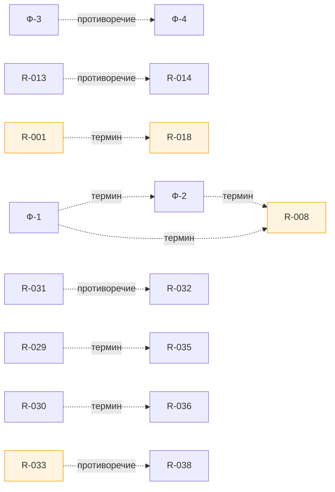

# Отчёт о проверке требований: Уведомление о расходах по карте

> 🔎 **Аудит цитат (проверено кодом):** цитат в замечаниях — 94, подтверждено в тексте документа — **94** (дословно 94, с пропусками «…» 0), не найдено — 0; отброшено как выдуманные моделью — 1. Учтено строк документа: 152 из 152.

<!-- reqlens:summary:start -->

**Итог за 30 секунд**

| Разработка | Тестирование | 🔴 Критичных | 🟠 Существенных | 🟡 Незначительных |
|---|---|---|---|---|
| ❌ нельзя | ❌ нельзя | 6 | 59 | 8 |

**Что исправить первым:**

1. 🔴 [S-01](#s-01) — Метод объявлен как GET («REST type \| GET»), но выполняет изменение данных («Сохранение») *Пример:* «Система должна предоставлять REST API метод типа POST для сохранения порога.»
2. 🔴 [S-02](#s-02) — В разделе успешного ответа 200 приведён пример с ошибкой ({"result":"ERROR","message":"Проверьте сумму"}), а для неверных параметров описан… *Пример:* «Если параметры запроса не соответствуют ограничениям формата или диапазона, то система должна возвращать код ответа 400.»
3. 🔴 [S-03](#s-03) — В спецификации API описан только метод изменения данных (/alerts/saveLimit), а метода чтения нет *Пример:* «Система должна принимать запросы по пути /alerts/saveLimit для окружений Dev и Prod.»
4. 🔴 [S-04](#s-04) — Расчёт строится на событиях внешней системы, но контракт события не описан: нет состава полей (карта, операция, тип операции, сумма и… *Пример:* «Когда сервис получает событие, система должна передать push на отправку в течение 1 минуты.»
5. 🔴 [S-05](#s-05) — Ф-3 ограничивает частоту («максимум один такой push за календарный месяц»), а Ф-4 требует отправки «независимо от истории» *Пример:* «Когда расходы переходят от суммы ниже порога к сумме, равной порогу или выше, система должна отправить клиенту push-уведомление, но не более одного раза на карту за календарный месяц.»
6. 🔴 [S-06](#s-06) — Для продуктивной среды не указано значение («Prod: —») — реализацию нельзя развернуть и проверить в Prod. *Пример:* «Система должна принимать запросы по пути /alerts/saveLimit для окружений Dev и Prod.»
7. 🟠 [S-12](#s-12), [S-14](#s-14), [S-15](#s-15), [S-16](#s-16) … — Полнота набора: замечаний — 17
8. 🟠 [S-07](#s-07), [S-08](#s-08), [S-09](#s-09), [S-10](#s-10) … — Непротиворечивость: замечаний — 12

Подробности: разделы 3–4 (разбор по каждому требованию и набору), раздел 6 (итог и план), приложения.

<!-- reqlens:summary:end -->

## 1. Паспорт прогона

| Параметр | Значение |
|---|---|
| Документ | Уведомление о расходах по карте |
| Файл | `bench/real/notifications.md` (MD) |
| SHA-256 файла | `e7dae55e5453a250…` |
| Дата и время прогона | 2026-11-26 19:45:00 UTC |
| Модель | gemini / gemini-3.1-flash-lite |
| Переключения модели | gemini-3.5-flash-lite → gemini-3.1-flash-lite (квота: HTTP 429) |
| Версия агента | v8.0.0, коммит a636a67 (v3.0.3-58-ga636a67) |
| Обращений к модели | 33 (повторов: 3) |
| Подлинность прогона | ✅ свежий прогон: все 33 ответов модели получены сейчас; ✅ код агента — чистый коммит `a636a67` |
| Профиль / режим | deep / облачная модель |
| Контекст запросов | полный текст · ≈3800 токенов на запрос (документ 8434 симв.) |
| База знаний (RAG) | 33 фрагментов · поиск: BM25 · основания у 73 замечаний |
| Критик-агент | включён |
| **Балл документа** | **59 / 100** `██████░░░░ 59` |
| **Готовность к разработке** | **5 %** `░░░░░░░░░░ 5` |
| Токены (вход / выход) | 180650 / 42923 |
| Длительность | 202 с |
| Способ нарезки | по идентификаторам документа |
| Отброшено неподтверждённых цитат модели | 1 |
| Учтено строк документа | 152 из 152 (100 %) — в требованиях или исключены с причиной |
| Аудит цитат | 94 из 94 подтверждены в документе (100 %), отброшено выдуманных — 1 |
| Самопроверка | предложено 116, подтверждено 73, отклонено критиком 42, без подтверждённой цитаты 1 |
| Критерии | ISO/IEC/IEEE 29148:2018 п. 5.2.5, 5.2.6; IEEE Std 830-1998 п. 4.3 |

Обозначения серьёзности: 🔴 критичный — требование непроверяемо, противоречиво или неполно настолько, что реализация и тестирование невозможны; 🟠 существенный; 🟡 незначительный. Источник «LLM» — замечание модели с проверенной цитатой; «правило» — словарный пред-фильтр агента.

## 2. Нарезка требований

| ID в отчёте | ID в документе | Вид | Место в документе | Краткая формулировка |
|---|---|---|---|---|
| R-001 | — (присвоен агентом) | требование | раздел «Дизайн процесса UI», строка 29 | Карты → Расходы → Уведомления. На экране видны переключатель, поле «Порог, ₸», сумма за месяц и кнопка «Сохранить». При ошибке ввода сооб… |
| R-002 | Ф-1 | требование | раздел «Функциональные требования», строка 37 | Держатель активной карты KZT задаёт целый порог от 1 000 до 1 000 000 ₸ включительно. По умолчанию уведомление выключено. |
| R-003 | Ф-2 | требование | раздел «Функциональные требования», строка 38 | Месяц определяется по дате совершения покупки в Алматы. В расходы входят проведённые покупки. Возврат уменьшает расходы месяца исходной п… |
| R-004 | Ф-3 | требование | раздел «Функциональные требования», строка 39 | Когда расходы переходят от суммы ниже порога к сумме, равной порогу или выше, клиент получает push. На карту приходится максимум один так… |
| R-005 | Ф-4 | требование | раздел «Функциональные требования», строка 40 | При изменении порога накопленная сумма сохраняется. Если она ниже нового порога, следующее достижение вызывает push независимо от истории… |
| R-006 | — (присвоен агентом) | требование | раздел «Нефункциональные требования», строка 46 | Сервис передаёт push на отправку в течение минуты после получения события. |
| R-007 | — (присвоен агентом) | требование | раздел «Требования к данным», строка 49 | Хранить идентификатор карты, месяц, идентификатор операции, сумму покупки в тиынах, признак отправки и порог в тенге. |
| R-008 | — (присвоен агентом) | требование | раздел «Требования к интеграции», строка 52 | Приложение читает и сохраняет настройки через дочерний документ «Уведомление о расходах по карте — REST API». Повторная доставка одного с… |
| R-009 | — (присвоен агентом) | незаполненное место | раздел «Тестирование требований», строка 57 | заполняются тестировщиками |
| R-010 | — (присвоен агентом) | критерий приёмки | раздел «Критерии приемки», строка 63 | Расходы 48 500 ₸, порог 50 000 ₸ \| Провести покупку на 1 500 ₸ \| Итог 50 000 ₸ и один push |
| R-011 | — (присвоен агентом) | критерий приёмки | раздел «Критерии приемки», строка 64 | Покупка 31 января в 23:58 на 4 000 ₸ \| Провести 1 февраля в 00:03 по Алматы \| Февральский счётчик вырос на 4 000 ₸ |
| R-012 | — (присвоен агентом) | критерий приёмки | раздел «Критерии приемки», строка 65 | Расходы 19 900 ₸, порог 20 000 ₸ \| Перевести 500 ₸ \| Счётчик показывает 19 900 ₸ |
| R-013 | — (присвоен агентом) | элемент спецификации API | раздел «Общие параметры», строка 103 | Description \| Сохранение порога. Функциональные требования: чтение порога |
| R-014 | — (присвоен агентом) | элемент спецификации API | раздел «Общие параметры», строка 104 | REST type \| GET |
| R-015 | — (присвоен агентом) | элемент спецификации API | раздел «Общие параметры», строка 105 | Authorization \| Bearer, сессия владельца карты |
| R-016 | — (присвоен агентом) | элемент спецификации API | раздел «Общие параметры», строка 107 | URL type \| Dev / Prod |
| R-017 | — (присвоен агентом) | элемент спецификации API | раздел «Общие параметры», строка 108 | Request URL \| Dev: /alerts/saveLimit . Prod: — |
| R-018 | — (присвоен агентом) | элемент спецификации API | раздел «Общие параметры», строка 109 | CURL \| curl -G "$BASE/alerts/saveLimit" -H "Authorization: Bearer $TOKEN" --data 'cardId=demo-42&amount=50000&enabled=1' |
| R-019 | — (присвоен агентом) | требование | раздел «Логика работы метода», строка 117 | Проверить пользовательскую сессию. |
| R-020 | — (присвоен агентом) | требование | раздел «Логика работы метода», строка 118 | Проверить принадлежность карты клиенту. |
| R-021 | — (присвоен агентом) | требование | раздел «Логика работы метода», строка 119 | Проверить сумму и переключатель. |
| R-022 | — (присвоен агентом) | требование | раздел «Логика работы метода», строка 120 | Заменить настройку и вернуть результат сохранения. |
| R-023 | — (присвоен агентом) | требование | раздел «Логика работы метода», строка 121 | При отклонении суммы вернуть прежнее состояние и результат ERROR. |
| R-024 | — (присвоен агентом) | требование | раздел «Особые правила», строка 124 | Целое число тенге, обе границы включены. |
| R-025 | — (присвоен агентом) | требование | раздел «Особые правила», строка 125 | Повторное сохранение заменяет действующую настройку. |
| R-026 | — (присвоен агентом) | требование | раздел «Особые правила», строка 126 | Изменение порога сохраняет накопленные расходы. |
| R-027 | — (присвоен агентом) | элемент спецификации API | раздел «Path-параметры», строка 136 | Не используются. |
| R-028 | — (присвоен агентом) | элемент спецификации API | раздел «Query-параметры», строка 142 | cardId \| string \| 1–64 \| Да \| Карта клиента \| Идентификатор карты \| card_id |
| R-029 | — (присвоен агентом) | элемент спецификации API | раздел «Query-параметры», строка 143 | amount \| integer \| 32 bit \| Да \| 1 000–1 000 000 \| Порог в тенге \| limit_kzt |
| R-030 | — (присвоен агентом) | элемент спецификации API | раздел «Query-параметры», строка 144 | enabled \| integer \| 1 знак \| Да \| 0 или 1 \| Признак включения \| enabled |
| R-031 | — (присвоен агентом) | элемент спецификации API | раздел «Request body», строка 147 | Content-Type: application/json . |
| R-032 | — (присвоен агентом) | элемент спецификации API | раздел «Request body», строка 148 | Тело не используется. |
| R-033 | — (присвоен агентом) | элемент спецификации API | раздел «Ответ», строка 151 | Если результат 200 или 201 — успешный. Если результат 400, 401 и далее — неуспешный. |
| R-034 | — (присвоен агентом) | элемент спецификации API | раздел «Ответ», строка 155 | result \| string \| OK / ERROR \| Исход сохранения \| — |
| R-035 | — (присвоен агентом) | элемент спецификации API | раздел «Ответ», строка 156 | amount \| string \| При успехе \| Порог в тенге \| limit_kzt |
| R-036 | — (присвоен агентом) | элемент спецификации API | раздел «Ответ», строка 157 | enabled \| string \| «0» или «1» \| Признак включения \| enabled |
| R-037 | — (присвоен агентом) | элемент спецификации API | раздел «Ответ», строка 158 | message \| string \| При ошибке \| Описание ошибки \| — |
| R-038 | — (присвоен агентом) | элемент спецификации API | раздел «Статусы», строка 162 | 200. Ответ в случае успешного выполнения метода. |
| R-039 | — (присвоен агентом) | элемент спецификации API | раздел «Статусы», строка 163 | 400. Ответ в случае, если параметры запроса заполнены неверно. |
| R-040 | — (присвоен агентом) | элемент спецификации API | раздел «200. Successful — Created», строка 174 | 401. Ответ в случае, если запрос выполнен без необходимой авторизации. |
| R-041 | — (присвоен агентом) | элемент спецификации API | раздел «200. Successful — Created», строка 175 | 403. Ответ в случае, если на указанный ресурс доступ запрещен. |
| R-042 | — (присвоен агентом) | элемент спецификации API | раздел «200. Successful — Created», строка 176 | 500. Ответ в случае, если произошла внутренняя ошибка сервера. |
| R-043 | — (присвоен агентом) | элемент спецификации API | раздел «403. Unsuccessful — Forbidden», строка 189 | Для чужой карты возвращается 404, как и для отсутствующей карты. |

Всего выделено требований: **16**. Кроме них проверены 1 незаполненное место, 3 строки критериев приёмки, 23 элемента спецификации API — они не считаются требованиями (не входят в число требований и готовность), но замечания к ним в отчёте есть.

## 3. Проверка каждого требования

Подробный разбор — у требований с критичными и существенными замечаниями (12). Требования только с мелкими замечаниями (2) — в таблице ниже, без замечаний (29) — списком. Полный текст каждого требования приведён один раз — в его разборе; приёмочные тесты — в приложении «Тест-пробы».

<a id="r-001"></a>

### R-001 — 🟠 требует доработки

*Место:* раздел «Дизайн процесса UI», строка 29 · *Балл:* `███████░░░ 70` · *Тип (EARS):* постоянное

> Карты → Расходы → Уведомления. На экране видны переключатель, поле «Порог, ₸», сумма за месяц и кнопка «Сохранить». При ошибке ввода сообщение появляется под полем.

| № | Критерий | Цитата | Проблема | Серьёзность | Как исправить | Источник |
|---|---|---|---|---|---|---|
| 1 | Однозначность | «При ошибке ввода сообщение появляется под полем.» | Не указан текст или условие возникновения ошибки ввода. | 🟠 Существенный | Система должна выводить текст ошибки под полем «Порог, ₸», если введённое значение выходит за диапазон от 1 000 до 1 000 000 ₸. | LLM ×2 |
| 2 | Проверяемость | «При ошибке ввода сообщение появляется под полем.» | Тест составить невозможно: Не определены конкретные тексты ошибок и точные условия их появления для проверки. | 🟠 Существенный | Переформулировать так, чтобы появился объективный критерий приёмки (число, условие, ожидаемый результат). | тест-проба |

**Основание:** стандарт: 29148 §5.2.5 c) Однозначность (`kb/standards/iso29148_ieee830.md`); норма РК, пересказ: Закон РК «О платежах и платёжных системах» — информирование и безопасность (`kb/law_kz/fintech_norms.md`); стандарт: 29148 §5.2.5 g) Проверяемость (`kb/standards/iso29148_ieee830.md`)

**Предлагаемая формулировка:** Система должна отображать на экране настроек переключатель, поле «Порог, ₸», сумму за месяц и кнопку «Сохранить».

*Шаблон из базы знаний (Порог и пересечение порога, `kb/patterns/fintech_ears.md`):* Шаблон: Когда накопленная сумма за период переходит от значения ниже порога к значению, равному порогу или выше, система должна выполнить <действие>; изменение порога внутри периода должно <правило> для уже отправленных уведомлений.

🧪 **Тест-проба: тест составить невозможно** — Не определены конкретные тексты ошибок и точные условия их появления для проверки. Мешает фрагмент: «При ошибке ввода сообщение появляется под полем.».

<a id="r-007"></a>

### R-007 — 🟠 требует доработки

*Место:* раздел «Требования к данным», строка 49 · *Балл:* `███████░░░ 70` · *Тип (EARS):* постоянное

> Хранить идентификатор карты, месяц, идентификатор операции, сумму покупки в тиынах, признак отправки и порог в тенге.

| № | Критерий | Цитата | Проблема | Серьёзность | Как исправить | Источник |
|---|---|---|---|---|---|---|
| 1 | Полнота | «сумму покупки в тиынах, признак отправки и порог в тенге» | Не указаны типы данных, размеры полей и требования к обязательности для каждого атрибута модели данных. | 🟠 Существенный | Уточнить типы данных и ограничения для каждого сохраняемого поля согласно модели данных. | LLM ×2 |
| 2 | Проверяемость | «Хранить идентификатор карты, месяц, идентификатор операции» | Тест составить невозможно: Требование описывает общую модель данных без указания конкретных условий сохранения и операций записи, что исключает возможность написания однозначного приёмочного теста. | 🟠 Существенный | Переформулировать так, чтобы появился объективный критерий приёмки (число, условие, ожидаемый результат). | тест-проба |

**Основание:** стандарт: 29148 §5.2.5 d) Полнота (`kb/standards/iso29148_ieee830.md`); норма РК, пересказ: Закон РК «О банках и банковской деятельности» — банковская тайна (`kb/law_kz/fintech_norms.md`); стандарт: 29148 §5.2.5 g) Проверяемость (`kb/standards/iso29148_ieee830.md`)

**Предлагаемая формулировка:** Система должна хранить идентификатор карты, месяц, идентификатор операции, сумму покупки в тиынах, признак отправки и порог в тенге.

*Шаблон из базы знаний (Хранение и удаление данных, `kb/patterns/fintech_ears.md`):* Шаблон: Система должна хранить <данные> в <единицах> не более <срок> и удалять их по истечении срока.

🧪 **Тест-проба: тест составить невозможно** — Требование описывает общую модель данных без указания конкретных условий сохранения и операций записи, что исключает возможность написания однозначного приёмочного теста. Мешает фрагмент: «Хранить идентификатор карты, месяц, идентификатор операции».

<a id="r-008"></a>

### R-008 — 🟠 требует доработки

*Место:* раздел «Требования к интеграции», строка 52 · *Балл:* `████████░░ 85` · *Тип (EARS):* составное

> Приложение читает и сохраняет настройки через дочерний документ «Уведомление о расходах по карте — REST API». Повторная доставка одного события процессинга сохраняет исходный итог.

| № | Критерий | Цитата | Проблема | Серьёзность | Как исправить | Источник |
|---|---|---|---|---|---|---|
| 1 | Единичность (атомарность) | «Приложение читает и сохраняет настройки через дочерний документ «Уведомление о расходах по карте — REST API». Повторная доставка одного события процессинга сохраняет исходный итог.» | Требование объединяет две разные логические операции: чтение/сохранение настроек через REST API и обработку идемпотентности событий процессинга. | 🟠 Существенный | Разделить на два атомарных требования: одно для работы приложения с REST API, второе для идемпотентности обработки событий процессинга. | LLM ×2 |

**Основание:** стандарт: 29148 §5.2.5 e) Единичность (`kb/standards/iso29148_ieee830.md`)

**Предлагаемая формулировка:** Система должна обеспечивать чтение и сохранение настроек через REST API, а при повторной доставке одного события процессинга сохранять исходный итог.

*Шаблон из базы знаний (Метод REST API, меняющий состояние, `kb/patterns/fintech_ears.md`):* Шаблон: Метод <назначение> должен использовать <POST \| PUT> на <URL>; параметры передаются в теле <формат>; ответы: <код> — <смысл> для каждого исхода, включая ошибки валидации и чужой ресурс.

<a id="r-018"></a>

### R-018 — 🟠 требует доработки

*Место:* раздел «Общие параметры», строка 109 · *Балл:* `████████░░ 85` · *Тип (EARS):* постоянное

> CURL \| curl -G "$BASE/alerts/saveLimit" -H "Authorization: Bearer $TOKEN" --data 'cardId=demo-42&amount=50000&enabled=1'

| № | Критерий | Цитата | Проблема | Серьёзность | Как исправить | Источник |
|---|---|---|---|---|---|---|
| 1 | Корректность | «CURL \| curl -G "$BASE/alerts/saveLimit" -H "Authorization: Bearer $TOKEN" --data 'cardId=demo-42&amount=50000&enabled=1'» | Пример CURL использует метод GET с передачей параметров через --data (что транслируется в query-параметры), что согласуется с текущим REST type GET, но противоречит семантике сохранения данных. | 🟠 Существенный | Исправить пример CURL на использование метода POST или PUT с JSON-телом, если тип REST будет изменен. | LLM ×2 |

**Основание:** стандарт: 29148 §5.2.5 h) Корректность (`kb/standards/iso29148_ieee830.md`); норма РК, пересказ: Закон РК «О персональных данных и их защите» — согласие (`kb/law_kz/fintech_norms.md`)

**Предлагаемая формулировка:** Система должна обрабатывать вызов согласно примеру CURL для сохранения порога.

<a id="r-019"></a>

### R-019 — 🟠 требует доработки

*Место:* раздел «Логика работы метода», строка 117 · *Балл:* `███████░░░ 70` · *Тип (EARS):* постоянное

> Проверить пользовательскую сессию.

| № | Критерий | Цитата | Проблема | Серьёзность | Как исправить | Источник |
|---|---|---|---|---|---|---|
| 1 | Полнота | «Проверить пользовательскую сессию.» | Требование не содержит описания реакции системы при недействительной или истекшей сессии (какой код ответа или сообщение должен возвращаться). | 🟠 Существенный | Система должна проверять пользовательскую сессию, и при её отсутствии или истечении возвращать код ответа 401 Unauthorized. | LLM ×2 |
| 2 | Проверяемость | «Проверить пользовательскую сессию.» | Тест составить невозможно: Не указано, какой именно ответ или ошибка должны возвращаться при провале проверки сессии. | 🟠 Существенный | Переформулировать так, чтобы появился объективный критерий приёмки (число, условие, ожидаемый результат). | тест-проба |

**Основание:** стандарт: 29148 §5.2.5 d) Полнота (`kb/standards/iso29148_ieee830.md`); стандарт: 29148 §5.2.5 g) Проверяемость (`kb/standards/iso29148_ieee830.md`)

**Предлагаемая формулировка:** Система должна проверять пользовательскую сессию.

🧪 **Тест-проба: тест составить невозможно** — Не указано, какой именно ответ или ошибка должны возвращаться при провале проверки сессии. Мешает фрагмент: «Проверить пользовательскую сессию.».

<a id="r-020"></a>

### R-020 — 🟠 требует доработки

*Место:* раздел «Логика работы метода», строка 118 · *Балл:* `███████░░░ 70` · *Тип (EARS):* постоянное

> Проверить принадлежность карты клиенту.

| № | Критерий | Цитата | Проблема | Серьёзность | Как исправить | Источник |
|---|---|---|---|---|---|---|
| 1 | Полнота | «Проверить принадлежность карты клиенту.» | Отсутствует указание на то, какой именно статус-код или ошибку возвращает система, если карта не принадлежит клиенту (в других разделах указано про 404, но здесь правило неполное). | 🟠 Существенный | Система должна проверять принадлежность карты клиенту, и при её отсутствии или чужой принадлежности возвращать код 404 с сообщением «Карта не найдена». | LLM ×2 |
| 2 | Проверяемость | «Проверить принадлежность карты клиенту.» | Тест составить невозможно: Не определены критерии и реакция на ошибку при нарушении проверки принадлежности карты. | 🟠 Существенный | Переформулировать так, чтобы появился объективный критерий приёмки (число, условие, ожидаемый результат). | тест-проба |

**Основание:** стандарт: 29148 §5.2.5 d) Полнота (`kb/standards/iso29148_ieee830.md`); норма РК, пересказ: Закон РК «О банках и банковской деятельности» — банковская тайна (`kb/law_kz/fintech_norms.md`); стандарт: 29148 §5.2.5 g) Проверяемость (`kb/standards/iso29148_ieee830.md`); норма РК, пересказ: Требования к информационной безопасности банков — аутентификация и журналирование (`kb/law_kz/fintech_norms.md`)

**Предлагаемая формулировка:** Система должна проверять принадлежность карты клиенту.

🧪 **Тест-проба: тест составить невозможно** — Не определены критерии и реакция на ошибку при нарушении проверки принадлежности карты. Мешает фрагмент: «Проверить принадлежность карты клиенту.».

<a id="r-021"></a>

### R-021 — 🟠 требует доработки

*Место:* раздел «Логика работы метода», строка 119 · *Балл:* `███████░░░ 70` · *Тип (EARS):* постоянное

> Проверить сумму и переключатель.

| № | Критерий | Цитата | Проблема | Серьёзность | Как исправить | Источник |
|---|---|---|---|---|---|---|
| 1 | Однозначность | «Проверить сумму и переключатель.» | Формулировка слишком общая («проверить»), не указаны конкретные допустимые диапазоны для суммы (от 1 000 до 1 000 000) и значения для переключателя (0 или 1). | 🟠 Существенный | Система должна проверять сумму в диапазоне от 1000 до 1000000 тенге и значение переключателя 0 или 1. | LLM ×2 |
| 2 | Проверяемость | «Проверить сумму и переключатель.» | Тест составить невозможно: Правила проверки суммы и переключателя не детализированы в самом требовании (нет диапазонов и допустимых значений). | 🟠 Существенный | Переформулировать так, чтобы появился объективный критерий приёмки (число, условие, ожидаемый результат). | тест-проба |

**Основание:** стандарт: 29148 §5.2.5 c) Однозначность (`kb/standards/iso29148_ieee830.md`); стандарт: 29148 §5.2.5 g) Проверяемость (`kb/standards/iso29148_ieee830.md`)

**Предлагаемая формулировка:** Система должна проверять сумму и переключатель.

🧪 **Тест-проба: тест составить невозможно** — Правила проверки суммы и переключателя не детализированы в самом требовании (нет диапазонов и допустимых значений). Мешает фрагмент: «Проверить сумму и переключатель.».

<a id="r-022"></a>

### R-022 — 🟠 требует доработки

*Место:* раздел «Логика работы метода», строка 120 · *Балл:* `███████░░░ 70` · *Тип (EARS):* постоянное

> Заменить настройку и вернуть результат сохранения.

| № | Критерий | Цитата | Проблема | Серьёзность | Как исправить | Источник |
|---|---|---|---|---|---|---|
| 1 | Полнота | «Заменить настройку и вернуть результат сохранения.» | Не указаны конкретные поля и формат успешного ответа (например, JSON с результатами OK, amount, enabled). | 🟠 Существенный | Система должна заменять настройку и возвращать результат сохранения в формате JSON со статусом OK. | LLM ×2 |
| 2 | Проверяемость | «Заменить настройку и вернуть результат сохранения.» | Тест составить невозможно: Не описана структура и состав возвращаемого результата сохранения. | 🟠 Существенный | Переформулировать так, чтобы появился объективный критерий приёмки (число, условие, ожидаемый результат). | тест-проба |

**Основание:** стандарт: 29148 §5.2.5 d) Полнота (`kb/standards/iso29148_ieee830.md`); стандарт: 29148 §5.2.5 g) Проверяемость (`kb/standards/iso29148_ieee830.md`)

**Предлагаемая формулировка:** Система должна заменять настройку и возвращать результат сохранения.

*Шаблон из базы знаний (Метод REST API, меняющий состояние, `kb/patterns/fintech_ears.md`):* Шаблон: Метод <назначение> должен использовать <POST \| PUT> на <URL>; параметры передаются в теле <формат>; ответы: <код> — <смысл> для каждого исхода, включая ошибки валидации и чужой ресурс.

🧪 **Тест-проба: тест составить невозможно** — Не описана структура и состав возвращаемого результата сохранения. Мешает фрагмент: «Заменить настройку и вернуть результат сохранения.».

<a id="r-024"></a>

### R-024 — 🟠 требует доработки

*Место:* раздел «Особые правила», строка 124 · *Балл:* `███████░░░ 70` · *Тип (EARS):* постоянное

> Целое число тенге, обе границы включены.

| № | Критерий | Цитата | Проблема | Серьёзность | Как исправить | Источник |
|---|---|---|---|---|---|---|
| 1 | Полнота | «Целое число тенге, обе границы включены.» | Требование неполное: не указано, к какому параметру или полю относится данное ограничение, и каковы сами числовые границы. | 🟠 Существенный | Система должна принимать порог расходов как целое число тенге в диапазоне от 1 000 до 1 000 000 включительно. | LLM ×2 |
| 2 | Проверяемость | «Целое число тенге, обе границы включены.» | Тест составить невозможно: В тексте требования отсутствуют конкретные числовые границы и указание на то, к какому параметру применяются правила. | 🟠 Существенный | Переформулировать так, чтобы появился объективный критерий приёмки (число, условие, ожидаемый результат). | тест-проба |

**Основание:** стандарт: 29148 §5.2.5 d) Полнота (`kb/standards/iso29148_ieee830.md`); стандарт: 29148 §5.2.5 g) Проверяемость (`kb/standards/iso29148_ieee830.md`)

**Предлагаемая формулировка:** Система должна обрабатывать сумму как целое число тенге в диапазоне от 1 000 до 1 000 000 включительно.

🧪 **Тест-проба: тест составить невозможно** — В тексте требования отсутствуют конкретные числовые границы и указание на то, к какому параметру применяются правила. Мешает фрагмент: «Целое число тенге, обе границы включены.».

<a id="r-025"></a>

### R-025 — 🟠 требует доработки

*Место:* раздел «Особые правила», строка 125 · *Балл:* `████████░░ 85` · *Тип (EARS):* постоянное

> Повторное сохранение заменяет действующую настройку.

| № | Критерий | Цитата | Проблема | Серьёзность | Как исправить | Источник |
|---|---|---|---|---|---|---|
| 1 | Проверяемость | «Повторное сохранение заменяет действующую настройку.» | Не указаны критерии успешности проверки замены настройки (например, возвращаемый статус 200 и обновленные данные в хранилище). | 🟠 Существенный | Система должна заменять действующую настройку при повторном сохранении и возвращать HTTP-статус 200 с актуальными параметрами. | LLM ×2 |

**Основание:** стандарт: 29148 §5.2.5 g) Проверяемость (`kb/standards/iso29148_ieee830.md`); норма РК, пересказ: Требования к информационной безопасности банков — аутентификация и журналирование (`kb/law_kz/fintech_norms.md`)

**Предлагаемая формулировка:** Система должна заменять действующую настройку при повторном сохранении.

<a id="r-033"></a>

### R-033 — 🟠 требует доработки

*Место:* раздел «Ответ», строка 151 · *Балл:* `████████░░ 80` · *Тип (EARS):* постоянное

> Если результат 200 или 201 — успешный. Если результат 400, 401 и далее — неуспешный.

| № | Критерий | Цитата | Проблема | Серьёзность | Как исправить | Источник |
|---|---|---|---|---|---|---|
| 1 | Корректность | «Если результат 200 или 201 — успешный.» | В документации REST API для данного метода задекларирован только код 200 (а также ошибки 400, 401, 403, 500). Код 201 (Created) не используется для метода GET сохранения настроек, так как ресурс не создается заново с генерацией URI, а обновляется существующий. | 🟠 Существенный | Система должна возвращать HTTP-код 200 в случае успешного выполнения метода. | LLM ×2 |
| 2 | Однозначность | «400, 401 и далее — неуспешный» | Формулировка «и далее» является размытой и допускает неоднозначное толкование диапазона кодов ошибок (например, 5xx, 4xx). | 🟡 Незначительный | Система должна возвращать HTTP-коды 400, 401, 403 или 500 в случае неуспешного выполнения запроса. | LLM ×2 |

**Основание:** стандарт: 29148 §5.2.5 h) Корректность (`kb/standards/iso29148_ieee830.md`); стандарт: 29148 §5.2.5 c) Однозначность (`kb/standards/iso29148_ieee830.md`)

**Предлагаемая формулировка:** Система должна возвращать HTTP-код 200 при успешном выполнении и коды 400, 401, 403, 500 при неуспешном выполнении запроса.

*Шаблон из базы знаний (Метод REST API, меняющий состояние, `kb/patterns/fintech_ears.md`):* Шаблон: Метод <назначение> должен использовать <POST \| PUT> на <URL>; параметры передаются в теле <формат>; ответы: <код> — <смысл> для каждого исхода, включая ошибки валидации и чужой ресурс.

<a id="r-043"></a>

### R-043 — 🟠 требует доработки

*Место:* раздел «403. Unsuccessful — Forbidden», строка 189 · *Балл:* `████████░░ 85` · *Тип (EARS):* постоянное

> Для чужой карты возвращается 404, как и для отсутствующей карты.

| № | Критерий | Цитата | Проблема | Серьёзность | Как исправить | Источник |
|---|---|---|---|---|---|---|
| 1 | Корректность | «Для чужой карты возвращается 404, как и для отсутствующей карты.» | Требование по безопасности предписывает возвращать код 404 (Not Found) при попытке доступа к чужой карте вместо стандартного для авторизации/доступа кода 403 (Forbidden), указанного в заголовке раздела. Это противоречит стандарту HTTP (в котором 403 означает Forbidden, а 404 — Not Found), хотя является допустимой практикой маскировки существования ресурсов в целях безопасности, но в данном контексте вступает в прямое противоречие с заголовком секции '403. Unsuccessful — Forbidden'. | 🟠 Существенный | Система должна возвращать статус 404 Not Found для чужой или отсутствующей карты в целях безопасности, перенеся данное описание в соответствующий подраздел статуса 404. | LLM ×2 |

**Основание:** стандарт: 29148 §5.2.5 h) Корректность (`kb/standards/iso29148_ieee830.md`); норма РК, пересказ: Закон РК «О банках и банковской деятельности» — банковская тайна (`kb/law_kz/fintech_norms.md`)

**Предлагаемая формулировка:** Система должна возвращать HTTP-статус 404 с сообщением «Карта не найдена» при запросе данных чужой или отсутствующей карты.

### Требования с мелкими замечаниями

| Требование | Критерий | Цитата | Проблема | Как исправить | Источник |
|---|---|---|---|---|---|
| <a id="r-003"></a>R-003 (Ф-2) | Единичность (атомарность) | «Месяц определяется по дате совершения покупки в Алматы. В расходы входят проведённые покупки. Возврат уменьшает расходы месяца исходной покупки. Переводы и снятие наличных исключаются.» | Требование содержит несколько несвязанных правил: определение месяца, состав расходов, учет возвратов и исключение операций. | Разделить правила расчёта расходов на отдельные атомарные требования. | LLM ×2 |
| <a id="r-037"></a>R-037 | Полнота | «message \| string \| При ошибке \| Описание ошибки \| —» | Параметр ответа описан слишком абстрактно, не указаны возможные значения или коды возможных ошибок. | Система должна возвращать текстовое описание ошибки в поле message при неуспешном результате. | LLM ×2 |

### Требования без замечаний

<a id="r-002"></a>R-002 (Ф-1), <a id="r-004"></a>R-004 (Ф-3), <a id="r-005"></a>R-005 (Ф-4), <a id="r-006"></a>R-006, <a id="r-009"></a>R-009, <a id="r-010"></a>R-010, <a id="r-011"></a>R-011, <a id="r-012"></a>R-012, <a id="r-013"></a>R-013, <a id="r-014"></a>R-014, <a id="r-015"></a>R-015, <a id="r-016"></a>R-016, <a id="r-017"></a>R-017, <a id="r-023"></a>R-023, <a id="r-026"></a>R-026, <a id="r-027"></a>R-027, <a id="r-028"></a>R-028, <a id="r-029"></a>R-029, <a id="r-030"></a>R-030, <a id="r-031"></a>R-031, <a id="r-032"></a>R-032, <a id="r-034"></a>R-034, <a id="r-035"></a>R-035, <a id="r-036"></a>R-036, <a id="r-038"></a>R-038, <a id="r-039"></a>R-039, <a id="r-040"></a>R-040, <a id="r-041"></a>R-041, <a id="r-042"></a>R-042 — нарушений критериев не найдено (проверены моделью и правилами).

## 4. Проверка набора требований

| Критерий набора | Источник | Замечаний | Статус |
|---|---|---|---|
| Полнота набора | 29148 §5.2.6 a) Complete; IEEE 830 §4.3.3 | 23 | 🔴 критичный |
| Непротиворечивость | 29148 §5.2.6 b) Consistent; IEEE 830 §4.3.4 | 16 | 🔴 критичный |
| Реализуемость набора | 29148 §5.2.6 c) Feasible | 0 | ✅ нарушений не найдено |
| Понятность | 29148 §5.2.6 d) Comprehensible | 7 | 🟠 существенный |
| Возможность валидации | 29148 §5.2.6 e) Able to be validated | 4 | 🟠 существенный |
| Ранжирование по важности | IEEE 830 §4.3.5 Ranked for importance and/or stability | 1 | 🟠 существенный |
| Модифицируемость | IEEE 830 §4.3.7 Modifiable | 0 | ✅ нарушений не найдено |
| Трассируемость | IEEE 830 §4.3.8 Traceable | 0 | ✅ нарушений не найдено |

<a id="s-01"></a>

#### S-01. Противоречие — 🔴 Критичный (Непротиворечивость; 29148 §5.2.6 b) Consistent; IEEE 830 §4.3.4)

- R-014, раздел «Общие параметры», строка 104: «REST type \| GET»
- R-013, раздел «Общие параметры», строка 103: «Description \| Сохранение порога. Функциональные»

**Проблема:** Метод объявлен как GET («REST type \| GET»), но выполняет изменение данных («Сохранение»). GET по смыслу безопасен и не меняет состояние: такие запросы кэшируются, повторяются браузером и прокси, параметры попадают в логи и историю — сохранение порога через GET приведёт к непредсказуемым изменениям. Также: Метод определен как GET (R-014), но выполняет модификацию (сохранение/замену) данных (R-022), что нарушает спецификацию REST и стандарты безопасности.

**Как исправить:** Использовать POST/PUT (например, PUT /alerts/limit), параметры передать в теле JSON; GET оставить только для чтения настройки.

**Основание:** стандарт: 29148 §5.2.6 b) Непротиворечивость (`kb/standards/iso29148_ieee830.md`); норма РК, пересказ: Закон РК «О платежах и платёжных системах» — информирование и безопасность (`kb/law_kz/fintech_norms.md`)


*Источник: правило+LLM*

<a id="s-02"></a>

#### S-02. Противоречие — 🔴 Критичный (Непротиворечивость; 29148 §5.2.6 b) Consistent; IEEE 830 §4.3.4)

- Текст документа: «{"result":"ERROR","message":"Проверьте сумму"}»
- R-039, раздел «Статусы», строка 163: «400. Ответ в случае, если параметры запроса заполнены неверн»

**Проблема:** В разделе успешного ответа 200 приведён пример с ошибкой ({"result":"ERROR","message":"Проверьте сумму"}), а для неверных параметров описан код 400. Непонятно, каким кодом сервис сообщает об отклонённой сумме — клиент может принять ошибку за успех.

**Как исправить:** Возвращать ошибку валидации суммы только кодом 400 с телом {"message": …}; в разделе 200 оставить только успешный ответ.

**Основание:** стандарт: 29148 §5.2.6 b) Непротиворечивость (`kb/standards/iso29148_ieee830.md`)


*Источник: правило*

<a id="s-03"></a>

#### S-03. Пропуск — 🔴 Критичный (Полнота набора; 29148 §5.2.6 a) Complete; IEEE 830 §4.3.3)

- R-017, раздел «Общие параметры», строка 108: «Request URL \| Dev: /alerts/saveLimit . Prod: —»
- R-001, раздел «Дизайн процесса UI», строка 29: «→ Расходы → Уведомления. На экране видны переключатель, поле «Порог, ₸», сумма за месяц и кнопка»
- Текст документа: «Сервис расходов → настройки: получить порог карты. Сервис расходов →»

**Проблема:** В спецификации API описан только метод изменения данных (/alerts/saveLimit), а метода чтения нет. При этом документ на чтение опирается: экран показывает текущие значения, интеграция «читает» настройки. Приложение не сможет показать сохранённый порог и сумму за месяц — функцию нельзя реализовать целиком. Также: В требованиях указано, что приложение читает настройки (R-008), а в описании API зафиксирован только метод сохранения/записи (R-013, R-014).

**Как исправить:** Добавить метод чтения (например, GET /alerts/limit?cardId=…): ответ — порог, признак включения, сумма расходов за текущий месяц; коды ответа и пример тела — как у метода сохранения.

**Основание:** стандарт: 29148 §5.2.6 a) Полнота набора (`kb/standards/iso29148_ieee830.md`); норма РК, пересказ: Требования к информационной безопасности банков — аутентификация и журналирование (`kb/law_kz/fintech_norms.md`)


*Источник: правило+LLM*

<a id="s-04"></a>

#### S-04. Пропуск — 🔴 Критичный (Полнота набора; 29148 §5.2.6 a) Complete; IEEE 830 §4.3.3)

- Текст документа: «→ сервис настроек. Карточный процессинг → учёт расходов → сервис»
- R-006, раздел «Нефункциональные требования», строка 46: «минуты после получения события.»
- R-008, раздел «Требования к интеграции», строка 52: «Повторная доставка одного события процессинга сохраняет»

**Проблема:** Расчёт строится на событиях внешней системы, но контракт события не описан: нет состава полей (карта, операция, тип операции, сумма и валюта, время с часовым поясом, ссылка на исходную операцию), нет перечня типов операций, хотя правила их различают («Возврат»), не заданы гарантии доставки, порядок и обработка дублей. Сервис нельзя реализовать однозначно, а интеграцию — протестировать. Также: Интеграция с процессингом построена на событиях о покупках, но отсутствуют спецификации формата входящих событий от процессинга (состав полей, типы операций, гарантии доставки и обработка дублей).

**Как исправить:** Описать контракт события: поля и типы, перечень типов операций (покупка, возврат, отмена, перевод, снятие), идентификатор для дедупликации, гарантию доставки (at-least-once), порядок и поведение при опоздавших событиях; пример сообщения.

**Основание:** стандарт: 29148 §5.2.6 a) Полнота набора (`kb/standards/iso29148_ieee830.md`); норма РК, пересказ: Закон РК «О платежах и платёжных системах» — информирование и безопасность (`kb/law_kz/fintech_norms.md`)


*Источник: правило+LLM*

<a id="s-05"></a>

#### S-05. Противоречие — 🔴 Критичный (Непротиворечивость; 29148 §5.2.6 b) Consistent; IEEE 830 §4.3.4)

- R-004 (Ф-3), раздел «Функциональные требования», строка 39: «push. На карту приходится максимум один такой push за календарный месяц.»
- R-005 (Ф-4), раздел «Функциональные требования», строка 40: «достижение вызывает push независимо от истории предыдущей настройки.»

**Проблема:** Ф-3 ограничивает частоту («максимум один такой push за календарный месяц»), а Ф-4 требует отправки «независимо от истории». Если оба условия выполняются в одном периоде (уведомление уже отправлено, затем изменён порог и он снова достигнут), Ф-3 запрещает второе уведомление, а Ф-4 его требует — какое правило главнее, не сказано. Реализация и ожидаемый результат теста зависят от толкования.

**Как исправить:** Явно задать приоритет: например, «При изменении порога признак отправки в текущем месяце сбрасывается; лимит Ф-3 считается от последнего изменения порога» — и добавить критерий приёмки на этот случай.

**Основание:** стандарт: 29148 §5.2.6 b) Непротиворечивость (`kb/standards/iso29148_ieee830.md`); норма РК, пересказ: Закон РК «О персональных данных и их защите» — согласие (`kb/law_kz/fintech_norms.md`)


*Источник: правило*

<a id="s-06"></a>

#### S-06. Пропуск — 🔴 Критичный (Полнота набора; 29148 §5.2.6 a) Complete; IEEE 830 §4.3.3)

- R-017, раздел «Общие параметры», строка 108: «\| Dev: /alerts/saveLimit . Prod: —»

**Проблема:** Для продуктивной среды не указано значение («Prod: —») — реализацию нельзя развернуть и проверить в Prod.

**Как исправить:** Указать значение для Prod (URL/параметр) или явно зафиксировать, когда и кем оно будет определено.

**Основание:** стандарт: 29148 §5.2.6 a) Полнота набора (`kb/standards/iso29148_ieee830.md`)


*Источник: правило*

<a id="s-07"></a>

#### S-07. Пропуск — 🟠 Существенный (Непротиворечивость; 29148 §5.2.6 b) Consistent; IEEE 830 §4.3.4)

- R-008, раздел «Требования к интеграции», строка 52: «Повторная доставка одного события процессинга сохраняет исходный итог.»

**Проблема:** Не определен механизм обеспечения идемпотентности при обработке событий от процессинга (отсутствует описание уникального ключа идемпотентности события), что при повторной доставке может привести к некорректному пересчету расходов.

**Как исправить:** Дописать требование: 'Для обеспечения идемпотентности сервис должен использовать уникальный идентификатор транзакции (transaction_id) из события процессинга. При получении события с уже обработанным transaction_id, сервис должен игнорировать его, сохраняя текущее состояние'.

**Основание:** стандарт: 29148 §5.2.6 b) Непротиворечивость (`kb/standards/iso29148_ieee830.md`); норма РК, пересказ: Закон РК «О платежах и платёжных системах» — информирование и безопасность (`kb/law_kz/fintech_norms.md`)


*Источник: LLM (узкий проход: интеграция и события)*

<a id="s-08"></a>

#### S-08. Терминология — 🟠 Существенный (Непротиворечивость; 29148 §5.2.6 b) Consistent; IEEE 830 §4.3.4)

- R-029, раздел «Query-параметры», строка 143: «amount \| integer \| 32 bit \| Да \| 1 000–1 000 000 \| Порог в т»
- R-035, раздел «Ответ», строка 156: «amount \| string \| При успехе \| Порог в тенге \| limit_kzt»

**Проблема:** Параметр «amount» описан с разными форматами: integer (Query-параметры) и string (Ответ). Клиент и сервер по-разному сериализуют значение — ошибки разбора и сравнения.

**Как исправить:** Задать единый формат «amount» во всех таблицах (например, integer) и пример ответа в том же формате.

**Основание:** стандарт: 29148 §5.2.6 b) Непротиворечивость (`kb/standards/iso29148_ieee830.md`)


*Источник: правило*

<a id="s-09"></a>

#### S-09. Терминология — 🟠 Существенный (Непротиворечивость; 29148 §5.2.6 b) Consistent; IEEE 830 §4.3.4)

- R-030, раздел «Query-параметры», строка 144: «enabled \| integer \| 1 знак \| Да \| 0 или 1 \| Признак включени»
- R-036, раздел «Ответ», строка 157: «enabled \| string \| «0» или «1» \| Признак включения \| enabled»

**Проблема:** Параметр «enabled» описан с разными форматами: integer (Query-параметры) и string (Ответ). Клиент и сервер по-разному сериализуют значение — ошибки разбора и сравнения.

**Как исправить:** Задать единый формат «enabled» во всех таблицах (например, integer) и пример ответа в том же формате.

**Основание:** стандарт: 29148 §5.2.6 b) Непротиворечивость (`kb/standards/iso29148_ieee830.md`)


*Источник: правило*

<a id="s-10"></a>

#### S-10. Противоречие — 🟠 Существенный (Непротиворечивость; 29148 §5.2.6 b) Consistent; IEEE 830 §4.3.4)

- R-043, раздел «403. Unsuccessful — Forbidden», строка 189: «Для чужой карты возвращается 404, как и для отсутствующей»

**Проблема:** Раздел ответа 403 («403. Unsuccessful — Forbidden») сообщает, что на самом деле возвращается 404. Описанный код 403 не используется, клиент не узнает, какой код обрабатывать.

**Как исправить:** Оставить один код для этого случая и описать его в перечне статусов (например, только 404 или только 403), убрать противоречивый раздел.

**Основание:** стандарт: 29148 §5.2.6 b) Непротиворечивость (`kb/standards/iso29148_ieee830.md`)


*Источник: правило*

<a id="s-11"></a>

#### S-11. Противоречие — 🟠 Существенный (Непротиворечивость; 29148 §5.2.6 b) Consistent; IEEE 830 §4.3.4)

- R-013, раздел «Общие параметры», строка 103: «Description \| Сохранение порога. Функциональные требования: чтение порога»

**Проблема:** Назначение метода противоречиво: в одном описании и изменение, и чтение («Сохранение порога. Функциональные требования: чтение порога»). Непонятно, что метод делает и какие данные возвращает — разработчик и тестировщик поймут его по-разному.

**Как исправить:** Разделить на два метода: чтение настроек (GET, без изменения данных) и сохранение (PUT/POST с телом); у каждого — своё описание, параметры и ответы.

**Основание:** стандарт: 29148 §5.2.6 b) Непротиворечивость (`kb/standards/iso29148_ieee830.md`); норма РК, пересказ: Закон РК «О персональных данных и их защите» — согласие (`kb/law_kz/fintech_norms.md`)


*Источник: правило*

<a id="s-12"></a>

#### S-12. Пропуск — 🟠 Существенный (Полнота набора; 29148 §5.2.6 a) Complete; IEEE 830 §4.3.3)

- R-033, раздел «Ответ», строка 151: «Если результат 200 или 201 — успешный. Если результат»

**Проблема:** Код 201 назван в описании ответа, но не описан в перечне статусов (200, 400, 401, 403, 404, 500): нет ни условия, когда он возвращается, ни примера тела. Клиент не знает, ждать ли 201 и как его обработать. Также: Статус 201 не описан в разделе статусов и не имеет примера тела ответа.

**Как исправить:** Либо описать код 201 (когда возвращается, пример ответа), либо убрать его из текста и оставить один успешный код.

**Основание:** стандарт: 29148 §5.2.6 a) Полнота набора (`kb/standards/iso29148_ieee830.md`); норма РК, пересказ: Закон РК «О персональных данных и их защите» — согласие (`kb/law_kz/fintech_norms.md`)


*Источник: правило+LLM*

<a id="s-13"></a>

#### S-13. Противоречие — 🟠 Существенный (Непротиворечивость; 29148 §5.2.6 b) Consistent; IEEE 830 §4.3.4)

- R-031, раздел «Request body», строка 147: «Content-Type: application/json .»
- R-032, раздел «Request body», строка 148: «Тело не используется.»

**Проблема:** Content-Type запроса указан (application/json), но тело не используется: непонятно, передаются ли параметры в теле или в строке запроса, и что проверять при пустом теле. Также: Указан заголовок Content-Type: application/json (R-031) при том, что тело запроса не используется (R-032) и параметры передаются через Query (R-028, R-029, R-030).

**Как исправить:** Если параметры передаются в строке запроса — убрать Content-Type запроса; если в теле — описать тело JSON с полями и примером (предпочтительно для метода изменения данных).

**Основание:** стандарт: 29148 §5.2.6 b) Непротиворечивость (`kb/standards/iso29148_ieee830.md`)


*Источник: правило+LLM*

<a id="s-14"></a>

#### S-14. Пропуск — 🟠 Существенный (Полнота набора; 29148 §5.2.6 a) Complete; IEEE 830 §4.3.3)

- R-015, раздел «Общие параметры», строка 105: «Authorization \| Bearer, сессия владельца карты»

**Проблема:** Токен и сессия не определены: не указано, какой токен ожидается (кем выдан, что в нём), сколько живёт сессия и что возвращает метод при истёкшей, отозванной или чужой сессии. Без этого нельзя реализовать проверку доступа и написать негативные тесты авторизации.

**Как исправить:** Описать: тип токена и издателя, срок жизни сессии, ответ при истёкшем токене (401 с телом {"message": …}), поведение приложения (повторный вход) и пример заголовка Authorization.

**Основание:** стандарт: 29148 §5.2.6 a) Полнота набора (`kb/standards/iso29148_ieee830.md`)


*Источник: правило*

<a id="s-15"></a>

#### S-15. Пропуск — 🟠 Существенный (Полнота набора; 29148 §5.2.6 a) Complete; IEEE 830 §4.3.3)

- R-002 (Ф-1), раздел «Функциональные требования», строка 37: «Держатель активной карты KZT задаёт целый порог от 1 000 до 1 000 000 ₸ включительно. По умолчанию»

**Проблема:** Не задано значение по умолчанию для параметра, который настраивается в Ф-1 («задаёт целый порог от 1 000 до 1 000 000»): неизвестно, что хранится и что показывает экран до первого сохранения, и чем первое сохранение отличается от изменения. Разработчик выберет сам (0, пусто или минимум диапазона), тестировщику не с чем сравнивать.

**Как исправить:** Дописать: «До первого сохранения порог не задан: экран показывает пустое поле, уведомление выключено, метод чтения возвращает amount = null» — или конкретное значение по умолчанию.

**Основание:** стандарт: 29148 §5.2.6 a) Полнота набора (`kb/standards/iso29148_ieee830.md`)


*Источник: правило*

<a id="s-16"></a>

#### S-16. Пропуск — 🟠 Существенный (Полнота набора; 29148 §5.2.6 a) Complete; IEEE 830 §4.3.3)

- R-003 (Ф-2), раздел «Функциональные требования», строка 38: «входят проведённые покупки. Возврат уменьшает расходы месяца исходной»

**Проблема:** Возврат меняет сумму, от которой зависит срабатывание порога («Возврат уменьшает»), но граничные случаи возвратов не описаны: частичный возврат, возврат в другом месяце (прошлый месяц уже закрыт?), возврат после отправленного уведомления — отзывается ли push, отправляется ли он снова, если сумма опустилась ниже порога и снова его достигла. Разработчик и тестировщик решат эти случаи по-разному.

**Как исправить:** Добавить правила и примеры приёмки: «Частичный возврат уменьшает расходы на сумму возврата; push, уже отправленный в этом месяце, не отзывается и повторно не отправляется; возврат по покупке прошлого месяца меняет только счётчик того месяца».

**Основание:** стандарт: 29148 §5.2.6 a) Полнота набора (`kb/standards/iso29148_ieee830.md`)


*Источник: правило*

<a id="s-17"></a>

#### S-17. Терминология — 🟠 Существенный (Понятность; 29148 §5.2.6 d) Comprehensible)

- R-002 (Ф-1), раздел «Функциональные требования», строка 37: «Держатель активной карты KZT задаёт целый порог от 1 000»
- R-003 (Ф-2), раздел «Функциональные требования», строка 38: «в Алматы. В расходы входят проведённые покупки. Возврат уменьшает расходы»
- R-008, раздел «Требования к интеграции», строка 52: «процессинга сохраняет исходный итог.»

**Проблема:** Термины-условия «активной карты KZT», «проведённые покупки», «исходный итог» не определены ни в глоссарии, ни в тексте (R-008, Ф-1, Ф-2): не сказано, какие статусы карты считаются активными, что значит «KZT» (валюта карты или счёта), какая покупка считается проведённой (авторизация или клиринг). От толкования зависит, сработает ли правило, — разработчик и тестировщик проверят разное.

**Как исправить:** Добавить глоссарий с определениями через проверяемые признаки, например: «Активная карта — карта в статусе „Действует“, не заблокированная и не просроченная»; «Проведённая покупка — операция покупки в статусе клиринга».

**Основание:** стандарт: 29148 §5.2.6 d) Понятность (`kb/standards/iso29148_ieee830.md`)


*Источник: правило*

<a id="s-18"></a>

#### S-18. Терминология — 🟠 Существенный (Непротиворечивость; 29148 §5.2.6 b) Consistent; IEEE 830 §4.3.4)

- R-007, раздел «Требования к данным», строка 49: «операции, сумму покупки в тиынах, признак отправки и порог в»

**Проблема:** Сравниваемые величины хранятся в разных единицах: «покупки в тиынах» и «порог в тенге». Порог сравнивается с суммой расходов — без явного правила пересчёта (тиын × 100 = тенге) возможна ошибка в 100 раз.

**Как исправить:** Хранить обе величины в одной единице (например, в тиынах как целое) и записать правило пересчёта для отображения и API.

**Основание:** стандарт: 29148 §5.2.6 b) Непротиворечивость (`kb/standards/iso29148_ieee830.md`)


*Источник: правило*

<a id="s-19"></a>

#### S-19. Пропуск — 🟠 Существенный (Возможность валидации; 29148 §5.2.6 e) Able to be validated)

- R-006, раздел «Нефункциональные требования», строка 46: «передаёт push на отправку в течение минуты после получения события.»

**Проблема:** Нефункциональное требование задаёт срок («в течение минуты»), но не говорит, для какой доли событий он выполняется (перцентиль: 95 % или 99 %), от какой точки и до какой измеряется время, при какой нагрузке (событий в секунду) — требование нельзя проверить нагрузочным тестом: любой замер можно трактовать как выполнение.

**Как исправить:** Переписать измеримо: «Для 99 % событий процессинга push передаётся сервису отправки не позднее 60 с с момента получения события сервисом расходов при нагрузке до N событий в секунду; измерение — по меткам времени в журнале».

**Основание:** стандарт: 29148 §5.2.6 e) Возможность валидации (`kb/standards/iso29148_ieee830.md`)


*Источник: правило*

<a id="s-20"></a>

#### S-20. Пропуск — 🟠 Существенный (Полнота набора; 29148 §5.2.6 a) Complete; IEEE 830 §4.3.3)

- R-042, раздел «200. Successful — Created», строка 176: «**500.** Ответ в случае, если»
- R-022, раздел «Логика работы метода», строка 120: «Заменить настройку и вернуть результат сохранения.»

**Проблема:** Для ответа 500 не определено, сохранена ли настройка: метод изменяет данные, но документ не говорит, откатывается ли изменение при внутренней ошибке и что показывать клиенту. Приложение не знает, повторять ли запрос, а тестировщик — какое состояние ожидать после сбоя. Также: При возникновении внутренней ошибки сервера (500) не определено состояние данных: применилась ли частичная запись или сработал откат транзакции.

**Как исправить:** Дописать: «При ответе 500 настройка не изменяется (операция атомарна); приложение показывает сообщение „Не удалось сохранить, попробуйте позже“ и прежние значения; повтор запроса безопасен».

**Основание:** стандарт: 29148 §5.2.6 a) Полнота набора (`kb/standards/iso29148_ieee830.md`); норма РК, пересказ: Требования к информационной безопасности банков — аутентификация и журналирование (`kb/law_kz/fintech_norms.md`)


*Источник: правило+LLM (узкий проход: отрицательные сценарии API)*

<a id="s-21"></a>

#### S-21. Пропуск — 🟠 Существенный (Полнота набора; 29148 §5.2.6 a) Complete; IEEE 830 §4.3.3)

- R-001, раздел «Дизайн процесса UI», строка 29: «и кнопка «Сохранить». При ошибке ввода сообщение появляется под полем.»

**Проблема:** Текст сообщения пользователю не задан («ошибке ввода сообщение появляется»): не указано, что именно видит клиент при каждой ошибке (сумма вне диапазона, не целое число, нет связи, сессия истекла). Разработчик придумает тексты сам, тестировщику не с чем сравнивать.

**Как исправить:** Добавить таблицу сообщений: условие → текст → место показа. Например: сумма меньше 1 000 ₸ — «Введите сумму от 1 000 до 1 000 000 ₸» под полем «Порог».

**Основание:** стандарт: 29148 §5.2.6 a) Полнота набора (`kb/standards/iso29148_ieee830.md`); норма РК, пересказ: Закон РК «О платежах и платёжных системах» — информирование и безопасность (`kb/law_kz/fintech_norms.md`)


*Источник: правило*

<a id="s-22"></a>

#### S-22. Пропуск — 🟠 Существенный (Возможность валидации; 29148 §5.2.6 e) Able to be validated)

- R-010, раздел «Критерии приемки», строка 63: «Расходы 48 500 ₸, порог 50 000 ₸ \| Провести покупку на 1 500»
- Текст документа: «Покупка 31 января в 23:58 на 4 000 ₸»

**Проблема:** Критерии приёмки: в исходных условиях не заданы предусловия, от которых зависит результат — включено ли уведомление, отправлялся ли push в этом месяце (строк без них: 3). Один и тот же пример даёт разный ожидаемый результат в зависимости от состояния, тест нельзя повторить. Также: В исходных условиях критерия не задано полное начальное состояние: не указано, включено ли уведомление (enabled = 1 или 0) и отправлялся ли уже push-уведомление в текущем календарном месяце.

**Как исправить:** В каждой строке «Исходные условия» указать полное состояние: «Уведомление включено, порог 50 000 ₸, расходы за месяц 48 500 ₸, push в этом месяце не отправлялся».

**Основание:** стандарт: 29148 §5.2.6 e) Возможность валидации (`kb/standards/iso29148_ieee830.md`)


*Источник: правило+LLM (узкий проход: предусловия приёмки)*

<a id="s-23"></a>

#### S-23. Структура/трассируемость — 🟠 Существенный (Ранжирование по важности; IEEE 830 §4.3.5 Ranked for importance and/or stability)

- R-001, раздел «Дизайн процесса UI», строка 29: «Карты → Расходы → Уведомления. На экране видны переключатель, поле «Порог, ₸», с»

**Проблема:** Ни у одного требования нет приоритета или признака стабильности (IEEE 830 §4.3.5) — невозможно спланировать порядок реализации и объём MVP.

**Как исправить:** Добавить атрибут «Приоритет» (например, MoSCoW) каждому требованию.

**Основание:** стандарт: IEEE 830 §4.3.5 Ранжирование (`kb/standards/iso29148_ieee830.md`)


*Источник: правило*

<a id="s-24"></a>

#### S-24. Противоречие — 🟠 Существенный (Непротиворечивость; 29148 §5.2.6 b) Consistent; IEEE 830 §4.3.4)

- R-033, раздел «Ответ», строка 151: «Если результат 200 или 201 — успешный.»
- R-038, раздел «Статусы», строка 162: «200. Ответ в случае успешного выполнения метода.»

**Проблема:** В описании ответа упоминается статус 201 (R-033), хотя метод возвращает ошибку в теле или успех при статусе 200 (R-038), а разделы озаглавлены как «200. Successful — Created» (R-040), что противоречит семантике HTTP-статусов.

**Как исправить:** Привести коды ответа в соответствие с REST: использовать 200 OK для успешного ответа и 400/403/404/500 для ошибок.

**Основание:** стандарт: 29148 §5.2.6 b) Непротиворечивость (`kb/standards/iso29148_ieee830.md`)


*Источник: LLM*

<a id="s-25"></a>

#### S-25. Пропуск — 🟠 Существенный (Полнота набора; 29148 §5.2.6 a) Complete; IEEE 830 §4.3.3)

- R-004 (Ф-3), раздел «Функциональные требования», строка 39: «На карту приходится максимум один такой push за календарный месяц.»
- R-005 (Ф-4), раздел «Функциональные требования», строка 40: «Если она ниже нового порога, следующее достижение вызывает push»

**Проблема:** Не описан граничный сценарий: если клиент в текущем месяце уже получил push, затем изменил порог на более высокий (и текущие расходы оказались ниже нового порога), а затем совершил еще одну покупку и снова перешагнул новый порог. Неясно, будет ли отправлен второй push за тот же месяц, так как правило «максимум один push в месяц» конфликтует с правилом «следующее достижение вызывает push».

**Как исправить:** Добавить правило: «Ограничение «максимум один push за календарный месяц» действует на факт отправки push. Смена порога не сбрасывает флаг отправленного push в текущем месяце, поэтому повторный push в том же месяце не отправляется» (или описать иное поведение).

**Основание:** стандарт: 29148 §5.2.6 a) Полнота набора (`kb/standards/iso29148_ieee830.md`); норма РК, пересказ: Закон РК «О персональных данных и их защите» — согласие (`kb/law_kz/fintech_norms.md`)


*Источник: LLM (проход полноты)*

<a id="s-26"></a>

#### S-26. Пропуск — 🟠 Существенный (Полнота набора; 29148 §5.2.6 a) Complete; IEEE 830 §4.3.3)

- R-042, раздел «200. Successful — Created», строка 176: «500. Ответ в случае, если произошла внутренняя ошибка сервера.»
- R-037, раздел «Ответ», строка 158: «message \| string \| При ошибке \| Описание ошибки \| —»

**Проблема:** При возникновении сетевого таймаута или ошибки 500 при вызове метода сохранения (`/alerts/saveLimit`) не определено поведение мобильного приложения: повторяется ли запрос автоматически (retry), видит ли пользователь модальное окно с кнопкой «Повторить» и сохраняется ли старое значение на экране.

**Как исправить:** Описать поведение клиентской части при таймауте и ошибке 500: «При получении HTTP 500 или таймауте приложение отображает всплывающее сообщение с текстом "Не удалось сохранить настройки. Повторите попытку" и кнопкой "Повторить", состояние переключателя и поля ввода на экране возвращается к исходному».

**Основание:** стандарт: 29148 §5.2.6 a) Полнота набора (`kb/standards/iso29148_ieee830.md`); норма РК, пересказ: Закон РК «О платежах и платёжных системах» — информирование и безопасность (`kb/law_kz/fintech_norms.md`)


*Источник: LLM (проход полноты)*

<a id="s-27"></a>

#### S-27. Пропуск — 🟠 Существенный (Полнота набора; 29148 §5.2.6 a) Complete; IEEE 830 §4.3.3)

- R-002 (Ф-1), раздел «Функциональные требования», строка 37: «задаёт целый порог от 1 000 до 1 000 000 ₸ включительно»

**Проблема:** Не определено поведение системы при вводе дробных значений (например, 1000.50 ₸) для целочисленного поля порога, а также при передаче нулевых, отрицательных значений или значений вне диапазона (например, 999 ₸ и 1 000 001 ₸). Неясно, отклоняет ли валидатор такие запросы с ошибкой 400 или производит округление.

**Как исправить:** Дописать правило валидации: «При вводе нецелых чисел, значений меньше 1 000 или больше 1 000 000 ₸ метод возвращает код 400 со статусом ERROR». Пример: При попытке передать amount=999 возвращается HTTP 400.

**Основание:** стандарт: 29148 §5.2.6 a) Полнота набора (`kb/standards/iso29148_ieee830.md`); норма РК, пересказ: Закон РК «О банках и банковской деятельности» — банковская тайна (`kb/law_kz/fintech_norms.md`)


*Источник: LLM (узкий проход: граничные значения)*

<a id="s-28"></a>

#### S-28. Пропуск — 🟠 Существенный (Непротиворечивость; 29148 §5.2.6 b) Consistent; IEEE 830 §4.3.4)

- R-004 (Ф-3), раздел «Функциональные требования», строка 39: «Когда расходы переходят от суммы ниже порога к сумме, равной порогу или выше, клиент получает push.»

**Проблема:** Не зафиксировано поведение системы при переходе расходов через порог с учётом копеек/тиынов, так как порог задаётся в целых тенге, а покупки хранятся в тиынах. Неоднозначно, считается ли достижением порога сумма 49999.01 ₸ при пороге 50 000 ₸.

**Как исправить:** Уточнить правило сравнения: «Сравнение суммы расходов (в тиынах, переведенных в тенге путем округления до целого или точного сопоставления) с целым значением порога производится по строгим математическим правилам». Пример: При накопленной сумме 49 999.50 ₸ порог 50 000 ₸ считается достигнутым.

**Основание:** стандарт: 29148 §5.2.6 b) Непротиворечивость (`kb/standards/iso29148_ieee830.md`)


*Источник: LLM (узкий проход: граничные значения)*

<a id="s-29"></a>

#### S-29. Пропуск — 🟠 Существенный (Понятность; 29148 §5.2.6 d) Comprehensible)

- R-011, раздел «Критерии приемки», строка 64: «Покупка 31 января в 23:58 на 4 000 ₸ \| Провести 1 февраля в 00:03 по Алматы»

**Проблема:** Стыки периодов (конец месяца) рассмотрены только для момента проведения транзакции, но не определено поведение при расхождении даты совершения покупки (в магазине) и даты проведения по счёту (клиринга/процессинга), если покупка совершена 31 января, а проведена 1 февраля. Также: В исходных условиях не указано начальное состояние системы на момент 31 января: какие были накопленные расходы за январь, был ли установлен порог и отправлен ли push за январь.

**Как исправить:** Уточнить правило отнесения к месяцу: «Месяц расходов определяется строго по дате и времени совершения покупки (транзакции), а не по дате её проводки процессингом». Пример: Покупка 31 января в 23:58 попадает в январский счётчик даже при проведении 1 февраля.

**Основание:** стандарт: 29148 §5.2.6 d) Понятность (`kb/standards/iso29148_ieee830.md`)


*Источник: LLM (узкий проход: граничные значения)+LLM (узкий проход: предусловия приёмки)*

<a id="s-30"></a>

#### S-30. Пропуск — 🟠 Существенный (Полнота набора; 29148 §5.2.6 a) Complete; IEEE 830 §4.3.3)

- R-019, раздел «Логика работы метода», строка 117: «Проверить пользовательскую сессию.»

**Проблема:** Не определено поведение системы при передаче просроченного или невалидного Bearer-токена: в документации упомянут только код 401 с текстом «Требуется вход», но не указано, возвращается ли 401 при истечении сессии.

**Как исправить:** Дописать требование: при истечении срока действия сессии или невалидном токене метод возвращает HTTP 401 Unauthorized с телом {"message":"Сессия истекла"}.

**Основание:** стандарт: 29148 §5.2.6 a) Полнота набора (`kb/standards/iso29148_ieee830.md`)


*Источник: LLM (узкий проход: отрицательные сценарии API)*

<a id="s-31"></a>

#### S-31. Пропуск — 🟠 Существенный (Полнота набора; 29148 §5.2.6 a) Complete; IEEE 830 §4.3.3)

- R-021, раздел «Логика работы метода», строка 119: «Проверить сумму и переключатель.»

**Проблема:** Не описаны отрицательные сценарии для параметра enabled: передача значений вне разрешенного диапазона (например, 2, -1, буквы) или передача пустого значения.

**Как исправить:** Дописать требование: при передаче в параметре enabled значений, отличных от 0 или 1, сервер возвращает HTTP 400 Bad Request с описанием ошибки.

**Основание:** стандарт: 29148 §5.2.6 a) Полнота набора (`kb/standards/iso29148_ieee830.md`)


*Источник: LLM (узкий проход: отрицательные сценарии API)*

<a id="s-32"></a>

#### S-32. Пропуск — 🟠 Существенный (Полнота набора; 29148 §5.2.6 a) Complete; IEEE 830 §4.3.3)

- R-024, раздел «Особые правила», строка 124: «Целое число тенге, обе границы включены.»

**Проблема:** Не определен отрицательный сценарий для выхода значения amount за верхнюю границу (больше 1 000 000) или передачи отрицательных чисел и нуля.

**Как исправить:** Дописать требование: если amount меньше 1 000 или больше 1 000 000, сервер возвращает HTTP 400 Bad Request с телом {"result":"ERROR","message":"Проверьте сумму"}.

**Основание:** стандарт: 29148 §5.2.6 a) Полнота набора (`kb/standards/iso29148_ieee830.md`)


*Источник: LLM (узкий проход: отрицательные сценарии API)*

<a id="s-33"></a>

#### S-33. Пропуск — 🟠 Существенный (Непротиворечивость; 29148 §5.2.6 b) Consistent; IEEE 830 §4.3.4)

- R-028, раздел «Query-параметры», строка 142: «cardId \| string \| 1–64 \| Да \| Карта клиента \| Идентификатор карты \| card_id»

**Проблема:** Не указано поведение метода при отсутствии обязательного параметра cardId в запросе.

**Как исправить:** Дописать требование: при отсутствии обязательного параметра cardId сервер возвращает HTTP 400 Bad Request с сообщением о неверных параметрах запроса.

**Основание:** стандарт: 29148 §5.2.6 b) Непротиворечивость (`kb/standards/iso29148_ieee830.md`); норма РК, пересказ: Закон РК «О банках и банковской деятельности» — банковская тайна (`kb/law_kz/fintech_norms.md`)


*Источник: LLM (узкий проход: отрицательные сценарии API)*

<a id="s-34"></a>

#### S-34. Пропуск — 🟠 Существенный (Непротиворечивость; 29148 §5.2.6 b) Consistent; IEEE 830 §4.3.4)

- R-029, раздел «Query-параметры», строка 143: «amount \| integer \| 32 bit \| Да \| 1 000–1 000 000 \| Порог в тенге \| limit_kzt»

**Проблема:** Не указано поведение при отсутствии обязательного параметра amount в запросе.

**Как исправить:** Дописать требование: при отсутствии обязательного параметра amount сервер возвращает HTTP 400 Bad Request.

**Основание:** стандарт: 29148 §5.2.6 b) Непротиворечивость (`kb/standards/iso29148_ieee830.md`)


*Источник: LLM (узкий проход: отрицательные сценарии API)*

<a id="s-35"></a>

#### S-35. Пропуск — 🟠 Существенный (Непротиворечивость; 29148 §5.2.6 b) Consistent; IEEE 830 §4.3.4)

- R-030, раздел «Query-параметры», строка 144: «enabled \| integer \| 1 знак \| Да \| 0 или 1 \| Признак включения \| enabled»

**Проблема:** Не указано поведение при отсутствии обязательного параметра enabled в запросе.

**Как исправить:** Дописать требование: при отсутствии обязательного параметра enabled сервер возвращает HTTP 400 Bad Request.

**Основание:** стандарт: 29148 §5.2.6 b) Непротиворечивость (`kb/standards/iso29148_ieee830.md`)


*Источник: LLM (узкий проход: отрицательные сценарии API)*

<a id="s-36"></a>

#### S-36. Пропуск — 🟠 Существенный (Полнота набора; 29148 §5.2.6 a) Complete; IEEE 830 §4.3.3)

- R-038, раздел «Статусы», строка 162: «200. Ответ в случае успешного выполнения метода.»

**Проблема:** При бизнес-ошибке (отклонение суммы) метод возвращает HTTP 200 со статусом ERROR в теле, что нарушает стандартную семантику REST API и затрудняет мониторинг и интеграцию.

**Как исправить:** Изменить спецификацию: при отклонении суммы или неверных бизнес-параметрах возвращать HTTP 400 Bad Request с соответствующим телом ошибки.

**Основание:** стандарт: 29148 §5.2.6 a) Полнота набора (`kb/standards/iso29148_ieee830.md`)


*Источник: LLM (узкий проход: отрицательные сценарии API)*

<a id="s-37"></a>

#### S-37. Пропуск — 🟠 Существенный (Полнота набора; 29148 §5.2.6 a) Complete; IEEE 830 §4.3.3)

- Текст документа: «Нефункциональные требования»

**Проблема:** В документе полностью отсутствуют требования к доступности (SLA/UPTIME) сервиса уведомлений и связанных компонентов, что не позволяет оценить отказоустойчивость контура.

**Как исправить:** Добавить требование к доступности сервиса, например: «Доступность сервиса уведомлений должна составлять не менее 99.9% в месяц, исключительные окна планового обслуживания не более 2 часов в месяц».

**Основание:** стандарт: 29148 §5.2.6 a) Полнота набора (`kb/standards/iso29148_ieee830.md`)


*Источник: LLM (узкий проход: метрики НФТ)*

<a id="s-38"></a>

#### S-38. Пропуск — 🟠 Существенный (Полнота набора; 29148 §5.2.6 a) Complete; IEEE 830 §4.3.3)

- Текст документа: «Хранить идентификатор карты, месяц, идентификатор операции, сумму покупки в тиынах, признак отправки и порог в тенге.»

**Проблема:** Не указаны сроки хранения (retention policy) данных о накопленных расходах и фактах отправки push за календарный месяц, что приведет к неограниченному росту базы данных.

**Как исправить:** Добавить правило хранения данных: «Данные о месячных расходах и фактах отправки push-уведомлений за календарный месяц должны храниться не менее 12 месяцев с последующей архивацией или удалением».

**Основание:** стандарт: 29148 §5.2.6 a) Полнота набора (`kb/standards/iso29148_ieee830.md`); норма РК, пересказ: Закон РК «О персональных данных и их защите» — хранение и защита (`kb/law_kz/fintech_norms.md`)


*Источник: LLM (узкий проход: метрики НФТ)*

<a id="s-39"></a>

#### S-39. Пропуск — 🟠 Существенный (Понятность; 29148 §5.2.6 d) Comprehensible)

- R-001, раздел «Дизайн процесса UI», строка 29: «При ошибке ввода сообщение появляется под полем.»

**Проблема:** Не определены конкретные тексты сообщений об ошибках валидации для интерфейса (например, при превышении лимита или вводе нецелого числа) и точное состояние элементов ввода и кнопки «Сохранить» при появлении ошибки.

**Как исправить:** Дописать текст ошибок для экрана настроек, например: «Порог должен быть от 1 000 до 1 000 000 ₸». Указать, что при ошибке поле подсвечивается красным, а кнопка «Сохранить» остается активной для повторного ввода.

**Основание:** стандарт: 29148 §5.2.6 d) Понятность (`kb/standards/iso29148_ieee830.md`)


*Источник: LLM (узкий проход: ошибки и состояния интерфейса)*

<a id="s-40"></a>

#### S-40. Пропуск — 🟠 Существенный (Понятность; 29148 §5.2.6 d) Comprehensible)

- R-039, раздел «Статусы», строка 163: «400. Ответ в случае, если параметры запроса заполнены неверно.»

**Проблема:** Не указано, что видит пользователь в мобильном приложении при получении ошибки 400 (например, всплывающее окно или экран с ошибкой), сохраняются ли введенные данные и можно ли повторить действие.

**Как исправить:** Описать UX для ответа 400: выводить модальное окно с текстом «Не удалось сохранить настройки. Проверьте введенные данные» и кнопкой «Закрыть», возвращая пользователя к форме с введенными ранее значениями.

**Основание:** стандарт: 29148 §5.2.6 d) Понятность (`kb/standards/iso29148_ieee830.md`)


*Источник: LLM (узкий проход: ошибки и состояния интерфейса)*

<a id="s-41"></a>

#### S-41. Пропуск — 🟠 Существенный (Понятность; 29148 §5.2.6 d) Comprehensible)

- R-040, раздел «200. Successful — Created», строка 174: «401. Ответ в случае, если запрос выполнен без необходимой авторизации.»

**Проблема:** Не определено поведение приложения и состояние экрана при получении ошибки 401 (сессия истекла или неавторизован): перенаправляется ли пользователь на экран входа и сбрасываются ли локальные данные формы.

**Как исправить:** Зафиксировать для ошибки 401: приложение прерывает текущее действие, сбрасывает введенные на экране данные и выполняет редирект пользователя на экран авторизации с сообщением «Требуется вход».

**Основание:** стандарт: 29148 §5.2.6 d) Понятность (`kb/standards/iso29148_ieee830.md`)


*Источник: LLM (узкий проход: ошибки и состояния интерфейса)*

<a id="s-42"></a>

#### S-42. Пропуск — 🟠 Существенный (Понятность; 29148 §5.2.6 d) Comprehensible)

- R-041, раздел «200. Successful — Created», строка 175: «403. Ответ в случае, если на указанный ресурс доступ запрещен.»

**Проблема:** Не определено визуальное представление и текст для пользователя при ошибке 403/404 (нет доступа или карта не найдена), а также состояние экрана настроек.

**Как исправить:** Указать, что при получении ошибки доступа приложение блокирует экран настроек уведомлений, выводит заглушку с текстом «Карта не найдена» и кнопкой «Назад» для возврата в список карт.

**Основание:** стандарт: 29148 §5.2.6 d) Понятность (`kb/standards/iso29148_ieee830.md`)


*Источник: LLM (узкий проход: ошибки и состояния интерфейса)*

<a id="s-43"></a>

#### S-43. Пропуск — 🟠 Существенный (Возможность валидации; 29148 §5.2.6 e) Able to be validated)

- R-015, раздел «Общие параметры», строка 105: «Authorization \| Bearer, сессия владельца карты»

**Проблема:** Не определена структура и требования к Bearer-токену (кто эмитент, какие claims обязательны, как валидировать сессию).

**Как исправить:** Добавить описание требований к токену: формат (JWT), обязательные поля (sub, exp), способ проверки сессии.

**Основание:** стандарт: 29148 §5.2.6 e) Возможность валидации (`kb/standards/iso29148_ieee830.md`)


*Источник: LLM (узкий проход: модель данных)*

<a id="s-44"></a>

#### S-44. Пропуск — 🟠 Существенный (Полнота набора; 29148 §5.2.6 a) Complete; IEEE 830 §4.3.3)

- R-006, раздел «Нефункциональные требования», строка 46: «Сервис передаёт push на отправку в течение минуты после получения события.»

**Проблема:** Не определена гарантия доставки push-уведомлений (at-least-once, exactly-once) и поведение системы при недоступности сервиса push-уведомлений в момент отправки, что может привести к потере уведомлений для клиента.

**Как исправить:** Дописать требование: 'Сервис должен обеспечивать гарантированную доставку push-уведомлений с использованием очереди сообщений. При недоступности сервиса push-уведомлений, событие должно оставаться в очереди для повторной попытки отправки'.

**Основание:** стандарт: 29148 §5.2.6 a) Полнота набора (`kb/standards/iso29148_ieee830.md`); норма РК, пересказ: Закон РК «О банках и банковской деятельности» — банковская тайна (`kb/law_kz/fintech_norms.md`)


*Источник: LLM (узкий проход: интеграция и события)*

<a id="s-45"></a>

#### S-45. Пропуск — 🟠 Существенный (Полнота набора; 29148 §5.2.6 a) Complete; IEEE 830 §4.3.3)

- Текст документа: «Уведомление о расходах по карте»

**Проблема:** Не покрыты области, типовые для банковского продукта (по доменному чек-листу): Аутентификация и двухфакторная проверка; Шифрование данных при передаче и хранении; Аудит-лог действий; Антифрод и AML-мониторинг; Защита персональных данных; Платёжные стандарты (PCI DSS — при работе с карточными данными); Резервирование и восстановление; Мониторинг и оповещения; Локализация (казахский / русский); Доступность интерфейса для людей с ограничениями.

**Как исправить:** Добавить требования или явно зафиксировать, что области вне рамок проекта. Вопросы заказчику: Аутентификация и двухфакторная проверка: Как клиент подтверждает личность при входе и при операциях (пароль, OTP, биометрия)? Какие факторы обязательны? Шифрование данных при передаче и хранении: Какие данные шифруются при хранении и передаче и по какому стандарту/алгоритму? Аудит-лог действий: Какие действия журналируются, какие поля фиксируются и сколько хранится журнал? Антифрод и AML-мониторинг: Какие операции проверяются антифрод/AML-системой, какие действия при подозрении на мошенничество? Защита персональных данных: Какие персональные данные обрабатываются, где хранятся, как получается согласие клиента (Закон РК «О персональных данных и их защите»)? Платёжные стандарты (PCI DSS — при работе с карточными данными): Обрабатываются ли карточные данные? Если да — как обеспечивается соответствие PCI DSS?

**Основание:** стандарт: 29148 §5.2.6 a) Полнота набора (`kb/standards/iso29148_ieee830.md`); норма РК, пересказ: Закон РК «О банках и банковской деятельности» — банковская тайна (`kb/law_kz/fintech_norms.md`)


*Источник: домен*

<a id="s-46"></a>

#### S-46. Пропуск — 🟠 Существенный (Возможность валидации; 29148 §5.2.6 e) Able to be validated)

- R-002 (Ф-1), раздел «Функциональные требования», строка 37: «Держатель активной карты KZT задаёт целый порог от 1 000 до»
- R-005 (Ф-4), раздел «Функциональные требования», строка 40: «При изменении порога накопленная сумма сохраняется. Если она»

**Проблема:** Критерии приёмки покрывают 50 % правил (2 из 4). Без примеров остаются: Ф-1, Ф-4. Приёмку нельзя провести по документу — каждый тестировщик придумает свои ожидаемые результаты.

**Как исправить:** Добавить по каждому правилу хотя бы один пример «исходные условия → действие → ожидаемый результат», включая граничные значения и отрицательные сценарии.

**Основание:** стандарт: 29148 §5.2.6 e) Возможность валидации (`kb/standards/iso29148_ieee830.md`)


*Источник: правило*

<a id="s-47"></a>

#### S-47. Структура/трассируемость — 🟡 Незначительный (Полнота набора; 29148 §5.2.6 a) Complete; IEEE 830 §4.3.3)

- Текст документа: «(версия/дата) в источнике не заполнен. Пункты чек-листа приведены»
- Текст документа: «Да / Нет»
- Текст документа: «ФИО ответственного»

**Проблема:** Служебные разделы шаблона не заполнены: версия и дата документа; отметки чек-листа ревью (14 пунктов «Да / Нет» без выбора); блок согласующих (нет ни одного подразделения и ФИО). Нельзя понять, какая версия документа проверяется, кем она согласована и прошла ли внутреннее ревью — изменения нельзя отследить. Также: Блок согласующих полностью пустой (отсутствуют ФИО и подписи ролей), что нарушает требования к фиксации ответственности.

**Как исправить:** Заполнить версию и дату документа, проставить отметки чек-листа ревью с примечаниями и указать согласующих (подразделение, ФИО) до передачи в разработку.

**Основание:** стандарт: 29148 §5.2.6 a) Полнота набора (`kb/standards/iso29148_ieee830.md`); норма РК, пересказ: Закон РК «О персональных данных и их защите» — согласие (`kb/law_kz/fintech_norms.md`)


*Источник: правило+LLM*

<a id="s-48"></a>

#### S-48. Пропуск — 🟡 Незначительный (Непротиворечивость; 29148 §5.2.6 b) Consistent; IEEE 830 §4.3.4)

- R-020, раздел «Логика работы метода», строка 118: «Проверить принадлежность карты клиенту.»

**Проблема:** Для чужой карты зафиксирован возврат кода 404 («Для чужой карты возвращается 404, как и для отсутствующей карты»), однако это противоречит стандартным практикам безопасности, где доступ к чужим ресурсам должен возвращать 403 Forbidden.

**Как исправить:** Уточнить в требованиях, что при попытке запросить чужую карту возвращается HTTP 403 Forbidden с текстом {"message":"Доступ запрещен"}, либо явно зафиксировать текущее поведение с кодом 404 для сокрытия существования карты.

**Основание:** стандарт: 29148 §5.2.6 b) Непротиворечивость (`kb/standards/iso29148_ieee830.md`); норма РК, пересказ: Закон РК «О банках и банковской деятельности» — банковская тайна (`kb/law_kz/fintech_norms.md`)


*Источник: LLM (узкий проход: отрицательные сценарии API)*

<a id="s-49"></a>

#### S-49. Пропуск — 🟡 Незначительный (Полнота набора; 29148 §5.2.6 a) Complete; IEEE 830 §4.3.3)

- R-039, раздел «Статусы», строка 163: «400. Ответ в случае, если параметры запроса заполнены неверно.»

**Проблема:** Для кода 400 приведен общий текст ошибки, но не описаны конкретные коды ошибок или структура ответа для разных типов валидации (неверный формат, выход за диапазон).

**Как исправить:** Дополнить описание ответа 400 примерами для различных ошибок валидации параметров cardId, amount и enabled.

**Основание:** стандарт: 29148 §5.2.6 a) Полнота набора (`kb/standards/iso29148_ieee830.md`)


*Источник: LLM (узкий проход: отрицательные сценарии API)*

<a id="s-50"></a>

#### S-50. Терминология — 🟡 Незначительный (Понятность; 29148 §5.2.6 d) Comprehensible)

- R-001, раздел «Дизайн процесса UI», строка 29: «порог»
- R-018, раздел «Общие параметры», строка 109: «amount»

**Проблема:** Одно понятие названо по-разному: «порог», «amount». Использование разных терминов для одного поля данных в БД и API может привести к ошибкам при маппинге.

**Как исправить:** Использовать единый термин «порог» и определить его в разделе терминов.

**Основание:** стандарт: 29148 §5.2.6 d) Понятность (`kb/standards/iso29148_ieee830.md`)


*Источник: LLM*

<a id="s-51"></a>

#### S-51. Пропуск — 🟡 Незначительный (Полнота набора; 29148 §5.2.6 a) Complete; IEEE 830 §4.3.3)

- Текст документа: «Уведомление о расходах по карте»

**Проблема:** Шаги типового процесса не покрыты ни одним требованием: Подтверждение; Журнал аудита.

**Как исправить:** Добавить требования или явно указать, что шаг вне рамок. Вопросы аналитику: Подтверждение: Как подтверждается операция (код, биометрия) и что при ошибке подтверждения? Журнал аудита: Какие действия журналируются и сколько хранится журнал?

**Основание:** стандарт: 29148 §5.2.6 a) Полнота набора (`kb/standards/iso29148_ieee830.md`)


*Источник: карта покрытия*

### Доменная полнота: Финтех / банковские системы — покрытие 38 %

*Чек-лист — ориентир для проверки полноты, а не юридическое или регуляторное заключение. Применимость каждой области определяет владелец продукта.*

| Область | Статус | Основание (цитата документа) |
|---|---|---|
| Аутентификация и двухфакторная проверка | 🔴 не покрыта | — |
| Управление сессиями | ✅ покрыта | «Проверить пользовательскую сессию» |
| Шифрование данных при передаче и хранении | 🔴 не покрыта | — |
| Роли и права доступа | ✅ покрыта | «Проверить принадлежность карты клиенту»; «Для чужой карты возвращается 404» |
| Аудит-лог действий | 🔴 не покрыта | — |
| Лимиты и комиссии | ✅ покрыта | «задаёт целый порог от 1 000 до 1 000 000 ₸ включительно» |
| Статусы операций и идемпотентность | 🟡 частично | «Повторная доставка одного события процессинга сохраняет исходный итог» |
| Обработка ошибок, таймаутов и повторов | ✅ покрыта | «При отклонении суммы вернуть прежнее состояние и результат ERROR»; «Ответ в случае, если параметры запроса заполнены неверно» |
| Антифрод и AML-мониторинг | 🔴 не покрыта | — |
| Защита персональных данных | 🔴 не покрыта | — |
| Платёжные стандарты (PCI DSS — при работе с карточными данными) | 🔴 не покрыта | — |
| Доступность и производительность (SLA) | ✅ покрыта | «Сервис передаёт push на отправку в течение минуты» |
| Резервирование и восстановление | 🔴 не покрыта | — |
| Мониторинг и оповещения | 🔴 не покрыта | — |
| Уведомления клиента | ✅ покрыта | «клиент получает push»; «На карту приходится максимум один такой push» |
| Локализация (казахский / русский) | 🔴 не покрыта | — |
| Доступность интерфейса для людей с ограничениями | 🔴 не покрыта | — |

### Глоссарий и согласованность терминов

- ⚠️ Разнобой терминов: «порог», «amount» → рекомендуется «порог».

| Термин | Определён в документе | Упоминаний в требованиях |
|---|---|---|
| Карты | нет | 8 |
| Расходы | нет | 7 |
| Порог | нет | 7 |
| порога | нет | 6 |
| enabled | нет | 5 |
| string | нет | 5 |
| Ответ | нет | 5 |
| случае | нет | 5 |
| месяц | нет | 4 |
| покупки | нет | 4 |
| сохраняется | нет | 4 |
| настройки | нет | 4 |

## 5. Сводка

| Показатель | Значение |
|---|---|
| Требований выделено | 16 (и ещё 1 незаполненное место, 3 строки критериев приёмки, 23 элемента спецификации API) |
| Требований без замечаний | 6 |
| Требований с замечаниями | 10 |
| Нарушений всего | 73 (по требованиям: 22, по набору: 51) |
| — критичный | 6 |
| — существенный | 59 |
| — незначительный | 8 |

| **Балл документа** | **59 / 100** (балл набора — 0) |
| **Готовность к разработке** | **5 %** (2 из 16 требований без критичных и существенных замечаний, в том числе к набору) |
| Покрыто тест-пробой | 9 из 16 требований (56 %) |
| Покрытие правил критериями приёмки | 50 % (2 из 4); без примеров: Ф-1, Ф-4 |
| Отклонено критиком | 42 |

**Профиль качества по критериям** (доля требований без нарушений):

| Критерий | Профиль |
|---|---|
| Необходимость | `██████████ 100` |
| Уместный уровень (без проектных решений) | `██████████ 100` |
| Однозначность | `█████████░ 88` |
| Полнота | `███████░░░ 69` |
| Единичность (атомарность) | `█████████░ 88` |
| Реализуемость | `██████████ 100` |
| Проверяемость | `█████░░░░░ 50` |
| Корректность | `██████████ 100` |
| Соответствие шаблону | `██████████ 100` |

**Требования по категориям:** интерфейс (UI/API) — 21 · функциональное — 6 · данные и хранение — 5 · безопасность — 4 · критерий приёмки — 3 · производительность — 1 · интеграция — 1 · прочее — 1 · доступность — 1

**Покрытие типового процесса:**

| Шаг процесса | Покрыт | Требования |
|---|---|---|
| Вход и аутентификация | ✅ да | R-003, R-015, R-018, R-019, R-040 |
| Выполнение операции / изменение настройки | ✅ да | R-001, R-002, R-003, R-004, R-005, R-007, R-008, R-010 |
| Подтверждение | 🔴 нет | — |
| Статусы и результат | ✅ да | R-018, R-022, R-023, R-033, R-034, R-038, R-039, R-040 |
| Ошибки и исключения | ✅ да | R-001, R-003, R-008, R-023, R-025, R-037, R-042 |
| Уведомления клиента | ✅ да | R-001, R-002, R-004, R-005, R-006, R-008, R-010 |
| Журнал аудита | 🔴 нет | — |
| Хранение и удаление данных | ✅ да | R-001, R-007, R-013, R-022, R-025, R-034 |

**Нарушения по критериям:**

| Критерий | Нарушений | Требования |
|---|---|---|
| Проверяемость | 8 | R-001, R-007, R-019, R-020, R-021, R-022, R-024, R-025 |
| Полнота | 6 | R-007, R-019, R-020, R-022, R-024, R-037 |
| Однозначность | 3 | R-001, R-021, R-033 |
| Корректность | 3 | R-018, R-033, R-043 |
| Единичность (атомарность) | 2 | R-003, R-008 |
| Непротиворечивость (набор) | 16 | — |
| Полнота набора (набор) | 23 | — |
| Понятность (набор) | 7 | — |
| Возможность валидации (набор) | 4 | — |
| Ранжирование по важности (набор) | 1 | — |

**Критичные дефекты** (непроверяемые, противоречивые, неполные формулировки):

- 🔴 **S-01** (Противоречие; R-014, R-013) — Метод объявлен как GET («REST type \| GET»), но выполняет изменение данных («Сохранение»). GET по смыслу безопасен и не меняет состояние: такие запросы кэшируются, повторяются браузером и прокси, параметры попадают в логи и историю — сохранение порога через GET приведёт к непредсказуемым изменениям. Также: Метод определен как GET (R-014), но выполняет модификацию (сохранение/замену) данных (R-022), что нарушает спецификацию REST и стандарты безопасности.
- 🔴 **S-02** (Противоречие; DOC, R-039) — В разделе успешного ответа 200 приведён пример с ошибкой ({"result":"ERROR","message":"Проверьте сумму"}), а для неверных параметров описан код 400. Непонятно, каким кодом сервис сообщает об отклонённой сумме — клиент может принять ошибку за успех.
- 🔴 **S-03** (Пропуск; R-017, R-001, DOC) — В спецификации API описан только метод изменения данных (/alerts/saveLimit), а метода чтения нет. При этом документ на чтение опирается: экран показывает текущие значения, интеграция «читает» настройки. Приложение не сможет показать сохранённый порог и сумму за месяц — функцию нельзя реализовать целиком. Также: В требованиях указано, что приложение читает настройки (R-008), а в описании API зафиксирован только метод сохранения/записи (R-013, R-014).
- 🔴 **S-04** (Пропуск; DOC, R-006, R-008) — Расчёт строится на событиях внешней системы, но контракт события не описан: нет состава полей (карта, операция, тип операции, сумма и валюта, время с часовым поясом, ссылка на исходную операцию), нет перечня типов операций, хотя правила их различают («Возврат»), не заданы гарантии доставки, порядок и обработка дублей. Сервис нельзя реализовать однозначно, а интеграцию — протестировать. Также: Интеграция с процессингом построена на событиях о покупках, но отсутствуют спецификации формата входящих событий от процессинга (состав полей, типы операций, гарантии доставки и обработка дублей).
- 🔴 **S-05** (Противоречие; R-004, R-005) — Ф-3 ограничивает частоту («максимум один такой push за календарный месяц»), а Ф-4 требует отправки «независимо от истории». Если оба условия выполняются в одном периоде (уведомление уже отправлено, затем изменён порог и он снова достигнут), Ф-3 запрещает второе уведомление, а Ф-4 его требует — какое правило главнее, не сказано. Реализация и ожидаемый результат теста зависят от толкования.
- 🔴 **S-06** (Пропуск; R-017) — Для продуктивной среды не указано значение («Prod: —») — реализацию нельзя развернуть и проверить в Prod.

## 6. Итог

**Вердикт: начинать разработку и тестирование по документу в текущем виде нельзя.** Найдено 6 критичных дефектов в 9 требованиях — их невозможно однозначно реализовать или проверить, тест-кейсы и критерии приёмки по ним составить нельзя.

| Разработка | Тестирование |
|---|---|
| ❌ нельзя | ❌ нельзя |

*Правило:* Разработка: «нельзя» при любом критичном дефекте, «с оговорками» — при существенных. Тестирование: «нельзя» при критичных противоречиях, неоднозначностях или непроверяемости, «с оговорками» — при остальных критичных или существенных дефектах этих критериев.

Без критичных и существенных замечаний (можно брать в работу уже сейчас): R-023, R-026.

**Что исправить в первую очередь:**

1. 🔴 **S-01 (Противоречие; R-014, R-013)**: Использовать POST/PUT (например, PUT /alerts/limit), параметры передать в теле JSON; GET оставить только для чтения настройки.
2. 🔴 **S-02 (Противоречие; текст документа, R-039)**: Возвращать ошибку валидации суммы только кодом 400 с телом {"message": …}; в разделе 200 оставить только успешный ответ.
3. 🔴 **S-03 (Пропуск; R-017, R-001, текст документа)**: Добавить метод чтения (например, GET /alerts/limit?cardId=…): ответ — порог, признак включения, сумма расходов за текущий месяц; коды ответа и пример тела — как у метода сохранения.
4. 🔴 **S-04 (Пропуск; текст документа, R-006, R-008)**: Описать контракт события: поля и типы, перечень типов операций (покупка, возврат, отмена, перевод, снятие), идентификатор для дедупликации, гарантию доставки (at-least-once), порядок и поведение при опоздавших событиях; пример сообщения.
5. 🔴 **S-05 (Противоречие; R-004 (Ф-3), R-005 (Ф-4))**: Явно задать приоритет: например, «При изменении порога признак отправки в текущем месяце сбрасывается; лимит Ф-3 считается от последнего изменения порога» — и добавить критерий приёмки на этот случай.
6. 🔴 **S-06 (Пропуск; R-017)**: Указать значение для Prod (URL/параметр) или явно зафиксировать, когда и кем оно будет определено.
7. 🟠 **S-07 (Пропуск; R-008)**: Дописать требование: 'Для обеспечения идемпотентности сервис должен использовать уникальный идентификатор транзакции (transaction_id) из события процессинга. При получении события с уже обработанным transaction_id, сервис должен игнорировать его, сохраняя текущее состояние'.
8. 🟠 **S-08 (Терминология; R-029, R-035)**: Задать единый формат «amount» во всех таблицах (например, integer) и пример ответа в том же формате.
9. 🟠 **S-09 (Терминология; R-030, R-036)**: Задать единый формат «enabled» во всех таблицах (например, integer) и пример ответа в том же формате.
10. 🟠 **S-10 (Противоречие; R-043)**: Оставить один код для этого случая и описать его в перечне статусов (например, только 404 или только 403), убрать противоречивый раздел.

**Как переписать (пример правильной формулировки):**

| Пункт | Пример | Источник |
|---|---|---|
| S-01: Метод объявлен как GET («REST type \| GET»), но выполняет изменение данных («Сохранение») | Система должна предоставлять REST API метод типа POST для сохранения порога. | переписанное R-014 |
| S-02: В разделе успешного ответа 200 приведён пример с ошибкой ({"result":"ERROR","message":"Про | Если параметры запроса не соответствуют ограничениям формата или диапазона, то система должна возвращать код ответа 400. | переписанное R-039 |
| S-03: В спецификации API описан только метод изменения данных (/alerts/saveLimit), а метода чтен | Система должна принимать запросы по пути /alerts/saveLimit для окружений Dev и Prod. | переписанное R-017 |
| S-04: Расчёт строится на событиях внешней системы, но контракт события не описан: нет состава по | Когда сервис получает событие, система должна передать push на отправку в течение 1 минуты. | переписанное R-006 |
| S-05: Ф-3 ограничивает частоту («максимум один такой push за календарный месяц»), а Ф-4 требует | Когда расходы переходят от суммы ниже порога к сумме, равной порогу или выше, система должна отправить клиенту push-уведомление, но не более одного раза на карту за календарный месяц. | переписанное R-004 |
| S-06: Для продуктивной среды не указано значение («Prod: —») — реализацию нельзя развернуть и пр | Система должна принимать запросы по пути /alerts/saveLimit для окружений Dev и Prod. | переписанное R-017 |

**Цена дефекта** (ориентировочно: трудозатраты на исправление найденных дефектов в зависимости от момента обнаружения):

| Когда исправлять | Трудозатраты |
|---|---|
| Ревью требований (сейчас) | ≈ 69.5 ч |
| Разработка | ≈ 347.5 ч |
| Тестирование | ≈ 695 ч |
| Эксплуатация | ≈ 6950 ч |

### Вопросы заказчику (75)

1. 🔴 **S-01** — Непротиворечивость (R-014, R-013): Метод объявлен как GET («REST type \| GET»), но выполняет изменение данных («Сохранение»). GET по смыслу безопасен и не меняет состояние: такие запросы кэшируются, повторяются браузером и прокси, параметры попадают в лог… Как исправить: Использовать POST/PUT (например, PUT /alerts/limit), параметры передать в теле JSON; GET оставить только для чтения настройки.
2. 🔴 **S-02** — Непротиворечивость (R-039): В разделе успешного ответа 200 приведён пример с ошибкой ({"result":"ERROR","message":"Проверьте сумму"}), а для неверных параметров описан код 400. Непонятно, каким кодом сервис сообщает об отклонённой сумме — клиент м… Как исправить: Возвращать ошибку валидации суммы только кодом 400 с телом {"message": …}; в разделе 200 оставить только успешный ответ.
3. 🔴 **S-03** — Полнота набора (R-017, R-001): В спецификации API описан только метод изменения данных (/alerts/saveLimit), а метода чтения нет. При этом документ на чтение опирается: экран показывает текущие значения, интеграция «читает» настройки. Приложение не см… Как исправить: Добавить метод чтения (например, GET /alerts/limit?cardId=…): ответ — порог, признак включения, сумма расходов за текущий месяц; коды ответа и пример тела — как у метода сохранения.
4. 🔴 **S-04** — Полнота набора (R-006, R-008): Расчёт строится на событиях внешней системы, но контракт события не описан: нет состава полей (карта, операция, тип операции, сумма и валюта, время с часовым поясом, ссылка на исходную операцию), нет перечня типов опера… Как исправить: Описать контракт события: поля и типы, перечень типов операций (покупка, возврат, отмена, перевод, снятие), идентификатор для дедупликации, гарантию доставки (at-least-once), порядок и поведение при…
5. 🔴 **S-05** — Непротиворечивость (R-004, R-005): Ф-3 ограничивает частоту («максимум один такой push за календарный месяц»), а Ф-4 требует отправки «независимо от истории». Если оба условия выполняются в одном периоде (уведомление уже отправлено, затем изменён порог и… Как исправить: Явно задать приоритет: например, «При изменении порога признак отправки в текущем месяце сбрасывается; лимит Ф-3 считается от последнего изменения порога» — и добавить критерий приёмки на этот случай.
6. 🔴 **S-06** — Полнота набора (R-017): Для продуктивной среды не указано значение («Prod: —») — реализацию нельзя развернуть и проверить в Prod. Как исправить: Указать значение для Prod (URL/параметр) или явно зафиксировать, когда и кем оно будет определено.
7. 🟠 **R-001** — Что именно означает «При ошибке ввода сообщение появляется под полем.»? Дайте одно толкование с конкретными значениями. Предложение агента: Система должна выводить текст ошибки под полем «Порог, ₸», если введённое значение выходит за диапазон от 1 000 до 1 000 000 ₸.
8. 🟠 **R-001** — Как проверить выполнение «При ошибке ввода сообщение появляется под полем.»? Укажите измеримый критерий приёмки (число, единицы, условия измерения). Предложение агента: Переформулировать так, чтобы появился объективный критерий приёмки (число, условие, ожидаемый результат).
9. 🟠 **R-007** — Чего не хватает во фрагменте «сумму покупки в тиынах, признак отправки и порог в тенге»? Уточните условия, ограничения, реакцию на ошибки и закройте перечисления. Предложение агента: Уточнить типы данных и ограничения для каждого сохраняемого поля согласно модели данных.
10. 🟠 **R-007** — Как проверить выполнение «Хранить идентификатор карты, месяц, идентификатор операции»? Укажите измеримый критерий приёмки (число, единицы, условия измерения). Предложение агента: Переформулировать так, чтобы появился объективный критерий приёмки (число, условие, ожидаемый результат).
11. 🟠 **R-008** — Фрагмент «Приложение читает и сохраняет настройки через дочерний документ «Увед…» объединяет несколько требований — можно ли разделить их и назначить отдельные ID? Предложение агента: Разделить на два атомарных требования: одно для работы приложения с REST API, второе для идемпотентности обработки событий процессинга.
12. 🟠 **R-018** — Верно ли отражает потребность фрагмент «CURL \| curl -G "$BASE/alerts/saveLimit" -H "Authorization: Bearer $TO…»? Подтвердите источник. Предложение агента: Исправить пример CURL на использование метода POST или PUT с JSON-телом, если тип REST будет изменен.
13. 🟠 **R-019** — Чего не хватает во фрагменте «Проверить пользовательскую сессию.»? Уточните условия, ограничения, реакцию на ошибки и закройте перечисления. Предложение агента: Система должна проверять пользовательскую сессию, и при её отсутствии или истечении возвращать код ответа 401 Unauthorized.
14. 🟠 **R-019** — Как проверить выполнение «Проверить пользовательскую сессию.»? Укажите измеримый критерий приёмки (число, единицы, условия измерения). Предложение агента: Переформулировать так, чтобы появился объективный критерий приёмки (число, условие, ожидаемый результат).
15. 🟠 **R-020** — Чего не хватает во фрагменте «Проверить принадлежность карты клиенту.»? Уточните условия, ограничения, реакцию на ошибки и закройте перечисления. Предложение агента: Система должна проверять принадлежность карты клиенту, и при её отсутствии или чужой принадлежности возвращать код 404 с сообщением «Карта не найдена».
16. 🟠 **R-020** — Как проверить выполнение «Проверить принадлежность карты клиенту.»? Укажите измеримый критерий приёмки (число, единицы, условия измерения). Предложение агента: Переформулировать так, чтобы появился объективный критерий приёмки (число, условие, ожидаемый результат).
17. 🟠 **R-021** — Что именно означает «Проверить сумму и переключатель.»? Дайте одно толкование с конкретными значениями. Предложение агента: Система должна проверять сумму в диапазоне от 1000 до 1000000 тенге и значение переключателя 0 или 1.
18. 🟠 **R-021** — Как проверить выполнение «Проверить сумму и переключатель.»? Укажите измеримый критерий приёмки (число, единицы, условия измерения). Предложение агента: Переформулировать так, чтобы появился объективный критерий приёмки (число, условие, ожидаемый результат).
19. 🟠 **R-022** — Чего не хватает во фрагменте «Заменить настройку и вернуть результат сохранения.»? Уточните условия, ограничения, реакцию на ошибки и закройте перечисления. Предложение агента: Система должна заменять настройку и возвращать результат сохранения в формате JSON со статусом OK.
20. 🟠 **R-022** — Как проверить выполнение «Заменить настройку и вернуть результат сохранения.»? Укажите измеримый критерий приёмки (число, единицы, условия измерения). Предложение агента: Переформулировать так, чтобы появился объективный критерий приёмки (число, условие, ожидаемый результат).
21. 🟠 **R-024** — Чего не хватает во фрагменте «Целое число тенге, обе границы включены.»? Уточните условия, ограничения, реакцию на ошибки и закройте перечисления. Предложение агента: Система должна принимать порог расходов как целое число тенге в диапазоне от 1 000 до 1 000 000 включительно.
22. 🟠 **R-024** — Как проверить выполнение «Целое число тенге, обе границы включены.»? Укажите измеримый критерий приёмки (число, единицы, условия измерения). Предложение агента: Переформулировать так, чтобы появился объективный критерий приёмки (число, условие, ожидаемый результат).
23. 🟠 **R-025** — Как проверить выполнение «Повторное сохранение заменяет действующую настройку.»? Укажите измеримый критерий приёмки (число, единицы, условия измерения). Предложение агента: Система должна заменять действующую настройку при повторном сохранении и возвращать HTTP-статус 200 с актуальными параметрами.
24. 🟠 **R-033** — Верно ли отражает потребность фрагмент «Если результат 200 или 201 — успешный.»? Подтвердите источник. Предложение агента: Система должна возвращать HTTP-код 200 в случае успешного выполнения метода.
25. 🟠 **R-043** — Верно ли отражает потребность фрагмент «Для чужой карты возвращается 404, как и для отсутствующей карты.»? Подтвердите источник. Предложение агента: Система должна возвращать статус 404 Not Found для чужой или отсутствующей карты в целях безопасности, перенеся данное описание в соответствующий подраздел ста….
26. 🟠 **S-07** — Непротиворечивость (R-008): Не определен механизм обеспечения идемпотентности при обработке событий от процессинга (отсутствует описание уникального ключа идемпотентности события), что при повторной доставке может привести к некорректному пересчет… Как исправить: Дописать требование: 'Для обеспечения идемпотентности сервис должен использовать уникальный идентификатор транзакции (transaction_id) из события процессинга. При получении события с уже обработанным…
27. 🟠 **S-08** — Непротиворечивость (R-029, R-035): Параметр «amount» описан с разными форматами: integer (Query-параметры) и string (Ответ). Клиент и сервер по-разному сериализуют значение — ошибки разбора и сравнения. Как исправить: Задать единый формат «amount» во всех таблицах (например, integer) и пример ответа в том же формате.
28. 🟠 **S-09** — Непротиворечивость (R-030, R-036): Параметр «enabled» описан с разными форматами: integer (Query-параметры) и string (Ответ). Клиент и сервер по-разному сериализуют значение — ошибки разбора и сравнения. Как исправить: Задать единый формат «enabled» во всех таблицах (например, integer) и пример ответа в том же формате.
29. 🟠 **S-10** — Непротиворечивость (R-043): Раздел ответа 403 («403. Unsuccessful — Forbidden») сообщает, что на самом деле возвращается 404. Описанный код 403 не используется, клиент не узнает, какой код обрабатывать. Как исправить: Оставить один код для этого случая и описать его в перечне статусов (например, только 404 или только 403), убрать противоречивый раздел.
30. 🟠 **S-11** — Непротиворечивость (R-013): Назначение метода противоречиво: в одном описании и изменение, и чтение («Сохранение порога. Функциональные требования: чтение порога»). Непонятно, что метод делает и какие данные возвращает — разработчик и тестировщик… Как исправить: Разделить на два метода: чтение настроек (GET, без изменения данных) и сохранение (PUT/POST с телом); у каждого — своё описание, параметры и ответы.

### Исправленный документ

Агент подготовил исправленную версию документа (14 формулировок). Топ-10 изменений:

| Требование | Было | Стало |
|---|---|---|
| R-001 | Карты → Расходы → Уведомления. На экране видны переключатель, поле «Порог, ₸», сумма за месяц и кнопка «Сохранить». При ошибке ввода сообщение появляется под полем. | Система должна отображать на экране настроек переключатель, поле «Порог, ₸», сумму за месяц и кнопку «Сохранить». |
| R-003 (Ф-2) | Месяц определяется по дате совершения покупки в Алматы. В расходы входят проведённые покупки. Возврат уменьшает расходы месяца исходной покупки. Переводы и снятие наличных исключаются. | Система должна определять месяц по дате совершения покупки в часовом поясе Алматы, включая проведённые покупки, уменьшая сумму на возвраты исходного месяца и исключая переводы и снятие наличных. |
| R-007 | Хранить идентификатор карты, месяц, идентификатор операции, сумму покупки в тиынах, признак отправки и порог в тенге. | Система должна хранить идентификатор карты, месяц, идентификатор операции, сумму покупки в тиынах, признак отправки и порог в тенге. |
| R-008 | Приложение читает и сохраняет настройки через дочерний документ «Уведомление о расходах по карте — REST API». Повторная доставка одного события процессинга сохраняет исходный итог. | Система должна обеспечивать чтение и сохранение настроек через REST API, а при повторной доставке одного события процессинга сохранять исходный итог. |
| R-018 | CURL \| curl -G "$BASE/alerts/saveLimit" -H "Authorization: Bearer $TOKEN" --data 'cardId=demo-42&amount=50000&enabled=1' | Система должна обрабатывать вызов согласно примеру CURL для сохранения порога. |
| R-019 | Проверить пользовательскую сессию. | Система должна проверять пользовательскую сессию. |
| R-020 | Проверить принадлежность карты клиенту. | Система должна проверять принадлежность карты клиенту. |
| R-021 | Проверить сумму и переключатель. | Система должна проверять сумму и переключатель. |
| R-022 | Заменить настройку и вернуть результат сохранения. | Система должна заменять настройку и возвращать результат сохранения. |
| R-024 | Целое число тенге, обе границы включены. | Система должна обрабатывать сумму как целое число тенге в диапазоне от 1 000 до 1 000 000 включительно. |

### Граф связей и противоречий



### Приложение. Учёт строк документа

Непустых строк: 152; в требованиях: 43; учтено всего: 152 (100 %).

| Причина исключения | Строк |
|---|---|
| разметка | 60 |
| раздел шаблона «Ревью требований» | 15 |
| заголовок таблицы | 7 |
| раздел шаблона «Общие сведения» | 7 |
| пример кода | 7 |
| метаданные | 6 |
| описание (контекст для проверки) | 4 |
| вводный текст | 3 |

---

### Приложение. Тест-пробы: приёмочные тесты составлены (9)

<details><summary>🧪 [R-002](#r-002) (Ф-1)</summary>

```gherkin
Сценарий: Успешная установка валидного порога
  Дано держатель карты открыл настройки уведомлений
  Когда он указывает порог 50000 ₸ и сохраняет настройки
  Тогда система принимает значение порога 50000 ₸

Сценарий: Проверка значения по умолчанию
  Дано держатель карты впервые открывает настройки уведомлений
  Тогда переключатель уведомлений находится в выключенном состоянии
```
</details>

<details><summary>🧪 [R-003](#r-003) (Ф-2)</summary>

```gherkin
Сценарий: Учет проведенной покупки в месяце по Алматы
  Дано покупка совершена 31 января в 23:58 и проведена 1 февраля в 00:03 по времени Алматы
  Когда система производит расчет расходов
  Тогда сумма учитывается в январе
```
</details>

<details><summary>🧪 [R-004](#r-004) (Ф-3)</summary>

```gherkin
Сценарий: Достижение порога расходов
  Дано текущие расходы составляют 48500 ₸, а порог равен 50000 ₸
  Когда проводится покупка на 1500 ₸
  Тогда клиент получает один push-уведомление
```
</details>

<details><summary>🧪 [R-005](#r-005) (Ф-4)</summary>

```gherkin
Сценарий: Изменение порога при накопленной сумме ниже нового
  Дано накопленные расходы составляют 30000 ₸, а старый порог составлял 20000 ₸ (push уже был отправлен)
  Когда пользователь устанавливает новый порог 50000 ₸
  Тогда накопленная сумма сохраняется равной 30000 ₸ и следующее достижение 50000 ₸ вызывает push
```
</details>

<details><summary>🧪 [R-006](#r-006)</summary>

```gherkin
Сценарий: Проверка времени отправки push
  Дано сервис получил событие достижения порога в 12:00:00
  Когда проходит 59 секунд
  Тогда сервис передает push на отправку
```
</details>

<details><summary>🧪 [R-008](#r-008)</summary>

```gherkin
Сценарий: Идемпотентность повторной доставки события
  Дано событие процессинга по карте с суммой расходов 48500 ₸
  Когда событие доставляется повторно
  Тогда итог расходов остается неизменным
```
</details>

<details><summary>🧪 [R-023](#r-023)</summary>

```gherkin
Сценарий: Отклонение неверной суммы
  Дано существующая настройка с порогом 50000 ₸
  Когда отправляется запрос с суммой 500 ₸
  Тогда система возвращает прежнее состояние и результат ERROR
```
</details>

<details><summary>🧪 [R-025](#r-025)</summary>

```gherkin
Сценарий: Успешная замена настройки
  Дано у клиента есть сохраненный порог 50000 тенге
  Когда клиент выполняет повторное сохранение с порогом 60000 тенге
  Тогда система заменяет действующую настройку и возвращает HTTP 200
```
</details>

<details><summary>🧪 [R-026](#r-026)</summary>

```gherkin
Сценарий: Сохранение расходов при смене порога
  Дано накопленные расходы составляют 45000 тенге
  Когда клиент изменяет порог расходов
  Тогда накопленные расходы остаются равными 45000 тенге
```
</details>

### Приложение. Основания из базы знаний (15)

Дословные фрагменты файлов `kb/`, на которые ссылаются замечания (нормы РК — пересказ, не текст закона).

- **Закон РК «О банках и банковской деятельности» — банковская тайна** (`kb/law_kz/fintech_norms.md`): «Сведения о счетах, операциях и остатках клиента относятся к банковской тайне; требования к уведомлениям и интерфейсам должны ограничивать состав раскрываемых данных, например маскировать номер карты.»
- **Закон РК «О персональных данных и их защите» — согласие** (`kb/law_kz/fintech_norms.md`): «Сбор и обработка персональных данных клиента допускаются с его согласия; требования должны описывать, когда и как клиент даёт согласие, на какие цели и как может его отозвать.»
- **Закон РК «О персональных данных и их защите» — хранение и защита** (`kb/law_kz/fintech_norms.md`): «Персональные данные должны храниться и защищаться так, чтобы исключить неправомерный доступ; для каждой категории данных требования должны задавать место и срок хранения и порядок удаления.»
- **Закон РК «О платежах и платёжных системах» — информирование и безопасность** (`kb/law_kz/fintech_norms.md`): «Поставщик платёжных услуг информирует клиента об операциях и обеспечивает безопасность платёжных услуг; требования должны описывать каналы и сроки уведомлений, обработку ошибок и защиту от повторного проведения операции.»
- **Требования к информационной безопасности банков — аутентификация и журналирование** (`kb/law_kz/fintech_norms.md`): «Действия клиента, меняющие настройки или влияющие на операции, должны выполняться после аутентификации и журналироваться; требования должны задавать проверку владельца ресурса и состав записей аудита.»
- **29148 §5.2.5 c) Однозначность** (`kb/standards/iso29148_ieee830.md`): «Требование допускает только одно толкование.»
- **29148 §5.2.5 d) Полнота** (`kb/standards/iso29148_ieee830.md`): «Требование содержит всё для реализации и проверки: кто действует, что делает, при каких условиях, с какими ограничениями и что происходит при ошибке.»
- **29148 §5.2.5 e) Единичность** (`kb/standards/iso29148_ieee830.md`): «Одно требование описывает одну возможность или характеристику.»
- **29148 §5.2.5 g) Проверяемость** (`kb/standards/iso29148_ieee830.md`): «Выполнение требования можно объективно проверить тестом, анализом, инспекцией или демонстрацией.»
- **29148 §5.2.5 h) Корректность** (`kb/standards/iso29148_ieee830.md`): «Требование верно отражает потребность заинтересованных сторон и не содержит фактических или логических ошибок.»
- **29148 §5.2.6 a) Полнота набора** (`kb/standards/iso29148_ieee830.md`): «Набор требований покрывает все нужные функции, ограничения, ошибки и интерфейсы, без незаполненных мест.»
- **29148 §5.2.6 b) Непротиворечивость** (`kb/standards/iso29148_ieee830.md`): «Требования набора не противоречат друг другу и используют единые термины и единицы.»
- **29148 §5.2.6 d) Понятность** (`kb/standards/iso29148_ieee830.md`): «Из набора ясно, что ожидается от системы; термины и сокращения определены.»
- **29148 §5.2.6 e) Возможность валидации** (`kb/standards/iso29148_ieee830.md`): «Можно подтвердить, что выполнение набора удовлетворит потребности заинтересованных сторон.»
- **IEEE 830 §4.3.5 Ранжирование** (`kb/standards/iso29148_ieee830.md`): «У требований указан приоритет или признак стабильности.»

### Приложение. Критерии проверки

| Ключ | Критерий | Источник |
|---|---|---|
| `necessary` | Необходимость | 29148 §5.2.5 a) Necessary |
| `appropriate` | Уместный уровень (без проектных решений) | 29148 §5.2.5 b) Appropriate; IEEE 830 §4.3 (design-free) |
| `unambiguous` | Однозначность | 29148 §5.2.5 c) Unambiguous; IEEE 830 §4.3.2 |
| `complete` | Полнота | 29148 §5.2.5 d) Complete; IEEE 830 §4.3.3 |
| `singular` | Единичность (атомарность) | 29148 §5.2.5 e) Singular |
| `feasible` | Реализуемость | 29148 §5.2.5 f) Feasible |
| `verifiable` | Проверяемость | 29148 §5.2.5 g) Verifiable; IEEE 830 §4.3.6 |
| `correct` | Корректность | 29148 §5.2.5 h) Correct; IEEE 830 §4.3.1 |
| `conforming` | Соответствие шаблону | 29148 §5.2.5 i) Conforming; IEEE 830 §4.3.8 (Traceable) |
| `set_complete` | Полнота набора | 29148 §5.2.6 a) Complete; IEEE 830 §4.3.3 |
| `set_consistent` | Непротиворечивость | 29148 §5.2.6 b) Consistent; IEEE 830 §4.3.4 |
| `set_feasible` | Реализуемость набора | 29148 §5.2.6 c) Feasible |
| `set_comprehensible` | Понятность | 29148 §5.2.6 d) Comprehensible |
| `set_validatable` | Возможность валидации | 29148 §5.2.6 e) Able to be validated |
| `set_ranked` | Ранжирование по важности | IEEE 830 §4.3.5 Ranked for importance and/or stability |
| `set_modifiable` | Модифицируемость | IEEE 830 §4.3.7 Modifiable |
| `set_traceable` | Трассируемость | IEEE 830 §4.3.8 Traceable |

### Приложение. Отброшенные замечания модели (1)

Цитата не найдена в тексте документа — замечание считается галлюцинацией и в оценку не входит.

| Где | Цитата модели | Суть |
|---|---|---|
| R-031 (тест-проба) | «Тело не используется.» | Требование описывает технический заголовок для несуществующего тела GET-запроса, что делает выполнение сценария невозможным и противоречивым. |

### Приложение. Замечания, отклонённые критиком (42)

| Где | Цитата | Суть | Причина отклонения |
|---|---|---|---|
| R-001 | «переключатель, поле «Порог, ₸», сумма за месяц и кнопка «Сохранить». При ошибке ввода сообщение появляется под полем.» | Требование объединяет описание элементов UI, логику экрана и поведение при ошибке. | не подтверждено повторным проходом (самосогласованность) |
| R-004 | «Когда расходы переходят от суммы ниже порога к сумме, равной порогу или выше, клиент получает push.» | Не указано, что именно содержится в push-уведомлении (например, упоминаемые в других разделах последние 4 цифры карты и сумма). | не подтверждено повторным проходом (самосогласованность) |
| R-008 | «Приложение читает и сохраняет настройки» | Требование не оформлено по стандартному шаблону EARS. | не подтверждено повторным проходом (самосогласованность) |
| R-009 | «заполняются тестировщиками» | Строка является артефактом шаблона и не содержит проверяемого требования к системе. | не подтверждено повторным проходом (самосогласованность) |
| R-010 | «Расходы 48 500 ₸, порог 50 000 ₸ \| Провести покупку на 1 500 ₸ \| Итог 50 000 ₸ и один push» | Критерий приемки корректен и соответствует правилу достижения порога (48500 + 1500 = 50000). | не подтверждено повторным проходом (самосогласованность) |
| R-011 | «Покупка 31 января в 23:58 на 4 000 ₸ \| Провести 1 февраля в 00:03 по Алматы \| Февральский счётчик вырос на 4 000 ₸» | Пример противоречит правилу Ф-2: 'Месяц определяется по дате совершения покупки в Алматы'. Покупка совершена 31 января, поэтому она должна увеличивать… | не подтверждено повторным проходом (самосогласованность) |
| R-012 | «Расходы 19 900 ₸, порог 20 000 ₸ \| Перевести 500 ₸ \| Счётчик показывает 19 900 ₸» | Пример корректен и соответствует правилу Ф-2: 'Переводы и снятие наличных исключаются', поэтому перевод на 500 ₸ не изменяет сумму расходов. | не подтверждено повторным проходом (самосогласованность) |
| R-015 | «Authorization \| Bearer, сессия владельца карты» | Формулировка не детализирует, какой именно токен используется в Bearer (JWT, opaque token) и как проверяется сессия. | не подтверждено повторным проходом (самосогласованность) |
| R-016 | «URL type \| Dev / Prod» | Отсутствуют конкретные доменные имена или базовые пути (URL) для сред Dev и Prod. | не подтверждено повторным проходом (самосогласованность) |
| R-017 | «Request URL \| Dev: /alerts/saveLimit . Prod: —» | Для продакшн-среды значение URL пропущено («—»), что делает спецификацию неполной для развертывания в боевой контур. | не подтверждено повторным проходом (самосогласованность) |
| R-031 | «Content-Type: application/json» | Указан заголовок Content-Type для запроса, в котором явно заявлено об отсутствии тела (Request body: Тело не используется). Запрос с методом GET не имеет тела… | не подтверждено повторным проходом (самосогласованность) |
| R-035 | «amount \| string \| При успехе \| Порог в тенге \| limit_kzt» | В спецификации входных параметров amount имеет тип integer, однако в таблице ответа указан тип string. Это приводит к несогласованности типов данных для одного… | не подтверждено повторным проходом (самосогласованность) |
| R-039 | «400. Ответ в случае, если параметры запроса заполнены неверно.» | Формулировка «заполнены неверно» является размытой и не определяет точные критерии валидации. | не подтверждено повторным проходом (самосогласованность) |
| R-040 | «401. Ответ в случае, если запрос выполнен без необходимой авторизации.» | Формулировка «без необходимой авторизации» не уточняет механизм проверки токена. | не подтверждено повторным проходом (самосогласованность) |
| R-041 | «403. Ответ в случае, если на указанный ресурс доступ запрещен.» | Формулировка «доступ запрещен» слишком общая и дублирует логику проверки чужой карты через 404. | не подтверждено повторным проходом (самосогласованность) |
| R-042 | «500. Ответ в случае, если произошла внутренняя ошибка сервера.» | Формулировка не содержит условий возникновения внутренней ошибки. | не подтверждено повторным проходом (самосогласованность) |
| набор | «Требования к интеграции» | Интеграция с процессингом построена на событиях о покупках, но отсутствуют спецификации формата входящих событий от процессинга (состав полей, типы операций… | дубль S-04: Дублирует замечание 41 о неполноте интеграционного контракта. |
| набор | «Content-Type: application/json . / Тело не используется.» | Указан заголовок Content-Type: application/json (R-031) при том, что тело запроса не используется (R-032) и параметры передаются через Query (R-028, R-029… | дубль S-15: Повтор замечания 53. |
| набор | «500. Ответ в случае, если произошла внутренняя ошибка сервера.» | При возникновении внутренней ошибки сервера (500) не определено состояние данных: применилась ли частичная запись или сработал откат транзакции. | дубль S-22: Повтор замечания 60. |
| набор | «Расходы 48 500 ₸, порог 50 000 ₸» | В исходных условиях критерия не задано полное начальное состояние: не указано, включено ли уведомление (enabled = 1 или 0) и отправлялся ли уже… | дубль S-24: Повтор замечания 62. |
| набор | «Покупка 31 января в 23:58 на 4 000 ₸» | В исходных условиях не указано начальное состояние системы на момент 31 января: какие были накопленные расходы за январь, был ли установлен порог и отправлен… | дубль S-31: Повтор замечания 70. |
| набор | «Блок согласующих» | Блок согласующих полностью пустой (отсутствуют ФИО и подписи ролей), что нарушает требования к фиксации ответственности. | дубль S-51: Повторяет замечание 91 о незаполненных служебных разделах. |
| R-007 | «Хранить идентификатор карты» | Требование не оформлено по шаблону EARS и не содержит субъекта «Система должна...». | свёрнуто: оформление пунктов без ID оценивается на уровне набора (трассируемость) |
| R-019 | «Проверить пользовательскую сессию.» | Формулировка не соответствует шаблону EARS (нет субъекта «Система должна...»). | свёрнуто: оформление пунктов без ID оценивается на уровне набора (трассируемость) |
| R-020 | «Проверить принадлежность карты клиенту.» | Отсутствует стандартный субъект и шаблон EARS. | свёрнуто: оформление пунктов без ID оценивается на уровне набора (трассируемость) |
| R-021 | «Проверить сумму и переключатель.» | Формулировка не соответствует шаблону EARS. | свёрнуто: оформление пунктов без ID оценивается на уровне набора (трассируемость) |
| R-022 | «Заменить настройку и вернуть результат сохранения.» | Отсутствует стандартный субъект и шаблон EARS. | свёрнуто: оформление пунктов без ID оценивается на уровне набора (трассируемость) |
| R-023 | «При отклонении суммы вернуть прежнее состояние и результат ERROR.» | Использован нестандартный союз 'При' вместо шаблонного 'Если <нежелательное событие>, то система должна'. | свёрнуто: оформление пунктов без ID оценивается на уровне набора (трассируемость) |
| R-024 | «Целое число тенге, обе границы включены.» | Фрагмент представляет собой обрывочную фразу без субъекта и шаблона EARS. | свёрнуто: оформление пунктов без ID оценивается на уровне набора (трассируемость) |
| R-025 | «Повторное сохранение заменяет действующую настройку.» | Формулировка не соответствует шаблону EARS («Система должна…»). | свёрнуто: оформление пунктов без ID оценивается на уровне набора (трассируемость) |
| R-026 | «Изменение порога сохраняет накопленные расходы.» | Формулировка не использует стандартный субъект «Система должна…». | свёрнуто: оформление пунктов без ID оценивается на уровне набора (трассируемость) |
| R-038 | «200. Ответ в случае успешного выполнения метода.» | Строка описания статус-кода API не является атомарным требованием в формате EARS. | свёрнуто: оформление пунктов без ID оценивается на уровне набора (трассируемость) |
| набор | «REST type \| GET / Заменить настройку и вернуть результат сохранения.» | Метод определен как GET (R-014), но выполняет модификацию (сохранение/замену) данных (R-022), что нарушает спецификацию REST и стандарты безопасности. | дубль S-01: та же проблема найдена правилом |
| набор | «Приложение читает и сохраняет настройки через дочерний документ «Уведомление о расходах по карте — REST API». / REST type \| GET» | В требованиях указано, что приложение читает настройки (R-008), а в описании API зафиксирован только метод сохранения/записи (R-013, R-014). Отсутствует метод… | дубль S-03: та же проблема найдена правилом |
| набор | «Расходы 19 900 ₸, порог 20 000 ₸» | В исходных условиях не указано, были ли до этого другие операции или отправлялись ли push-уведомления, а также каков статус переключателя уведомлений. | дубль S-22: та же проблема найдена правилом |
| набор | «Если результат 200 или 201 — успешный.» | Статус 201 не описан в разделе статусов и не имеет примера тела ответа. Неясно, когда именно он должен возвращаться. | дубль S-12: та же проблема найдена правилом |
| набор | «Тестирование требований» | Раздел тестирования требований оставлен незаполненным («заполняются тестировщиками»), что нарушает полноту набора требований. | дубль S-47: та же проблема найдена правилом |
| R-009 | «заполняются тестировщиками» | Тест составить невозможно: Строка 'заполняются тестировщиками' не является требованием к поведению системы и не может быть протестирована. | тест-проба применяется к требованиям, а это незаполненное место |
| R-011 | «Покупка 31 января в 23:58 на 4 000 ₸ \| Провести 1 февраля в 00:03 по Алматы \| Февральский счётчик вырос на 4 000 ₸» | Тест составить невозможно: Пример содержит логическую ошибку, противоречащую правилу определения месяца по дате совершения покупки (Ф-2), что делает… | тест-проба применяется к требованиям, а это критерий приёмки |
| R-013 | «Сохранение порога. Функциональные требования: чтение порога» | Метод использует GET-запрос для сохранения порога (что противоречит REST semantics, так как GET должен быть безопасным и идемпотентным), а описание содержит… | дубль S-01: то же место и та же проблема описаны замечанием к набору |
| R-013 | «Сохранение порога. Функциональные требования: чтение порога» | Тест составить невозможно: Требование содержит противоречие в описании операции (сохранение против чтения), что делает невозможным создание однозначного… | тест-проба применяется к требованиям, а это элемент спецификации API |
| R-014 | «REST type \| GET» | Использование метода GET для операции сохранения (записи/модификации данных) нарушает стандарты REST API и архитектурные принципы безопасности и… | дубль S-01: то же место и та же проблема описаны замечанием к набору |

### Приложение. Методика оценки

**Балл требования** (0–100): 100 минус штраф за каждый критерий с нарушением — по самому серьёзному нарушению
в критерии: критичное −35, существенное −15, незначительное −5; не ниже 0.

**Балл набора** (0–100): 100 минус штрафы за замечания уровня набора: критичное −25,
существенное −10, незначительное −3; не ниже 0.

**Балл документа** = 0,7 × средний балл требований + 0,3 × балл набора.

**Готовность к разработке** = доля требований без критичных и существенных замечаний — и не затронутых критичными
или существенными замечаниями к набору — × (1 − 0,1 × число критичных замечаний набора), не ниже 0.

**Радар**: для каждого критерия — доля требований без нарушений по нему.

**Цена дефекта**: условные часы на исправление на этапе требований (критичный 2.0 ч, существенный
1.0 ч, незначительный 0.25 ч) × ориентировочный множитель стадии
(ревью требований (сейчас) 1×, разработка 5×, тестирование 10×, эксплуатация 100×). Оценка иллюстративная, а не бюджетная.

*Отчёт сформирован автоматически агентом ReqLens / req-review (v8.0.0, коммит a636a67 (v3.0.3-58-ga636a67)).*
