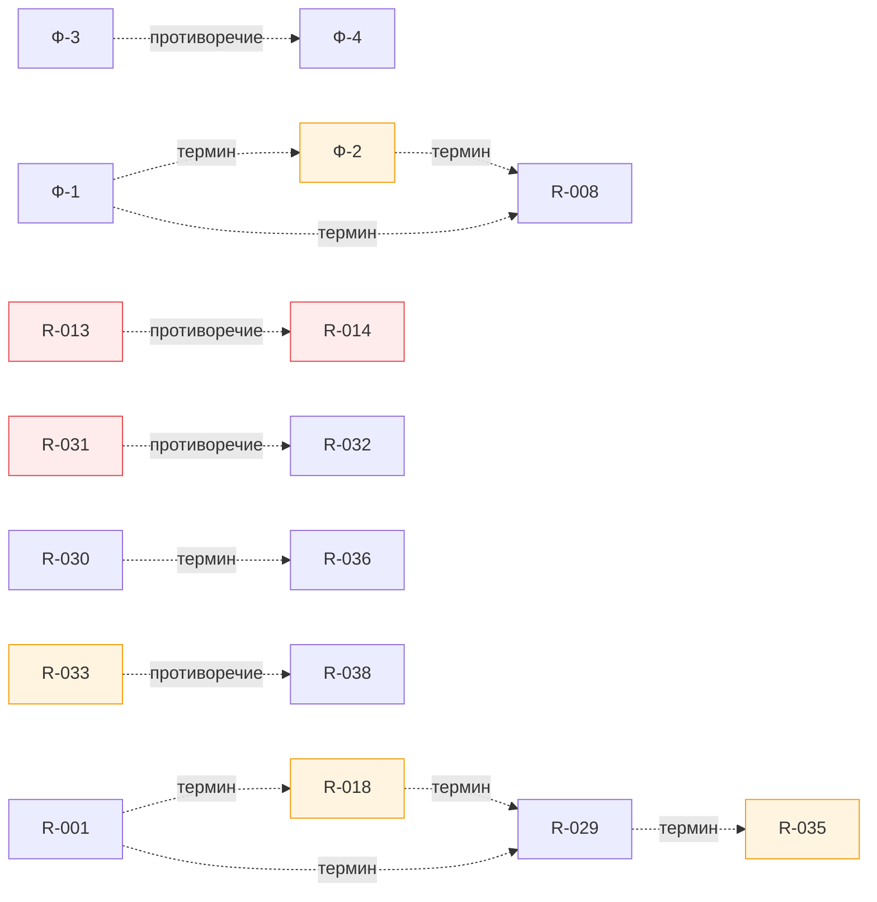

# Отчёт о проверке требований: Уведомление о расходах по карте

<!-- reqlens:summary:start -->

**Итог за 30 секунд**

| Разработка | Тестирование | 🔴 Критичных | 🟠 Существенных | 🟡 Незначительных |
|---|---|---|---|---|
| ❌ нельзя | ❌ нельзя | 16 | 39 | 20 |

**Что исправить первым:**

1. 🔴 [S-01](#s-01) — Метод объявлен как GET («REST type \| GET»), но выполняет изменение данных («Сохранение») *Пример:* «Система должна принимать параметры сохранения порога через HTTP-метод POST.»
2. 🔴 [S-02](#s-02) — В разделе успешного ответа 200 приведён пример с ошибкой ({"result":"ERROR","message":"Проверьте сумму"}), а для неверных параметров описан *Пример:* «Если параметры запроса заполнены с нарушением правил валидации, то система должна возвращать HTTP-статус 400.»
3. 🔴 [S-03](#s-03) — В спецификации API описан только метод изменения данных (/alerts/saveLimit), а метода чтения нет *Пример:* «Система должна принимать запросы по пути /alerts/saveLimit для среды Dev и Prod.»
4. 🔴 [S-04](#s-04) — Расчёт строится на событиях внешней системы, но контракт события не описан: нет состава полей (карта, операция, тип операции, сумма и валюта *Пример:* «Когда сервис получает событие достижения порога, система должна передать push-уведомление на отправку в течение 60 секунд.»
5. 🔴 [S-05](#s-05) — Ф-3 ограничивает частоту («максимум один такой push за календарный месяц»), а Ф-4 требует отправки «независимо от истории» *Пример:* «Когда расходы переходят от суммы ниже порога к сумме, равной порогу или выше, система должна отправить клиенту push-уведомление, но не более одного такого уведомления на карту за календарный месяц.»
6. 🔴 [S-06](#s-06) — Для продуктивной среды не указано значение («Prod: —») — реализацию нельзя развернуть и проверить в Prod. *Пример:* «Система должна принимать запросы по пути /alerts/saveLimit для среды Dev и Prod.»
7. 🔴 [S-07](#s-07) — Пример в таблице прямо противоречит требованию Ф-2 («Месяц определяется по дате совершения покупки в Алматы»): дата совершения указана 31 ян *Пример:* «Если совершена покупка 31 января в 23:58 на 4 000 ₸, то при проведении транзакции 1 февраля в 00:03 по Алматы система должна учесть её в февральском счётчике, увеличив его на 4 000 ₸.»
8. 🔴 [R-007](#r-007) — Тест составить невозможно: Требование описывает общую модель данных без указания конкретных таблиц, интерфейсов доступа *Пример:* «Система должна хранить идентификатор карты, месяц, идентификатор операции, сумму покупки в тиынах, признак отправки и порог в тенге.»

Подробности: разделы 3–4 (разбор по каждому требованию и набору), раздел 6 (итог и план), приложения.

<!-- reqlens:summary:end -->

## 1. Паспорт прогона

| Параметр | Значение |
|---|---|
| Документ | Уведомление о расходах по карте |
| Файл | `bench/real/notifications.md` (MD) |
| SHA-256 файла | `e7dae55e5453a250…` |
| Дата и время прогона | 2026-11-26 15:42:23 UTC |
| Модель | gemini / gemini-3.5-flash-lite |
| Версия агента | v6.0.0, коммит 5d85e5a (v3.0.3-26-g5d85e5a-dirty) |
| Обращений к модели | 0 (повторов: 0, из кэша: 31) |
| Профиль / режим | deep / облачная модель |
| Контекст запросов | полный текст · ≈3800 токенов на запрос (документ 8434 симв.) |
| База знаний (RAG) | 33 фрагментов · поиск: BM25 · основания у 75 замечаний |
| Критик-агент | включён |
| **Балл документа** | **61 / 100** `██████░░░░ 61` |
| **Готовность к разработке** | **6 %** `█░░░░░░░░░ 6` |
| Длительность | 0 с |
| Способ нарезки | по идентификаторам документа |
| Отброшено неподтверждённых цитат модели | 0 |
| Учтено строк документа | 152 из 152 (100 %) — в требованиях или исключены с причиной |
| Самопроверка | предложено 99, подтверждено 75, отклонено критиком 24, без подтверждённой цитаты 0 |
| Критерии | ISO/IEC/IEEE 29148:2018 п. 5.2.5, 5.2.6; IEEE Std 830-1998 п. 4.3 |

Обозначения серьёзности: 🔴 критичный — требование непроверяемо, противоречиво или неполно настолько, что реализация и тестирование невозможны; 🟠 существенный; 🟡 незначительный. Источник «LLM» — замечание модели с проверенной цитатой; «правило» — словарный пред-фильтр агента.

## 2. Нарезка требований

| ID в отчёте | ID в документе | Место в документе | Краткая формулировка |
|---|---|---|---|
| R-001 | — (присвоен агентом) | раздел «Дизайн процесса UI», строка 29 | Карты → Расходы → Уведомления. На экране видны переключатель, поле «Порог, ₸», сумма за месяц и кнопка «Сохранить». При ошибке ввода сооб… |
| R-002 | Ф-1 | раздел «Функциональные требования», строка 37 | Держатель активной карты KZT задаёт целый порог от 1 000 до 1 000 000 ₸ включительно. По умолчанию уведомление выключено. |
| R-003 | Ф-2 | раздел «Функциональные требования», строка 38 | Месяц определяется по дате совершения покупки в Алматы. В расходы входят проведённые покупки. Возврат уменьшает расходы месяца исходной п… |
| R-004 | Ф-3 | раздел «Функциональные требования», строка 39 | Когда расходы переходят от суммы ниже порога к сумме, равной порогу или выше, клиент получает push. На карту приходится максимум один так… |
| R-005 | Ф-4 | раздел «Функциональные требования», строка 40 | При изменении порога накопленная сумма сохраняется. Если она ниже нового порога, следующее достижение вызывает push независимо от истории… |
| R-006 | — (присвоен агентом) | раздел «Нефункциональные требования», строка 46 | Сервис передаёт push на отправку в течение минуты после получения события. |
| R-007 | — (присвоен агентом) | раздел «Требования к данным», строка 49 | Хранить идентификатор карты, месяц, идентификатор операции, сумму покупки в тиынах, признак отправки и порог в тенге. |
| R-008 | — (присвоен агентом) | раздел «Требования к интеграции», строка 52 | Приложение читает и сохраняет настройки через дочерний документ «Уведомление о расходах по карте — REST API». Повторная доставка одного с… |
| R-009 | — (присвоен агентом) | раздел «Тестирование требований», строка 57 | заполняются тестировщиками |
| R-010 | — (присвоен агентом) | раздел «Критерии приемки», строка 63 | Расходы 48 500 ₸, порог 50 000 ₸ \| Провести покупку на 1 500 ₸ \| Итог 50 000 ₸ и один push |
| R-011 | — (присвоен агентом) | раздел «Критерии приемки», строка 64 | Покупка 31 января в 23:58 на 4 000 ₸ \| Провести 1 февраля в 00:03 по Алматы \| Февральский счётчик вырос на 4 000 ₸ |
| R-012 | — (присвоен агентом) | раздел «Критерии приемки», строка 65 | Расходы 19 900 ₸, порог 20 000 ₸ \| Перевести 500 ₸ \| Счётчик показывает 19 900 ₸ |
| R-013 | — (присвоен агентом) | раздел «Общие параметры», строка 103 | Description \| Сохранение порога. Функциональные требования: чтение порога |
| R-014 | — (присвоен агентом) | раздел «Общие параметры», строка 104 | REST type \| GET |
| R-015 | — (присвоен агентом) | раздел «Общие параметры», строка 105 | Authorization \| Bearer, сессия владельца карты |
| R-016 | — (присвоен агентом) | раздел «Общие параметры», строка 107 | URL type \| Dev / Prod |
| R-017 | — (присвоен агентом) | раздел «Общие параметры», строка 108 | Request URL \| Dev: /alerts/saveLimit . Prod: — |
| R-018 | — (присвоен агентом) | раздел «Общие параметры», строка 109 | CURL \| curl -G "$BASE/alerts/saveLimit" -H "Authorization: Bearer $TOKEN" --data 'cardId=demo-42&amount=50000&enabled=1' |
| R-019 | — (присвоен агентом) | раздел «Логика работы метода», строка 117 | Проверить пользовательскую сессию. |
| R-020 | — (присвоен агентом) | раздел «Логика работы метода», строка 118 | Проверить принадлежность карты клиенту. |
| R-021 | — (присвоен агентом) | раздел «Логика работы метода», строка 119 | Проверить сумму и переключатель. |
| R-022 | — (присвоен агентом) | раздел «Логика работы метода», строка 120 | Заменить настройку и вернуть результат сохранения. |
| R-023 | — (присвоен агентом) | раздел «Логика работы метода», строка 121 | При отклонении суммы вернуть прежнее состояние и результат ERROR. |
| R-024 | — (присвоен агентом) | раздел «Особые правила», строка 124 | Целое число тенге, обе границы включены. |
| R-025 | — (присвоен агентом) | раздел «Особые правила», строка 125 | Повторное сохранение заменяет действующую настройку. |
| R-026 | — (присвоен агентом) | раздел «Особые правила», строка 126 | Изменение порога сохраняет накопленные расходы. |
| R-027 | — (присвоен агентом) | раздел «Path-параметры», строка 136 | Не используются. |
| R-028 | — (присвоен агентом) | раздел «Query-параметры», строка 142 | cardId \| string \| 1–64 \| Да \| Карта клиента \| Идентификатор карты \| card_id |
| R-029 | — (присвоен агентом) | раздел «Query-параметры», строка 143 | amount \| integer \| 32 bit \| Да \| 1 000–1 000 000 \| Порог в тенге \| limit_kzt |
| R-030 | — (присвоен агентом) | раздел «Query-параметры», строка 144 | enabled \| integer \| 1 знак \| Да \| 0 или 1 \| Признак включения \| enabled |
| R-031 | — (присвоен агентом) | раздел «Request body», строка 147 | Content-Type: application/json . |
| R-032 | — (присвоен агентом) | раздел «Request body», строка 148 | Тело не используется. |
| R-033 | — (присвоен агентом) | раздел «Ответ», строка 151 | Если результат 200 или 201 — успешный. Если результат 400, 401 и далее — неуспешный. |
| R-034 | — (присвоен агентом) | раздел «Ответ», строка 155 | result \| string \| OK / ERROR \| Исход сохранения \| — |
| R-035 | — (присвоен агентом) | раздел «Ответ», строка 156 | amount \| string \| При успехе \| Порог в тенге \| limit_kzt |
| R-036 | — (присвоен агентом) | раздел «Ответ», строка 157 | enabled \| string \| «0» или «1» \| Признак включения \| enabled |
| R-037 | — (присвоен агентом) | раздел «Ответ», строка 158 | message \| string \| При ошибке \| Описание ошибки \| — |
| R-038 | — (присвоен агентом) | раздел «Статусы», строка 162 | 200. Ответ в случае успешного выполнения метода. |
| R-039 | — (присвоен агентом) | раздел «Статусы», строка 163 | 400. Ответ в случае, если параметры запроса заполнены неверно. |
| R-040 | — (присвоен агентом) | раздел «200. Successful — Created», строка 174 | 401. Ответ в случае, если запрос выполнен без необходимой авторизации. |
| R-041 | — (присвоен агентом) | раздел «200. Successful — Created», строка 175 | 403. Ответ в случае, если на указанный ресурс доступ запрещен. |
| R-042 | — (присвоен агентом) | раздел «200. Successful — Created», строка 176 | 500. Ответ в случае, если произошла внутренняя ошибка сервера. |
| R-043 | — (присвоен агентом) | раздел «403. Unsuccessful — Forbidden», строка 189 | Для чужой карты возвращается 404, как и для отсутствующей карты. |

Всего выделено требований: **43**.

## 3. Проверка каждого требования

Подробный разбор — у требований с критичными и существенными замечаниями (15). Требования только с мелкими замечаниями (9) — в таблице ниже, без замечаний (19) — списком. Полный текст каждого требования приведён один раз — в его разборе; приёмочные тесты — в приложении «Тест-пробы».

<a id="r-003"></a>

### R-003 (Ф-2) — 🟠 требует доработки

*Место:* раздел «Функциональные требования», строка 38 · *Балл:* `████████░░ 85` · *Тип (EARS):* постоянное

> Месяц определяется по дате совершения покупки в Алматы. В расходы входят проведённые покупки. Возврат уменьшает расходы месяца исходной покупки. Переводы и снятие наличных исключаются.

| № | Критерий | Цитата | Проблема | Серьёзность | Как исправить | Источник |
|---|---|---|---|---|---|---|
| 1 | Однозначность | «В расходы входят проведённые покупки.» | Формулировка «проведённые покупки» двусмысленна и не определяет точно статус транзакции (авторизованная или с клирингом). | 🟠 Существенный | Уточнить статус транзакции, например, «В расходы входят успешно проведенные (списанные) транзакции покупок». | LLM ×2 |

**Основание:** стандарт: 29148 §5.2.5 c) Однозначность (`kb/standards/iso29148_ieee830.md`)

**Предлагаемая формулировка:** Система должна определять месяц по дате совершения покупки в часовом поясе Алматы, включая в расчеты успешно проведенные покупки, уменьшая расходы на сумму возврата по исходному месяцу покупки и исключая переводы и снятие наличных.

*Шаблон из базы знаний (Период и часовой пояс, `kb/patterns/fintech_ears.md`):* Шаблон: Принадлежность операции к периоду определяется по <дата совершения \| дата проведения> в часовом поясе <пояс>.

<a id="r-007"></a>

### R-007 — 🔴 есть критичные дефекты

*Место:* раздел «Требования к данным», строка 49 · *Балл:* `█████░░░░░ 50` · *Тип (EARS):* постоянное

> Хранить идентификатор карты, месяц, идентификатор операции, сумму покупки в тиынах, признак отправки и порог в тенге.

| № | Критерий | Цитата | Проблема | Серьёзность | Как исправить | Источник |
|---|---|---|---|---|---|---|
| 1 | Проверяемость | «Хранить идентификатор карты, месяц, идентификатор операции» | Тест составить невозможно: Требование описывает общую модель данных без указания конкретных таблиц, интерфейсов доступа и измеримых условий проверки записи. | 🔴 Критичный | Переформулировать так, чтобы появился объективный критерий приёмки (число, условие, ожидаемый результат). | тест-проба |
| 2 | Полнота | «месяц, идентификатор операции, сумму покупки в тиынах» | Не указаны типы данных, обязательность полей и ограничения длины для перечисленных сущностей. | 🟠 Существенный | Добавить типы данных, ограничения и требования к обязательности хранения для каждого указанного поля. | LLM ×2 |

**Основание:** стандарт: 29148 §5.2.5 g) Проверяемость (`kb/standards/iso29148_ieee830.md`); норма РК, пересказ: Закон РК «О банках и банковской деятельности» — банковская тайна (`kb/law_kz/fintech_norms.md`); стандарт: 29148 §5.2.5 d) Полнота (`kb/standards/iso29148_ieee830.md`)

**Предлагаемая формулировка:** Система должна хранить идентификатор карты, месяц, идентификатор операции, сумму покупки в тиынах, признак отправки и порог в тенге.

*Шаблон из базы знаний (Хранение и удаление данных, `kb/patterns/fintech_ears.md`):* Шаблон: Система должна хранить <данные> в <единицах> не более <срок> и удалять их по истечении срока.

🧪 **Тест-проба: тест составить невозможно** — Требование описывает общую модель данных без указания конкретных таблиц, интерфейсов доступа и измеримых условий проверки записи. Мешает фрагмент: «Хранить идентификатор карты, месяц, идентификатор операции».

<a id="r-009"></a>

### R-009 — 🔴 есть критичные дефекты

*Место:* раздел «Тестирование требований», строка 57 · *Балл:* `███░░░░░░░ 30` · *Тип (EARS):* постоянное

> заполняются тестировщиками

| № | Критерий | Цитата | Проблема | Серьёзность | Как исправить | Источник |
|---|---|---|---|---|---|---|
| 1 | Полнота | «заполняются тестировщиками» | Текст не является требованием к системе, представляет собой заглушку-плейсхолдер в спецификации. | 🔴 Критичный | Удалить данный пункт из раздела требований или заменить на реальные требования к процедуре тестирования. | LLM ×2 |
| 2 | Проверяемость | «заполняются тестировщиками» | Отсутствуют какие-либо критерии проверки или измеримые параметры. Подтверждено тест-пробой: тест составить невозможно — Текст является мета-информацией документа («заполняются тестировщиками») и не содержит функциональных или нефункциональных требований к системе. | 🔴 Критичный | Заменить на конкретное измеримое требование к результатам тестового покрытия. | LLM ×2 |

**Основание:** стандарт: 29148 §5.2.5 d) Полнота (`kb/standards/iso29148_ieee830.md`); стандарт: 29148 §5.2.5 g) Проверяемость (`kb/standards/iso29148_ieee830.md`); норма РК, пересказ: Требования к информационной безопасности банков — аутентификация и журналирование (`kb/law_kz/fintech_norms.md`)

🧪 **Тест-проба: тест составить невозможно** — Текст является мета-информацией документа («заполняются тестировщиками») и не содержит функциональных или нефункциональных требований к системе. Мешает фрагмент: «заполняются тестировщиками».

<a id="r-013"></a>

### R-013 — 🔴 есть критичные дефекты

*Место:* раздел «Общие параметры», строка 103 · *Балл:* `█████░░░░░ 50` · *Тип (EARS):* постоянное

> Description \| Сохранение порога. Функциональные требования: чтение порога

| № | Критерий | Цитата | Проблема | Серьёзность | Как исправить | Источник |
|---|---|---|---|---|---|---|
| 1 | Проверяемость | «Сохранение порога. Функциональные требования: чтение порога» | Тест составить невозможно: Формулировка содержит противоречие между сохранением и чтением, отсутствует однозначное описание ожидаемого поведения метода. | 🔴 Критичный | Переформулировать так, чтобы появился объективный критерий приёмки (число, условие, ожидаемый результат). | тест-проба |
| 2 | Корректность | «Сохранение порога. Функциональные требования: чтение порога» | Метод использует GET-запрос и сохраняет данные, при этом описание упоминает и сохранение, и чтение, что противоречит архитектуре REST API. | 🟠 Существенный | Система должна сохранять и возвращать порог уведомлений. | LLM ×2 |

**Основание:** стандарт: 29148 §5.2.5 g) Проверяемость (`kb/standards/iso29148_ieee830.md`); стандарт: 29148 §5.2.5 h) Корректность (`kb/standards/iso29148_ieee830.md`)

**Предлагаемая формулировка:** Система должна обрабатывать запрос сохранения и чтения порога расходов по карте.

*Шаблон из базы знаний (Порог и пересечение порога, `kb/patterns/fintech_ears.md`):* Шаблон: Когда накопленная сумма за период переходит от значения ниже порога к значению, равному порогу или выше, система должна выполнить <действие>; изменение порога внутри периода должно <правило> для уже отправленных уведомлений.

🧪 **Тест-проба: тест составить невозможно** — Формулировка содержит противоречие между сохранением и чтением, отсутствует однозначное описание ожидаемого поведения метода. Мешает фрагмент: «Сохранение порога. Функциональные требования: чтение порога».

<a id="r-014"></a>

### R-014 — 🔴 есть критичные дефекты

*Место:* раздел «Общие параметры», строка 104 · *Балл:* `███░░░░░░░ 30` · *Тип (EARS):* постоянное

> REST type \| GET

| № | Критерий | Цитата | Проблема | Серьёзность | Как исправить | Источник |
|---|---|---|---|---|---|---|
| 1 | Корректность | «REST type \| GET» | Использование метода GET для сохранения (изменения) данных нарушает стандарты REST API и противоречит описанию метода «Сохранение порога». | 🔴 Критичный | Изменить тип запроса на POST или PUT для операций сохранения. | LLM ×2 |
| 2 | Проверяемость | «REST type \| GET» | Тест составить невозможно: Метод GET не предназначен для изменения состояния на сервере, что делает тест некорректным с точки зрения архитектуры. | 🔴 Критичный | Переформулировать так, чтобы появился объективный критерий приёмки (число, условие, ожидаемый результат). | тест-проба |

**Основание:** стандарт: 29148 §5.2.5 h) Корректность (`kb/standards/iso29148_ieee830.md`); стандарт: 29148 §5.2.5 g) Проверяемость (`kb/standards/iso29148_ieee830.md`)

**Предлагаемая формулировка:** Система должна принимать параметры сохранения порога через HTTP-метод POST.

*Шаблон из базы знаний (Метод REST API, меняющий состояние, `kb/patterns/fintech_ears.md`):* Шаблон: Метод <назначение> должен использовать <POST \| PUT> на <URL>; параметры передаются в теле <формат>; ответы: <код> — <смысл> для каждого исхода, включая ошибки валидации и чужой ресурс.

🧪 **Тест-проба: тест составить невозможно** — Метод GET не предназначен для изменения состояния на сервере, что делает тест некорректным с точки зрения архитектуры. Мешает фрагмент: «REST type \| GET».

<a id="r-017"></a>

### R-017 — 🔴 есть критичные дефекты

*Место:* раздел «Общие параметры», строка 108 · *Балл:* `█████░░░░░ 50` · *Тип (EARS):* постоянное

> Request URL \| Dev: /alerts/saveLimit . Prod: —

| № | Критерий | Цитата | Проблема | Серьёзность | Как исправить | Источник |
|---|---|---|---|---|---|---|
| 1 | Проверяемость | «Prod: —» | Тест составить невозможно: Отсутствует URL для продуктовой среды (Prod: —), что делает невозможным тестирование в данном контуре. | 🔴 Критичный | Переформулировать так, чтобы появился объективный критерий приёмки (число, условие, ожидаемый результат). | тест-проба |
| 2 | Полнота | «Request URL \| Dev: /alerts/saveLimit . Prod: —» | Для продакшена значение не задано (прочерк), что делает интеграцию в Prod незавершенной. | 🟠 Существенный | Указать Request URL для продуктовой среды. | LLM ×2 |

**Основание:** стандарт: 29148 §5.2.5 g) Проверяемость (`kb/standards/iso29148_ieee830.md`); стандарт: 29148 §5.2.5 d) Полнота (`kb/standards/iso29148_ieee830.md`)

**Предлагаемая формулировка:** Система должна принимать запросы по пути /alerts/saveLimit для среды Dev и Prod.

*Шаблон из базы знаний (Метод REST API, меняющий состояние, `kb/patterns/fintech_ears.md`):* Шаблон: Метод <назначение> должен использовать <POST \| PUT> на <URL>; параметры передаются в теле <формат>; ответы: <код> — <смысл> для каждого исхода, включая ошибки валидации и чужой ресурс.

🧪 **Тест-проба: тест составить невозможно** — Отсутствует URL для продуктовой среды (Prod: —), что делает невозможным тестирование в данном контуре. Мешает фрагмент: «Prod: —».

<a id="r-018"></a>

### R-018 — 🟠 требует доработки

*Место:* раздел «Общие параметры», строка 109 · *Балл:* `████████░░ 85` · *Тип (EARS):* постоянное

> CURL \| curl -G "$BASE/alerts/saveLimit" -H "Authorization: Bearer $TOKEN" --data 'cardId=demo-42&amount=50000&enabled=1'

| № | Критерий | Цитата | Проблема | Серьёзность | Как исправить | Источник |
|---|---|---|---|---|---|---|
| 1 | Корректность | «CURL \| curl -G "$BASE/alerts/saveLimit" -H "Authorization: Bearer $TOKEN" --data 'cardId=demo-42&amount=50000&enabled=1'» | Использование флага -G в curl принудительно превращает передаваемые данные в query-параметры для GET-запроса, что противоречит операции сохранения. | 🟠 Существенный | Убрать флаг -G и использовать метод POST с передачей данных в теле запроса. | LLM ×2 |

**Основание:** стандарт: 29148 §5.2.5 h) Корректность (`kb/standards/iso29148_ieee830.md`)

**Предлагаемая формулировка:** Система должна обрабатывать CURL-запрос с передачей параметров сохранения порога.

<a id="r-019"></a>

### R-019 — 🔴 есть критичные дефекты

*Место:* раздел «Логика работы метода», строка 117 · *Балл:* `██████░░░░ 65` · *Тип (EARS):* постоянное

> Проверить пользовательскую сессию.

| № | Критерий | Цитата | Проблема | Серьёзность | Как исправить | Источник |
|---|---|---|---|---|---|---|
| 1 | Проверяемость | «Проверить пользовательскую сессию.» | Тест составить невозможно: Невозможно составить точный приёмочный тест, так как не указаны критерии валидности сессии и ожидаемый ответ при ошибке. | 🔴 Критичный | Переформулировать так, чтобы появился объективный критерий приёмки (число, условие, ожидаемый результат). | тест-проба |

**Основание:** стандарт: 29148 §5.2.5 g) Проверяемость (`kb/standards/iso29148_ieee830.md`)

**Предлагаемая формулировка:** Система должна проверять действительность пользовательской сессии при получении запроса.

🧪 **Тест-проба: тест составить невозможно** — Невозможно составить точный приёмочный тест, так как не указаны критерии валидности сессии и ожидаемый ответ при ошибке. Мешает фрагмент: «Проверить пользовательскую сессию.».

<a id="r-020"></a>

### R-020 — 🟠 требует доработки

*Место:* раздел «Логика работы метода», строка 118 · *Балл:* `████████░░ 85` · *Тип (EARS):* постоянное

> Проверить принадлежность карты клиенту.

| № | Критерий | Цитата | Проблема | Серьёзность | Как исправить | Источник |
|---|---|---|---|---|---|---|
| 1 | Полнота | «Проверить принадлежность карты клиенту.» | Не указан ожидаемый результат и код ответа в случае, если карта не принадлежит клиенту (хотя в разделе статусов упоминается 403/404, само требование неполное). | 🟠 Существенный | Дополнить требование указанием реакции на чужую карту (возвращать ошибку доступа). | LLM ×2 |

**Основание:** стандарт: 29148 §5.2.5 d) Полнота (`kb/standards/iso29148_ieee830.md`); норма РК, пересказ: Закон РК «О банках и банковской деятельности» — банковская тайна (`kb/law_kz/fintech_norms.md`)

**Предлагаемая формулировка:** Система должна проверять принадлежность карты клиенту и возвращать ошибку доступа, если карта принадлежит другому пользователю.

<a id="r-021"></a>

### R-021 — 🟠 требует доработки

*Место:* раздел «Логика работы метода», строка 119 · *Балл:* `████████░░ 85` · *Тип (EARS):* постоянное

> Проверить сумму и переключатель.

| № | Критерий | Цитата | Проблема | Серьёзность | Как исправить | Источник |
|---|---|---|---|---|---|---|
| 1 | Однозначность | «Проверить сумму и переключатель.» | Формулировка слишком общая, не указаны допустимые диапазоны суммы (1 000–1 000 000) и значения переключателя (0 или 1) внутри самого текста требования. | 🟠 Существенный | Уточнить правила проверки суммы и переключателя со ссылкой на допустимые диапазоны. | LLM ×2 |

**Основание:** стандарт: 29148 §5.2.5 c) Однозначность (`kb/standards/iso29148_ieee830.md`)

**Предлагаемая формулировка:** Система должна проверять, что сумма находится в диапазоне от 1 000 до 1 000 000 тенге, а переключатель равен 0 или 1.

<a id="r-024"></a>

### R-024 — 🟠 требует доработки

*Место:* раздел «Особые правила», строка 124 · *Балл:* `████████░░ 85` · *Тип (EARS):* постоянное

> Целое число тенге, обе границы включены.

| № | Критерий | Цитата | Проблема | Серьёзность | Как исправить | Источник |
|---|---|---|---|---|---|---|
| 1 | Полнота | «Целое число тенге, обе границы включены.» | Не указаны конкретные числовые значения границ (1 000 и 1 000 000), о которых идет речь в документе. | 🟠 Существенный | Явно указать числовые границы допустимого диапазона (от 1 000 до 1 000 000 тенге). | LLM ×2 |

**Основание:** стандарт: 29148 §5.2.5 d) Полнота (`kb/standards/iso29148_ieee830.md`)

**Предлагаемая формулировка:** Система должна принимать значение порога в виде целого числа тенге в диапазоне от 1 000 до 1 000 000 включительно.

<a id="r-031"></a>

### R-031 — 🔴 есть критичные дефекты

*Место:* раздел «Request body», строка 147 · *Балл:* `██████░░░░ 60` · *Тип (EARS):* постоянное

> Content-Type: application/json .

| № | Критерий | Цитата | Проблема | Серьёзность | Как исправить | Источник |
|---|---|---|---|---|---|---|
| 1 | Проверяемость | «Content-Type: application/json» | Тест составить невозможно: Требование описывает заголовок для неиспользуемого тела GET-запроса, что технически бессмысленно для тестирования. | 🔴 Критичный | Переформулировать так, чтобы появился объективный критерий приёмки (число, условие, ожидаемый результат). | тест-проба |
| 2 | Необходимость | «Content-Type: application/json .» | Требование указывает Content-Type для тела запроса, однако в следующем требовании указано, что тело не используется. Параметр GET-запроса передается через query-параметры, поэтому заголовок Content-Type избыточен. | 🟡 Незначительный | Удалить требование о Content-Type, так как GET-запросы не передают тело. | LLM ×2 |

**Основание:** стандарт: 29148 §5.2.5 g) Проверяемость (`kb/standards/iso29148_ieee830.md`); стандарт: 29148 §5.2.5 a) Необходимость (`kb/standards/iso29148_ieee830.md`)

🧪 **Тест-проба: тест составить невозможно** — Требование описывает заголовок для неиспользуемого тела GET-запроса, что технически бессмысленно для тестирования. Мешает фрагмент: «Content-Type: application/json».

<a id="r-033"></a>

### R-033 — 🟠 требует доработки

*Место:* раздел «Ответ», строка 151 · *Балл:* `███████░░░ 70` · *Тип (EARS):* по событию

> Если результат 200 или 201 — успешный. Если результат 400, 401 и далее — неуспешный.

| № | Критерий | Цитата | Проблема | Серьёзность | Как исправить | Источник |
|---|---|---|---|---|---|---|
| 1 | Корректность | «Если результат 200 или 201 — успешный.» | Метод настроен как GET (`REST type: GET`), поэтому успешный ответ должен возвращать только статус 200 OK. Статус 201 Created применяется при создании ресурсов (POST), поэтому упоминание 201 для данного метода некорректно. | 🟠 Существенный | Система должна возвращать статус 200 для успешного выполнения запроса. | LLM ×2 |
| 2 | Однозначность | «400, 401 и далее» | Формулировка «и далее» размыта и не определяет конкретный перечень обрабатываемых кодов ошибок. | 🟠 Существенный | Система должна возвращать статус 400, 401, 403, 404 или 500 для неуспешных ответов в соответствии со спецификацией. | LLM ×2 |

**Основание:** стандарт: 29148 §5.2.5 h) Корректность (`kb/standards/iso29148_ieee830.md`); стандарт: 29148 §5.2.5 c) Однозначность (`kb/standards/iso29148_ieee830.md`)

**Предлагаемая формулировка:** Когда запрос обрабатывается сервером, система должна возвращать статус 200 при успешном выполнении или статусы 400, 401, 403, 404, 500 при возникновении ошибок.

*Шаблон из базы знаний (Метод REST API, меняющий состояние, `kb/patterns/fintech_ears.md`):* Шаблон: Метод <назначение> должен использовать <POST \| PUT> на <URL>; параметры передаются в теле <формат>; ответы: <код> — <смысл> для каждого исхода, включая ошибки валидации и чужой ресурс.

<a id="r-035"></a>

### R-035 — 🟠 требует доработки

*Место:* раздел «Ответ», строка 156 · *Балл:* `████████░░ 85` · *Тип (EARS):* постоянное

> amount \| string \| При успехе \| Порог в тенге \| limit_kzt

| № | Критерий | Цитата | Проблема | Серьёзность | Как исправить | Источник |
|---|---|---|---|---|---|---|
| 1 | Корректность | «amount \| string \| При успехе \| Порог в тенге \| limit_kzt» | В таблице параметров запроса (Query-параметры) параметр amount имеет формат integer, однако в таблице ответов указан формат string. Это противоречит типу данных порога. | 🟠 Существенный | Система должна возвращать параметр amount в формате integer, соответствующем формату в запросе. | LLM ×2 |

**Основание:** стандарт: 29148 §5.2.5 h) Корректность (`kb/standards/iso29148_ieee830.md`)

**Предлагаемая формулировка:** Система должна возвращать в ответе при успехе поле amount в формате integer, содержащее сохраненный порог в тенге.

*Шаблон из базы знаний (Порог и пересечение порога, `kb/patterns/fintech_ears.md`):* Шаблон: Когда накопленная сумма за период переходит от значения ниже порога к значению, равному порогу или выше, система должна выполнить <действие>; изменение порога внутри периода должно <правило> для уже отправленных уведомлений.

<a id="r-043"></a>

### R-043 — 🟠 требует доработки

*Место:* раздел «403. Unsuccessful — Forbidden», строка 189 · *Балл:* `████████░░ 85` · *Тип (EARS):* постоянное

> Для чужой карты возвращается 404, как и для отсутствующей карты.

| № | Критерий | Цитата | Проблема | Серьёзность | Как исправить | Источник |
|---|---|---|---|---|---|---|
| 1 | Корректность | «Для чужой карты возвращается 404, как и для отсутствующей карты.» | В заголовке секции указан статус 403, но в тексте требования явно утверждается, что возвращается статус 404, что создает логическое противоречие. | 🟠 Существенный | Перенести требование в подраздел со статусом 404 или исправить возвращаемый код состояния на 403 в соответствии с заголовком. | LLM ×2 |

**Основание:** стандарт: 29148 §5.2.5 h) Корректность (`kb/standards/iso29148_ieee830.md`); норма РК, пересказ: Закон РК «О банках и банковской деятельности» — банковская тайна (`kb/law_kz/fintech_norms.md`)

**Предлагаемая формулировка:** Система должна возвращать статус 404 для чужой карты, как и для отсутствующей карты.

*Шаблон из базы знаний (Метод REST API, меняющий состояние, `kb/patterns/fintech_ears.md`):* Шаблон: Метод <назначение> должен использовать <POST \| PUT> на <URL>; параметры передаются в теле <формат>; ответы: <код> — <смысл> для каждого исхода, включая ошибки валидации и чужой ресурс.

### Требования с мелкими замечаниями

| Требование | Критерий | Цитата | Проблема | Как исправить | Источник |
|---|---|---|---|---|---|
| <a id="r-008"></a>R-008 | Единичность (атомарность) | «Приложение читает и сохраняет настройки» | Склеено два действия в одно требование: чтение настроек и сохранение настроек. | Разбить на два атомарных требования: одно для чтения, другое для сохранения настроек. | LLM ×2 |
| <a id="r-015"></a>R-015 | Однозначность | «Authorization \| Bearer, сессия владельца карты» | Формулировка не уточняет формат токена и способ валидации сессии. | Система должна проверять Bearer-токен авторизованной сессии владельца карты. | LLM ×2 |
| <a id="r-016"></a>R-016 | Полнота | «URL type \| Dev / Prod» | Отсутствуют конкретные доменные имена или базовые пути для среды разработки и продакшена. | Указать полные базовые URL для сред Dev и Prod. | LLM ×2 |
| <a id="r-037"></a>R-037 | Полнота | «message \| string \| При ошибке \| Описание ошибки \| —» | В описании параметра message не указаны возможные значения или формат текста ошибки (например, допустимая длина строки, локализация или коды ошибок). | Система должна возвращать в поле message текстовое описание ошибки на русском языке длиной до 255 символов. | LLM ×2 |
| <a id="r-038"></a>R-038 | Проверяемость | «200. Ответ в случае успешного выполнения метода.» | Формулировка является слишком общей и не описывает конкретные условия возврата статуса 200 и структуру тела ответа. | Система должна возвращать HTTP-статус 200 OK и JSON-тект с результатами операции при успешном сохранении настроек. | LLM ×2 |
| <a id="r-039"></a>R-039 | Однозначность | «400. Ответ в случае, если параметры запроса заполнены неверно.» | Формулировка «заполнены неверно» не уточняет, какие именно нарушения валидации (тип данных, диапазон, обязательность) приводят к статусу 400. | Если параметры запроса нарушают требования формата или диапазона, то система должна возвращать HTTP-статус 400 Bad Request. | LLM ×2 |
| <a id="r-040"></a>R-040 | Уместный уровень (без проектных решений) | «401. Ответ в случае, если запрос выполнен без необходимой авторизации.» | Требование находится в подразделе заголовка «200. Successful — Created», что является логической ошибкой структурирования документов API. | Перенести описание статуса 401 в соответствующий раздел статусов ошибок аутентификации. | LLM ×2 |
| <a id="r-041"></a>R-041 | Уместный уровень (без проектных решений) | «403. Ответ в случае, если на указанный ресурс доступ запрещен.» | Требование ошибочно размещено в разделе «200. Successful — Created». Требуется перенести его в секцию кодов ошибок. | Перенести описание статуса 403 в надлежащий раздел обработки ошибок доступа. | LLM ×2 |
| <a id="r-042"></a>R-042 | Уместный уровень (без проектных решений) | «500. Ответ в случае, если произошла внутренняя ошибка сервера.» | Требование размещено внутри раздела «200. Successful — Created», что нарушает структуру спецификации ответов. | Перенести описание статуса 500 в общий список кодов ошибок сервера. | LLM ×2 |

### Требования без замечаний

<a id="r-001"></a>R-001, <a id="r-002"></a>R-002 (Ф-1), <a id="r-004"></a>R-004 (Ф-3), <a id="r-005"></a>R-005 (Ф-4), <a id="r-006"></a>R-006, <a id="r-010"></a>R-010, <a id="r-011"></a>R-011, <a id="r-012"></a>R-012, <a id="r-022"></a>R-022, <a id="r-023"></a>R-023, <a id="r-025"></a>R-025, <a id="r-026"></a>R-026, <a id="r-027"></a>R-027, <a id="r-028"></a>R-028, <a id="r-029"></a>R-029, <a id="r-030"></a>R-030, <a id="r-032"></a>R-032, <a id="r-034"></a>R-034, <a id="r-036"></a>R-036 — нарушений критериев не найдено (проверены моделью и правилами).

## 4. Проверка набора требований

| Критерий набора | Источник | Замечаний | Статус |
|---|---|---|---|
| Полнота набора | 29148 §5.2.6 a) Complete; IEEE 830 §4.3.3 | 21 | 🔴 критичный |
| Непротиворечивость | 29148 §5.2.6 b) Consistent; IEEE 830 §4.3.4 | 13 | 🔴 критичный |
| Реализуемость набора | 29148 §5.2.6 c) Feasible | 0 | ✅ нарушений не найдено |
| Понятность | 29148 §5.2.6 d) Comprehensible | 6 | 🟠 существенный |
| Возможность валидации | 29148 §5.2.6 e) Able to be validated | 3 | 🟠 существенный |
| Ранжирование по важности | IEEE 830 §4.3.5 Ranked for importance and/or stability | 1 | 🟡 незначительный |
| Модифицируемость | IEEE 830 §4.3.7 Modifiable | 0 | ✅ нарушений не найдено |
| Трассируемость | IEEE 830 §4.3.8 Traceable | 0 | ✅ нарушений не найдено |

<a id="s-01"></a>

#### S-01. Противоречие — 🔴 Критичный (Непротиворечивость; 29148 §5.2.6 b) Consistent; IEEE 830 §4.3.4)

- R-014, раздел «Общие параметры», строка 104: «REST type \| GET»
- R-013, раздел «Общие параметры», строка 103: «Description \| Сохранение порога. Функциональные»

**Проблема:** Метод объявлен как GET («REST type \| GET»), но выполняет изменение данных («Сохранение»). GET по смыслу безопасен и не меняет состояние: такие запросы кэшируются, повторяются браузером и прокси, параметры попадают в логи и историю — сохранение порога через GET приведёт к непредсказуемым изменениям.

**Как исправить:** Использовать POST/PUT (например, PUT /alerts/limit), параметры передать в теле JSON; GET оставить только для чтения настройки.

**Основание:** стандарт: 29148 §5.2.6 b) Непротиворечивость (`kb/standards/iso29148_ieee830.md`); норма РК, пересказ: Закон РК «О платежах и платёжных системах» — информирование и безопасность (`kb/law_kz/fintech_norms.md`)


*Источник: правило+LLM*

<a id="s-02"></a>

#### S-02. Противоречие — 🔴 Критичный (Непротиворечивость; 29148 §5.2.6 b) Consistent; IEEE 830 §4.3.4)

- Текст документа: «{"result":"ERROR","message":"Проверьте сумму"}»
- R-039, раздел «Статусы», строка 163: «400. Ответ в случае, если параметры запроса заполнены неверн»

**Проблема:** В разделе успешного ответа 200 приведён пример с ошибкой ({"result":"ERROR","message":"Проверьте сумму"}), а для неверных параметров описан код 400. Непонятно, каким кодом сервис сообщает об отклонённой сумме — клиент может принять ошибку за успех.

**Как исправить:** Возвращать ошибку валидации суммы только кодом 400 с телом {"message": …}; в разделе 200 оставить только успешный ответ.

**Основание:** стандарт: 29148 §5.2.6 b) Непротиворечивость (`kb/standards/iso29148_ieee830.md`)


*Источник: правило*

<a id="s-03"></a>

#### S-03. Пропуск — 🔴 Критичный (Полнота набора; 29148 §5.2.6 a) Complete; IEEE 830 §4.3.3)

- R-017, раздел «Общие параметры», строка 108: «Request URL \| Dev: /alerts/saveLimit . Prod: —»
- R-001, раздел «Дизайн процесса UI», строка 29: «→ Расходы → Уведомления. На экране видны переключатель, поле «Порог, ₸», сумма за месяц и кнопка»
- Текст документа: «Сервис расходов → настройки: получить порог карты. Сервис расходов →»

**Проблема:** В спецификации API описан только метод изменения данных (/alerts/saveLimit), а метода чтения нет. При этом документ на чтение опирается: экран показывает текущие значения, интеграция «читает» настройки. Приложение не сможет показать сохранённый порог и сумму за месяц — функцию нельзя реализовать целиком.

**Как исправить:** Добавить метод чтения (например, GET /alerts/limit?cardId=…): ответ — порог, признак включения, сумма расходов за текущий месяц; коды ответа и пример тела — как у метода сохранения.

**Основание:** стандарт: 29148 §5.2.6 a) Полнота набора (`kb/standards/iso29148_ieee830.md`); норма РК, пересказ: Закон РК «О банках и банковской деятельности» — банковская тайна (`kb/law_kz/fintech_norms.md`)


*Источник: правило+LLM*

<a id="s-04"></a>

#### S-04. Пропуск — 🔴 Критичный (Полнота набора; 29148 §5.2.6 a) Complete; IEEE 830 §4.3.3)

- Текст документа: «→ сервис настроек. Карточный процессинг → учёт расходов → сервис»
- R-006, раздел «Нефункциональные требования», строка 46: «минуты после получения события.»
- R-008, раздел «Требования к интеграции», строка 52: «Повторная доставка одного события процессинга сохраняет»

**Проблема:** Расчёт строится на событиях внешней системы, но контракт события не описан: нет состава полей (карта, операция, тип операции, сумма и валюта, время с часовым поясом, ссылка на исходную операцию), нет перечня типов операций, хотя правила их различают («Возврат»), не заданы гарантии доставки, порядок и обработка дублей. Сервис нельзя реализовать однозначно, а интеграцию — протестировать.

**Как исправить:** Описать контракт события: поля и типы, перечень типов операций (покупка, возврат, отмена, перевод, снятие), идентификатор для дедупликации, гарантию доставки (at-least-once), порядок и поведение при опоздавших событиях; пример сообщения.

**Основание:** стандарт: 29148 §5.2.6 a) Полнота набора (`kb/standards/iso29148_ieee830.md`); норма РК, пересказ: Закон РК «О платежах и платёжных системах» — информирование и безопасность (`kb/law_kz/fintech_norms.md`)


*Источник: правило+LLM*

<a id="s-05"></a>

#### S-05. Противоречие — 🔴 Критичный (Непротиворечивость; 29148 §5.2.6 b) Consistent; IEEE 830 §4.3.4)

- R-004 (Ф-3), раздел «Функциональные требования», строка 39: «push. На карту приходится максимум один такой push за календарный месяц.»
- R-005 (Ф-4), раздел «Функциональные требования», строка 40: «достижение вызывает push независимо от истории предыдущей настройки.»

**Проблема:** Ф-3 ограничивает частоту («максимум один такой push за календарный месяц»), а Ф-4 требует отправки «независимо от истории». Если оба условия выполняются в одном периоде (уведомление уже отправлено, затем изменён порог и он снова достигнут), Ф-3 запрещает второе уведомление, а Ф-4 его требует — какое правило главнее, не сказано. Реализация и ожидаемый результат теста зависят от толкования.

**Как исправить:** Явно задать приоритет: например, «При изменении порога признак отправки в текущем месяце сбрасывается; лимит Ф-3 считается от последнего изменения порога» — и добавить критерий приёмки на этот случай.

**Основание:** стандарт: 29148 §5.2.6 b) Непротиворечивость (`kb/standards/iso29148_ieee830.md`); норма РК, пересказ: Закон РК «О персональных данных и их защите» — согласие (`kb/law_kz/fintech_norms.md`)


*Источник: правило*

<a id="s-06"></a>

#### S-06. Пропуск — 🔴 Критичный (Полнота набора; 29148 §5.2.6 a) Complete; IEEE 830 §4.3.3)

- R-017, раздел «Общие параметры», строка 108: «\| Dev: /alerts/saveLimit . Prod: —»

**Проблема:** Для продуктивной среды не указано значение («Prod: —») — реализацию нельзя развернуть и проверить в Prod.

**Как исправить:** Указать значение для Prod (URL/параметр) или явно зафиксировать, когда и кем оно будет определено.

**Основание:** стандарт: 29148 §5.2.6 a) Полнота набора (`kb/standards/iso29148_ieee830.md`)


*Источник: правило*

<a id="s-07"></a>

#### S-07. Пропуск — 🔴 Критичный (Непротиворечивость; 29148 §5.2.6 b) Consistent; IEEE 830 §4.3.4)

- R-011, раздел «Критерии приемки», строка 64: «Покупка 31 января в 23:58 на 4 000 ₸ \| Провести 1 февраля в 00:03 по Алматы \| Февральский счётчик вырос на 4 000 ₸»

**Проблема:** Пример в таблице прямо противоречит требованию Ф-2 («Месяц определяется по дате совершения покупки в Алматы»): дата совершения указана 31 января, а в результате счётчик вырос в феврале. Неясно, какая дата является приоритетной для зачисления в месяц — дата совершения или дата проведения.

**Как исправить:** Устранить противоречие в требованиях и примерах. Если месяц определяется по дате совершения, то исправить ожидаемый результат в примере: «Январский счётчик вырос на 4 000 ₸». Дописать формулировку: «При расхождении даты совершения и проведения приоритет имеет дата совершения операции в часовом поясе Алматы».

**Основание:** стандарт: 29148 §5.2.6 b) Непротиворечивость (`kb/standards/iso29148_ieee830.md`)


*Источник: LLM (узкий проход: граничные значения)+LLM (перекрёстная проверка)*

<a id="s-08"></a>

#### S-08. Терминология — 🟠 Существенный (Непротиворечивость; 29148 §5.2.6 b) Consistent; IEEE 830 §4.3.4)

- R-029, раздел «Query-параметры», строка 143: «amount \| integer \| 32 bit \| Да \| 1 000–1 000 000 \| Порог в т»
- R-035, раздел «Ответ», строка 156: «amount \| string \| При успехе \| Порог в тенге \| limit_kzt»

**Проблема:** Параметр «amount» описан с разными форматами: integer (Query-параметры) и string (Ответ). Клиент и сервер по-разному сериализуют значение — ошибки разбора и сравнения.

**Как исправить:** Задать единый формат «amount» во всех таблицах (например, integer) и пример ответа в том же формате.

**Основание:** стандарт: 29148 §5.2.6 b) Непротиворечивость (`kb/standards/iso29148_ieee830.md`)


*Источник: правило*

<a id="s-09"></a>

#### S-09. Терминология — 🟠 Существенный (Непротиворечивость; 29148 §5.2.6 b) Consistent; IEEE 830 §4.3.4)

- R-030, раздел «Query-параметры», строка 144: «enabled \| integer \| 1 знак \| Да \| 0 или 1 \| Признак включени»
- R-036, раздел «Ответ», строка 157: «enabled \| string \| «0» или «1» \| Признак включения \| enabled»

**Проблема:** Параметр «enabled» описан с разными форматами: integer (Query-параметры) и string (Ответ). Клиент и сервер по-разному сериализуют значение — ошибки разбора и сравнения.

**Как исправить:** Задать единый формат «enabled» во всех таблицах (например, integer) и пример ответа в том же формате.

**Основание:** стандарт: 29148 §5.2.6 b) Непротиворечивость (`kb/standards/iso29148_ieee830.md`)


*Источник: правило*

<a id="s-10"></a>

#### S-10. Противоречие — 🟠 Существенный (Непротиворечивость; 29148 §5.2.6 b) Consistent; IEEE 830 §4.3.4)

- R-043, раздел «403. Unsuccessful — Forbidden», строка 189: «Для чужой карты возвращается 404, как и для отсутствующей»

**Проблема:** Раздел ответа 403 («403. Unsuccessful — Forbidden») сообщает, что на самом деле возвращается 404. Описанный код 403 не используется, клиент не узнает, какой код обрабатывать.

**Как исправить:** Оставить один код для этого случая и описать его в перечне статусов (например, только 404 или только 403), убрать противоречивый раздел.

**Основание:** стандарт: 29148 §5.2.6 b) Непротиворечивость (`kb/standards/iso29148_ieee830.md`)


*Источник: правило*

<a id="s-11"></a>

#### S-11. Противоречие — 🟠 Существенный (Непротиворечивость; 29148 §5.2.6 b) Consistent; IEEE 830 §4.3.4)

- R-013, раздел «Общие параметры», строка 103: «Description \| Сохранение порога. Функциональные требования: чтение порога»

**Проблема:** Назначение метода противоречиво: в одном описании и изменение, и чтение («Сохранение порога. Функциональные требования: чтение порога»). Непонятно, что метод делает и какие данные возвращает — разработчик и тестировщик поймут его по-разному.

**Как исправить:** Разделить на два метода: чтение настроек (GET, без изменения данных) и сохранение (PUT/POST с телом); у каждого — своё описание, параметры и ответы.

**Основание:** стандарт: 29148 §5.2.6 b) Непротиворечивость (`kb/standards/iso29148_ieee830.md`); норма РК, пересказ: Закон РК «О персональных данных и их защите» — согласие (`kb/law_kz/fintech_norms.md`)


*Источник: правило*

<a id="s-12"></a>

#### S-12. Пропуск — 🟠 Существенный (Полнота набора; 29148 §5.2.6 a) Complete; IEEE 830 §4.3.3)

- R-033, раздел «Ответ», строка 151: «Если результат 200 или 201 — успешный. Если результат»

**Проблема:** Код 201 назван в описании ответа, но не описан в перечне статусов (200, 400, 401, 403, 404, 500): нет ни условия, когда он возвращается, ни примера тела. Клиент не знает, ждать ли 201 и как его обработать.

**Как исправить:** Либо описать код 201 (когда возвращается, пример ответа), либо убрать его из текста и оставить один успешный код.

**Основание:** стандарт: 29148 §5.2.6 a) Полнота набора (`kb/standards/iso29148_ieee830.md`); норма РК, пересказ: Закон РК «О персональных данных и их защите» — согласие (`kb/law_kz/fintech_norms.md`)


*Источник: правило*

<a id="s-13"></a>

#### S-13. Противоречие — 🟠 Существенный (Непротиворечивость; 29148 §5.2.6 b) Consistent; IEEE 830 §4.3.4)

- R-031, раздел «Request body», строка 147: «Content-Type: application/json .»
- R-032, раздел «Request body», строка 148: «Тело не используется.»

**Проблема:** Content-Type запроса указан (application/json), но тело не используется: непонятно, передаются ли параметры в теле или в строке запроса, и что проверять при пустом теле.

**Как исправить:** Если параметры передаются в строке запроса — убрать Content-Type запроса; если в теле — описать тело JSON с полями и примером (предпочтительно для метода изменения данных).

**Основание:** стандарт: 29148 §5.2.6 b) Непротиворечивость (`kb/standards/iso29148_ieee830.md`)


*Источник: правило+LLM*

<a id="s-14"></a>

#### S-14. Пропуск — 🟠 Существенный (Полнота набора; 29148 §5.2.6 a) Complete; IEEE 830 §4.3.3)

- R-015, раздел «Общие параметры», строка 105: «Authorization \| Bearer, сессия владельца карты»

**Проблема:** Токен и сессия не определены: не указано, какой токен ожидается (кем выдан, что в нём), сколько живёт сессия и что возвращает метод при истёкшей, отозванной или чужой сессии. Без этого нельзя реализовать проверку доступа и написать негативные тесты авторизации.

**Как исправить:** Описать: тип токена и издателя, срок жизни сессии, ответ при истёкшем токене (401 с телом {"message": …}), поведение приложения (повторный вход) и пример заголовка Authorization.

**Основание:** стандарт: 29148 §5.2.6 a) Полнота набора (`kb/standards/iso29148_ieee830.md`)


*Источник: правило*

<a id="s-15"></a>

#### S-15. Пропуск — 🟠 Существенный (Полнота набора; 29148 §5.2.6 a) Complete; IEEE 830 §4.3.3)

- R-002 (Ф-1), раздел «Функциональные требования», строка 37: «Держатель активной карты KZT задаёт целый порог от 1 000 до 1 000 000 ₸ включительно. По умолчанию»

**Проблема:** Не задано значение по умолчанию для параметра, который настраивается в Ф-1 («задаёт целый порог от 1 000 до 1 000 000»): неизвестно, что хранится и что показывает экран до первого сохранения, и чем первое сохранение отличается от изменения. Разработчик выберет сам (0, пусто или минимум диапазона), тестировщику не с чем сравнивать.

**Как исправить:** Дописать: «До первого сохранения порог не задан: экран показывает пустое поле, уведомление выключено, метод чтения возвращает amount = null» — или конкретное значение по умолчанию.

**Основание:** стандарт: 29148 §5.2.6 a) Полнота набора (`kb/standards/iso29148_ieee830.md`)


*Источник: правило*

<a id="s-16"></a>

#### S-16. Пропуск — 🟠 Существенный (Полнота набора; 29148 §5.2.6 a) Complete; IEEE 830 §4.3.3)

- R-003 (Ф-2), раздел «Функциональные требования», строка 38: «входят проведённые покупки. Возврат уменьшает расходы месяца исходной»

**Проблема:** Возврат меняет сумму, от которой зависит срабатывание порога («Возврат уменьшает»), но граничные случаи возвратов не описаны: частичный возврат, возврат в другом месяце (прошлый месяц уже закрыт?), возврат после отправленного уведомления — отзывается ли push, отправляется ли он снова, если сумма опустилась ниже порога и снова его достигла. Разработчик и тестировщик решат эти случаи по-разному.

**Как исправить:** Добавить правила и примеры приёмки: «Частичный возврат уменьшает расходы на сумму возврата; push, уже отправленный в этом месяце, не отзывается и повторно не отправляется; возврат по покупке прошлого месяца меняет только счётчик того месяца».

**Основание:** стандарт: 29148 §5.2.6 a) Полнота набора (`kb/standards/iso29148_ieee830.md`)


*Источник: правило*

<a id="s-17"></a>

#### S-17. Терминология — 🟠 Существенный (Понятность; 29148 §5.2.6 d) Comprehensible)

- R-002 (Ф-1), раздел «Функциональные требования», строка 37: «Держатель активной карты KZT задаёт целый порог от 1 000»
- R-003 (Ф-2), раздел «Функциональные требования», строка 38: «в Алматы. В расходы входят проведённые покупки. Возврат уменьшает расходы»
- R-008, раздел «Требования к интеграции», строка 52: «процессинга сохраняет исходный итог.»

**Проблема:** Термины-условия «активной карты KZT», «проведённые покупки», «исходный итог» не определены ни в глоссарии, ни в тексте (R-008, Ф-1, Ф-2): не сказано, какие статусы карты считаются активными, что значит «KZT» (валюта карты или счёта), какая покупка считается проведённой (авторизация или клиринг). От толкования зависит, сработает ли правило, — разработчик и тестировщик проверят разное.

**Как исправить:** Добавить глоссарий с определениями через проверяемые признаки, например: «Активная карта — карта в статусе „Действует“, не заблокированная и не просроченная»; «Проведённая покупка — операция покупки в статусе клиринга».

**Основание:** стандарт: 29148 §5.2.6 d) Понятность (`kb/standards/iso29148_ieee830.md`)


*Источник: правило*

<a id="s-18"></a>

#### S-18. Терминология — 🟠 Существенный (Непротиворечивость; 29148 §5.2.6 b) Consistent; IEEE 830 §4.3.4)

- R-007, раздел «Требования к данным», строка 49: «операции, сумму покупки в тиынах, признак отправки и порог в»

**Проблема:** Сравниваемые величины хранятся в разных единицах: «покупки в тиынах» и «порог в тенге». Порог сравнивается с суммой расходов — без явного правила пересчёта (тиын × 100 = тенге) возможна ошибка в 100 раз.

**Как исправить:** Хранить обе величины в одной единице (например, в тиынах как целое) и записать правило пересчёта для отображения и API.

**Основание:** стандарт: 29148 §5.2.6 b) Непротиворечивость (`kb/standards/iso29148_ieee830.md`)


*Источник: правило*

<a id="s-19"></a>

#### S-19. Пропуск — 🟠 Существенный (Возможность валидации; 29148 §5.2.6 e) Able to be validated)

- R-006, раздел «Нефункциональные требования», строка 46: «передаёт push на отправку в течение минуты после получения события.»

**Проблема:** Нефункциональное требование задаёт срок («в течение минуты»), но не говорит, для какой доли событий он выполняется (перцентиль: 95 % или 99 %), от какой точки и до какой измеряется время, при какой нагрузке (событий в секунду) — требование нельзя проверить нагрузочным тестом: любой замер можно трактовать как выполнение.

**Как исправить:** Переписать измеримо: «Для 99 % событий процессинга push передаётся сервису отправки не позднее 60 с с момента получения события сервисом расходов при нагрузке до N событий в секунду; измерение — по меткам времени в журнале».

**Основание:** стандарт: 29148 §5.2.6 e) Возможность валидации (`kb/standards/iso29148_ieee830.md`)


*Источник: правило+LLM (узкий проход: метрики НФТ)*

<a id="s-20"></a>

#### S-20. Пропуск — 🟠 Существенный (Полнота набора; 29148 §5.2.6 a) Complete; IEEE 830 §4.3.3)

- R-042, раздел «200. Successful — Created», строка 176: «**500.** Ответ в случае, если»
- R-022, раздел «Логика работы метода», строка 120: «Заменить настройку и вернуть результат сохранения.»

**Проблема:** Для ответа 500 не определено, сохранена ли настройка: метод изменяет данные, но документ не говорит, откатывается ли изменение при внутренней ошибке и что показывать клиенту. Приложение не знает, повторять ли запрос, а тестировщик — какое состояние ожидать после сбоя.

**Как исправить:** Дописать: «При ответе 500 настройка не изменяется (операция атомарна); приложение показывает сообщение „Не удалось сохранить, попробуйте позже“ и прежние значения; повтор запроса безопасен».

**Основание:** стандарт: 29148 §5.2.6 a) Полнота набора (`kb/standards/iso29148_ieee830.md`); норма РК, пересказ: Требования к информационной безопасности банков — аутентификация и журналирование (`kb/law_kz/fintech_norms.md`)


*Источник: правило*

<a id="s-21"></a>

#### S-21. Пропуск — 🟠 Существенный (Полнота набора; 29148 §5.2.6 a) Complete; IEEE 830 §4.3.3)

- R-001, раздел «Дизайн процесса UI», строка 29: «и кнопка «Сохранить». При ошибке ввода сообщение появляется под полем.»

**Проблема:** Текст сообщения пользователю не задан («ошибке ввода сообщение появляется»): не указано, что именно видит клиент при каждой ошибке (сумма вне диапазона, не целое число, нет связи, сессия истекла). Разработчик придумает тексты сам, тестировщику не с чем сравнивать.

**Как исправить:** Добавить таблицу сообщений: условие → текст → место показа. Например: сумма меньше 1 000 ₸ — «Введите сумму от 1 000 до 1 000 000 ₸» под полем «Порог».

**Основание:** стандарт: 29148 §5.2.6 a) Полнота набора (`kb/standards/iso29148_ieee830.md`); норма РК, пересказ: Закон РК «О платежах и платёжных системах» — информирование и безопасность (`kb/law_kz/fintech_norms.md`)


*Источник: правило*

<a id="s-22"></a>

#### S-22. Пропуск — 🟠 Существенный (Возможность валидации; 29148 §5.2.6 e) Able to be validated)

- R-010, раздел «Критерии приемки», строка 63: «Расходы 48 500 ₸, порог 50 000 ₸ \| Провести покупку на 1 500»
- Текст документа: «Покупка 31 января в 23:58 на 4 000 ₸»

**Проблема:** Критерии приёмки: в исходных условиях не заданы предусловия, от которых зависит результат — включено ли уведомление, отправлялся ли push в этом месяце (строк без них: 3). Один и тот же пример даёт разный ожидаемый результат в зависимости от состояния, тест нельзя повторить.

**Как исправить:** В каждой строке «Исходные условия» указать полное состояние: «Уведомление включено, порог 50 000 ₸, расходы за месяц 48 500 ₸, push в этом месяце не отправлялся».

**Основание:** стандарт: 29148 §5.2.6 e) Возможность валидации (`kb/standards/iso29148_ieee830.md`)


*Источник: правило+LLM (узкий проход: предусловия приёмки)*

<a id="s-23"></a>

#### S-23. Пропуск — 🟠 Существенный (Полнота набора; 29148 §5.2.6 a) Complete; IEEE 830 §4.3.3)

- R-002 (Ф-1), раздел «Функциональные требования», строка 37: «Держатель активной карты KZT задаёт целый порог от 1 000 до 1 000 000 ₸ включительно.»

**Проблема:** Не определено поведение системы при попытке ввести дробное число (например, 1000.50 ₸) или значение вне диапазона (999 ₸, 1 000 001 ₸, 0, отрицательные числа): не указано, отклоняет ли валидация запрос с ошибкой 400 или производит математическое округление.

**Как исправить:** Дописать правило валидации: «При передаче дробного значения или суммы вне диапазона 1 000 – 1 000 000 ₸ метод возвращает код 400 и ошибку валидации». Пример: amount=999 возвращает 400.

**Основание:** стандарт: 29148 §5.2.6 a) Полнота набора (`kb/standards/iso29148_ieee830.md`); норма РК, пересказ: Закон РК «О банках и банковской деятельности» — банковская тайна (`kb/law_kz/fintech_norms.md`)


*Источник: LLM (узкий проход: граничные значения)*

<a id="s-24"></a>

#### S-24. Пропуск — 🟠 Существенный (Непротиворечивость; 29148 §5.2.6 b) Consistent; IEEE 830 §4.3.4)

- R-004 (Ф-3), раздел «Функциональные требования», строка 39: «На карту приходится максимум один такой push за календарный месяц.»

**Проблема:** Не зафиксировано точное поведение счётчика и флага отправки push при наступлении полночи (00:00:00) последнего дня месяца и первого дня нового месяца по часовому поясу Алматы, а также при сбросе ограничения отправки.

**Как исправить:** Дописать правило сброса: «Флаг отправки push сбрасывается 1-го числа каждого месяца в 00:00:00 по времени Алматы. Покупки, совершённые до полуночи, учитываются в текущем месяце». Пример: покупка 31 января в 23:59 относится к январю.

**Основание:** стандарт: 29148 §5.2.6 b) Непротиворечивость (`kb/standards/iso29148_ieee830.md`)


*Источник: LLM (узкий проход: граничные значения)*

<a id="s-25"></a>

#### S-25. Пропуск — 🟠 Существенный (Полнота набора; 29148 §5.2.6 a) Complete; IEEE 830 §4.3.3)

- R-028, раздел «Query-параметры», строка 142: «cardId \| string \| 1–64 \| Да \| Карта клиента \| Идентификатор карты \| card_id»

**Проблема:** Отсутствует негативный сценарий для отсутствующего обязательного параметра cardId в запросе, а также для случаев передачи некорректного типа данных или пустой строки.

**Как исправить:** Добавить описание поведения API при отсутствии или неверном формате cardId: возвращать код 400 с телом ошибки {"message":"Некорректный запрос"}.

**Основание:** стандарт: 29148 §5.2.6 a) Полнота набора (`kb/standards/iso29148_ieee830.md`); норма РК, пересказ: Закон РК «О банках и банковской деятельности» — банковская тайна (`kb/law_kz/fintech_norms.md`)


*Источник: LLM (узкий проход: отрицательные сценарии API)*

<a id="s-26"></a>

#### S-26. Пропуск — 🟠 Существенный (Полнота набора; 29148 §5.2.6 a) Complete; IEEE 830 §4.3.3)

- R-029, раздел «Query-параметры», строка 143: «amount \| integer \| 32 bit \| Да \| 1 000–1 000 000 \| Порог в тенге \| limit_kzt»

**Проблема:** Не определен отрицательный сценарий для передачи параметра amount вне разрешенного диапазона (меньше 1 000 или больше 1 000 000), а также при передаче нечисловых символов.

**Как исправить:** Уточнить, что при значении amount вне диапазона 1 000–1 000 000 или неверном формате метод должен возвращать код 400 и тело {"result":"ERROR","message":"Проверьте сумму"}.

**Основание:** стандарт: 29148 §5.2.6 a) Полнота набора (`kb/standards/iso29148_ieee830.md`)


*Источник: LLM (узкий проход: отрицательные сценарии API)*

<a id="s-27"></a>

#### S-27. Пропуск — 🟠 Существенный (Полнота набора; 29148 §5.2.6 a) Complete; IEEE 830 §4.3.3)

- R-030, раздел «Query-параметры», строка 144: «enabled \| integer \| 1 знак \| Да \| 0 или 1 \| Признак включения \| enabled»

**Проблема:** Не зафиксирован отрицательный сценарий для недопустимых значений параметра enabled (например, 2, -1, буквы или отсутствие параметра), так как обязательным указан только диапазон 0 или 1.

**Как исправить:** Дописать обработку ошибок для параметра enabled: при передаче значений отличных от 0 или 1 возвращать код 400 с текстом ошибки.

**Основание:** стандарт: 29148 §5.2.6 a) Полнота набора (`kb/standards/iso29148_ieee830.md`)


*Источник: LLM (узкий проход: отрицательные сценарии API)*

<a id="s-28"></a>

#### S-28. Пропуск — 🟠 Существенный (Понятность; 29148 §5.2.6 d) Comprehensible)

- R-042, раздел «200. Successful — Created», строка 176: «500. Ответ в случае, если произошла внутренняя ошибка сервера.»

**Проблема:** Не описаны сценарии недоступности зависимостей (например, сбой хранилища данных или таймаут соединения): не указано, возвращает ли сервис 500 ошибку и происходит ли откат транзакции.

**Как исправить:** Добавить требование: при недоступности хранилища или таймауте запроса возвращать код 500 со статическим телом {"message":"Ошибка сервиса"} и откатывать незавершенные изменения.

**Основание:** стандарт: 29148 §5.2.6 d) Понятность (`kb/standards/iso29148_ieee830.md`)


*Источник: LLM (узкий проход: отрицательные сценарии API)*

<a id="s-29"></a>

#### S-29. Пропуск — 🟠 Существенный (Полнота набора; 29148 §5.2.6 a) Complete; IEEE 830 §4.3.3)

- R-011, раздел «Критерии приемки», строка 64: «Покупка 31 января в 23:58 на 4 000 ₸»

**Проблема:** В исходных условиях не указано состояние счётчиков расходов и статус уведомлений на начало теста для обоих месяцев (января и февраля), а также время проведения операции в системе процессинга.

**Как исправить:** Указать начальные балансы расходов января и февраля, а также настройки уведомлений. Пример формулировки: «Январский счётчик расходов 0 ₸, февральский счётчик 0 ₸, уведомления включены».

**Основание:** стандарт: 29148 §5.2.6 a) Полнота набора (`kb/standards/iso29148_ieee830.md`)


*Источник: LLM (узкий проход: предусловия приёмки)*

<a id="s-30"></a>

#### S-30. Пропуск — 🟠 Существенный (Полнота набора; 29148 §5.2.6 a) Complete; IEEE 830 §4.3.3)

- R-012, раздел «Критерии приемки», строка 65: «Расходы 19 900 ₸, порог 20 000 ₸»

**Проблема:** В исходных условиях не задан признак включения уведомлений (enabled) и текущее состояние флага отправки push в текущем месяце перед выполнением перевода.

**Как исправить:** Дописать в предусловия состояние переключателя и истории. Пример формулировки: «Расходы 19 900 ₸, порог 20 000 ₸, уведомления включены, push не отправлялся».

**Основание:** стандарт: 29148 §5.2.6 a) Полнота набора (`kb/standards/iso29148_ieee830.md`)


*Источник: LLM (узкий проход: предусловия приёмки)*

<a id="s-31"></a>

#### S-31. Пропуск — 🟠 Существенный (Понятность; 29148 §5.2.6 d) Comprehensible)

- R-039, раздел «Статусы», строка 163: «400. Ответ в случае, если параметры запроса заполнены неверно.»

**Проблема:** При получении ошибки 400 от сервера не определено, какой именно текст сообщения видит пользователь на экране, блокируется ли кнопка «Сохранить» и сбрасывается ли введённое значение.

**Как исправить:** Определить, что при ошибке 400 под полем «Порог, ₸» отображается текст ответа сервера (например, «Некорректный запрос»), введённое значение сохраняется в поле для исправления, а кнопка «Сохранить» остается активной.

**Основание:** стандарт: 29148 §5.2.6 d) Понятность (`kb/standards/iso29148_ieee830.md`)


*Источник: LLM (узкий проход: ошибки и состояния интерфейса)*

<a id="s-32"></a>

#### S-32. Пропуск — 🟠 Существенный (Понятность; 29148 §5.2.6 d) Comprehensible)

- R-040, раздел «200. Successful — Created», строка 174: «401. Ответ в случае, если запрос выполнен без необходимой авторизации.»

**Проблема:** Не указано, что видит пользователь на экране при ошибке 401 (истечение сессии), происходит ли автоматический переход на экран авторизации и сохраняются ли введённые на экране данные.

**Как исправить:** Указать, что при ошибке 401 приложение открывает модальное окно или экран входа с сообщением «Требуется вход», после успешной повторной авторизации пользователь возвращается на экран настроек, а несохраненные данные сбрасываются.

**Основание:** стандарт: 29148 §5.2.6 d) Понятность (`kb/standards/iso29148_ieee830.md`)


*Источник: LLM (узкий проход: ошибки и состояния интерфейса)*

<a id="s-33"></a>

#### S-33. Пропуск — 🟠 Существенный (Понятность; 29148 §5.2.6 d) Comprehensible)

- R-041, раздел «200. Successful — Created», строка 175: «403. Ответ в случае, если на указанный ресурс доступ запрещен.»

**Проблема:** Не определено визуальное поведение интерфейса при получении ошибки доступа (403/404): какое системное уведомление или экран видит пользователь, блокируется ли доступ к настройкам карты.

**Как исправить:** Описать, что при получении ошибки доступа приложение отображает экран-заглушку с текстом «Карта не найдена» и кнопкой возврата назад, блокируя возможность изменения параметров.

**Основание:** стандарт: 29148 §5.2.6 d) Понятность (`kb/standards/iso29148_ieee830.md`)


*Источник: LLM (узкий проход: ошибки и состояния интерфейса)*

<a id="s-34"></a>

#### S-34. Пропуск — 🟠 Существенный (Возможность валидации; 29148 §5.2.6 e) Able to be validated)

- R-002 (Ф-1), раздел «Функциональные требования», строка 37: «Держатель активной карты KZT задаёт целый порог от 1 000 до»
- R-005 (Ф-4), раздел «Функциональные требования», строка 40: «При изменении порога накопленная сумма сохраняется. Если она»

**Проблема:** Критерии приёмки покрывают 50 % правил (2 из 4). Без примеров остаются: Ф-1, Ф-4. Приёмку нельзя провести по документу — каждый тестировщик придумает свои ожидаемые результаты.

**Как исправить:** Добавить по каждому правилу хотя бы один пример «исходные условия → действие → ожидаемый результат», включая граничные значения и отрицательные сценарии.

**Основание:** стандарт: 29148 §5.2.6 e) Возможность валидации (`kb/standards/iso29148_ieee830.md`)


*Источник: правило*

<a id="s-35"></a>

#### S-35. Структура/трассируемость — 🟡 Незначительный (Ранжирование по важности; IEEE 830 §4.3.5 Ranked for importance and/or stability)

- R-001, раздел «Дизайн процесса UI», строка 29: «Карты → Расходы → Уведомления. На экране видны переключатель, поле «Порог, ₸», с»

**Проблема:** Ни у одного требования нет приоритета или признака стабильности (IEEE 830 §4.3.5) — невозможно спланировать порядок реализации и объём MVP.

**Как исправить:** Добавить атрибут «Приоритет» (например, MoSCoW) каждому требованию.

**Основание:** стандарт: IEEE 830 §4.3.5 Ранжирование (`kb/standards/iso29148_ieee830.md`)


*Источник: правило*

<a id="s-36"></a>

#### S-36. Структура/трассируемость — 🟡 Незначительный (Полнота набора; 29148 §5.2.6 a) Complete; IEEE 830 §4.3.3)

- Текст документа: «(версия/дата) в источнике не заполнен. Пункты чек-листа приведены»
- Текст документа: «Да / Нет»
- Текст документа: «ФИО ответственного»

**Проблема:** Служебные разделы шаблона не заполнены: версия и дата документа; отметки чек-листа ревью (14 пунктов «Да / Нет» без выбора); блок согласующих (нет ни одного подразделения и ФИО). Нельзя понять, какая версия документа проверяется, кем она согласована и прошла ли внутреннее ревью — изменения нельзя отследить.

**Как исправить:** Заполнить версию и дату документа, проставить отметки чек-листа ревью с примечаниями и указать согласующих (подразделение, ФИО) до передачи в разработку.

**Основание:** стандарт: 29148 §5.2.6 a) Полнота набора (`kb/standards/iso29148_ieee830.md`); норма РК, пересказ: Закон РК «О персональных данных и их защите» — согласие (`kb/law_kz/fintech_norms.md`)


*Источник: правило*

<a id="s-37"></a>

#### S-37. Противоречие — 🟡 Незначительный (Непротиворечивость; 29148 §5.2.6 b) Consistent; IEEE 830 §4.3.4)

- R-033, раздел «Ответ», строка 151: «Если результат 200 или 201 — успешный.»
- R-038, раздел «Статусы», строка 162: «200. Ответ в случае успешного выполнения метода.»

**Проблема:** Упоминается код ответа 201 (Created), однако в статусах и примерах описан только код 200, что создает противоречие в спецификации кодов ответов.

**Как исправить:** Убрать упоминание кода 201 из общих требований к ответам, так как метод является обновлением/сохранением по GET/POST без создания нового ресурса с отдельным URI.

**Основание:** стандарт: 29148 §5.2.6 b) Непротиворечивость (`kb/standards/iso29148_ieee830.md`)


*Источник: LLM*

<a id="s-38"></a>

#### S-38. Пропуск — 🟡 Незначительный (Полнота набора; 29148 §5.2.6 a) Complete; IEEE 830 §4.3.3)

- R-009, раздел «Тестирование требований», строка 57: «заполняются тестировщиками»

**Проблема:** Раздел «Тестирование требований» оставлен незаполненным («заполняются тестировщиками»).

**Как исправить:** Заполнить матрицу или удалить пустую заглушку.

**Основание:** стандарт: 29148 §5.2.6 a) Полнота набора (`kb/standards/iso29148_ieee830.md`)


*Источник: LLM*

<a id="s-39"></a>

#### S-39. Пропуск — 🟡 Незначительный (Полнота набора; 29148 §5.2.6 a) Complete; IEEE 830 §4.3.3)

- R-010, раздел «Критерии приемки», строка 63: «Расходы 48 500 ₸, порог 50 000 ₸ \| Провести покупку на 1 500 ₸ \| Итог 50 000 ₸ и один push»

**Проблема:** В критерии приемки рассмотрен только переход ровно в точку порога (50 000 ₸), но не описано поведение при переходе с превышением порога (например, расходы 48 500 ₸ и покупка на 2 000 ₸ с итогом 50 500 ₸), а также обработка тиынов при сравнении с целым порогом в тенге.

**Как исправить:** Дописать пояснение к расчёту: «При превышении порога (сумма расходов больше порога) пуш также отправляется ровно один раз за месяц. Сравнение тиынов с порогом в тенге производится с учётом округления до целого тенге по математическим правилам».

**Основание:** стандарт: 29148 §5.2.6 a) Полнота набора (`kb/standards/iso29148_ieee830.md`)


*Источник: LLM (узкий проход: граничные значения)*

<a id="s-40"></a>

#### S-40. Пропуск — 🟡 Незначительный (Полнота набора; 29148 §5.2.6 a) Complete; IEEE 830 §4.3.3)

- R-012, раздел «Критерии приемки», строка 65: «Расходы 19 900 ₸, порог 20 000 ₸ \| Перевести 500 ₸ \| Счётчик показывает 19 900 ₸»

**Проблема:** В примере показано исключение перевода, но не описаны граничные случаи для исключаемых операций (например, перевод с нулевой или отрицательной суммой, а также комиссии по переводам и снятию наличных, которые могут проводиться как отдельные операции).

**Как исправить:** Дописать правило обработки комиссий: «Комиссии по переводам и снятию наличных также исключаются из расчёта месячных расходов аналогично самим переводам и снятию».

**Основание:** стандарт: 29148 §5.2.6 a) Полнота набора (`kb/standards/iso29148_ieee830.md`)


*Источник: LLM (узкий проход: граничные значения)*

<a id="s-41"></a>

#### S-41. Пропуск — 🟡 Незначительный (Непротиворечивость; 29148 §5.2.6 b) Consistent; IEEE 830 §4.3.4)

- R-025, раздел «Особые правила», строка 125: «Повторное сохранение заменяет действующую настройку.»

**Проблема:** Не описан сценарий идемпотентности и одновременного изменения (race condition): не указано, как ведет себя система при отправке двух идентичных или конфликтующих запросов на сохранение порога одновременно.

**Как исправить:** Описать поведение системы при параллельных запросах: последний успешный запрос перезаписывает настройку, блокировка на уровне БД предотвращает гонку данных.

**Основание:** стандарт: 29148 §5.2.6 b) Непротиворечивость (`kb/standards/iso29148_ieee830.md`)


*Источник: LLM (узкий проход: отрицательные сценарии API)*

<a id="s-42"></a>

#### S-42. Пропуск — 🟡 Незначительный (Полнота набора; 29148 §5.2.6 a) Complete; IEEE 830 §4.3.3)

- R-007, раздел «Требования к данным», строка 49: «Хранить идентификатор карты, месяц, идентификатор операции, сумму покупки в тиынах, признак отправки и порог в тенге.»

**Проблема:** Для сущности хранения параметров не определен срок хранения данных (Retention period) и политика их удаления или архивации (например, очистка исторических данных по месяцам).

**Как исправить:** Добавить требование: «Срок хранения данных о расходах за месяц и признаках отправки push составляет 12 месяцев, после чего записи подлежат архивации/удалению».

**Основание:** стандарт: 29148 §5.2.6 a) Полнота набора (`kb/standards/iso29148_ieee830.md`); норма РК, пересказ: Закон РК «О персональных данных и их защите» — хранение и защита (`kb/law_kz/fintech_norms.md`)


*Источник: LLM (узкий проход: модель данных)*

<a id="s-43"></a>

#### S-43. Пропуск — 🟡 Незначительный (Полнота набора; 29148 §5.2.6 a) Complete; IEEE 830 §4.3.3)

- Текст документа: «Уведомление о расходах по карте»

**Проблема:** Не покрыты области, типовые для банковского продукта (по доменному чек-листу): Шифрование данных при передаче и хранении; Аудит-лог действий; Антифрод и AML-мониторинг; Защита персональных данных; Платёжные стандарты (PCI DSS — при работе с карточными данными); Резервирование и восстановление; Мониторинг и оповещения; Доступность интерфейса для людей с ограничениями.

**Как исправить:** Добавить требования или явно зафиксировать, что области вне рамок проекта. Вопросы заказчику: Шифрование данных при передаче и хранении: Какие данные шифруются при хранении и передаче и по какому стандарту/алгоритму? Аудит-лог действий: Какие действия журналируются, какие поля фиксируются и сколько хранится журнал? Антифрод и AML-мониторинг: Какие операции проверяются антифрод/AML-системой, какие действия при подозрении на мошенничество? Защита персональных данных: Какие персональные данные обрабатываются, где хранятся, как получается согласие клиента (Закон РК «О персональных данных и их защите»)? Платёжные стандарты (PCI DSS — при работе с карточными данными): Обрабатываются ли карточные данные? Если да — как обеспечивается соответствие PCI DSS? Резервирование и восстановление: Какие RTO/RPO, как часто делается резервное копирование, как восстанавливается сервис после аварии?

**Основание:** стандарт: 29148 §5.2.6 a) Полнота набора (`kb/standards/iso29148_ieee830.md`); норма РК, пересказ: Закон РК «О банках и банковской деятельности» — банковская тайна (`kb/law_kz/fintech_norms.md`)


*Источник: домен*

<a id="s-44"></a>

#### S-44. Терминология — 🟡 Незначительный (Понятность; 29148 §5.2.6 d) Comprehensible)

- R-001, раздел «Дизайн процесса UI», строка 29: «порог»
- R-018, раздел «Общие параметры», строка 109: «amount»
- R-029, раздел «Query-параметры», строка 143: «limit_kzt»

**Проблема:** Одно понятие названо по-разному: «порог», «amount», «limit_kzt». Смешение терминов в описании бизнес-логики, параметров API и полей БД может вызвать ошибки при маппинге данных и разработке.

**Как исправить:** Использовать единый термин «порог» и определить его в разделе терминов.

**Основание:** стандарт: 29148 §5.2.6 d) Понятность (`kb/standards/iso29148_ieee830.md`)


*Источник: LLM*

### Доменная полнота: Финтех / банковские системы — покрытие 50 %

*Чек-лист — ориентир для проверки полноты, а не юридическое или регуляторное заключение. Применимость каждой области определяет владелец продукта.*

| Область | Статус | Основание (цитата документа) |
|---|---|---|
| Аутентификация и двухфакторная проверка | ✅ покрыта | «Проверить пользовательскую сессию» |
| Управление сессиями | ✅ покрыта | «сессия владельца карты»; «Проверить пользовательскую сессию» |
| Шифрование данных при передаче и хранении | 🔴 не покрыта | — |
| Роли и права доступа | ✅ покрыта | «Проверить принадлежность карты клиенту»; «Для чужой карты возвращается 404» |
| Аудит-лог действий | 🔴 не покрыта | — |
| Лимиты и комиссии | ✅ покрыта | «Месячный порог расходов по карте»; «целый порог от 1 000 до 1 000 000 ₸» |
| Статусы операций и идемпотентность | ✅ покрыта | «Повторная доставка одного события процессинга сохраняет исходный итог» |
| Обработка ошибок, таймаутов и повторов | ✅ покрыта | «При отклонении суммы вернуть прежнее состояние и результат ERROR»; «Ответ в случае, если параметры запроса заполнены неверно» |
| Антифрод и AML-мониторинг | 🔴 не покрыта | — |
| Защита персональных данных | 🔴 не покрыта | — |
| Платёжные стандарты (PCI DSS — при работе с карточными данными) | 🔴 не покрыта | — |
| Доступность и производительность (SLA) | ✅ покрыта | «Сервис передаёт push на отправку в течение минуты после получения события» |
| Резервирование и восстановление | 🔴 не покрыта | — |
| Мониторинг и оповещения | 🔴 не покрыта | — |
| Уведомления клиента | ✅ покрыта | «Информирование держателя карты»; «при достижении отправка push»; «клиент получает push» |
| Локализация (казахский / русский) | 🟡 частично | «₸»; «тенге»; «Алматы» |
| Доступность интерфейса для людей с ограничениями | 🔴 не покрыта | — |

### Глоссарий и согласованность терминов

- ⚠️ Разнобой терминов: «порог», «amount», «limit_kzt» → рекомендуется «порог».

| Термин | Определён в документе | Упоминаний в требованиях |
|---|---|---|
| Карты | нет | 8 |
| Расходы | нет | 7 |
| Порог | нет | 7 |
| порога | нет | 6 |
| enabled | нет | 5 |
| string | нет | 5 |
| Ответ | нет | 5 |
| случае | нет | 5 |
| месяц | нет | 4 |
| покупки | нет | 4 |
| сохраняется | нет | 4 |
| настройки | нет | 4 |

## 5. Сводка

| Показатель | Значение |
|---|---|
| Требований выделено | 43 |
| Требований без замечаний | 19 |
| Требований с замечаниями | 24 |
| Нарушений всего | 75 (по требованиям: 31, по набору: 44) |
| — критичный | 16 |
| — существенный | 39 |
| — незначительный | 20 |

| **Балл документа** | **61 / 100** (балл набора — 0) |
| **Готовность к разработке** | **6 %** (8 из 43 требований без критичных и существенных замечаний, в том числе к набору) |
| Покрыто тест-пробой | 36 из 43 требований (84 %) |
| Покрытие правил критериями приёмки | 50 % (2 из 4); без примеров: Ф-1, Ф-4 |
| Отклонено критиком | 24 |

**Профиль качества по критериям** (доля требований без нарушений):

| Критерий | Профиль |
|---|---|
| Необходимость | `██████████ 98` |
| Уместный уровень (без проектных решений) | `█████████░ 93` |
| Однозначность | `█████████░ 88` |
| Полнота | `████████░░ 84` |
| Единичность (атомарность) | `██████████ 98` |
| Реализуемость | `██████████ 100` |
| Проверяемость | `████████░░ 81` |
| Корректность | `█████████░ 86` |
| Соответствие шаблону | `██████████ 100` |

**Требования по категориям:** интерфейс (UI/API) — 20 · функциональное — 11 · критерий приёмки — 4 · безопасность — 4 · производительность — 1 · данные и хранение — 1 · интеграция — 1 · доступность — 1

**Покрытие типового процесса:**

| Шаг процесса | Покрыт | Требования |
|---|---|---|
| Вход и аутентификация | ✅ да | R-003, R-015, R-018, R-019, R-040 |
| Выполнение операции / изменение настройки | ✅ да | R-001, R-002, R-003, R-004, R-005, R-007, R-008, R-010 |
| Подтверждение | 🔴 нет | — |
| Статусы и результат | ✅ да | R-018, R-022, R-023, R-033, R-034, R-038, R-039, R-040 |
| Ошибки и исключения | ✅ да | R-001, R-003, R-008, R-023, R-025, R-037, R-042 |
| Уведомления клиента | ✅ да | R-001, R-002, R-004, R-005, R-006, R-008, R-010 |
| Журнал аудита | 🔴 нет | — |
| Хранение и удаление данных | ✅ да | R-001, R-007, R-013, R-022, R-025, R-034 |

**Нарушения по критериям:**

| Критерий | Нарушений | Требования |
|---|---|---|
| Проверяемость | 8 | R-007, R-009, R-013, R-014, R-017, R-019, R-031, R-038 |
| Полнота | 7 | R-007, R-009, R-016, R-017, R-020, R-024, R-037 |
| Корректность | 6 | R-013, R-014, R-018, R-033, R-035, R-043 |
| Однозначность | 5 | R-003, R-015, R-021, R-033, R-039 |
| Уместный уровень (без проектных решений) | 3 | R-040, R-041, R-042 |
| Единичность (атомарность) | 1 | R-008 |
| Необходимость | 1 | R-031 |
| Непротиворечивость (набор) | 13 | — |
| Полнота набора (набор) | 21 | — |
| Понятность (набор) | 6 | — |
| Возможность валидации (набор) | 3 | — |
| Ранжирование по важности (набор) | 1 | — |

**Критичные дефекты** (непроверяемые, противоречивые, неполные формулировки):

- 🔴 **R-007** — Проверяемость: «Хранить идентификатор карты, месяц, идентификатор операции» — Тест составить невозможно: Требование описывает общую модель данных без указания конкретных таблиц, интерфейсов доступа и измеримых условий проверки записи.
- 🔴 **R-009** — Полнота: «заполняются тестировщиками» — Текст не является требованием к системе, представляет собой заглушку-плейсхолдер в спецификации.
- 🔴 **R-009** — Проверяемость: «заполняются тестировщиками» — Отсутствуют какие-либо критерии проверки или измеримые параметры. Подтверждено тест-пробой: тест составить невозможно — Текст является мета-информацией документа («заполняются тестировщиками») и не содержит функциональных или нефункциональных требований к системе.
- 🔴 **R-013** — Проверяемость: «Сохранение порога. Функциональные требования: чтение порога» — Тест составить невозможно: Формулировка содержит противоречие между сохранением и чтением, отсутствует однозначное описание ожидаемого поведения метода.
- 🔴 **R-014** — Корректность: «REST type \| GET» — Использование метода GET для сохранения (изменения) данных нарушает стандарты REST API и противоречит описанию метода «Сохранение порога».
- 🔴 **R-014** — Проверяемость: «REST type \| GET» — Тест составить невозможно: Метод GET не предназначен для изменения состояния на сервере, что делает тест некорректным с точки зрения архитектуры.
- 🔴 **R-017** — Проверяемость: «Prod: —» — Тест составить невозможно: Отсутствует URL для продуктовой среды (Prod: —), что делает невозможным тестирование в данном контуре.
- 🔴 **R-019** — Проверяемость: «Проверить пользовательскую сессию.» — Тест составить невозможно: Невозможно составить точный приёмочный тест, так как не указаны критерии валидности сессии и ожидаемый ответ при ошибке.
- 🔴 **R-031** — Проверяемость: «Content-Type: application/json» — Тест составить невозможно: Требование описывает заголовок для неиспользуемого тела GET-запроса, что технически бессмысленно для тестирования.
- 🔴 **S-01** (Противоречие; R-014, R-013) — Метод объявлен как GET («REST type \| GET»), но выполняет изменение данных («Сохранение»). GET по смыслу безопасен и не меняет состояние: такие запросы кэшируются, повторяются браузером и прокси, параметры попадают в логи и историю — сохранение порога через GET приведёт к непредсказуемым изменениям.
- 🔴 **S-02** (Противоречие; DOC, R-039) — В разделе успешного ответа 200 приведён пример с ошибкой ({"result":"ERROR","message":"Проверьте сумму"}), а для неверных параметров описан код 400. Непонятно, каким кодом сервис сообщает об отклонённой сумме — клиент может принять ошибку за успех.
- 🔴 **S-03** (Пропуск; R-017, R-001, DOC) — В спецификации API описан только метод изменения данных (/alerts/saveLimit), а метода чтения нет. При этом документ на чтение опирается: экран показывает текущие значения, интеграция «читает» настройки. Приложение не сможет показать сохранённый порог и сумму за месяц — функцию нельзя реализовать целиком.
- 🔴 **S-04** (Пропуск; DOC, R-006, R-008) — Расчёт строится на событиях внешней системы, но контракт события не описан: нет состава полей (карта, операция, тип операции, сумма и валюта, время с часовым поясом, ссылка на исходную операцию), нет перечня типов операций, хотя правила их различают («Возврат»), не заданы гарантии доставки, порядок и обработка дублей. Сервис нельзя реализовать однозначно, а интеграцию — протестировать.
- 🔴 **S-05** (Противоречие; R-004, R-005) — Ф-3 ограничивает частоту («максимум один такой push за календарный месяц»), а Ф-4 требует отправки «независимо от истории». Если оба условия выполняются в одном периоде (уведомление уже отправлено, затем изменён порог и он снова достигнут), Ф-3 запрещает второе уведомление, а Ф-4 его требует — какое правило главнее, не сказано. Реализация и ожидаемый результат теста зависят от толкования.
- 🔴 **S-06** (Пропуск; R-017) — Для продуктивной среды не указано значение («Prod: —») — реализацию нельзя развернуть и проверить в Prod.
- 🔴 **S-07** (Пропуск; R-011) — Пример в таблице прямо противоречит требованию Ф-2 («Месяц определяется по дате совершения покупки в Алматы»): дата совершения указана 31 января, а в результате счётчик вырос в феврале. Неясно, какая дата является приоритетной для зачисления в месяц — дата совершения или дата проведения.

## 6. Итог

**Вердикт: начинать разработку и тестирование по документу в текущем виде нельзя.** Найдено 16 критичных дефектов в 14 требованиях — их невозможно однозначно реализовать или проверить, тест-кейсы и критерии приёмки по ним составить нельзя.

| Разработка | Тестирование |
|---|---|
| ❌ нельзя | ❌ нельзя |

*Правило:* Разработка: «нельзя» при любом критичном дефекте, «с оговорками» — при существенных. Тестирование: «нельзя» при критичных противоречиях, неоднозначностях или непроверяемости, «с оговорками» — при остальных критичных или существенных дефектах этих критериев.

Без критичных и существенных замечаний (можно брать в работу уже сейчас): R-016, R-023, R-025, R-026, R-027, R-034, R-037, R-038.

**Что исправить в первую очередь:**

1. 🔴 **S-01 (Противоречие; R-014, R-013)**: Использовать POST/PUT (например, PUT /alerts/limit), параметры передать в теле JSON; GET оставить только для чтения настройки.
2. 🔴 **S-02 (Противоречие; текст документа, R-039)**: Возвращать ошибку валидации суммы только кодом 400 с телом {"message": …}; в разделе 200 оставить только успешный ответ.
3. 🔴 **S-03 (Пропуск; R-017, R-001, текст документа)**: Добавить метод чтения (например, GET /alerts/limit?cardId=…): ответ — порог, признак включения, сумма расходов за текущий месяц; коды ответа и пример тела — как у метода сохранения.
4. 🔴 **S-04 (Пропуск; текст документа, R-006, R-008)**: Описать контракт события: поля и типы, перечень типов операций (покупка, возврат, отмена, перевод, снятие), идентификатор для дедупликации, гарантию доставки (at-least-once), порядок и поведение при опоздавших событиях; пример сообщения.
5. 🔴 **S-05 (Противоречие; R-004 (Ф-3), R-005 (Ф-4))**: Явно задать приоритет: например, «При изменении порога признак отправки в текущем месяце сбрасывается; лимит Ф-3 считается от последнего изменения порога» — и добавить критерий приёмки на этот случай.
6. 🔴 **S-06 (Пропуск; R-017)**: Указать значение для Prod (URL/параметр) или явно зафиксировать, когда и кем оно будет определено.
7. 🔴 **S-07 (Пропуск; R-011)**: Устранить противоречие в требованиях и примерах. Если месяц определяется по дате совершения, то исправить ожидаемый результат в примере: «Январский счётчик вырос на 4 000 ₸». Дописать формулировку: «При расхождении даты совершения и проведения приоритет имеет дата совершения операции в часовом поясе Алматы».
8. 🔴 **R-007** — Проверяемость, «Хранить идентификатор карты, месяц, идентификатор операции»: Переформулировать так, чтобы появился объективный критерий приёмки (число, условие, ожидаемый результат).
9. 🔴 **R-009** — Полнота, «заполняются тестировщиками»: Удалить данный пункт из раздела требований или заменить на реальные требования к процедуре тестирования. (+ ещё 1)
10. 🔴 **R-013** — Проверяемость, «Сохранение порога. Функциональные требования: чтение порога»: Переформулировать так, чтобы появился объективный критерий приёмки (число, условие, ожидаемый результат).

**Как переписать (пример правильной формулировки):**

| Пункт | Пример | Источник |
|---|---|---|
| S-01: Метод объявлен как GET («REST type \| GET»), но выполняет изменение данных («Сохранение») | Система должна принимать параметры сохранения порога через HTTP-метод POST. | переписанное R-014 |
| S-02: В разделе успешного ответа 200 приведён пример с ошибкой ({"result":"ERROR","message":"Про | Если параметры запроса заполнены с нарушением правил валидации, то система должна возвращать HTTP-статус 400. | переписанное R-039 |
| S-03: В спецификации API описан только метод изменения данных (/alerts/saveLimit), а метода чтен | Система должна принимать запросы по пути /alerts/saveLimit для среды Dev и Prod. | переписанное R-017 |
| S-04: Расчёт строится на событиях внешней системы, но контракт события не описан: нет состава по | Когда сервис получает событие достижения порога, система должна передать push-уведомление на отправку в течение 60 секунд. | переписанное R-006 |
| S-05: Ф-3 ограничивает частоту («максимум один такой push за календарный месяц»), а Ф-4 требует | Когда расходы переходят от суммы ниже порога к сумме, равной порогу или выше, система должна отправить клиенту push-уведомление, но не более одного такого уведомления на карту за календарный месяц. | переписанное R-004 |
| S-06: Для продуктивной среды не указано значение («Prod: —») — реализацию нельзя развернуть и пр | Система должна принимать запросы по пути /alerts/saveLimit для среды Dev и Prod. | переписанное R-017 |
| S-07: Пример в таблице прямо противоречит требованию Ф-2 («Месяц определяется по дате совершения | Если совершена покупка 31 января в 23:58 на 4 000 ₸, то при проведении транзакции 1 февраля в 00:03 по Алматы система должна учесть её в февральском счётчике, увеличив его на 4 000 ₸. | переписанное R-011 |
| R-007: R-007: Тест составить невозможно: Требование описывает общую модель данных без указания ко | Система должна хранить идентификатор карты, месяц, идентификатор операции, сумму покупки в тиынах, признак отправки и порог в тенге. | переписанное R-007 |

**Цена дефекта** (ориентировочно: трудозатраты на исправление найденных дефектов в зависимости от момента обнаружения):

| Когда исправлять | Трудозатраты |
|---|---|
| Ревью требований (сейчас) | ≈ 76 ч |
| Разработка | ≈ 380 ч |
| Тестирование | ≈ 760 ч |
| Эксплуатация | ≈ 7600 ч |

### Вопросы заказчику (63)

1. 🔴 **R-007** — Как проверить выполнение «Хранить идентификатор карты, месяц, идентификатор операции»? Укажите измеримый критерий приёмки (число, единицы, условия измерения). Предложение агента: Переформулировать так, чтобы появился объективный критерий приёмки (число, условие, ожидаемый результат).
2. 🔴 **R-009** — Чего не хватает во фрагменте «заполняются тестировщиками»? Уточните условия, ограничения, реакцию на ошибки и закройте перечисления. Предложение агента: Удалить данный пункт из раздела требований или заменить на реальные требования к процедуре тестирования.
3. 🔴 **R-009** — Как проверить выполнение «заполняются тестировщиками»? Укажите измеримый критерий приёмки (число, единицы, условия измерения). Предложение агента: Заменить на конкретное измеримое требование к результатам тестового покрытия.
4. 🔴 **R-013** — Как проверить выполнение «Сохранение порога. Функциональные требования: чтение порога»? Укажите измеримый критерий приёмки (число, единицы, условия измерения). Предложение агента: Переформулировать так, чтобы появился объективный критерий приёмки (число, условие, ожидаемый результат).
5. 🔴 **R-014** — Верно ли отражает потребность фрагмент «REST type \| GET»? Подтвердите источник. Предложение агента: Изменить тип запроса на POST или PUT для операций сохранения.
6. 🔴 **R-014** — Как проверить выполнение «REST type \| GET»? Укажите измеримый критерий приёмки (число, единицы, условия измерения). Предложение агента: Переформулировать так, чтобы появился объективный критерий приёмки (число, условие, ожидаемый результат).
7. 🔴 **R-017** — Как проверить выполнение «Prod: —»? Укажите измеримый критерий приёмки (число, единицы, условия измерения). Предложение агента: Переформулировать так, чтобы появился объективный критерий приёмки (число, условие, ожидаемый результат).
8. 🔴 **R-019** — Как проверить выполнение «Проверить пользовательскую сессию.»? Укажите измеримый критерий приёмки (число, единицы, условия измерения). Предложение агента: Переформулировать так, чтобы появился объективный критерий приёмки (число, условие, ожидаемый результат).
9. 🔴 **R-031** — Как проверить выполнение «Content-Type: application/json»? Укажите измеримый критерий приёмки (число, единицы, условия измерения). Предложение агента: Переформулировать так, чтобы появился объективный критерий приёмки (число, условие, ожидаемый результат).
10. 🔴 **S-01** — Непротиворечивость (R-014, R-013): Метод объявлен как GET («REST type \| GET»), но выполняет изменение данных («Сохранение»). GET по смыслу безопасен и не меняет состояние: такие запросы кэшируются, повторяются браузером и прокси, параметры попадают в лог… Как исправить: Использовать POST/PUT (например, PUT /alerts/limit), параметры передать в теле JSON; GET оставить только для чтения настройки.
11. 🔴 **S-02** — Непротиворечивость (R-039): В разделе успешного ответа 200 приведён пример с ошибкой ({"result":"ERROR","message":"Проверьте сумму"}), а для неверных параметров описан код 400. Непонятно, каким кодом сервис сообщает об отклонённой сумме — клиент м… Как исправить: Возвращать ошибку валидации суммы только кодом 400 с телом {"message": …}; в разделе 200 оставить только успешный ответ.
12. 🔴 **S-03** — Полнота набора (R-017, R-001): В спецификации API описан только метод изменения данных (/alerts/saveLimit), а метода чтения нет. При этом документ на чтение опирается: экран показывает текущие значения, интеграция «читает» настройки. Приложение не см… Как исправить: Добавить метод чтения (например, GET /alerts/limit?cardId=…): ответ — порог, признак включения, сумма расходов за текущий месяц; коды ответа и пример тела — как у метода сохранения.
13. 🔴 **S-04** — Полнота набора (R-006, R-008): Расчёт строится на событиях внешней системы, но контракт события не описан: нет состава полей (карта, операция, тип операции, сумма и валюта, время с часовым поясом, ссылка на исходную операцию), нет перечня типов опера… Как исправить: Описать контракт события: поля и типы, перечень типов операций (покупка, возврат, отмена, перевод, снятие), идентификатор для дедупликации, гарантию доставки (at-least-once), порядок и поведение при…
14. 🔴 **S-05** — Непротиворечивость (R-004, R-005): Ф-3 ограничивает частоту («максимум один такой push за календарный месяц»), а Ф-4 требует отправки «независимо от истории». Если оба условия выполняются в одном периоде (уведомление уже отправлено, затем изменён порог и… Как исправить: Явно задать приоритет: например, «При изменении порога признак отправки в текущем месяце сбрасывается; лимит Ф-3 считается от последнего изменения порога» — и добавить критерий приёмки на этот случай.
15. 🔴 **S-06** — Полнота набора (R-017): Для продуктивной среды не указано значение («Prod: —») — реализацию нельзя развернуть и проверить в Prod. Как исправить: Указать значение для Prod (URL/параметр) или явно зафиксировать, когда и кем оно будет определено.
16. 🔴 **S-07** — Непротиворечивость (R-011): Пример в таблице прямо противоречит требованию Ф-2 («Месяц определяется по дате совершения покупки в Алматы»): дата совершения указана 31 января, а в результате счётчик вырос в феврале. Неясно, какая дата является приор… Как исправить: Устранить противоречие в требованиях и примерах. Если месяц определяется по дате совершения, то исправить ожидаемый результат в примере: «Январский счётчик вырос на 4 000 ₸». Дописать формулировку: «…
17. 🟠 **R-003 (Ф-2)** — Что именно означает «В расходы входят проведённые покупки.»? Дайте одно толкование с конкретными значениями. Предложение агента: Уточнить статус транзакции, например, «В расходы входят успешно проведенные (списанные) транзакции покупок».
18. 🟠 **R-007** — Чего не хватает во фрагменте «месяц, идентификатор операции, сумму покупки в тиынах»? Уточните условия, ограничения, реакцию на ошибки и закройте перечисления. Предложение агента: Добавить типы данных, ограничения и требования к обязательности хранения для каждого указанного поля.
19. 🟠 **R-013** — Верно ли отражает потребность фрагмент «Сохранение порога. Функциональные требования: чтение порога»? Подтвердите источник. Предложение агента: Система должна сохранять и возвращать порог уведомлений.
20. 🟠 **R-017** — Чего не хватает во фрагменте «Request URL \| Dev: /alerts/saveLimit . Prod: —»? Уточните условия, ограничения, реакцию на ошибки и закройте перечисления. Предложение агента: Указать Request URL для продуктовой среды.
21. 🟠 **R-018** — Верно ли отражает потребность фрагмент «CURL \| curl -G "$BASE/alerts/saveLimit" -H "Authorization: Bearer $TO…»? Подтвердите источник. Предложение агента: Убрать флаг -G и использовать метод POST с передачей данных в теле запроса.
22. 🟠 **R-020** — Чего не хватает во фрагменте «Проверить принадлежность карты клиенту.»? Уточните условия, ограничения, реакцию на ошибки и закройте перечисления. Предложение агента: Дополнить требование указанием реакции на чужую карту (возвращать ошибку доступа).
23. 🟠 **R-021** — Что именно означает «Проверить сумму и переключатель.»? Дайте одно толкование с конкретными значениями. Предложение агента: Уточнить правила проверки суммы и переключателя со ссылкой на допустимые диапазоны.
24. 🟠 **R-024** — Чего не хватает во фрагменте «Целое число тенге, обе границы включены.»? Уточните условия, ограничения, реакцию на ошибки и закройте перечисления. Предложение агента: Явно указать числовые границы допустимого диапазона (от 1 000 до 1 000 000 тенге).
25. 🟠 **R-033** — Верно ли отражает потребность фрагмент «Если результат 200 или 201 — успешный.»? Подтвердите источник. Предложение агента: Система должна возвращать статус 200 для успешного выполнения запроса.
26. 🟠 **R-033** — Что именно означает «400, 401 и далее»? Дайте одно толкование с конкретными значениями. Предложение агента: Система должна возвращать статус 400, 401, 403, 404 или 500 для неуспешных ответов в соответствии со спецификацией.
27. 🟠 **R-035** — Верно ли отражает потребность фрагмент «amount \| string \| При успехе \| Порог в тенге \| limit_kzt»? Подтвердите источник. Предложение агента: Система должна возвращать параметр amount в формате integer, соответствующем формату в запросе.
28. 🟠 **R-043** — Верно ли отражает потребность фрагмент «Для чужой карты возвращается 404, как и для отсутствующей карты.»? Подтвердите источник. Предложение агента: Перенести требование в подраздел со статусом 404 или исправить возвращаемый код состояния на 403 в соответствии с заголовком.
29. 🟠 **S-08** — Непротиворечивость (R-029, R-035): Параметр «amount» описан с разными форматами: integer (Query-параметры) и string (Ответ). Клиент и сервер по-разному сериализуют значение — ошибки разбора и сравнения. Как исправить: Задать единый формат «amount» во всех таблицах (например, integer) и пример ответа в том же формате.
30. 🟠 **S-09** — Непротиворечивость (R-030, R-036): Параметр «enabled» описан с разными форматами: integer (Query-параметры) и string (Ответ). Клиент и сервер по-разному сериализуют значение — ошибки разбора и сравнения. Как исправить: Задать единый формат «enabled» во всех таблицах (например, integer) и пример ответа в том же формате.

### Исправленный документ

Агент подготовил исправленную версию документа (22 формулировок). Топ-10 изменений:

| Требование | Было | Стало |
|---|---|---|
| R-003 (Ф-2) | Месяц определяется по дате совершения покупки в Алматы. В расходы входят проведённые покупки. Возврат уменьшает расходы месяца исходной покупки. Переводы и снятие наличных исключаются. | Система должна определять месяц по дате совершения покупки в часовом поясе Алматы, включая в расчеты успешно проведенные покупки, уменьшая расходы на сумму возврата по исходному месяцу покупки и исключая переводы и снятие наличных. |
| R-007 | Хранить идентификатор карты, месяц, идентификатор операции, сумму покупки в тиынах, признак отправки и порог в тенге. | Система должна хранить идентификатор карты, месяц, идентификатор операции, сумму покупки в тиынах, признак отправки и порог в тенге. |
| R-008 | Приложение читает и сохраняет настройки через дочерний документ «Уведомление о расходах по карте — REST API». Повторная доставка одного события процессинга сохраняет исходный итог. | Система должна читать и сохранять настройки через REST API дочернего документа «Уведомление о расходах по карте — REST API», обеспечивая сохранение исходного итога при повторной доставке одного события процессинга. |
| R-013 | Description \| Сохранение порога. Функциональные требования: чтение порога | Система должна обрабатывать запрос сохранения и чтения порога расходов по карте. |
| R-014 | REST type \| GET | Система должна принимать параметры сохранения порога через HTTP-метод POST. |
| R-015 | Authorization \| Bearer, сессия владельца карты | Система должна осуществлять авторизацию запроса с использованием Bearer токена сессии владельца карты. |
| R-016 | URL type \| Dev / Prod | Система должна быть доступна по URL для среды Dev и Prod. |
| R-017 | Request URL \| Dev: /alerts/saveLimit . Prod: — | Система должна принимать запросы по пути /alerts/saveLimit для среды Dev и Prod. |
| R-018 | CURL \| curl -G "$BASE/alerts/saveLimit" -H "Authorization: Bearer $TOKEN" --data 'cardId=demo-42&amount=50000&enabled=1' | Система должна обрабатывать CURL-запрос с передачей параметров сохранения порога. |
| R-019 | Проверить пользовательскую сессию. | Система должна проверять действительность пользовательской сессии при получении запроса. |

### Граф связей и противоречий



### Приложение. Учёт строк документа

Непустых строк: 152; в требованиях: 43; учтено всего: 152 (100 %).

| Причина исключения | Строк |
|---|---|
| разметка | 60 |
| раздел шаблона «Ревью требований» | 15 |
| заголовок таблицы | 7 |
| раздел шаблона «Общие сведения» | 7 |
| пример кода | 7 |
| метаданные | 6 |
| описание (контекст для проверки) | 4 |
| вводный текст | 3 |

---

### Приложение. Тест-пробы: приёмочные тесты составлены (36)

<details><summary>🧪 [R-001](#r-001)</summary>

```gherkin
Сценарий: Отображение настроек уведомлений
  Дано пользователь находится на экране уведомлений о расходах по карте
  Когда экран загружается
  Тогда система отображает поле ввода порога, сумму за месяц, элемент управления включением и кнопку сохранения
```
</details>

<details><summary>🧪 [R-002](#r-002) (Ф-1)</summary>

```gherkin
Сценарий: Успешная установка порога
  Дано держатель открыл настройки активной карты KZT
  Когда пользователь устанавливает порог равный 50000 ₸ и сохраняет настройки
  Тогда система сохраняет порог 50000 ₸

Сценарий: Значение по умолчанию
  Дано держатель открыл настройки новой карты
  Когда пользователь впервые открывает экран настройки уведомлений
  Тогда уведомление находится в выключенном состоянии
```
</details>

<details><summary>🧪 [R-003](#r-003) (Ф-2)</summary>

```gherkin
Сценарий: Учет возврата в месяце покупки
  Дано в январе совершены покупки на 10000 ₸
  Когда в феврале поступает возврат на 3000 ₸ за январскую покупку
  Тогда расходы января уменьшаются до 7000 ₸
```
</details>

<details><summary>🧪 [R-004](#r-004) (Ф-3)</summary>

```gherkin
Сценарий: Достижение порога расходов
  Дано текущие расходы составляют 48000 ₸, а порог равен 50000 ₸
  Когда проводится покупка на 3000 ₸
  Тогда клиент получает одно push-уведомление о достижении порога

Сценарий: Ограничение количества уведомлений
  Дано клиент уже получил одно push-уведомление в текущем календарном месяце
  Когда расходы снова превышают установленный порог
  Тогда новое push-уведомление не отправляется
```
</details>

<details><summary>🧪 [R-005](#r-005) (Ф-4)</summary>

```gherkin
Сценарий: Изменение порога выше текущих расходов
  Дано накопленные расходы составляют 30000 ₸, а старый порог составлял 25000 ₸
  Когда пользователь изменяет порог на 50000 ₸
  Тогда накопленные расходы сохраняются равными 30000 ₸ и следующее достижение 50000 ₸ вызывает push-уведомление
```
</details>

<details><summary>🧪 [R-006](#r-006)</summary>

```gherkin
Сценарий: Время доставки push-уведомления
  Дано получено событие достижения порога расходов
  Когда сервис инициирует отправку push-уведомления
  Тогда время от получения события до передачи в шлюз отправки составляет не более 60 секунд
```
</details>

<details><summary>🧪 [R-008](#r-008)</summary>

```gherkin
Сценарий: Успешное чтение и сохранение настроек
  Дано приложение готово к запросу настроек
  Когда приложение отправляет запрос на чтение и сохранение настроек через REST API
  Тогда настройки успешно читаются и сохраняются

Сценарий: Повторная доставка события процессинга
  Дано событие процессинга уже было доставлено и обработано
  Когда происходит повторная доставка этого же события процессинга
  Тогда исходный итог сохраняется без изменений
```
</details>

<details><summary>🧪 [R-010](#r-010)</summary>

```gherkin
Сценарий: Достижение порога расходов
  Дано текущие расходы равны 48 500 ₸ и порог установлен на 50 000 ₸
  Когда проводится покупка на 1 500 ₸
  Тогда итоговая сумма расходов составляет 50 000 ₸ и клиенту отправляется ровно один push
```
</details>

<details><summary>🧪 [R-011](#r-011)</summary>

```gherkin
Сценарий: Учет покупки по дате Алматы
  Дано покупка совершена 31 января в 23:58
  Когда транзакция проведена 1 февраля в 00:03 по часовому поясу Алматы
  Тогда февральский счётчик расходов увеличивается на 4 000 ₸
```
</details>

<details><summary>🧪 [R-012](#r-012)</summary>

```gherkin
Сценарий: Исключение переводов из расходов
  Дано расходы составляют 19 900 ₸ и порог установлен на 20 000 ₸
  Когда клиент совершает перевод на 500 ₸
  Тогда счётчик расходов остаётся равным 19 900 ₸
```
</details>

<details><summary>🧪 [R-015](#r-015)</summary>

```gherkin
Сценарий: Успешная авторизация
  Дано валидный Bearer токен владельца карты
  Когда выполняется запрос сохранения порога
  Тогда запрос успешно авторизуется
```
</details>

<details><summary>🧪 [R-016](#r-016)</summary>

```gherkin
Сценарий: Проверка доступности среды
  Дано окружение Dev
  Когда отправляется запрос на базовый URL
  Тогда сервер отвечает на запрос
```
</details>

<details><summary>🧪 [R-018](#r-018)</summary>

```gherkin
Сценарий: Выполнение CURL запроса
  Дано настроенные переменные BASE и TOKEN
  Когда выполняется curl запрос с параметрами cardId=demo-42, amount=50000, enabled=1
  Тогда сервер возвращает ответ
```
</details>

<details><summary>🧪 [R-020](#r-020)</summary>

```gherkin
Сценарий: Проверка принадлежности карты
  Дано клиент авторизован в системе
  Когда он запрашивает сохранение настроек для чужой карты
  То система отклоняет запрос с ошибкой
```
</details>

<details><summary>🧪 [R-021](#r-021)</summary>

```gherkin
Сценарий: Валидация суммы и переключателя
  Дано клиент передает сумму 50000 и переключатель 1
  Когда система проверяет параметры
  То параметры проходят валидацию успешно
```
</details>

<details><summary>🧪 [R-022](#r-022)</summary>

```gherkin
Сценарий: Успешное сохранение настроек
  Дано корректные параметры запроса переданы в систему
  Когда система обрабатывает запрос
  То настройка заменяется и возвращается результат OK
```
</details>

<details><summary>🧪 [R-023](#r-023)</summary>

```gherkin
Сценарий: Отклонение неверной суммы
  Дано текущий порог равен 50000 тенге
  Когда клиент передает некорректную сумму 500
  То система возвращает прежнее состояние и результат ERROR
```
</details>

<details><summary>🧪 [R-024](#r-024)</summary>

```gherkin
Сценарий: Проверка граничных значений
  Дано клиент передает сумму равную нижней границе 1000 тенге
  Когда система проверяет порог
  То значение принимается успешно
```
</details>

<details><summary>🧪 [R-025](#r-025)</summary>

```gherkin
Сценарий: Повторное сохранение настройки
  Дано у клиента есть сохраненная настройка порога 50000
  Когда клиент повторно сохраняет настройку с порогом 60000
  Тогда система заменяет действующую настройку на новое значение 60000
```
</details>

<details><summary>🧪 [R-026](#r-026)</summary>

```gherkin
Сценарий: Сохранение накопленных расходов при смене порога
  Дано у клиента имеются накопленные расходы 30000 и порог 50000
  Когда клиент изменяет порог на 40000
  Тогда система сохраняет накопленные расходы в размере 30000
```
</details>

<details><summary>🧪 [R-027](#r-027)</summary>

```gherkin
Сценарий: Проверка отсутствия path-параметров
  Дано метод API не требует path-параметров
  Когда клиент отправляет запрос на `/alerts/saveLimit` без path-параметров
  Тогда система успешно обрабатывает запрос
```
</details>

<details><summary>🧪 [R-028](#r-028)</summary>

```gherkin
Сценарий: Передача параметра cardId
  Дано клиент выполняет запрос сохранения порога
  Когда параметр cardId передается со значением длиной от 1 до 64 символов
  Тогда система принимает идентификатор карты
```
</details>

<details><summary>🧪 [R-029](#r-029)</summary>

```gherkin
Сценарий: Передача валидного порога amount
  Дано клиент выполняет запрос сохранения порога
  Когда параметр amount передается со значением в диапазоне от 1 000 до 1 000 000
  Тогда система принимает значение порога в тенге
```
</details>

<details><summary>🧪 [R-030](#r-030)</summary>

```gherkin
Сценарий: Передача признака включения enabled
  Дано клиент выполняет запрос сохранения порога
  Когда параметр enabled передается со значением 0 или 1
  Тогда система принимает признак включения
```
</details>

<details><summary>🧪 [R-032](#r-032)</summary>

```gherkin
Сценарий: Успешный запрос без тела
  Дано клиент авторизован в системе
  Когда отправляется GET-запрос на '/alerts/saveLimit' с query-параметрами без тела
  Тогда система принимает запрос без ошибок.
```
</details>

<details><summary>🧪 [R-033](#r-033)</summary>

```gherkin
Сценарий: Успешный ответ
  Дано корректные параметры запроса
  Когда выполняется GET-запрос
  Тогда возвращается статус 200

Сценарий: Некорректный запрос
  Дано неверные параметры запроса
  Когда выполняется GET-запрос
  Тогда возвращается статус 400
```
</details>

<details><summary>🧪 [R-034](#r-034)</summary>

```gherkin
Сценарий: Проверка поля result
  Дано выполнен запрос сохранения
  Когда получен ответ от сервера
  Тогда поле result содержит строку 'OK' или 'ERROR'.
```
</details>

<details><summary>🧪 [R-035](#r-035)</summary>

```gherkin
Сценарий: Проверка формата amount в ответе
  Дано запрос выполнен успешно с порогом 50000
  Когда получен JSON-ответ
  Тогда поле amount имеет числовой формат или корректную строку со значением '50000'.
```
</details>

<details><summary>🧪 [R-036](#r-036)</summary>

```gherkin
Сценарий: Проверка поля enabled в ответе
  Дано настройка сохранена со значением включения 1
  Когда получен ответ
  Тогда поле enabled равно '1'.
```
</details>

<details><summary>🧪 [R-037](#r-037)</summary>

```gherkin
Сценарий: Проверка наличия message при ошибке
  Дано клиент отправляет запрос с неверным параметром amount
  Когда сервер обрабатывает запрос
  Тогда ответ содержит поле message с описанием ошибки
```
</details>

<details><summary>🧪 [R-038](#r-038)</summary>

```gherkin
Сценарий: Успешный ответ метода
  Дано валидные параметры запроса cardId и amount
  Когда клиент вызывает метод сохранения
  Тогда система возвращает HTTP-статус 200
```
</details>

<details><summary>🧪 [R-039](#r-039)</summary>

```gherkin
Сценарий: Ошибка валидации параметров
  Дано параметр amount равен 500 (ниже допустимого минимума)
  Когда клиент отправляет запрос
  Тогда система возвращает HTTP-статус 400
```
</details>

<details><summary>🧪 [R-040](#r-040)</summary>

```gherkin
Сценарий: Отсутствие авторизации
  Дано запрос отправлен без заголовока Authorization
  Когда клиент вызывает метод
  Тогда система возвращает HTTP-статус 401
```
</details>

<details><summary>🧪 [R-041](#r-041)</summary>

```gherkin
Сценарий: Доступ запрещен
  Дано у пользователя отсутствуют права на ресурс
  Когда клиент выполняет запрос
  Тогда система возвращает HTTP-статус 403
```
</details>

<details><summary>🧪 [R-042](#r-042)</summary>

```gherkin
Сценарий: Внутренняя ошибка сервера
  Дано на сервере возникла непредвиденная ошибка исключения
  Когда клиент выполняет запрос
  Тогда система возвращает HTTP-статус 500
```
</details>

<details><summary>🧪 [R-043](#r-043)</summary>

```gherkin
Сценарий: Запрос по чужой карте
  Дано авторизованный пользователь
  Когда отправлен GET-запрос на /alerts/saveLimit с cardId чужой карты
  Тогда система возвращает статус 404 с сообщением "Карта не найдена"
```
</details>

### Приложение. Основания из базы знаний (15)

Дословные фрагменты файлов `kb/`, на которые ссылаются замечания (нормы РК — пересказ, не текст закона).

- **Закон РК «О банках и банковской деятельности» — банковская тайна** (`kb/law_kz/fintech_norms.md`): «Сведения о счетах, операциях и остатках клиента относятся к банковской тайне; требования к уведомлениям и интерфейсам должны ограничивать состав раскрываемых данных, например маскировать номер карты.»
- **Закон РК «О персональных данных и их защите» — согласие** (`kb/law_kz/fintech_norms.md`): «Сбор и обработка персональных данных клиента допускаются с его согласия; требования должны описывать, когда и как клиент даёт согласие, на какие цели и как может его отозвать.»
- **Закон РК «О персональных данных и их защите» — хранение и защита** (`kb/law_kz/fintech_norms.md`): «Персональные данные должны храниться и защищаться так, чтобы исключить неправомерный доступ; для каждой категории данных требования должны задавать место и срок хранения и порядок удаления.»
- **Закон РК «О платежах и платёжных системах» — информирование и безопасность** (`kb/law_kz/fintech_norms.md`): «Поставщик платёжных услуг информирует клиента об операциях и обеспечивает безопасность платёжных услуг; требования должны описывать каналы и сроки уведомлений, обработку ошибок и защиту от повторного проведения операции.»
- **Требования к информационной безопасности банков — аутентификация и журналирование** (`kb/law_kz/fintech_norms.md`): «Действия клиента, меняющие настройки или влияющие на операции, должны выполняться после аутентификации и журналироваться; требования должны задавать проверку владельца ресурса и состав записей аудита.»
- **29148 §5.2.5 a) Необходимость** (`kb/standards/iso29148_ieee830.md`): «Требование нужно, если без него система теряет важную возможность или свойство.»
- **29148 §5.2.5 c) Однозначность** (`kb/standards/iso29148_ieee830.md`): «Требование допускает только одно толкование.»
- **29148 §5.2.5 d) Полнота** (`kb/standards/iso29148_ieee830.md`): «Требование содержит всё для реализации и проверки: кто действует, что делает, при каких условиях, с какими ограничениями и что происходит при ошибке.»
- **29148 §5.2.5 g) Проверяемость** (`kb/standards/iso29148_ieee830.md`): «Выполнение требования можно объективно проверить тестом, анализом, инспекцией или демонстрацией.»
- **29148 §5.2.5 h) Корректность** (`kb/standards/iso29148_ieee830.md`): «Требование верно отражает потребность заинтересованных сторон и не содержит фактических или логических ошибок.»
- **29148 §5.2.6 a) Полнота набора** (`kb/standards/iso29148_ieee830.md`): «Набор требований покрывает все нужные функции, ограничения, ошибки и интерфейсы, без незаполненных мест.»
- **29148 §5.2.6 b) Непротиворечивость** (`kb/standards/iso29148_ieee830.md`): «Требования набора не противоречат друг другу и используют единые термины и единицы.»
- **29148 §5.2.6 d) Понятность** (`kb/standards/iso29148_ieee830.md`): «Из набора ясно, что ожидается от системы; термины и сокращения определены.»
- **29148 §5.2.6 e) Возможность валидации** (`kb/standards/iso29148_ieee830.md`): «Можно подтвердить, что выполнение набора удовлетворит потребности заинтересованных сторон.»
- **IEEE 830 §4.3.5 Ранжирование** (`kb/standards/iso29148_ieee830.md`): «У требований указан приоритет или признак стабильности.»

### Приложение. Критерии проверки

| Ключ | Критерий | Источник |
|---|---|---|
| `necessary` | Необходимость | 29148 §5.2.5 a) Necessary |
| `appropriate` | Уместный уровень (без проектных решений) | 29148 §5.2.5 b) Appropriate; IEEE 830 §4.3 (design-free) |
| `unambiguous` | Однозначность | 29148 §5.2.5 c) Unambiguous; IEEE 830 §4.3.2 |
| `complete` | Полнота | 29148 §5.2.5 d) Complete; IEEE 830 §4.3.3 |
| `singular` | Единичность (атомарность) | 29148 §5.2.5 e) Singular |
| `feasible` | Реализуемость | 29148 §5.2.5 f) Feasible |
| `verifiable` | Проверяемость | 29148 §5.2.5 g) Verifiable; IEEE 830 §4.3.6 |
| `correct` | Корректность | 29148 §5.2.5 h) Correct; IEEE 830 §4.3.1 |
| `conforming` | Соответствие шаблону | 29148 §5.2.5 i) Conforming; IEEE 830 §4.3.8 (Traceable) |
| `set_complete` | Полнота набора | 29148 §5.2.6 a) Complete; IEEE 830 §4.3.3 |
| `set_consistent` | Непротиворечивость | 29148 §5.2.6 b) Consistent; IEEE 830 §4.3.4 |
| `set_feasible` | Реализуемость набора | 29148 §5.2.6 c) Feasible |
| `set_comprehensible` | Понятность | 29148 §5.2.6 d) Comprehensible |
| `set_validatable` | Возможность валидации | 29148 §5.2.6 e) Able to be validated |
| `set_ranked` | Ранжирование по важности | IEEE 830 §4.3.5 Ranked for importance and/or stability |
| `set_modifiable` | Модифицируемость | IEEE 830 §4.3.7 Modifiable |
| `set_traceable` | Трассируемость | IEEE 830 §4.3.8 Traceable |

### Приложение. Замечания, отклонённые критиком (24)

| Где | Цитата | Суть | Причина отклонения |
|---|---|---|---|
| R-001 | «переключатель, поле «Порог, ₸», сумма за месяц и кнопка «Сохранить»» | Содержит избыточные детали пользовательского интерфейса (конкретные элементы управления), что сужает возможности реализации дизайна. | не подтверждено повторным проходом (самосогласованность) |
| R-012 | «Расходы 19 900 ₸, порог 20 000 ₸ \| Перевести 500 ₸ \| Счётчик показывает 19 900 ₸» | Согласно функциональному требованию Ф-2 переводы исключаются из расходов, поэтому проведение перевода на 500 ₸ не должно изменять счётчик расходов (остаток долж | не подтверждено повторным проходом (самосогласованность) |
| R-019 | «Проверить пользовательскую сессию.» | Не указано, какое именно условие валидности сессии проверяется и какой код ответа или ошибка возвращается при невалидной сессии. | не подтверждено повторным проходом (самосогласованность) |
| R-021 | «Проверить сумму и переключатель.» | Требование не оформлено по шаблону EARS (нет субъекта «Система должна…»). | не подтверждено повторным проходом (самосогласованность) |
| R-027 | «Не используются.» | Описание параметров API оформлено не как требование с субъектом 'Система должна'. | не подтверждено повторным проходом (самосогласованность) |
| набор | «Dev: /alerts/saveLimit . Prod: —» |  | Замечание пустое (нет текста проблемы). |
| набор | «Уведомление о расходах по карте» | Шаги типового процесса не покрыты ни одним требованием: Подтверждение; Журнал аудита. | Шаги подтверждения и журнала аудита избыточны для простой настройки порога уведомлений. |
| набор | «Сохранение порога. Функциональные требования: чтение порога / REST type \| GET» | Метод назван как для сохранения (/alerts/saveLimit), но использует HTTP-метод GET (R-014), что нарушает принципы REST API для изменения данных, а также описывае | дубль S-01: Дублирует проблему несоответствия HTTP-метода GET операции сохранения (замечание 42). |
| набор | «Приложение читает и сохраняет настройки через дочерний документ» | Отсутствует спецификация метода чтения настроек (GET), упомянутого в описании (R-013) и требованиях интеграции (R-008), так как описан только метод сохранения ( | дубль S-03: Повторяет замечание 44 об отсутствии спецификации метода чтения настроек (GET). |
| набор | «Повторная доставка одного события процессинга сохраняет исходный итог.» | Интеграция с процессингом опирается на события, но полностью отсутствуют спецификации входящего события (формат сообщений, типы операций, структура полей, идемп | дубль S-04: Повторяет замечание 45 об отсутствии спецификации входящего события процессинга. |
| набор | «Content-Type: application/json / Тело не используется.» | Указан Content-Type: application/json при том, что тело запроса не используется, а все параметры передаются через Query-параметры в GET-запросе. | дубль S-13: Дублирует замечание 57 про Content-Type и отсутствие тела запроса. |
| набор | «Месяц определяется по дате совершения покупки в Алматы / Покупка 31 января в 23:58 на 4 000 ₸» | Согласно правилу R-003, месяц определяется по дате совершения покупки в Алматы. В примере R-011 покупка совершена 31 января, а проведена 1 февраля, и ожидаемый  | дубль S-07: Повторяет суть замечания 51 о противоречии даты совершения и проведения покупки. |
| набор | «Расходы 48 500 ₸, порог 50 000 ₸» | В исходных условиях критерия не задано полное начальное состояние: не указано, было ли уведомление включено (enabled=1) и отправлялся ли уже push в текущем кале | дубль S-22: Повторяет замечание 66 об отсутствии предусловий в примере. |
| набор | «Сервис передаёт push на отправку в течение минуты» | Не указаны перцентиль (например, 95% или 99%), целевая нагрузка (запросов/событий в секунду), период измерения и окно, а также поведение системы при недоступнос | дубль S-19: Дублирует замечание 63 о неполноте нефункциональных требований к push-уведомлениям. |
| R-007 | «Хранить идентификатор карты» | Требование не оформлено по шаблону EARS и не содержит субъекта «Система должна...». | свёрнуто: оформление пунктов без ID оценивается на уровне набора (трассируемость) |
| R-008 | «Приложение читает и сохраняет настройки» | Требование не использует стандартную формулировку «Система должна...». | свёрнуто: оформление пунктов без ID оценивается на уровне набора (трассируемость) |
| R-019 | «Проверить пользовательскую сессию.» | Требование не оформлено по шаблону EARS (нет субъекта «Система должна…»). | свёрнуто: оформление пунктов без ID оценивается на уровне набора (трассируемость) |
| R-020 | «Проверить принадлежность карты клиенту.» | Требование не оформлено по шаблону EARS (нет субъекта «Система должна…»). | свёрнуто: оформление пунктов без ID оценивается на уровне набора (трассируемость) |
| R-022 | «Заменить настройку и вернуть результат сохранения.» | Требование не оформлено по шаблону EARS (нет субъекта «Система должна…»). | свёрнуто: оформление пунктов без ID оценивается на уровне набора (трассируемость) |
| R-023 | «При отклонении суммы вернуть прежнее состояние и результат ERROR.» | Требование не оформлено по стандарту EARS для нежелательных событий («Если <нежелательное событие>, то система должна…»). | свёрнуто: оформление пунктов без ID оценивается на уровне набора (трассируемость) |
| R-024 | «Целое число тенге, обе границы включены.» | Фрагмент представляет собой обрывочную фразу без глагола и субъекта, не оформлен по шаблону EARS. | свёрнуто: оформление пунктов без ID оценивается на уровне набора (трассируемость) |
| R-025 | «Повторное сохранение заменяет действующую настройку.» | Требование не оформлено по шаблону EARS с использованием субъекта 'Система должна'. | свёрнуто: оформление пунктов без ID оценивается на уровне набора (трассируемость) |
| R-026 | «Изменение порога сохраняет накопленные расходы.» | Требование не оформлено по шаблону EARS с использованием субъекта 'Система должна'. | свёрнуто: оформление пунктов без ID оценивается на уровне набора (трассируемость) |
| R-043 | «Для чужой карты возвращается 404» | Требование не оформлено по стандарту EARS с использованием субъекта «Система должна…». | свёрнуто: оформление пунктов без ID оценивается на уровне набора (трассируемость) |

### Приложение. Методика оценки

**Балл требования** (0–100): 100 минус штраф за каждый критерий с нарушением — по самому серьёзному нарушению
в критерии: критичное −35, существенное −15, незначительное −5; не ниже 0.

**Балл набора** (0–100): 100 минус штрафы за замечания уровня набора: критичное −25,
существенное −10, незначительное −3; не ниже 0.

**Балл документа** = 0,7 × средний балл требований + 0,3 × балл набора.

**Готовность к разработке** = доля требований без критичных и существенных замечаний — и не затронутых критичными
или существенными замечаниями к набору — × (1 − 0,1 × число критичных замечаний набора), не ниже 0.

**Радар**: для каждого критерия — доля требований без нарушений по нему.

**Цена дефекта**: условные часы на исправление на этапе требований (критичный 2.0 ч, существенный
1.0 ч, незначительный 0.25 ч) × ориентировочный множитель стадии
(ревью требований (сейчас) 1×, разработка 5×, тестирование 10×, эксплуатация 100×). Оценка иллюстративная, а не бюджетная.

*Отчёт сформирован автоматически агентом ReqLens / req-review (v6.0.0, коммит 5d85e5a (v3.0.3-26-g5d85e5a-dirty)).*
