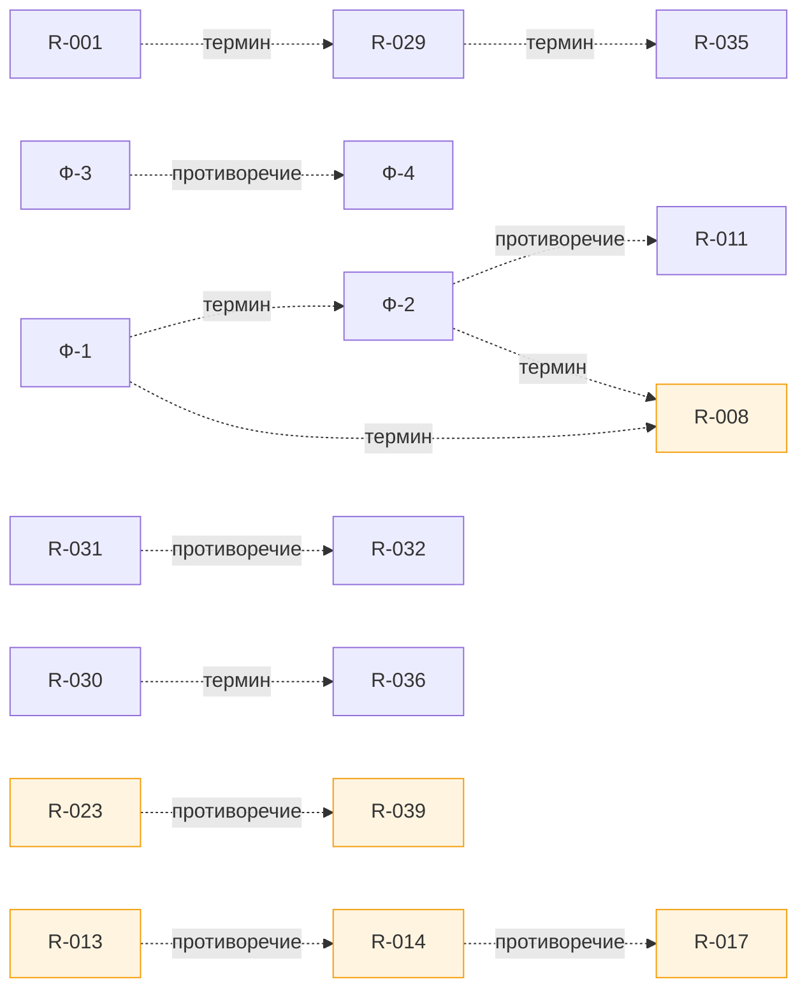

# Отчёт о проверке требований: Уведомление о расходах по карте

> 🔎 **Аудит цитат (проверено кодом):** цитат в замечаниях — 89, подтверждено в тексте документа — **89** (дословно 89, с пропусками «…» 0), не найдено — 0; отброшено как выдуманные моделью — 1. Учтено строк документа: 152 из 152.

<!-- reqlens:summary:start -->

**Итог за 30 секунд**

| Разработка | Тестирование | 🔴 Критичных | 🟠 Существенных | 🟡 Незначительных |
|---|---|---|---|---|
| ❌ нельзя | ❌ нельзя | 7 | 52 | 10 |

**Что исправить первым:**

1. 🔴 [S-01](#s-01) — Метод объявлен как GET («REST type \| GET»), но выполняет изменение данных («Сохранение») *Пример:* «PUT /alerts/limit»
2. 🔴 [S-02](#s-02) — В разделе успешного ответа 200 приведён пример с ошибкой ({"result":"ERROR","message":"Проверьте сумму"}), а для неверных параметров описан… *Пример:* «Если параметры запроса не соответствуют требуемому формату или типу данных, то система должна возвращать HTTP-статус 400 Bad Request.»
3. 🔴 [S-03](#s-03) — В спецификации API описан только метод изменения данных (/alerts/saveLimit), а метода чтения нет *Пример:* «GET /alerts/limit?cardId=…»
4. 🔴 [S-04](#s-04) — Расчёт строится на событиях внешней системы, но контракт события не описан: нет состава полей (карта, операция, тип операции, сумма и… *Пример:* «Мобильное приложение должно читать и сохранять настройки порога через REST API. При повторной доставке одного события процессинга система должна сохранять исходный итог.»
5. 🔴 [S-05](#s-05) — Ф-3 ограничивает частоту («максимум один такой push за календарный месяц»), а Ф-4 требует отправки «независимо от истории» *Пример:* «При изменении порога признак отправки в текущем месяце сбрасывается; лимит Ф-3 считается от последнего изменения порога»
6. 🔴 [S-06](#s-06) — Для продуктивной среды не указано значение («Prod: —») — реализацию нельзя развернуть и проверить в Prod. *Пример:* «Request URL должен содержать Dev: /alerts/saveLimit и Prod: /alerts/saveLimit.»
7. 🔴 [S-07](#s-07) — Правило Ф-2 определяет месяц по дате совершения покупки (31 января), однако в критерии приёмки покупка от 31 января, проведённая 1 февраля…
8. 🟠 [S-08](#s-08), [S-13](#s-13), [S-15](#s-15), [S-16](#s-16) … — Полнота набора: замечаний — 22 *Пример:* «UUID для карты, VARCHAR для месяца YYYY-MM, BIGINT для суммы в тиынах, BOOLEAN для признака отправки»

Подробности: разделы 3–4 (разбор по каждому требованию и набору), раздел 6 (итог и план), приложения.

<!-- reqlens:summary:end -->

## 1. Паспорт прогона

| Параметр | Значение |
|---|---|
| Документ | Уведомление о расходах по карте |
| Файл | `bench/real/notifications.md` (MD) |
| SHA-256 файла | `e7dae55e5453a250…` |
| Дата и время прогона | 2026-11-27 08:33:52 UTC |
| Модель | gemini / gemini-3.5-flash-lite |
| Переключения модели | gemini-3.8-flash → gemini-3.7-flash (HTTP 503); gemini-3.7-flash → gemini-3.6-flash (сетевая ошибка: HTTPSConnectionPool(host='generativelanguage.googleapis.com', port=443): Read timed out. (read timeout=180.0)); gemini-3.6-flash → gemini-3.5-flash-lite (квота: HTTP 429) |
| Версия агента | v9.0.0, коммит b76ae21 (v3.0.3-30-gb76ae21) |
| Обращений к модели | 36 (повторов: 15) |
| Подлинность прогона | ✅ свежий прогон: все 36 ответов модели получены сейчас; ✅ код агента — чистый коммит `b76ae21` |
| Профиль / режим | deep / облачная модель |
| Контекст запросов | полный текст · ≈3800 токенов на запрос (документ 8434 симв.) |
| База знаний (RAG) | 33 фрагментов · поиск: BM25 · основания у 69 замечаний |
| Экономия времени (оценка) | ручное ревью ≈ 3,8 ч аналитика (строк в документе — 152, норма — 40 строк/ч), агент — 13,7 мин; формула — в «Методике» |
| Критик-агент | включён |
| **Балл документа** | **65 / 100** `██████░░░░ 65` |
| **Готовность к разработке** | **4 %** `░░░░░░░░░░ 4` |
| Токены (вход / выход) | 201871 / 41691 |
| Длительность | 820 с |
| Журнал прогона | `requirements-report.log` — этапы, обращения к модели, кэш, повторы, отброшенные цитаты |
| Способ нарезки | по идентификаторам документа |
| Отброшено неподтверждённых цитат модели | 1 |
| Учтено строк документа | 152 из 152 (100 %) — в требованиях или исключены с причиной |
| Аудит цитат | 89 из 89 подтверждены в документе (100 %), отброшено выдуманных — 1 |
| Самопроверка | предложено 99, подтверждено 69, отклонено критиком 29, без подтверждённой цитаты 1 |
| Критерии | ISO/IEC/IEEE 29148:2018 п. 5.2.5, 5.2.6; IEEE Std 830-1998 п. 4.3 |

Обозначения серьёзности: 🔴 критичный — требование непроверяемо, противоречиво или неполно настолько, что реализация и тестирование невозможны; 🟠 существенный; 🟡 незначительный. Источник «LLM» — замечание модели с проверенной цитатой; «правило» — словарный пред-фильтр агента.

## 2. Нарезка требований

| ID в отчёте | ID в документе | Вид | Место в документе | Краткая формулировка |
|---|---|---|---|---|
| R-001 | — (присвоен агентом) | требование | раздел «Дизайн процесса UI», строка 29 | Карты → Расходы → Уведомления. На экране видны переключатель, поле «Порог, ₸», сумма за месяц и кнопка «Сохранить». При ошибке ввода сооб… |
| R-002 | Ф-1 | требование | раздел «Функциональные требования», строка 37 | Держатель активной карты KZT задаёт целый порог от 1 000 до 1 000 000 ₸ включительно. По умолчанию уведомление выключено. |
| R-003 | Ф-2 | требование | раздел «Функциональные требования», строка 38 | Месяц определяется по дате совершения покупки в Алматы. В расходы входят проведённые покупки. Возврат уменьшает расходы месяца исходной п… |
| R-004 | Ф-3 | требование | раздел «Функциональные требования», строка 39 | Когда расходы переходят от суммы ниже порога к сумме, равной порогу или выше, клиент получает push. На карту приходится максимум один так… |
| R-005 | Ф-4 | требование | раздел «Функциональные требования», строка 40 | При изменении порога накопленная сумма сохраняется. Если она ниже нового порога, следующее достижение вызывает push независимо от истории… |
| R-006 | — (присвоен агентом) | требование | раздел «Нефункциональные требования», строка 46 | Сервис передаёт push на отправку в течение минуты после получения события. |
| R-007 | — (присвоен агентом) | требование | раздел «Требования к данным», строка 49 | Хранить идентификатор карты, месяц, идентификатор операции, сумму покупки в тиынах, признак отправки и порог в тенге. |
| R-008 | — (присвоен агентом) | требование | раздел «Требования к интеграции», строка 52 | Приложение читает и сохраняет настройки через дочерний документ «Уведомление о расходах по карте — REST API». Повторная доставка одного с… |
| R-009 | — (присвоен агентом) | незаполненное место | раздел «Тестирование требований», строка 57 | заполняются тестировщиками |
| R-010 | — (присвоен агентом) | критерий приёмки | раздел «Критерии приемки», строка 63 | Расходы 48 500 ₸, порог 50 000 ₸ \| Провести покупку на 1 500 ₸ \| Итог 50 000 ₸ и один push |
| R-011 | — (присвоен агентом) | критерий приёмки | раздел «Критерии приемки», строка 64 | Покупка 31 января в 23:58 на 4 000 ₸ \| Провести 1 февраля в 00:03 по Алматы \| Февральский счётчик вырос на 4 000 ₸ |
| R-012 | — (присвоен агентом) | критерий приёмки | раздел «Критерии приемки», строка 65 | Расходы 19 900 ₸, порог 20 000 ₸ \| Перевести 500 ₸ \| Счётчик показывает 19 900 ₸ |
| R-013 | — (присвоен агентом) | элемент спецификации API | раздел «Общие параметры», строка 103 | Description \| Сохранение порога. Функциональные требования: чтение порога |
| R-014 | — (присвоен агентом) | элемент спецификации API | раздел «Общие параметры», строка 104 | REST type \| GET |
| R-015 | — (присвоен агентом) | элемент спецификации API | раздел «Общие параметры», строка 105 | Authorization \| Bearer, сессия владельца карты |
| R-016 | — (присвоен агентом) | элемент спецификации API | раздел «Общие параметры», строка 107 | URL type \| Dev / Prod |
| R-017 | — (присвоен агентом) | элемент спецификации API | раздел «Общие параметры», строка 108 | Request URL \| Dev: /alerts/saveLimit . Prod: — |
| R-018 | — (присвоен агентом) | элемент спецификации API | раздел «Общие параметры», строка 109 | CURL \| curl -G "$BASE/alerts/saveLimit" -H "Authorization: Bearer $TOKEN" --data 'cardId=demo-42&amount=50000&enabled=1' |
| R-019 | — (присвоен агентом) | требование | раздел «Логика работы метода», строка 117 | Проверить пользовательскую сессию. |
| R-020 | — (присвоен агентом) | требование | раздел «Логика работы метода», строка 118 | Проверить принадлежность карты клиенту. |
| R-021 | — (присвоен агентом) | требование | раздел «Логика работы метода», строка 119 | Проверить сумму и переключатель. |
| R-022 | — (присвоен агентом) | требование | раздел «Логика работы метода», строка 120 | Заменить настройку и вернуть результат сохранения. |
| R-023 | — (присвоен агентом) | требование | раздел «Логика работы метода», строка 121 | При отклонении суммы вернуть прежнее состояние и результат ERROR. |
| R-024 | — (присвоен агентом) | требование | раздел «Особые правила», строка 124 | Целое число тенге, обе границы включены. |
| R-025 | — (присвоен агентом) | требование | раздел «Особые правила», строка 125 | Повторное сохранение заменяет действующую настройку. |
| R-026 | — (присвоен агентом) | требование | раздел «Особые правила», строка 126 | Изменение порога сохраняет накопленные расходы. |
| R-027 | — (присвоен агентом) | элемент спецификации API | раздел «Path-параметры», строка 136 | Не используются. |
| R-028 | — (присвоен агентом) | элемент спецификации API | раздел «Query-параметры», строка 142 | cardId \| string \| 1–64 \| Да \| Карта клиента \| Идентификатор карты \| card_id |
| R-029 | — (присвоен агентом) | элемент спецификации API | раздел «Query-параметры», строка 143 | amount \| integer \| 32 bit \| Да \| 1 000–1 000 000 \| Порог в тенге \| limit_kzt |
| R-030 | — (присвоен агентом) | элемент спецификации API | раздел «Query-параметры», строка 144 | enabled \| integer \| 1 знак \| Да \| 0 или 1 \| Признак включения \| enabled |
| R-031 | — (присвоен агентом) | элемент спецификации API | раздел «Request body», строка 147 | Content-Type: application/json . |
| R-032 | — (присвоен агентом) | элемент спецификации API | раздел «Request body», строка 148 | Тело не используется. |
| R-033 | — (присвоен агентом) | элемент спецификации API | раздел «Ответ», строка 151 | Если результат 200 или 201 — успешный. Если результат 400, 401 и далее — неуспешный. |
| R-034 | — (присвоен агентом) | элемент спецификации API | раздел «Ответ», строка 155 | result \| string \| OK / ERROR \| Исход сохранения \| — |
| R-035 | — (присвоен агентом) | элемент спецификации API | раздел «Ответ», строка 156 | amount \| string \| При успехе \| Порог в тенге \| limit_kzt |
| R-036 | — (присвоен агентом) | элемент спецификации API | раздел «Ответ», строка 157 | enabled \| string \| «0» или «1» \| Признак включения \| enabled |
| R-037 | — (присвоен агентом) | элемент спецификации API | раздел «Ответ», строка 158 | message \| string \| При ошибке \| Описание ошибки \| — |
| R-038 | — (присвоен агентом) | элемент спецификации API | раздел «Статусы», строка 162 | 200. Ответ в случае успешного выполнения метода. |
| R-039 | — (присвоен агентом) | элемент спецификации API | раздел «Статусы», строка 163 | 400. Ответ в случае, если параметры запроса заполнены неверно. |
| R-040 | — (присвоен агентом) | элемент спецификации API | раздел «200. Successful — Created», строка 174 | 401. Ответ в случае, если запрос выполнен без необходимой авторизации. |
| R-041 | — (присвоен агентом) | элемент спецификации API | раздел «200. Successful — Created», строка 175 | 403. Ответ в случае, если на указанный ресурс доступ запрещен. |
| R-042 | — (присвоен агентом) | элемент спецификации API | раздел «200. Successful — Created», строка 176 | 500. Ответ в случае, если произошла внутренняя ошибка сервера. |
| R-043 | — (присвоен агентом) | элемент спецификации API | раздел «403. Unsuccessful — Forbidden», строка 189 | Для чужой карты возвращается 404, как и для отсутствующей карты. |

Всего выделено требований: **16**. Кроме них проверены 1 незаполненное место, 3 строки критериев приёмки, 23 элемента спецификации API — они не считаются требованиями (не входят в число требований и готовность), но замечания к ним в отчёте есть.

## 3. Проверка каждого требования

Подробный разбор — у требований с критичными и существенными замечаниями (13). Требования только с мелкими замечаниями (2) — в таблице ниже, без замечаний (28) — списком. Полный текст каждого требования приведён один раз — в его разборе; приёмочные тесты — в приложении «Тест-пробы».

<a id="r-008"></a>

### R-008 — 🟠 требует доработки

*Место:* раздел «Требования к интеграции», строка 52 · *Балл:* `████████░░ 85` · *Тип (EARS):* составное

> Приложение читает и сохраняет настройки через дочерний документ «Уведомление о расходах по карте — REST API». Повторная доставка одного события процессинга сохраняет исходный итог.

| № | Критерий | Цитата | Проблема | Серьёзность | Как исправить | Источник |
|---|---|---|---|---|---|---|
| 1 | Единичность (атомарность) | «Приложение читает и сохраняет настройки через дочерний документ «Уведомление о расходах по карте — REST API». Повторная доставка одного события процессинга сохраняет исходный итог.» | В одной формулировке объединены два разных функциональных требования: чтение/сохранение настроек приложением и идемпотентность обработки событий процессинга. | 🟠 Существенный | Разбить на два отдельных требования: одно для взаимодействия мобильного приложения с API настроек, второе — для обработки дубликатов событий процессинга. | LLM + правило |

**Основание:** стандарт: 29148 §5.2.5 e) Единичность (`kb/standards/iso29148_ieee830.md`)

**Предлагаемая формулировка:** Мобильное приложение должно читать и сохранять настройки порога через REST API. При повторной доставке одного события процессинга система должна сохранять исходный итог.

*Шаблон из базы знаний (Метод REST API, меняющий состояние, `kb/patterns/fintech_ears.md`):* Шаблон: Метод <назначение> должен использовать <POST \| PUT> на <URL>; параметры передаются в теле <формат>; ответы: <код> — <смысл> для каждого исхода, включая ошибки валидации и чужой ресурс.

<a id="r-009"></a>

### R-009 — 🟠 требует доработки

*Место:* раздел «Тестирование требований», строка 57 · *Балл:* `████████░░ 85` · *Тип (EARS):* постоянное

> заполняются тестировщиками

| № | Критерий | Цитата | Проблема | Серьёзность | Как исправить | Источник |
|---|---|---|---|---|---|---|
| 1 | Полнота | «заполняются тестировщиками» | Раздел содержит нефункциональную плейсхолдер-заглушку вместо сформулированных требований к тестированию. | 🟠 Существенный | Заполнить конкретными требованиями к тестированию и критериями качества либо удалить пустой раздел. | LLM + правило |

**Основание:** стандарт: 29148 §5.2.5 d) Полнота (`kb/standards/iso29148_ieee830.md`)

<a id="r-013"></a>

### R-013 — 🟠 требует доработки

*Место:* раздел «Общие параметры», строка 103 · *Балл:* `████████░░ 85` · *Тип (EARS):* постоянное

> Description \| Сохранение порога. Функциональные требования: чтение порога

| № | Критерий | Цитата | Проблема | Серьёзность | Как исправить | Источник |
|---|---|---|---|---|---|---|
| 1 | Корректность | «Сохранение порога. Функциональные требования: чтение порога» | В описании эндпоинта присутствует смысловое противоречие: указывается 'Сохранение порога', а затем 'чтение порога'. | 🟠 Существенный | Уточнить описание методом, указав только целевую операцию: 'Сохранение порога расходов по карте'. | LLM ×2 |

**Основание:** стандарт: 29148 §5.2.5 h) Корректность (`kb/standards/iso29148_ieee830.md`)

**Предлагаемая формулировка:** Описание метода должно содержать формулировку: 'Сохранение порога расходов по карте'.

*Шаблон из базы знаний (Порог и пересечение порога, `kb/patterns/fintech_ears.md`):* Шаблон: Когда накопленная сумма за период переходит от значения ниже порога к значению, равному порогу или выше, система должна выполнить <действие>; изменение порога внутри периода должно <правило> для уже отправленных уведомлений.

<a id="r-014"></a>

### R-014 — 🟠 требует доработки

*Место:* раздел «Общие параметры», строка 104 · *Балл:* `████████░░ 85` · *Тип (EARS):* постоянное

> REST type \| GET

| № | Критерий | Цитата | Проблема | Серьёзность | Как исправить | Источник |
|---|---|---|---|---|---|---|
| 1 | Корректность | «REST type \| GET» | Метод изменяет состояние системы (сохраняет порог расходов в БД), но декларируется как HTTP GET. Использование метода GET для мутирующих операций нарушает спецификацию HTTP и принципы REST (GET должен быть безопасным и идемпотентным вызовом без побочных эффектов). | 🟠 Существенный | Изменить HTTP-метод со значения GET на POST или PUT. | LLM ×2 |

**Основание:** стандарт: 29148 §5.2.5 h) Корректность (`kb/standards/iso29148_ieee830.md`)

**Предлагаемая формулировка:** Для изменения порога расходов метод REST API должен использовать HTTP-метод POST (или PUT).

*Шаблон из базы знаний (Метод REST API, меняющий состояние, `kb/patterns/fintech_ears.md`):* Шаблон: Метод <назначение> должен использовать <POST \| PUT> на <URL>; параметры передаются в теле <формат>; ответы: <код> — <смысл> для каждого исхода, включая ошибки валидации и чужой ресурс.

<a id="r-017"></a>

### R-017 — 🟠 требует доработки

*Место:* раздел «Общие параметры», строка 108 · *Балл:* `████████░░ 85` · *Тип (EARS):* постоянное

> Request URL \| Dev: /alerts/saveLimit . Prod: —

| № | Критерий | Цитата | Проблема | Серьёзность | Как исправить | Источник |
|---|---|---|---|---|---|---|
| 1 | Полнота | «Prod: —» | Не указан относительный URL эндпоинта для промышленной среды (Prod). | 🟠 Существенный | Указать путь для Prod (например, 'Prod: /alerts/saveLimit'). | LLM ×2 |

**Основание:** стандарт: 29148 §5.2.5 d) Полнота (`kb/standards/iso29148_ieee830.md`)

**Предлагаемая формулировка:** Request URL должен содержать Dev: /alerts/saveLimit и Prod: /alerts/saveLimit.

*Шаблон из базы знаний (Метод REST API, меняющий состояние, `kb/patterns/fintech_ears.md`):* Шаблон: Метод <назначение> должен использовать <POST \| PUT> на <URL>; параметры передаются в теле <формат>; ответы: <код> — <смысл> для каждого исхода, включая ошибки валидации и чужой ресурс.

<a id="r-019"></a>

### R-019 — 🟠 требует доработки

*Место:* раздел «Логика работы метода», строка 117 · *Балл:* `████████░░ 85` · *Тип (EARS):* по событию

> Проверить пользовательскую сессию.

| № | Критерий | Цитата | Проблема | Серьёзность | Как исправить | Источник |
|---|---|---|---|---|---|---|
| 1 | Полнота | «Проверить пользовательскую сессию.» | Не указано действие сервиса в случае недействительной или отсутствующей сессии. | 🟠 Существенный | Добавить условие: при недействительной сессии возвращать HTTP 401 Unauthorized с телом {"message":"Требуется вход"}. | LLM ×2 |

**Основание:** стандарт: 29148 §5.2.5 d) Полнота (`kb/standards/iso29148_ieee830.md`)

**Предлагаемая формулировка:** Когда поступает запрос к API GET /alerts/saveLimit, сервис должен проверить пользовательскую сессию и при её отсутствии или недействительности возвращать HTTP-ответ 401 Unauthorized.

<a id="r-020"></a>

### R-020 — 🟠 требует доработки

*Место:* раздел «Логика работы метода», строка 118 · *Балл:* `████████░░ 85` · *Тип (EARS):* по событию

> Проверить принадлежность карты клиенту.

| № | Критерий | Цитата | Проблема | Серьёзность | Как исправить | Источник |
|---|---|---|---|---|---|---|
| 1 | Полнота | «Проверить принадлежность карты клиенту.» | Не описано поведение системы, если карта не принадлежит авторизованному клиенту или не существует. | 🟠 Существенный | Дополнить: при отсутствии карты у клиента возвращать HTTP-ответ 404 со структурой {"message":"Карта не найдена"}. | LLM ×2 |

**Основание:** стандарт: 29148 §5.2.5 d) Полнота (`kb/standards/iso29148_ieee830.md`); норма РК, пересказ: Закон РК «О банках и банковской деятельности» — банковская тайна (`kb/law_kz/fintech_norms.md`)

**Предлагаемая формулировка:** Когда сессия клиента подтверждена, сервис должен проверить принадлежность указанной карты cardId текущему клиенту и, если карта не принадлежит клиенту, возвращать HTTP-ответ 404.

<a id="r-021"></a>

### R-021 — 🟠 требует доработки

*Место:* раздел «Логика работы метода», строка 119 · *Балл:* `████████░░ 85` · *Тип (EARS):* по событию

> Проверить сумму и переключатель.

| № | Критерий | Цитата | Проблема | Серьёзность | Как исправить | Источник |
|---|---|---|---|---|---|---|
| 1 | Полнота | «Проверить сумму и переключатель.» | Не указаны правила проверки (допустимые диапазоны и форматы) и реакция системы при некорректных значениях. | 🟠 Существенный | Указать допустимый диапазон суммы (от 1 000 до 1 000 000 ₸) и значение переключателя (0 или 1), а также HTTP-ответ при ошибке (400 Bad Request). | LLM ×2 |

**Основание:** стандарт: 29148 §5.2.5 d) Полнота (`kb/standards/iso29148_ieee830.md`)

**Предлагаемая формулировка:** Когда карта принадлежит клиенту, сервис должен проверить, что параметр amount является целым числом от 1 000 до 1 000 000 ₸, а параметр enabled равен 0 или 1.

<a id="r-022"></a>

### R-022 — 🟠 требует доработки

*Место:* раздел «Логика работы метода», строка 120 · *Балл:* `████████░░ 80` · *Тип (EARS):* по событию

> Заменить настройку и вернуть результат сохранения.

| № | Критерий | Цитата | Проблема | Серьёзность | Как исправить | Источник |
|---|---|---|---|---|---|---|
| 1 | Полнота | «вернуть результат сохранения.» | Не специфицирована структура успешного ответа. | 🟠 Существенный | Уточнить: возвращать HTTP 200 со структурой {"result":"OK","amount":"<amount>","enabled":"<enabled>"}. | LLM ×2 |
| 2 | Единичность (атомарность) | «Заменить настройку и вернуть результат сохранения.» | Объединены операция изменения состояния в хранилище и операция формирования ответа клиенту. | 🟡 Незначительный | Разбить на требование по обновлению записи в БД и требование по возврату ответа HTTP 200 OK. | LLM ×2 |

**Основание:** стандарт: 29148 §5.2.5 d) Полнота (`kb/standards/iso29148_ieee830.md`); стандарт: 29148 §5.2.5 e) Единичность (`kb/standards/iso29148_ieee830.md`)

**Предлагаемая формулировка:** Если проверки пройдены успешно, сервис должен обновить настройку порога карты в хранилище и вернуть HTTP-ответ 200 со структурой {"result":"OK","amount":"<amount>","enabled":"<enabled>"}.

*Шаблон из базы знаний (Идемпотентность и повторная доставка, `kb/patterns/fintech_ears.md`):* Шаблон: Если событие с тем же идентификатором <id> получено повторно в течение <T>, то система должна вернуть исходный результат и не изменять состояние повторно.

<a id="r-023"></a>

### R-023 — 🟠 требует доработки

*Место:* раздел «Логика работы метода», строка 121 · *Балл:* `████████░░ 85` · *Тип (EARS):* нежелательное поведение

> При отклонении суммы вернуть прежнее состояние и результат ERROR.

| № | Критерий | Цитата | Проблема | Серьёзность | Как исправить | Источник |
|---|---|---|---|---|---|---|
| 1 | Однозначность | «При отклонении суммы» | Неоднозначный термин «отклонение суммы»: не указано, какие именно условия приводят к отклонению (выход за пределы диапазона, нецелое число, нечисловой формат). | 🟠 Существенный | Уточнить условие: «Если сумма не является целым числом в диапазоне от 1 000 до 1 000 000 ₸…». | LLM ×2 |

**Основание:** стандарт: 29148 §5.2.5 c) Однозначность (`kb/standards/iso29148_ieee830.md`)

**Предлагаемая формулировка:** Если переданная сумма не входит в диапазон от 1 000 до 1 000 000 ₸, сервис должен сохранить прежнюю настройку порога карты и вернуть результат с ошибкой.

*Шаблон из базы знаний (Идемпотентность и повторная доставка, `kb/patterns/fintech_ears.md`):* Шаблон: Если событие с тем же идентификатором <id> получено повторно в течение <T>, то система должна вернуть исходный результат и не изменять состояние повторно.

<a id="r-024"></a>

### R-024 — 🟠 требует доработки

*Место:* раздел «Особые правила», строка 124 · *Балл:* `████████░░ 85` · *Тип (EARS):* постоянное

> Целое число тенге, обе границы включены.

| № | Критерий | Цитата | Проблема | Серьёзность | Как исправить | Источник |
|---|---|---|---|---|---|---|
| 1 | Полнота | «обе границы включены.» | Не указаны конкретные значения границ диапазона прямо в тексте правила. | 🟠 Существенный | Явно указать числовые границы: «от 1 000 до 1 000 000 ₸ включительно». | LLM ×2 |

**Основание:** стандарт: 29148 §5.2.5 d) Полнота (`kb/standards/iso29148_ieee830.md`)

**Предлагаемая формулировка:** Значение порога расходов по карте должно быть целым числом тенге в диапазоне от 1 000 до 1 000 000 ₸ включительно.

<a id="r-033"></a>

### R-033 — 🟠 требует доработки

*Место:* раздел «Ответ», строка 151 · *Балл:* `████████░░ 85` · *Тип (EARS):* постоянное

> Если результат 200 или 201 — успешный. Если результат 400, 401 и далее — неуспешный.

| № | Критерий | Цитата | Проблема | Серьёзность | Как исправить | Источник |
|---|---|---|---|---|---|---|
| 1 | Корректность | «200 или 201 — успешный» | В описании статусов код 201 отсутствует, а для кода 200 приведён пример ответа с result: ERROR, что противоречит утверждению об однозначно успешном характере кода 200. | 🟠 Существенный | Уточнить критерии успешности: использовать 200 OK для успешного выполнения и корректные коды ошибок (например, 400 Bad Request) вместо возврата result: ERROR при HTTP 200. | LLM ×2 |

**Основание:** стандарт: 29148 §5.2.5 h) Корректность (`kb/standards/iso29148_ieee830.md`)

**Предлагаемая формулировка:** Если сервер возвращает HTTP-статус 200 с значением result равным OK, то запрос считается успешным; при возврате HTTP-статусов 400, 401, 403, 404, 500 — неуспешным.

*Шаблон из базы знаний (Метод REST API, меняющий состояние, `kb/patterns/fintech_ears.md`):* Шаблон: Метод <назначение> должен использовать <POST \| PUT> на <URL>; параметры передаются в теле <формат>; ответы: <код> — <смысл> для каждого исхода, включая ошибки валидации и чужой ресурс.

<a id="r-039"></a>

### R-039 — 🟠 требует доработки

*Место:* раздел «Статусы», строка 163 · *Балл:* `████████░░ 85` · *Тип (EARS):* нежелательное поведение

> 400. Ответ в случае, если параметры запроса заполнены неверно.

| № | Критерий | Цитата | Проблема | Серьёзность | Как исправить | Источник |
|---|---|---|---|---|---|---|
| 1 | Однозначность | «если параметры запроса заполнены неверно» | Не разграничены ошибки: для неверно заполненных параметров декларируется HTTP 400, однако пример ошибки валидации суммы {"result":"ERROR","message":"Проверьте сумму"} приведён в секции кода 200. | 🟠 Существенный | Явно указать, какие ошибки вызывают статус 400 Bad Request (например, неверный формат/тип Query-параметров), а какие возвращают код 200 с result=ERROR. | LLM ×2 |

**Основание:** стандарт: 29148 §5.2.5 c) Однозначность (`kb/standards/iso29148_ieee830.md`)

**Предлагаемая формулировка:** Если параметры запроса не соответствуют требуемому формату или типу данных, то система должна возвращать HTTP-статус 400 Bad Request.

*Шаблон из базы знаний (Метод REST API, меняющий состояние, `kb/patterns/fintech_ears.md`):* Шаблон: Метод <назначение> должен использовать <POST \| PUT> на <URL>; параметры передаются в теле <формат>; ответы: <код> — <смысл> для каждого исхода, включая ошибки валидации и чужой ресурс.

### Требования с мелкими замечаниями

| Требование | Критерий | Цитата | Проблема | Как исправить | Источник |
|---|---|---|---|---|---|
| <a id="r-001"></a>R-001 | Уместный уровень (без проектных решений) | «поле «Порог, ₸», сумма за месяц и кнопка «Сохранить». При ошибке ввода сообщение» | В требование включено проектное решение (технология/элемент интерфейса) — это «как», а не «что». (маркер: «кнопка») | Если это ограничение заказчика — вынести в раздел ограничений с обоснованием; иначе сформулировать через потребность. | правило |
| <a id="r-043"></a>R-043 | Корректность | «возвращается 404, как и для отсутствующей карты» | Правило возврата HTTP-статуса 404 размещено в подразделе «403. Unsuccessful — Forbidden», что создает несоответствие между заголовком раздела (403) и фактически возвращаемым кодом ошибки (404). | Выделить для ошибки 404 отдельный подраздел «404. Unsuccessful — Not Found» и перенести данное требование туда. | LLM ×2 |

### Требования без замечаний

<a id="r-002"></a>R-002 (Ф-1), <a id="r-003"></a>R-003 (Ф-2), <a id="r-004"></a>R-004 (Ф-3), <a id="r-005"></a>R-005 (Ф-4), <a id="r-006"></a>R-006, <a id="r-007"></a>R-007, <a id="r-010"></a>R-010, <a id="r-011"></a>R-011, <a id="r-012"></a>R-012, <a id="r-015"></a>R-015, <a id="r-016"></a>R-016, <a id="r-018"></a>R-018, <a id="r-025"></a>R-025, <a id="r-026"></a>R-026, <a id="r-027"></a>R-027, <a id="r-028"></a>R-028, <a id="r-029"></a>R-029, <a id="r-030"></a>R-030, <a id="r-031"></a>R-031, <a id="r-032"></a>R-032, <a id="r-034"></a>R-034, <a id="r-035"></a>R-035, <a id="r-036"></a>R-036, <a id="r-037"></a>R-037, <a id="r-038"></a>R-038, <a id="r-040"></a>R-040, <a id="r-041"></a>R-041, <a id="r-042"></a>R-042 — нарушений критериев не найдено (проверены моделью и правилами).

## 4. Проверка набора требований

| Критерий набора | Источник | Замечаний | Статус |
|---|---|---|---|
| Полнота набора | 29148 §5.2.6 a) Complete; IEEE 830 §4.3.3 | 30 | 🔴 критичный |
| Непротиворечивость | 29148 §5.2.6 b) Consistent; IEEE 830 §4.3.4 | 12 | 🔴 критичный |
| Реализуемость набора | 29148 §5.2.6 c) Feasible | 0 | ✅ нарушений не найдено |
| Понятность | 29148 §5.2.6 d) Comprehensible | 8 | 🟠 существенный |
| Возможность валидации | 29148 §5.2.6 e) Able to be validated | 2 | 🟠 существенный |
| Ранжирование по важности | IEEE 830 §4.3.5 Ranked for importance and/or stability | 1 | 🟠 существенный |
| Модифицируемость | IEEE 830 §4.3.7 Modifiable | 0 | ✅ нарушений не найдено |
| Трассируемость | IEEE 830 §4.3.8 Traceable | 0 | ✅ нарушений не найдено |

<a id="s-01"></a>

#### S-01. Противоречие — 🔴 Критичный (Непротиворечивость; 29148 §5.2.6 b) Consistent; IEEE 830 §4.3.4)

- R-014, раздел «Общие параметры», строка 104: «REST type \| GET»
- R-013, раздел «Общие параметры», строка 103: «Description \| Сохранение порога. Функциональные»

**Проблема:** Метод объявлен как GET («REST type \| GET»), но выполняет изменение данных («Сохранение»). GET по смыслу безопасен и не меняет состояние: такие запросы кэшируются, повторяются браузером и прокси, параметры попадают в логи и историю — сохранение порога через GET приведёт к непредсказуемым изменениям.

**Как исправить:** Использовать POST/PUT (например, PUT /alerts/limit), параметры передать в теле JSON; GET оставить только для чтения настройки.

**Основание:** стандарт: 29148 §5.2.6 b) Непротиворечивость (`kb/standards/iso29148_ieee830.md`); норма РК, пересказ: Закон РК «О платежах и платёжных системах» — информирование и безопасность (`kb/law_kz/fintech_norms.md`)


*Источник: правило*

<a id="s-02"></a>

#### S-02. Противоречие — 🔴 Критичный (Непротиворечивость; 29148 §5.2.6 b) Consistent; IEEE 830 §4.3.4)

- Текст документа: «{"result":"ERROR","message":"Проверьте сумму"}»
- R-039, раздел «Статусы», строка 163: «400. Ответ в случае, если параметры запроса заполнены неверн»

**Проблема:** В разделе успешного ответа 200 приведён пример с ошибкой ({"result":"ERROR","message":"Проверьте сумму"}), а для неверных параметров описан код 400. Непонятно, каким кодом сервис сообщает об отклонённой сумме — клиент может принять ошибку за успех.

**Как исправить:** Возвращать ошибку валидации суммы только кодом 400 с телом {"message": …}; в разделе 200 оставить только успешный ответ.

**Основание:** стандарт: 29148 §5.2.6 b) Непротиворечивость (`kb/standards/iso29148_ieee830.md`)


*Источник: правило*

<a id="s-03"></a>

#### S-03. Пропуск — 🔴 Критичный (Полнота набора; 29148 §5.2.6 a) Complete; IEEE 830 §4.3.3)

- R-017, раздел «Общие параметры», строка 108: «Request URL \| Dev: /alerts/saveLimit . Prod: —»
- R-001, раздел «Дизайн процесса UI», строка 29: «→ Расходы → Уведомления. На экране видны переключатель, поле «Порог, ₸», сумма за месяц и кнопка»
- Текст документа: «Сервис расходов → настройки: получить порог карты. Сервис расходов →»

**Проблема:** В спецификации API описан только метод изменения данных (/alerts/saveLimit), а метода чтения нет. При этом документ на чтение опирается: экран показывает текущие значения, интеграция «читает» настройки. Приложение не сможет показать сохранённый порог и сумму за месяц — функцию нельзя реализовать целиком. Также: В спецификации интеграции заявлено, что приложение читает и сохраняет настройки, но в документе REST API описан только метод сохранения (/alerts/saveLimit), а метод чтения настроек отсутствует.

**Как исправить:** Добавить метод чтения (например, GET /alerts/limit?cardId=…): ответ — порог, признак включения, сумма расходов за текущий месяц; коды ответа и пример тела — как у метода сохранения.

**Основание:** стандарт: 29148 §5.2.6 a) Полнота набора (`kb/standards/iso29148_ieee830.md`); норма РК, пересказ: Требования к информационной безопасности банков — аутентификация и журналирование (`kb/law_kz/fintech_norms.md`)


*Источник: правило+LLM*

<a id="s-04"></a>

#### S-04. Пропуск — 🔴 Критичный (Полнота набора; 29148 §5.2.6 a) Complete; IEEE 830 §4.3.3)

- Текст документа: «→ сервис настроек. Карточный процессинг → учёт расходов → сервис»
- R-006, раздел «Нефункциональные требования», строка 46: «минуты после получения события.»
- R-008, раздел «Требования к интеграции», строка 52: «Повторная доставка одного события процессинга сохраняет»

**Проблема:** Расчёт строится на событиях внешней системы, но контракт события не описан: нет состава полей (карта, операция, тип операции, сумма и валюта, время с часовым поясом, ссылка на исходную операцию), нет перечня типов операций, хотя правила их различают («Возврат»), не заданы гарантии доставки, порядок и обработка дублей. Сервис нельзя реализовать однозначно, а интеграцию — протестировать. Также: Отсутствует спецификация контракта входящих событий от карточного процессинга (состав полей, уникальный идентификатор транзакции, формат даты, гарантии доставки и механизм дедупликации).

**Как исправить:** Описать контракт события: поля и типы, перечень типов операций (покупка, возврат, отмена, перевод, снятие), идентификатор для дедупликации, гарантию доставки (at-least-once), порядок и поведение при опоздавших событиях; пример сообщения.

**Основание:** стандарт: 29148 §5.2.6 a) Полнота набора (`kb/standards/iso29148_ieee830.md`); норма РК, пересказ: Требования к информационной безопасности банков — аутентификация и журналирование (`kb/law_kz/fintech_norms.md`)


*Источник: правило+LLM*

<a id="s-05"></a>

#### S-05. Противоречие — 🔴 Критичный (Непротиворечивость; 29148 §5.2.6 b) Consistent; IEEE 830 §4.3.4)

- R-004 (Ф-3), раздел «Функциональные требования», строка 39: «push. На карту приходится максимум один такой push за календарный месяц.»
- R-005 (Ф-4), раздел «Функциональные требования», строка 40: «достижение вызывает push независимо от истории предыдущей настройки.»

**Проблема:** Ф-3 ограничивает частоту («максимум один такой push за календарный месяц»), а Ф-4 требует отправки «независимо от истории». Если оба условия выполняются в одном периоде (уведомление уже отправлено, затем изменён порог и он снова достигнут), Ф-3 запрещает второе уведомление, а Ф-4 его требует — какое правило главнее, не сказано. Реализация и ожидаемый результат теста зависят от толкования.

**Как исправить:** Явно задать приоритет: например, «При изменении порога признак отправки в текущем месяце сбрасывается; лимит Ф-3 считается от последнего изменения порога» — и добавить критерий приёмки на этот случай.

**Основание:** стандарт: 29148 §5.2.6 b) Непротиворечивость (`kb/standards/iso29148_ieee830.md`); норма РК, пересказ: Закон РК «О персональных данных и их защите» — согласие (`kb/law_kz/fintech_norms.md`)


*Источник: правило*

<a id="s-06"></a>

#### S-06. Пропуск — 🔴 Критичный (Полнота набора; 29148 §5.2.6 a) Complete; IEEE 830 §4.3.3)

- R-017, раздел «Общие параметры», строка 108: «\| Dev: /alerts/saveLimit . Prod: —»

**Проблема:** Для продуктивной среды не указано значение («Prod: —») — реализацию нельзя развернуть и проверить в Prod.

**Как исправить:** Указать значение для Prod (URL/параметр) или явно зафиксировать, когда и кем оно будет определено.

**Основание:** стандарт: 29148 §5.2.6 a) Полнота набора (`kb/standards/iso29148_ieee830.md`)


*Источник: правило*

<a id="s-07"></a>

#### S-07. Противоречие — 🔴 Критичный (Непротиворечивость; 29148 §5.2.6 b) Consistent; IEEE 830 §4.3.4)

- R-003 (Ф-2), раздел «Функциональные требования», строка 38: «Месяц определяется по дате совершения покупки в Алматы.»
- R-011, раздел «Критерии приемки», строка 64: «Покупка 31 января в 23:58 на 4 000 ₸ \| Провести 1 февраля в 00:03 по Алматы \| Февральский счётчик вырос на 4 000 ₸»

**Проблема:** Правило Ф-2 определяет месяц по дате совершения покупки (31 января), однако в критерии приёмки покупка от 31 января, проведённая 1 февраля, ошибочно относится к февральскому счётчику.

**Как исправить:** Уточнить правило Ф-2: фиксируется ли месяц по дате совершения или по дате проводки покупки, и привести критерий приёмки R-011 в соответствие с принятым правилом.

**Основание:** стандарт: 29148 §5.2.6 b) Непротиворечивость (`kb/standards/iso29148_ieee830.md`)


*Источник: LLM*

<a id="s-08"></a>

#### S-08. Пропуск — 🟠 Существенный (Полнота набора; 29148 §5.2.6 a) Complete; IEEE 830 §4.3.3)

- R-007, раздел «Требования к данным», строка 49: «Хранить идентификатор карты, месяц, идентификатор операции, сумму покупки в тиынах, признак отправки и порог в тенге.»

**Проблема:** Для перечисленных сущностей хранения (идентификатор карты, месяц, идентификатор операции, сумма покупки, признак отправки, порог) не указаны типы данных, точность, обязательность, ключи уникальности и связи между таблицами.

**Как исправить:** Добавить детальную схему данных с указанием типов (например, UUID для карты, VARCHAR для месяца YYYY-MM, BIGINT для суммы в тиынах, BOOLEAN для признака отправки), ограничений NOT NULL и первичных/внешних ключей.

**Основание:** стандарт: 29148 §5.2.6 a) Полнота набора (`kb/standards/iso29148_ieee830.md`); норма РК, пересказ: Закон РК «О банках и банковской деятельности» — банковская тайна (`kb/law_kz/fintech_norms.md`)


*Источник: LLM (узкий проход: модель данных)*

<a id="s-09"></a>

#### S-09. Терминология — 🟠 Существенный (Непротиворечивость; 29148 §5.2.6 b) Consistent; IEEE 830 §4.3.4)

- R-029, раздел «Query-параметры», строка 143: «amount \| integer \| 32 bit \| Да \| 1 000–1 000 000 \| Порог в т»
- R-035, раздел «Ответ», строка 156: «amount \| string \| При успехе \| Порог в тенге \| limit_kzt»

**Проблема:** Параметр «amount» описан с разными форматами: integer (Query-параметры) и string (Ответ). Клиент и сервер по-разному сериализуют значение — ошибки разбора и сравнения.

**Как исправить:** Задать единый формат «amount» во всех таблицах (например, integer) и пример ответа в том же формате.

**Основание:** стандарт: 29148 §5.2.6 b) Непротиворечивость (`kb/standards/iso29148_ieee830.md`)


*Источник: правило*

<a id="s-10"></a>

#### S-10. Терминология — 🟠 Существенный (Непротиворечивость; 29148 §5.2.6 b) Consistent; IEEE 830 §4.3.4)

- R-030, раздел «Query-параметры», строка 144: «enabled \| integer \| 1 знак \| Да \| 0 или 1 \| Признак включени»
- R-036, раздел «Ответ», строка 157: «enabled \| string \| «0» или «1» \| Признак включения \| enabled»

**Проблема:** Параметр «enabled» описан с разными форматами: integer (Query-параметры) и string (Ответ). Клиент и сервер по-разному сериализуют значение — ошибки разбора и сравнения.

**Как исправить:** Задать единый формат «enabled» во всех таблицах (например, integer) и пример ответа в том же формате.

**Основание:** стандарт: 29148 §5.2.6 b) Непротиворечивость (`kb/standards/iso29148_ieee830.md`)


*Источник: правило*

<a id="s-11"></a>

#### S-11. Противоречие — 🟠 Существенный (Непротиворечивость; 29148 §5.2.6 b) Consistent; IEEE 830 §4.3.4)

- R-043, раздел «403. Unsuccessful — Forbidden», строка 189: «Для чужой карты возвращается 404, как и для отсутствующей»

**Проблема:** Раздел ответа 403 («403. Unsuccessful — Forbidden») сообщает, что на самом деле возвращается 404. Описанный код 403 не используется, клиент не узнает, какой код обрабатывать.

**Как исправить:** Оставить один код для этого случая и описать его в перечне статусов (например, только 404 или только 403), убрать противоречивый раздел.

**Основание:** стандарт: 29148 §5.2.6 b) Непротиворечивость (`kb/standards/iso29148_ieee830.md`)


*Источник: правило*

<a id="s-12"></a>

#### S-12. Противоречие — 🟠 Существенный (Непротиворечивость; 29148 §5.2.6 b) Consistent; IEEE 830 §4.3.4)

- R-013, раздел «Общие параметры», строка 103: «Description \| Сохранение порога. Функциональные требования: чтение порога»

**Проблема:** Назначение метода противоречиво: в одном описании и изменение, и чтение («Сохранение порога. Функциональные требования: чтение порога»). Непонятно, что метод делает и какие данные возвращает — разработчик и тестировщик поймут его по-разному.

**Как исправить:** Разделить на два метода: чтение настроек (GET, без изменения данных) и сохранение (PUT/POST с телом); у каждого — своё описание, параметры и ответы.

**Основание:** стандарт: 29148 §5.2.6 b) Непротиворечивость (`kb/standards/iso29148_ieee830.md`); норма РК, пересказ: Закон РК «О персональных данных и их защите» — согласие (`kb/law_kz/fintech_norms.md`)


*Источник: правило*

<a id="s-13"></a>

#### S-13. Пропуск — 🟠 Существенный (Полнота набора; 29148 §5.2.6 a) Complete; IEEE 830 §4.3.3)

- R-033, раздел «Ответ», строка 151: «Если результат 200 или 201 — успешный. Если результат»

**Проблема:** Код 201 назван в описании ответа, но не описан в перечне статусов (200, 400, 401, 403, 404, 500): нет ни условия, когда он возвращается, ни примера тела. Клиент не знает, ждать ли 201 и как его обработать.

**Как исправить:** Либо описать код 201 (когда возвращается, пример ответа), либо убрать его из текста и оставить один успешный код.

**Основание:** стандарт: 29148 §5.2.6 a) Полнота набора (`kb/standards/iso29148_ieee830.md`); норма РК, пересказ: Закон РК «О персональных данных и их защите» — согласие (`kb/law_kz/fintech_norms.md`)


*Источник: правило*

<a id="s-14"></a>

#### S-14. Противоречие — 🟠 Существенный (Непротиворечивость; 29148 §5.2.6 b) Consistent; IEEE 830 §4.3.4)

- R-031, раздел «Request body», строка 147: «Content-Type: application/json .»
- R-032, раздел «Request body», строка 148: «Тело не используется.»

**Проблема:** Content-Type запроса указан (application/json), но тело не используется: непонятно, передаются ли параметры в теле или в строке запроса, и что проверять при пустом теле.

**Как исправить:** Если параметры передаются в строке запроса — убрать Content-Type запроса; если в теле — описать тело JSON с полями и примером (предпочтительно для метода изменения данных).

**Основание:** стандарт: 29148 §5.2.6 b) Непротиворечивость (`kb/standards/iso29148_ieee830.md`)


*Источник: правило*

<a id="s-15"></a>

#### S-15. Пропуск — 🟠 Существенный (Полнота набора; 29148 §5.2.6 a) Complete; IEEE 830 §4.3.3)

- R-015, раздел «Общие параметры», строка 105: «Authorization \| Bearer, сессия владельца карты»

**Проблема:** Токен и сессия не определены: не указано, какой токен ожидается (кем выдан, что в нём), сколько живёт сессия и что возвращает метод при истёкшей, отозванной или чужой сессии. Без этого нельзя реализовать проверку доступа и написать негативные тесты авторизации.

**Как исправить:** Описать: тип токена и издателя, срок жизни сессии, ответ при истёкшем токене (401 с телом {"message": …}), поведение приложения (повторный вход) и пример заголовка Authorization.

**Основание:** стандарт: 29148 §5.2.6 a) Полнота набора (`kb/standards/iso29148_ieee830.md`)


*Источник: правило*

<a id="s-16"></a>

#### S-16. Пропуск — 🟠 Существенный (Полнота набора; 29148 §5.2.6 a) Complete; IEEE 830 §4.3.3)

- R-002 (Ф-1), раздел «Функциональные требования», строка 37: «Держатель активной карты KZT задаёт целый порог от 1 000 до 1 000 000 ₸ включительно. По умолчанию»

**Проблема:** Не задано значение по умолчанию для параметра, который настраивается в Ф-1 («задаёт целый порог от 1 000 до 1 000 000»): неизвестно, что хранится и что показывает экран до первого сохранения, и чем первое сохранение отличается от изменения. Разработчик выберет сам (0, пусто или минимум диапазона), тестировщику не с чем сравнивать.

**Как исправить:** Дописать: «До первого сохранения порог не задан: экран показывает пустое поле, уведомление выключено, метод чтения возвращает amount = null» — или конкретное значение по умолчанию.

**Основание:** стандарт: 29148 §5.2.6 a) Полнота набора (`kb/standards/iso29148_ieee830.md`)


*Источник: правило*

<a id="s-17"></a>

#### S-17. Пропуск — 🟠 Существенный (Полнота набора; 29148 §5.2.6 a) Complete; IEEE 830 §4.3.3)

- R-003 (Ф-2), раздел «Функциональные требования», строка 38: «входят проведённые покупки. Возврат уменьшает расходы месяца исходной»

**Проблема:** Возврат меняет сумму, от которой зависит срабатывание порога («Возврат уменьшает»), но граничные случаи возвратов не описаны: частичный возврат, возврат в другом месяце (прошлый месяц уже закрыт?), возврат после отправленного уведомления — отзывается ли push, отправляется ли он снова, если сумма опустилась ниже порога и снова его достигла. Разработчик и тестировщик решат эти случаи по-разному.

**Как исправить:** Добавить правила и примеры приёмки: «Частичный возврат уменьшает расходы на сумму возврата; push, уже отправленный в этом месяце, не отзывается и повторно не отправляется; возврат по покупке прошлого месяца меняет только счётчик того месяца».

**Основание:** стандарт: 29148 §5.2.6 a) Полнота набора (`kb/standards/iso29148_ieee830.md`)


*Источник: правило*

<a id="s-18"></a>

#### S-18. Терминология — 🟠 Существенный (Понятность; 29148 §5.2.6 d) Comprehensible)

- R-002 (Ф-1), раздел «Функциональные требования», строка 37: «Держатель активной карты KZT задаёт целый порог от 1 000»
- R-003 (Ф-2), раздел «Функциональные требования», строка 38: «в Алматы. В расходы входят проведённые покупки. Возврат уменьшает расходы»
- R-008, раздел «Требования к интеграции», строка 52: «процессинга сохраняет исходный итог.»

**Проблема:** Термины-условия «активной карты KZT», «проведённые покупки», «исходный итог» не определены ни в глоссарии, ни в тексте (R-008, Ф-1, Ф-2): не сказано, какие статусы карты считаются активными, что значит «KZT» (валюта карты или счёта), какая покупка считается проведённой (авторизация или клиринг). От толкования зависит, сработает ли правило, — разработчик и тестировщик проверят разное.

**Как исправить:** Добавить глоссарий с определениями через проверяемые признаки, например: «Активная карта — карта в статусе „Действует“, не заблокированная и не просроченная»; «Проведённая покупка — операция покупки в статусе клиринга».

**Основание:** стандарт: 29148 §5.2.6 d) Понятность (`kb/standards/iso29148_ieee830.md`)


*Источник: правило*

<a id="s-19"></a>

#### S-19. Терминология — 🟠 Существенный (Непротиворечивость; 29148 §5.2.6 b) Consistent; IEEE 830 §4.3.4)

- R-007, раздел «Требования к данным», строка 49: «операции, сумму покупки в тиынах, признак отправки и порог в»

**Проблема:** Сравниваемые величины хранятся в разных единицах: «покупки в тиынах» и «порог в тенге». Порог сравнивается с суммой расходов — без явного правила пересчёта (тиын × 100 = тенге) возможна ошибка в 100 раз.

**Как исправить:** Хранить обе величины в одной единице (например, в тиынах как целое) и записать правило пересчёта для отображения и API.

**Основание:** стандарт: 29148 §5.2.6 b) Непротиворечивость (`kb/standards/iso29148_ieee830.md`)


*Источник: правило*

<a id="s-20"></a>

#### S-20. Пропуск — 🟠 Существенный (Полнота набора; 29148 §5.2.6 a) Complete; IEEE 830 §4.3.3)

- R-001, раздел «Дизайн процесса UI», строка 29: «и кнопка «Сохранить». При ошибке ввода сообщение появляется под полем.»

**Проблема:** Текст сообщения пользователю не задан («ошибке ввода сообщение появляется»): не указано, что именно видит клиент при каждой ошибке (сумма вне диапазона, не целое число, нет связи, сессия истекла). Разработчик придумает тексты сам, тестировщику не с чем сравнивать.

**Как исправить:** Добавить таблицу сообщений: условие → текст → место показа. Например: сумма меньше 1 000 ₸ — «Введите сумму от 1 000 до 1 000 000 ₸» под полем «Порог».

**Основание:** стандарт: 29148 §5.2.6 a) Полнота набора (`kb/standards/iso29148_ieee830.md`); норма РК, пересказ: Закон РК «О платежах и платёжных системах» — информирование и безопасность (`kb/law_kz/fintech_norms.md`)


*Источник: правило*

<a id="s-21"></a>

#### S-21. Структура/трассируемость — 🟠 Существенный (Ранжирование по важности; IEEE 830 §4.3.5 Ranked for importance and/or stability)

- R-001, раздел «Дизайн процесса UI», строка 29: «Карты → Расходы → Уведомления. На экране видны переключатель, поле «Порог, ₸», с»

**Проблема:** Ни у одного требования нет приоритета или признака стабильности (IEEE 830 §4.3.5) — невозможно спланировать порядок реализации и объём MVP. Также: В комплекте требований отсутствуют признаки приоритета или стабильности требований (не выполнено ранжирование по IEEE 830).

**Как исправить:** Добавить атрибут «Приоритет» (например, MoSCoW) каждому требованию.

**Основание:** стандарт: IEEE 830 §4.3.5 Ранжирование (`kb/standards/iso29148_ieee830.md`)


*Источник: правило+LLM*

<a id="s-22"></a>

#### S-22. Противоречие — 🟠 Существенный (Непротиворечивость; 29148 §5.2.6 b) Consistent; IEEE 830 §4.3.4)

- R-014, раздел «Общие параметры», строка 104: «REST type \| GET»
- R-017, раздел «Общие параметры», строка 108: «Request URL \| Dev: /alerts/saveLimit . Prod: —»

**Проблема:** Метод сохранения настроек порога /alerts/saveLimit объявлен как HTTP GET с передачей мутирующих данных в query-параметрах, что нарушает принципы REST и стандарты безопасности.

**Как исправить:** Изменить HTTP-метод для /alerts/saveLimit с GET на POST или PUT, а параметры передавать в теле запроса.

**Основание:** стандарт: 29148 §5.2.6 b) Непротиворечивость (`kb/standards/iso29148_ieee830.md`)


*Источник: LLM*

<a id="s-23"></a>

#### S-23. Противоречие — 🟠 Существенный (Непротиворечивость; 29148 §5.2.6 b) Consistent; IEEE 830 §4.3.4)

- R-023, раздел «Логика работы метода», строка 121: «При отклонении суммы вернуть прежнее состояние и результат ERROR.»
- R-039, раздел «Статусы», строка 163: «400. Ответ в случае, если параметры запроса заполнены неверно.»

**Проблема:** Логика метода предусматривает возврат результата ERROR внутри ответа HTTP 200 при ошибке в сумме, что противоречит наличию описанного статуса HTTP 400 Bad Request.

**Как исправить:** Исключить структуру ERROR из тела HTTP 200 OK. При бизнес-ошибке или неверных параметрах возвращать HTTP status 400 с JSON-описанием ошибки.

**Основание:** стандарт: 29148 §5.2.6 b) Непротиворечивость (`kb/standards/iso29148_ieee830.md`)


*Источник: LLM*

<a id="s-24"></a>

#### S-24. Пропуск — 🟠 Существенный (Полнота набора; 29148 §5.2.6 a) Complete; IEEE 830 §4.3.3)

- R-003 (Ф-2), раздел «Функциональные требования», строка 38: «Месяц определяется по дате совершения покупки в Алматы.»

**Проблема:** Не описан механизм и момент сброса месячного счётчика расходов при наступлении нового календарного месяца (обнуляется ли сумма автоматически в 00:00:00 по Алматы или инициализируется при первой транзакции нового месяца). Это не позволяет спроектировать и протестировать логику перехода между месяцами.

**Как исправить:** Добавить в Ф-2: «Счётчик накопленных расходов карты автоматически обнуляется (устанавливается в 0 ₸) первого числа каждого месяца в 00:00:00 по времени Алматы (UTC+5).»

**Основание:** стандарт: 29148 §5.2.6 a) Полнота набора (`kb/standards/iso29148_ieee830.md`)


*Источник: LLM (проход полноты)*

<a id="s-25"></a>

#### S-25. Пропуск — 🟠 Существенный (Полнота набора; 29148 §5.2.6 a) Complete; IEEE 830 §4.3.3)

- R-006, раздел «Нефункциональные требования», строка 46: «Сервис передаёт push на отправку в течение минуты после получения события.»

**Проблема:** Не определено поведение системы при недоступности шлюза push-уведомлений (таймаут, ошибки 5xx): отбрасывается ли уведомление, сохраняется ли в очередь повторных попыток (retry/DLQ) и каков лимит времени/попыток на доставку.

**Как исправить:** Дополнить нефункциональные требования: «При недоступности сервиса push событие помещается в очередь retry. Повторные попытки отправки выполняются 3 раза с интервалом в 1 минуту. Если сервис недоступен более 5 минут, push отбрасывается, признак отправки не проставляется.»

**Основание:** стандарт: 29148 §5.2.6 a) Полнота набора (`kb/standards/iso29148_ieee830.md`); норма РК, пересказ: Закон РК «О платежах и платёжных системах» — информирование и безопасность (`kb/law_kz/fintech_norms.md`)


*Источник: LLM (проход полноты)*

<a id="s-26"></a>

#### S-26. Пропуск — 🟠 Существенный (Полнота набора; 29148 §5.2.6 a) Complete; IEEE 830 §4.3.3)

- R-007, раздел «Требования к данным», строка 49: «Хранить идентификатор карты, месяц, идентификатор операции, сумму покупки в тиынах»

**Проблема:** Отсутствуют требования к сроку хранения (глубине архивации) исторических данных о расходах и порогах, а также не указан владелец данных и требования по защите персональных данных клиентов (PCI DSS / законодательство о персональных данных).

**Как исправить:** Добавить в требования к данным: «Данные об операциях и установленных порогах хранятся в БД 5 лет для обеспечения отчетности. Владелец данных — процессинговый центр. Идентификатор карты хранить в маскированном или хешированном виде по стандарту PCI DSS.»

**Основание:** стандарт: 29148 §5.2.6 a) Полнота набора (`kb/standards/iso29148_ieee830.md`); норма РК, пересказ: Закон РК «О персональных данных и их защите» — хранение и защита (`kb/law_kz/fintech_norms.md`)


*Источник: LLM (проход полноты)*

<a id="s-27"></a>

#### S-27. Пропуск — 🟠 Существенный (Полнота набора; 29148 §5.2.6 a) Complete; IEEE 830 §4.3.3)

- R-002 (Ф-1), раздел «Функциональные требования», строка 37: «Держатель активной карты KZT задаёт целый порог от 1 000 до 1 000 000 ₸ включительно.»

**Проблема:** Не определено поведение системы и формат ошибки при попытке ввести нецелое число (например, с копейками) или значения вне диапазона (меньше 1 000 и больше 1 000 000).

**Как исправить:** Уточнить валидацию: при вводе дробных чисел или значений вне диапазона [1 000; 1 000 000] возвращать ошибку валидации с текстом, например: «Порог должен быть целым числом от 1 000 до 1 000 000 ₸».

**Основание:** стандарт: 29148 §5.2.6 a) Полнота набора (`kb/standards/iso29148_ieee830.md`); норма РК, пересказ: Закон РК «О банках и банковской деятельности» — банковская тайна (`kb/law_kz/fintech_norms.md`)


*Источник: LLM (узкий проход: граничные значения)*

<a id="s-28"></a>

#### S-28. Пропуск — 🟠 Существенный (Полнота набора; 29148 §5.2.6 a) Complete; IEEE 830 §4.3.3)

- R-004 (Ф-3), раздел «Функциональные требования», строка 39: «Когда расходы переходят от суммы ниже порога к сумме, равной порогу или выше, клиент получает push.»

**Проблема:** Не описано поведение, если сумма расходов изначально (до совершения покупки) уже была равна порогу или выше, и совершается ещё одна покупка — будет ли отправлен повторный push в том же месяце (при условии, что счётчик сброшен настройкой Ф-4 или это новое превышение после возврата).

**Как исправить:** Дописать правило: пуш отправляется ровно один раз при первом за календарный месяц переходе из зоны ниже порога в зону >= порога. Если расходы уже были >= порога, новые покупки не вызывают повторный пуш в этом же месяце.

**Основание:** стандарт: 29148 §5.2.6 a) Полнота набора (`kb/standards/iso29148_ieee830.md`)


*Источник: LLM (узкий проход: граничные значения)*

<a id="s-29"></a>

#### S-29. Пропуск — 🟠 Существенный (Полнота набора; 29148 §5.2.6 a) Complete; IEEE 830 §4.3.3)

- R-011, раздел «Критерии приемки», строка 64: «Покупка 31 января в 23:58 на 4 000 ₸ \| Провести 1 февраля в 00:03 по Алматы»

**Проблема:** Пример иллюстрирует стык месяцев, но не определено, какая именно дата берётся в расчет при расхождении времени авторизации (совершения) транзакции и времени её фактического проведения (клиринга/поступления события в процессинг).

**Как исправить:** Уточнить правило стыка суток и месяцев: для отнесения к месяцу используется исключительно штамп времени совершения покупки (авторизации) по часовому поясу Алматы, независимо от времени поступления проводки.

**Основание:** стандарт: 29148 §5.2.6 a) Полнота набора (`kb/standards/iso29148_ieee830.md`)


*Источник: LLM (узкий проход: граничные значения)*

<a id="s-30"></a>

#### S-30. Пропуск — 🟠 Существенный (Полнота набора; 29148 §5.2.6 a) Complete; IEEE 830 §4.3.3)

- R-019, раздел «Логика работы метода», строка 117: «Проверить пользовательскую сессию.»

**Проблема:** Не описано поведение системы и код ответа при передаче некорректного, просроченного или отозванного Bearer-токена в заголовке Authorization.

**Как исправить:** Дописать требование: при истекшем или невалидном токене возвращать код 401 Unauthorized с телом {"message":"Требуется вход"}.

**Основание:** стандарт: 29148 §5.2.6 a) Полнота набора (`kb/standards/iso29148_ieee830.md`)


*Источник: LLM (узкий проход: отрицательные сценарии API)*

<a id="s-31"></a>

#### S-31. Пропуск — 🟠 Существенный (Полнота набора; 29148 §5.2.6 a) Complete; IEEE 830 §4.3.3)

- R-020, раздел «Логика работы метода», строка 118: «Проверить принадлежность карты клиенту.»

**Проблема:** Не определен точный HTTP-код ответа и формат тела при попытке запросить чужую или несуществующую карту (в тексте есть противоречие между кодами 403 и 404).

**Как исправить:** Уточнить контракт: для чужих и несуществующих карт возвращать единообразный ответ 404 Not Found с телом {"message":"Карта не найдена"}.

**Основание:** стандарт: 29148 §5.2.6 a) Полнота набора (`kb/standards/iso29148_ieee830.md`); норма РК, пересказ: Закон РК «О банках и банковской деятельности» — банковская тайна (`kb/law_kz/fintech_norms.md`)


*Источник: LLM (узкий проход: отрицательные сценарии API)*

<a id="s-32"></a>

#### S-32. Пропуск — 🟠 Существенный (Возможность валидации; 29148 §5.2.6 e) Able to be validated)

- R-021, раздел «Логика работы метода», строка 119: «Проверить сумму и переключатель.»

**Проблема:** Не указан код ответа и формат ошибки при передаче неверного типа данных или недопустимого значения для параметра enabled (например, передача буквы, числа 2 или пустого значения вместо 0 или 1).

**Как исправить:** Дописать правило валидации: при неверном значении enabled возвращать HTTP 400 Bad Request с текстом ошибки.

**Основание:** стандарт: 29148 §5.2.6 e) Возможность валидации (`kb/standards/iso29148_ieee830.md`)


*Источник: LLM (узкий проход: отрицательные сценарии API)*

<a id="s-33"></a>

#### S-33. Пропуск — 🟠 Существенный (Полнота набора; 29148 §5.2.6 a) Complete; IEEE 830 §4.3.3)

- R-028, раздел «Query-параметры», строка 142: «cardId \| string \| 1–64 \| Да \| Карта клиента \| Идентификатор карты \| card_id»

**Проблема:** Отсутствует негативный сценарий для отсутствующего или пустого обязательного параметра cardId, а также для значений, превышающих длину 64 символа.

**Как исправить:** Описать обработку: при отсутствии cardId или превышении длины 64 символа возвращать HTTP 400 Bad Request с описанием ошибки.

**Основание:** стандарт: 29148 §5.2.6 a) Полнота набора (`kb/standards/iso29148_ieee830.md`); норма РК, пересказ: Закон РК «О банках и банковской деятельности» — банковская тайна (`kb/law_kz/fintech_norms.md`)


*Источник: LLM (узкий проход: отрицательные сценарии API)*

<a id="s-34"></a>

#### S-34. Пропуск — 🟠 Существенный (Полнота набора; 29148 §5.2.6 a) Complete; IEEE 830 §4.3.3)

- R-029, раздел «Query-параметры», строка 143: «amount \| integer \| 32 bit \| Да \| 1 000–1 000 000 \| Порог в тенге \| limit_kzt»

**Проблема:** Не определено поведение при отсутствии обязательного параметра amount или при передаче нечислового значения (строка, спецсимволы, дробное число).

**Как исправить:** Добавить требование: при отсутствии или неверном формате amount возвращать HTTP 400 Bad Request.

**Основание:** стандарт: 29148 §5.2.6 a) Полнота набора (`kb/standards/iso29148_ieee830.md`)


*Источник: LLM (узкий проход: отрицательные сценарии API)*

<a id="s-35"></a>

#### S-35. Пропуск — 🟠 Существенный (Полнота набора; 29148 §5.2.6 a) Complete; IEEE 830 §4.3.3)

- R-030, раздел «Query-параметры», строка 144: «enabled \| integer \| 1 знак \| Да \| 0 или 1 \| Признак включения \| enabled»

**Проблема:** Не указан ответ сервера при отсутствии обязательного параметра enabled в запросе.

**Как исправить:** Указать, что при пропуске параметра enabled сервер возвращает HTTP 400 Bad Request с телом {"message":"Некорректный запрос"}.

**Основание:** стандарт: 29148 §5.2.6 a) Полнота набора (`kb/standards/iso29148_ieee830.md`)


*Источник: LLM (узкий проход: отрицательные сценарии API)*

<a id="s-36"></a>

#### S-36. Пропуск — 🟠 Существенный (Полнота набора; 29148 §5.2.6 a) Complete; IEEE 830 §4.3.3)

- R-042, раздел «200. Successful — Created», строка 176: «500. Ответ в случае, если произошла внутренняя ошибка сервера.»

**Проблема:** При возникновении внутренней ошибки 500 не уточняется состояние данных в базе (происходит ли откат транзакции или сохраняются частично измененные данные). Также: Для ответа 500 не определено, сохранена ли настройка: метод изменяет данные, но документ не говорит, откатывается ли изменение при внутренней ошибке и что показывать клиенту.

**Как исправить:** Явно указать: при ошибке 500 любые изменения настроек отменяются (используется транзакционность), возвращается прежнее состояние.

**Основание:** стандарт: 29148 §5.2.6 a) Полнота набора (`kb/standards/iso29148_ieee830.md`); норма РК, пересказ: Закон РК «О персональных данных и их защите» — согласие (`kb/law_kz/fintech_norms.md`)


*Источник: LLM (узкий проход: отрицательные сценарии API)+правило*

<a id="s-37"></a>

#### S-37. Пропуск — 🟠 Существенный (Полнота набора; 29148 §5.2.6 a) Complete; IEEE 830 §4.3.3)

- R-010, раздел «Критерии приемки», строка 63: «Расходы 48 500 ₸, порог 50 000 ₸»

**Проблема:** В исходных условиях не задано начальное состояние: включено ли уведомление (enabled) и отправлялся ли уже push в текущем календарном месяце. Также: Критерии приёмки: в исходных условиях не заданы предусловия, от которых зависит результат — включено ли уведомление, отправлялся ли push в этом месяце (строк без них: 3).

**Как исправить:** Дополнить исходные условия: «Уведомление включено, в текущем месяце push ещё не отправлялся, расходы 48 500 ₸, порог 50 000 ₸».

**Основание:** стандарт: 29148 §5.2.6 a) Полнота набора (`kb/standards/iso29148_ieee830.md`)


*Источник: LLM (узкий проход: предусловия приёмки)+правило*

<a id="s-38"></a>

#### S-38. Пропуск — 🟠 Существенный (Полнота набора; 29148 §5.2.6 a) Complete; IEEE 830 §4.3.3)

- R-011, раздел «Критерии приемки», строка 64: «Покупка 31 января в 23:58 на 4 000 ₸»

**Проблема:** Не указаны начальные расходы за январь и февраль, состояние переключателя и факт отправки push за предыдущий период.

**Как исправить:** Дополнить исходные условия: «Уведомление включено, январский счётчик расходов 0 ₸, совершена покупка 31 января в 23:58 на 4 000 ₸».

**Основание:** стандарт: 29148 §5.2.6 a) Полнота набора (`kb/standards/iso29148_ieee830.md`)


*Источник: LLM (узкий проход: предусловия приёмки)*

<a id="s-39"></a>

#### S-39. Пропуск — 🟠 Существенный (Полнота набора; 29148 §5.2.6 a) Complete; IEEE 830 §4.3.3)

- R-006, раздел «Нефункциональные требования», строка 46: «Сервис передаёт push на отправку в течение минуты»

**Проблема:** Требование к времени доставки push-уведомления не содержит перцентиля (например, 95% или 99%), что делает невозможным объективное измерение и подтверждение соответствия скорости при нагрузочном тестировании. Также: Нефункциональное требование задаёт срок («в течение минуты»), но не говорит, для какой доли событий он выполняется (перцентиль: 95 % или 99 %), от какой точки и до какой измеряется время, при какой нагрузке (событий в секунду) — требование….

**Как исправить:** Дополнить требование перцентилем: «Сервис передаёт push на отправку в течение минуты после получения события для 95% запросов».

**Основание:** стандарт: 29148 §5.2.6 a) Полнота набора (`kb/standards/iso29148_ieee830.md`); норма РК, пересказ: Закон РК «О банках и банковской деятельности» — банковская тайна (`kb/law_kz/fintech_norms.md`)


*Источник: LLM (узкий проход: метрики НФТ)+правило*

<a id="s-40"></a>

#### S-40. Пропуск — 🟠 Существенный (Понятность; 29148 §5.2.6 d) Comprehensible)

- R-001, раздел «Дизайн процесса UI», строка 29: «При ошибке ввода сообщение появляется под полем.»

**Проблема:** Не определено, что именно видит пользователь на экране при успешном сохранении (сохраняется ли введённый порог в интерфейсе, появляется ли индикатор или сообщение об успехе), а также блокируется ли кнопка «Сохранить» при загрузке или неверных данных.

**Как исправить:** Дописать в требования к экрану: «При успешном сохранении настройки появляется всплывающее сообщение (тоаст) „Настройки сохранены“, а на экране отображается актуальный сохранённый порог. Во время запроса кнопка „Сохранить“ неактивна (в состоянии загрузки).»

**Основание:** стандарт: 29148 §5.2.6 d) Понятность (`kb/standards/iso29148_ieee830.md`)


*Источник: LLM (узкий проход: ошибки и состояния интерфейса)*

<a id="s-41"></a>

#### S-41. Пропуск — 🟠 Существенный (Понятность; 29148 §5.2.6 d) Comprehensible)

- R-039, раздел «Статусы», строка 163: «400. Ответ в случае, если параметры запроса заполнены неверно.»

**Проблема:** Не описано, какое именно сообщение видит пользователь в мобильном приложении при получении ответа 400 от сервера, и остаётся ли введенное значение в поле ввода или сбрасывается к предыдущему.

**Как исправить:** Дописать: «При получении ошибки 400 от сервера под полем ввода отображается текст сообщения из ответа API (поле message), введенное пользователем значение сохраняется в поле для исправления, а кнопка „Сохранить“ становится активной.»

**Основание:** стандарт: 29148 §5.2.6 d) Понятность (`kb/standards/iso29148_ieee830.md`)


*Источник: LLM (узкий проход: ошибки и состояния интерфейса)*

<a id="s-42"></a>

#### S-42. Пропуск — 🟠 Существенный (Понятность; 29148 §5.2.6 d) Comprehensible)

- R-040, раздел «200. Successful — Created», строка 174: «401. Ответ в случае, если запрос выполнен без необходимой авторизации.»

**Проблема:** Не определено, какой экран видит пользователь при получении ошибки 401 (например, перенаправление на экран авторизации) и сбрасываются ли введённые им данные.

**Как исправить:** Дописать: «При получении ошибки 401 приложение открывает экран авторизации (логина), сбрасывая введенные на экране настройки данные.»

**Основание:** стандарт: 29148 §5.2.6 d) Понятность (`kb/standards/iso29148_ieee830.md`)


*Источник: LLM (узкий проход: ошибки и состояния интерфейса)*

<a id="s-43"></a>

#### S-43. Пропуск — 🟠 Существенный (Понятность; 29148 §5.2.6 d) Comprehensible)

- R-041, раздел «200. Successful — Created», строка 175: «403. Ответ в случае, если на указанный ресурс доступ запрещен.»

**Проблема:** Не указано визуальное состояние экрана и текст ошибки для пользователя при получении статуса 403 / 404 (чужая или несуществующая карта), и можно ли повторить действие.

**Как исправить:** Дописать: «При получении ошибки 404 („Карта не найдена“) на экране настроек блокируется поле ввода и кнопка сохранения, а по центру экрана выводится модальное окно с текстом „Карта не найдена“ и кнопкой „Назад“ для возврата к списку карт.»

**Основание:** стандарт: 29148 §5.2.6 d) Понятность (`kb/standards/iso29148_ieee830.md`)


*Источник: LLM (узкий проход: ошибки и состояния интерфейса)*

<a id="s-44"></a>

#### S-44. Пропуск — 🟠 Существенный (Понятность; 29148 §5.2.6 d) Comprehensible)

- R-042, раздел «200. Successful — Created», строка 176: «500. Ответ в случае, если произошла внутренняя ошибка сервера.»

**Проблема:** Не определено, видит ли пользователь модальное окно, шторку или тоаст при ошибке 500, какой текст отображается и есть ли на экране кнопка «Повторить» для отправки запроса заново.

**Как исправить:** Дописать: «При получении ошибки 500 („Ошибка сервиса“) над экраном настроек появляется всплывающий баннер с текстом „Не удалось сохранить настройки, попробуйте позже“ и кнопкой „Повторить“, позволяющей отправить запрос повторно без потери введенных данных.»

**Основание:** стандарт: 29148 §5.2.6 d) Понятность (`kb/standards/iso29148_ieee830.md`)


*Источник: LLM (узкий проход: ошибки и состояния интерфейса)*

<a id="s-45"></a>

#### S-45. Пропуск — 🟠 Существенный (Полнота набора; 29148 §5.2.6 a) Complete; IEEE 830 §4.3.3)

- Текст документа: «Уведомление о расходах по карте»

**Проблема:** Не покрыты области, типовые для банковского продукта (по доменному чек-листу): Шифрование данных при передаче и хранении; Аудит-лог действий; Антифрод и AML-мониторинг; Защита персональных данных; Платёжные стандарты (PCI DSS — при работе с карточными данными); Резервирование и восстановление; Мониторинг и оповещения; Доступность интерфейса для людей с ограничениями.

**Как исправить:** Добавить требования или явно зафиксировать, что области вне рамок проекта. Вопросы заказчику: Шифрование данных при передаче и хранении: Какие данные шифруются при хранении и передаче и по какому стандарту/алгоритму? Аудит-лог действий: Какие действия журналируются, какие поля фиксируются и сколько хранится журнал? Антифрод и AML-мониторинг: Какие операции проверяются антифрод/AML-системой, какие действия при подозрении на мошенничество? Защита персональных данных: Какие персональные данные обрабатываются, где хранятся, как получается согласие клиента (Закон РК «О персональных данных и их защите»)? Платёжные стандарты (PCI DSS — при работе с карточными данными): Обрабатываются ли карточные данные? Если да — как обеспечивается соответствие PCI DSS? Резервирование и восстановление: Какие RTO/RPO, как часто делается резервное копирование, как восстанавливается сервис после аварии?

**Основание:** стандарт: 29148 §5.2.6 a) Полнота набора (`kb/standards/iso29148_ieee830.md`); норма РК, пересказ: Закон РК «О банках и банковской деятельности» — банковская тайна (`kb/law_kz/fintech_norms.md`)


*Источник: домен*

<a id="s-46"></a>

#### S-46. Пропуск — 🟠 Существенный (Возможность валидации; 29148 §5.2.6 e) Able to be validated)

- R-002 (Ф-1), раздел «Функциональные требования», строка 37: «Держатель активной карты KZT задаёт целый порог от 1 000 до»
- R-005 (Ф-4), раздел «Функциональные требования», строка 40: «При изменении порога накопленная сумма сохраняется. Если она»

**Проблема:** Критерии приёмки покрывают 50 % правил (2 из 4). Без примеров остаются: Ф-1, Ф-4. Приёмку нельзя провести по документу — каждый тестировщик придумает свои ожидаемые результаты.

**Как исправить:** Добавить по каждому правилу хотя бы один пример «исходные условия → действие → ожидаемый результат», включая граничные значения и отрицательные сценарии.

**Основание:** стандарт: 29148 §5.2.6 e) Возможность валидации (`kb/standards/iso29148_ieee830.md`)


*Источник: правило*

<a id="s-47"></a>

#### S-47. Структура/трассируемость — 🟡 Незначительный (Полнота набора; 29148 §5.2.6 a) Complete; IEEE 830 §4.3.3)

- Текст документа: «(версия/дата) в источнике не заполнен. Пункты чек-листа приведены»
- Текст документа: «Да / Нет»
- Текст документа: «ФИО ответственного»

**Проблема:** Служебные разделы шаблона не заполнены: версия и дата документа; отметки чек-листа ревью (14 пунктов «Да / Нет» без выбора); блок согласующих (нет ни одного подразделения и ФИО). Нельзя понять, какая версия документа проверяется, кем она согласована и прошла ли внутреннее ревью — изменения нельзя отследить.

**Как исправить:** Заполнить версию и дату документа, проставить отметки чек-листа ревью с примечаниями и указать согласующих (подразделение, ФИО) до передачи в разработку.

**Основание:** стандарт: 29148 §5.2.6 a) Полнота набора (`kb/standards/iso29148_ieee830.md`); норма РК, пересказ: Закон РК «О персональных данных и их защите» — согласие (`kb/law_kz/fintech_norms.md`)


*Источник: правило*

<a id="s-48"></a>

#### S-48. Пропуск — 🟡 Незначительный (Полнота набора; 29148 §5.2.6 a) Complete; IEEE 830 §4.3.3)

- R-009, раздел «Тестирование требований», строка 57: «заполняются тестировщиками»

**Проблема:** Раздел 'Тестирование требований' не содержит требований к тестированию и представляет собой незаполненную шаблонную заглушку.

**Как исправить:** Заполнить раздел конкретными требованиями к тестированию функционала.

**Основание:** стандарт: 29148 §5.2.6 a) Полнота набора (`kb/standards/iso29148_ieee830.md`)


*Источник: LLM*

<a id="s-49"></a>

#### S-49. Пропуск — 🟡 Незначительный (Полнота набора; 29148 §5.2.6 a) Complete; IEEE 830 §4.3.3)

- R-010, раздел «Критерии приемки», строка 63: «Расходы 48 500 ₸, порог 50 000 ₸ \| Провести покупку на 1 500 ₸ \| Итог 50 000 ₸ и один push»

**Проблема:** Критерий описывает точное попадание в границу (50 000 ₸), но не зафиксировано ожидаемое поведение при превышении порога на минимальную неделимую единицу (на 1 тиын или 1 тенге), а также при покупке ровно на 0 ₸.

**Как исправить:** Дополнить критерии приемки кейсом с переходом порога на 1 тенге (например, расходы 49 999 ₸, покупка 1 ₸, итог 50 000 ₸) для проверки точного срабатывания нижней границы условия.

**Основание:** стандарт: 29148 §5.2.6 a) Полнота набора (`kb/standards/iso29148_ieee830.md`)


*Источник: LLM (узкий проход: граничные значения)*

<a id="s-50"></a>

#### S-50. Пропуск — 🟡 Незначительный (Полнота набора; 29148 §5.2.6 a) Complete; IEEE 830 §4.3.3)

- R-012, раздел «Критерии приемки», строка 65: «Расходы 19 900 ₸, порог 20 000 ₸ \| Перевести 500 ₸ \| Счётчик показывает 19 900 ₸»

**Проблема:** Пример демонстрирует исключение перевода, но не описаны граничные случаи для уменьшения суммы: что происходит при возврате или переводах, если текущий счётчик расходов равен 0 ₸ (может ли уйти в минус или обнуляется).

**Как исправить:** Дописать правило обработки отрицательного баланса счётчика: месячные расходы по карте не могут быть меньше 0 ₸. При превышении суммы возвратов над суммой покупок счётчик фиксируется на значении 0 ₸.

**Основание:** стандарт: 29148 §5.2.6 a) Полнота набора (`kb/standards/iso29148_ieee830.md`)


*Источник: LLM (узкий проход: граничные значения)*

<a id="s-51"></a>

#### S-51. Пропуск — 🟡 Незначительный (Понятность; 29148 §5.2.6 d) Comprehensible)

- R-033, раздел «Ответ», строка 151: «Если результат 200 или 201 — успешный. Если результат 400, 401 и далее — неуспешный.»

**Проблема:** Упоминание кода 201 в документе никак не обосновано, так как метод выполняет обновление существующей настройки, а не создание нового ресурса, и статус 201 нигде не описан.

**Как исправить:** Убрать упоминание кода 201 из общей логики успешных ответов или задокументировать условие его возврата.

**Основание:** стандарт: 29148 §5.2.6 d) Понятность (`kb/standards/iso29148_ieee830.md`)


*Источник: LLM (узкий проход: отрицательные сценарии API)*

<a id="s-52"></a>

#### S-52. Терминология — 🟡 Незначительный (Понятность; 29148 §5.2.6 d) Comprehensible)

- R-001, раздел «Дизайн процесса UI», строка 29: «порог»
- R-001, раздел «Дизайн процесса UI», строка 29: «Порог, ₸»
- R-029, раздел «Query-параметры», строка 143: «limit_kzt»

**Проблема:** Одно понятие названо по-разному: «порог», «Порог, ₸», «limit_kzt». Использование разных наименований для одного параметра в UI, бизнес-требованиях и модели данных создает риск ошибок маппинга при разработке.

**Как исправить:** Использовать единый термин «порог» и определить его в разделе терминов.

**Основание:** стандарт: 29148 §5.2.6 d) Понятность (`kb/standards/iso29148_ieee830.md`)


*Источник: LLM*

<a id="s-53"></a>

#### S-53. Пропуск — 🟡 Незначительный (Полнота набора; 29148 §5.2.6 a) Complete; IEEE 830 §4.3.3)

- Текст документа: «Уведомление о расходах по карте»

**Проблема:** Шаги типового процесса не покрыты ни одним требованием: Подтверждение; Журнал аудита.

**Как исправить:** Добавить требования или явно указать, что шаг вне рамок. Вопросы аналитику: Подтверждение: Как подтверждается операция (код, биометрия) и что при ошибке подтверждения? Журнал аудита: Какие действия журналируются и сколько хранится журнал?

**Основание:** стандарт: 29148 §5.2.6 a) Полнота набора (`kb/standards/iso29148_ieee830.md`)


*Источник: карта покрытия*

### Доменная полнота: Финтех / банковские системы — покрытие 50 %

*Чек-лист — ориентир для проверки полноты, а не юридическое или регуляторное заключение. Применимость каждой области определяет владелец продукта.*

| Область | Статус | Основание (цитата документа) |
|---|---|---|
| Аутентификация и двухфакторная проверка | ✅ покрыта | «Authorization»; «Bearer, сессия владельца карты»; «Требуется вход» |
| Управление сессиями | ✅ покрыта | «сессия владельца карты»; «Проверить пользовательскую сессию» |
| Шифрование данных при передаче и хранении | 🔴 не покрыта | — |
| Роли и права доступа | ✅ покрыта | «Проверить принадлежность карты клиенту»; «Для чужой карты возвращается 404» |
| Аудит-лог действий | 🔴 не покрыта | — |
| Лимиты и комиссии | ✅ покрыта | «Месячный порог расходов по карте»; «целый порог от 1 000 до 1 000 000 ₸ включительно» |
| Статусы операций и идемпотентность | ✅ покрыта | «Повторная доставка одного события процессинга сохраняет исходный итог»; «OK / ERROR» |
| Обработка ошибок, таймаутов и повторов | ✅ покрыта | «При отклонении суммы вернуть прежнее состояние и результат ERROR»; «400. Unsuccessful — Bad request» |
| Антифрод и AML-мониторинг | 🔴 не покрыта | — |
| Защита персональных данных | 🔴 не покрыта | — |
| Платёжные стандарты (PCI DSS — при работе с карточными данными) | 🔴 не покрыта | — |
| Доступность и производительность (SLA) | ✅ покрыта | «Сервис передаёт push на отправку в течение минуты после получения события» |
| Резервирование и восстановление | 🔴 не покрыта | — |
| Мониторинг и оповещения | 🔴 не покрыта | — |
| Уведомления клиента | ✅ покрыта | «Информирование держателя карты»; «при достижении отправка push»; «клиент получает push» |
| Локализация (казахский / русский) | 🟡 частично | «₸»; «тенге»; «Алматы» |
| Доступность интерфейса для людей с ограничениями | 🔴 не покрыта | — |

### Глоссарий и согласованность терминов

- ⚠️ Разнобой терминов: «порог», «Порог, ₸», «limit_kzt» → рекомендуется «порог».

| Термин | Определён в документе | Упоминаний в требованиях |
|---|---|---|
| Карты | нет | 8 |
| Расходы | нет | 7 |
| Порог | нет | 7 |
| порога | нет | 6 |
| enabled | нет | 5 |
| string | нет | 5 |
| Ответ | нет | 5 |
| случае | нет | 5 |
| месяц | нет | 4 |
| покупки | нет | 4 |
| сохраняется | нет | 4 |
| настройки | нет | 4 |

## 5. Сводка

| Показатель | Значение |
|---|---|
| Требований выделено | 16 (и ещё 1 незаполненное место, 3 строки критериев приёмки, 23 элемента спецификации API) |
| Требований без замечаний | 8 |
| Требований с замечаниями | 8 |
| Нарушений всего | 69 (по требованиям: 16, по набору: 53) |
| — критичный | 7 |
| — существенный | 52 |
| — незначительный | 10 |

| **Балл документа** | **65 / 100** (балл набора — 0) |
| **Готовность к разработке** | **4 %** (2 из 16 требований без критичных и существенных замечаний, в том числе к набору) |
| Экономия времени (оценка) | ручное ревью ≈ 3,8 ч аналитика (строк в документе — 152, норма — 40 строк/ч), агент — 13,7 мин; формула — в «Методике» |
| Покрыто тест-пробой | 10 из 10 требований (100 %) |
| Покрытие правил критериями приёмки | 50 % (2 из 4); без примеров: Ф-1, Ф-4 |
| Отклонено критиком | 29 |

**Профиль качества по критериям** (доля требований без нарушений):

| Критерий | Профиль |
|---|---|
| Необходимость | `██████████ 100` |
| Уместный уровень (без проектных решений) | `█████████░ 94` |
| Однозначность | `█████████░ 94` |
| Полнота | `███████░░░ 69` |
| Единичность (атомарность) | `█████████░ 88` |
| Реализуемость | `██████████ 100` |
| Проверяемость | `██████████ 100` |
| Корректность | `██████████ 100` |
| Соответствие шаблону | `██████████ 100` |

**Требования по категориям:** интерфейс (UI/API) — 23 · функциональное — 8 · безопасность — 5 · критерий приёмки — 3 · данные и хранение — 2 · интеграция — 1 · доступность — 1

**Покрытие типового процесса:**

| Шаг процесса | Покрыт | Требования |
|---|---|---|
| Вход и аутентификация | ✅ да | R-003, R-015, R-018, R-019, R-040 |
| Выполнение операции / изменение настройки | ✅ да | R-001, R-002, R-003, R-004, R-005, R-007, R-008, R-010 |
| Подтверждение | 🔴 нет | — |
| Статусы и результат | ✅ да | R-018, R-022, R-023, R-033, R-034, R-038, R-039, R-040 |
| Ошибки и исключения | ✅ да | R-001, R-003, R-008, R-023, R-025, R-037, R-042 |
| Уведомления клиента | ✅ да | R-001, R-002, R-004, R-005, R-006, R-008, R-010 |
| Журнал аудита | 🔴 нет | — |
| Хранение и удаление данных | ✅ да | R-001, R-007, R-013, R-022, R-025, R-034 |

**Нарушения по критериям:**

| Критерий | Нарушений | Требования |
|---|---|---|
| Полнота | 7 | R-009, R-017, R-019, R-020, R-021, R-022, R-024 |
| Корректность | 4 | R-013, R-014, R-033, R-043 |
| Единичность (атомарность) | 2 | R-008, R-022 |
| Однозначность | 2 | R-023, R-039 |
| Уместный уровень (без проектных решений) | 1 | R-001 |
| Непротиворечивость (набор) | 12 | — |
| Полнота набора (набор) | 30 | — |
| Понятность (набор) | 8 | — |
| Ранжирование по важности (набор) | 1 | — |
| Возможность валидации (набор) | 2 | — |

**Критичные дефекты** (непроверяемые, противоречивые, неполные формулировки):

- 🔴 **S-01** (Противоречие; R-014, R-013) — Метод объявлен как GET («REST type \| GET»), но выполняет изменение данных («Сохранение»). GET по смыслу безопасен и не меняет состояние: такие запросы кэшируются, повторяются браузером и прокси, параметры попадают в логи и историю — сохранение порога через GET приведёт к непредсказуемым изменениям.
- 🔴 **S-02** (Противоречие; DOC, R-039) — В разделе успешного ответа 200 приведён пример с ошибкой ({"result":"ERROR","message":"Проверьте сумму"}), а для неверных параметров описан код 400. Непонятно, каким кодом сервис сообщает об отклонённой сумме — клиент может принять ошибку за успех.
- 🔴 **S-03** (Пропуск; R-017, R-001, DOC) — В спецификации API описан только метод изменения данных (/alerts/saveLimit), а метода чтения нет. При этом документ на чтение опирается: экран показывает текущие значения, интеграция «читает» настройки. Приложение не сможет показать сохранённый порог и сумму за месяц — функцию нельзя реализовать целиком. Также: В спецификации интеграции заявлено, что приложение читает и сохраняет настройки, но в документе REST API описан только метод сохранения (/alerts/saveLimit), а метод чтения настроек отсутствует.
- 🔴 **S-04** (Пропуск; DOC, R-006, R-008) — Расчёт строится на событиях внешней системы, но контракт события не описан: нет состава полей (карта, операция, тип операции, сумма и валюта, время с часовым поясом, ссылка на исходную операцию), нет перечня типов операций, хотя правила их различают («Возврат»), не заданы гарантии доставки, порядок и обработка дублей. Сервис нельзя реализовать однозначно, а интеграцию — протестировать. Также: Отсутствует спецификация контракта входящих событий от карточного процессинга (состав полей, уникальный идентификатор транзакции, формат даты, гарантии доставки и механизм дедупликации).
- 🔴 **S-05** (Противоречие; R-004, R-005) — Ф-3 ограничивает частоту («максимум один такой push за календарный месяц»), а Ф-4 требует отправки «независимо от истории». Если оба условия выполняются в одном периоде (уведомление уже отправлено, затем изменён порог и он снова достигнут), Ф-3 запрещает второе уведомление, а Ф-4 его требует — какое правило главнее, не сказано. Реализация и ожидаемый результат теста зависят от толкования.
- 🔴 **S-06** (Пропуск; R-017) — Для продуктивной среды не указано значение («Prod: —») — реализацию нельзя развернуть и проверить в Prod.
- 🔴 **S-07** (Противоречие; R-003, R-011) — Правило Ф-2 определяет месяц по дате совершения покупки (31 января), однако в критерии приёмки покупка от 31 января, проведённая 1 февраля, ошибочно относится к февральскому счётчику.

## 6. Итог

**Вердикт: начинать разработку и тестирование по документу в текущем виде нельзя.** Найдено 7 критичных дефектов в 11 требованиях — их невозможно однозначно реализовать или проверить, тест-кейсы и критерии приёмки по ним составить нельзя.

| Разработка | Тестирование |
|---|---|
| ❌ нельзя | ❌ нельзя |

*Правило:* Разработка: «нельзя» при любом критичном дефекте, «с оговорками» — при существенных. Тестирование: «нельзя» при критичных противоречиях, неоднозначностях или непроверяемости, «с оговорками» — при остальных критичных или существенных дефектах этих критериев.

### Решения для владельца продукта (8)

Реальные развилки документа: без этих решений разработка и тестирование прочтут требования по-разному. Собрано из подтверждённых противоречий и критичных пропусков.

| # | Какое решение принять | Где расходится | Что меняется для клиента / разработки | Варианты |
|---|---|---|---|---|
| D-01 | Что верно: R-014 или R-013? Метод объявлен как GET («REST type \| GET»), но выполняет изменение данных («Сохранение») | R-014 (стр. 104), R-013 (стр. 103) | GET по смыслу безопасен и не меняет состояние: такие запросы кэшируются, повторяются браузером и прокси, параметры попадают в логи и историю — сохранение порога через GET приведёт к непредсказуемым изменениям. | 1) Принять R-014: «REST type \| GET»<br>2) Принять R-013: «Description \| Сохранение порога. Функциональные»<br>3) Изменить оба места: Использовать POST/PUT (например, PUT /alerts/limit), параметры передать в теле JSON; GET оставить только для чтения настройки |
| D-02 | Что верно: строка 171 или R-039? В разделе успешного ответа 200 приведён пример с ошибкой ({"result":"ERROR","message":"Проверьте сумму"}), а… | DOC (стр. 171), R-039 (стр. 163) | Непонятно, каким кодом сервис сообщает об отклонённой сумме — клиент может принять ошибку за успех. | 1) Принять строка 171: «{"result":"ERROR","message":"Проверьте сумму"}»<br>2) Принять R-039: «400. Ответ в случае, если параметры запроса заполнены неверн»<br>3) Изменить оба места: Возвращать ошибку валидации суммы только кодом 400 с телом {"message": …}; в разделе 200 оставить только успешный ответ |
| D-03 | Что верно: Ф-3 или Ф-4? Ф-3 ограничивает частоту («максимум один такой push за календарный месяц»), а Ф-4 требует отправки… | Ф-3 (стр. 39), Ф-4 (стр. 40) | Если оба условия выполняются в одном периоде (уведомление уже отправлено, затем изменён порог и он снова достигнут), Ф-3 запрещает второе уведомление, а Ф-4 его требует — какое правило главнее, не сказано. Реализация и ожидаемый результат теста зависят от…. | 1) Принять Ф-3: «push. На карту приходится максимум один такой push за календарный месяц»<br>2) Принять Ф-4: «достижение вызывает push независимо от истории предыдущей настройки»<br>3) Изменить оба места: Явно задать приоритет: например, «При изменении порога признак отправки в текущем месяце сбрасывается; лимит Ф-3 считается от последнего изменения порога» — и добавить критерий приёмки на этот случай |
| D-04 | Что верно: Ф-2 или R-011? Правило Ф-2 определяет месяц по дате совершения покупки (31 января), однако в критерии приёмки покупка от 31… | Ф-2 (стр. 38), R-011 (стр. 64) | Разработка и тестирование прочтут документ по-разному: без решения нельзя написать однозначные тест-кейсы. | 1) Принять Ф-2: «Месяц определяется по дате совершения покупки в Алматы»<br>2) Принять R-011: «Покупка 31 января в 23:58 на 4 000 ₸ \| Провести 1 февраля в 00:03 по Алматы \|…»<br>3) Изменить оба места: Уточнить правило Ф-2: фиксируется ли месяц по дате совершения или по дате проводки покупки, и привести критерий приёмки R-011 в соответствие с принятым правилом |
| D-05 | Нужно ли закрыть пропуск: В спецификации API описан только метод изменения данных (/alerts/saveLimit), а метода чтения нет? | R-017 (стр. 108), R-001 (стр. 29), DOC (стр. 43) | При этом документ на чтение опирается: экран показывает текущие значения, интеграция «читает» настройки. Приложение не сможет показать сохранённый порог и сумму за месяц — функцию нельзя реализовать целиком. | 1) Дописать в документ: Добавить метод чтения (например, GET /alerts/limit?cardId=…): ответ — порог, признак включения, сумма расходов за текущий месяц; коды ответа и пример тела — как у метода сохранения<br>2) Сознательно исключить из этой версии и записать это в документе |
| D-06 | Нужно ли закрыть пропуск: Расчёт строится на событиях внешней системы, но контракт события не описан: нет состава полей (карта…? | DOC (стр. 26), R-006 (стр. 46), R-008 (стр. 52) | Сервис нельзя реализовать однозначно, а интеграцию — протестировать. Также: Отсутствует спецификация контракта входящих событий от карточного процессинга (состав полей, уникальный идентификатор транзакции, формат даты, гарантии доставки и механизм…. | 1) Дописать в документ: Описать контракт события: поля и типы, перечень типов операций (покупка, возврат, отмена, перевод, снятие), идентификатор для дедупликации, гарантию доставки (at-least-once), порядок и поведение при…<br>2) Сознательно исключить из этой версии и записать это в документе |
| D-07 | Что верно: R-031 или R-032? Content-Type запроса указан (application/json), но тело не используется: непонятно, передаются ли параметры… | R-031 (стр. 147), R-032 (стр. 148) | Разработка и тестирование прочтут документ по-разному: без решения нельзя написать однозначные тест-кейсы. | 1) Принять R-031: «Content-Type: application/json »<br>2) Принять R-032: «Тело не используется»<br>3) Изменить оба места: Если параметры передаются в строке запроса — убрать Content-Type запроса; если в теле — описать тело JSON с полями и примером (предпочтительно для метода изменения данных) |
| D-08 | Что верно: R-014 или R-017? Метод сохранения настроек порога /alerts/saveLimit объявлен как HTTP GET с передачей мутирующих данных в… | R-014 (стр. 104), R-017 (стр. 108) | Разработка и тестирование прочтут документ по-разному: без решения нельзя написать однозначные тест-кейсы. | 1) Принять R-014: «REST type \| GET»<br>2) Принять R-017: «Request URL \| Dev: /alerts/saveLimit . Prod: —»<br>3) Изменить оба места: Изменить HTTP-метод для /alerts/saveLimit с GET на POST или PUT, а параметры передавать в теле запроса |

Без критичных и существенных замечаний (можно брать в работу уже сейчас): R-025, R-026.

**Что исправить в первую очередь:**

1. 🔴 **S-01 (Противоречие; R-014, R-013)**: Использовать POST/PUT (например, PUT /alerts/limit), параметры передать в теле JSON; GET оставить только для чтения настройки.
2. 🔴 **S-02 (Противоречие; текст документа, R-039)**: Возвращать ошибку валидации суммы только кодом 400 с телом {"message": …}; в разделе 200 оставить только успешный ответ.
3. 🔴 **S-03 (Пропуск; R-017, R-001, текст документа)**: Добавить метод чтения (например, GET /alerts/limit?cardId=…): ответ — порог, признак включения, сумма расходов за текущий месяц; коды ответа и пример тела — как у метода сохранения.
4. 🔴 **S-04 (Пропуск; текст документа, R-006, R-008)**: Описать контракт события: поля и типы, перечень типов операций (покупка, возврат, отмена, перевод, снятие), идентификатор для дедупликации, гарантию доставки (at-least-once), порядок и поведение при опоздавших событиях; пример сообщения.
5. 🔴 **S-05 (Противоречие; R-004 (Ф-3), R-005 (Ф-4))**: Явно задать приоритет: например, «При изменении порога признак отправки в текущем месяце сбрасывается; лимит Ф-3 считается от последнего изменения порога» — и добавить критерий приёмки на этот случай.
6. 🔴 **S-06 (Пропуск; R-017)**: Указать значение для Prod (URL/параметр) или явно зафиксировать, когда и кем оно будет определено.
7. 🔴 **S-07 (Противоречие; R-003 (Ф-2), R-011)**: Уточнить правило Ф-2: фиксируется ли месяц по дате совершения или по дате проводки покупки, и привести критерий приёмки R-011 в соответствие с принятым правилом.
8. 🟠 **S-08 (Пропуск; R-007)**: Добавить детальную схему данных с указанием типов (например, UUID для карты, VARCHAR для месяца YYYY-MM, BIGINT для суммы в тиынах, BOOLEAN для признака отправки), ограничений NOT NULL и первичных/внешних ключей.
9. 🟠 **S-09 (Терминология; R-029, R-035)**: Задать единый формат «amount» во всех таблицах (например, integer) и пример ответа в том же формате.
10. 🟠 **S-10 (Терминология; R-030, R-036)**: Задать единый формат «enabled» во всех таблицах (например, integer) и пример ответа в том же формате.

**Как переписать (пример правильной формулировки):**

| Пункт | Пример | Источник |
|---|---|---|
| S-01: Метод объявлен как GET («REST type \| GET»), но выполняет изменение данных («Сохранение») | PUT /alerts/limit | из рекомендации |
| S-02: В разделе успешного ответа 200 приведён пример с ошибкой ({"result":"ERROR","message":"Про | Если параметры запроса не соответствуют требуемому формату или типу данных, то система должна возвращать HTTP-статус 400 Bad Request. | переписанное R-039 |
| S-03: В спецификации API описан только метод изменения данных (/alerts/saveLimit), а метода чтен | GET /alerts/limit?cardId=… | из рекомендации |
| S-04: Расчёт строится на событиях внешней системы, но контракт события не описан: нет состава по | Мобильное приложение должно читать и сохранять настройки порога через REST API. При повторной доставке одного события процессинга система должна сохранять исходный итог. | переписанное R-008 |
| S-05: Ф-3 ограничивает частоту («максимум один такой push за календарный месяц»), а Ф-4 требует | При изменении порога признак отправки в текущем месяце сбрасывается; лимит Ф-3 считается от последнего изменения порога | из рекомендации |
| S-06: Для продуктивной среды не указано значение («Prod: —») — реализацию нельзя развернуть и пр | Request URL должен содержать Dev: /alerts/saveLimit и Prod: /alerts/saveLimit. | переписанное R-017 |
| S-08, S-13, S-15, S-16: Полнота набора: замечаний — 22 | UUID для карты, VARCHAR для месяца YYYY-MM, BIGINT для суммы в тиынах, BOOLEAN для признака отправки | из рекомендации |

**Цена дефекта** (ориентировочно: трудозатраты на исправление найденных дефектов в зависимости от момента обнаружения):

| Когда исправлять | Трудозатраты |
|---|---|
| Ревью требований (сейчас) | ≈ 62.2 ч |
| Разработка | ≈ 311.2 ч |
| Тестирование | ≈ 622.5 ч |
| Эксплуатация | ≈ 6225 ч |

### Вопросы заказчику (67)

1. 🔴 **Q-01. S-01** — Непротиворечивость (R-014, R-013): Метод объявлен как GET («REST type \| GET»), но выполняет изменение данных («Сохранение»). GET по смыслу безопасен и не меняет состояние: такие запросы кэшируются, повторяются браузером и прокси, параметры попадают в лог… Как исправить: Использовать POST/PUT (например, PUT /alerts/limit), параметры передать в теле JSON; GET оставить только для чтения настройки.
2. 🔴 **Q-02. S-02** — Непротиворечивость (R-039): В разделе успешного ответа 200 приведён пример с ошибкой ({"result":"ERROR","message":"Проверьте сумму"}), а для неверных параметров описан код 400. Непонятно, каким кодом сервис сообщает об отклонённой сумме — клиент м… Как исправить: Возвращать ошибку валидации суммы только кодом 400 с телом {"message": …}; в разделе 200 оставить только успешный ответ.
3. 🔴 **Q-03. S-03** — Полнота набора (R-017, R-001): В спецификации API описан только метод изменения данных (/alerts/saveLimit), а метода чтения нет. При этом документ на чтение опирается: экран показывает текущие значения, интеграция «читает» настройки. Приложение не см… Как исправить: Добавить метод чтения (например, GET /alerts/limit?cardId=…): ответ — порог, признак включения, сумма расходов за текущий месяц; коды ответа и пример тела — как у метода сохранения.
4. 🔴 **Q-04. S-04** — Полнота набора (R-006, R-008): Расчёт строится на событиях внешней системы, но контракт события не описан: нет состава полей (карта, операция, тип операции, сумма и валюта, время с часовым поясом, ссылка на исходную операцию), нет перечня типов опера… Как исправить: Описать контракт события: поля и типы, перечень типов операций (покупка, возврат, отмена, перевод, снятие), идентификатор для дедупликации, гарантию доставки (at-least-once), порядок и поведение при…
5. 🔴 **Q-05. S-05** — Непротиворечивость (R-004, R-005): Ф-3 ограничивает частоту («максимум один такой push за календарный месяц»), а Ф-4 требует отправки «независимо от истории». Если оба условия выполняются в одном периоде (уведомление уже отправлено, затем изменён порог и… Как исправить: Явно задать приоритет: например, «При изменении порога признак отправки в текущем месяце сбрасывается; лимит Ф-3 считается от последнего изменения порога» — и добавить критерий приёмки на этот случай.
6. 🔴 **Q-06. S-06** — Полнота набора (R-017): Для продуктивной среды не указано значение («Prod: —») — реализацию нельзя развернуть и проверить в Prod. Как исправить: Указать значение для Prod (URL/параметр) или явно зафиксировать, когда и кем оно будет определено.
7. 🔴 **Q-07. S-07** — Непротиворечивость (R-003, R-011): Правило Ф-2 определяет месяц по дате совершения покупки (31 января), однако в критерии приёмки покупка от 31 января, проведённая 1 февраля, ошибочно относится к февральскому счётчику. Как исправить: Уточнить правило Ф-2: фиксируется ли месяц по дате совершения или по дате проводки покупки, и привести критерий приёмки R-011 в соответствие с принятым правилом.
8. 🟠 **Q-08. R-008** — Фрагмент «Приложение читает и сохраняет настройки через дочерний документ «Увед…» объединяет несколько требований — можно ли разделить их и назначить отдельные ID? Предложение агента: Разбить на два отдельных требования: одно для взаимодействия мобильного приложения с API настроек, второе — для обработки дубликатов событий процессинга.
9. 🟠 **Q-09. R-009** — Чего не хватает во фрагменте «заполняются тестировщиками»? Уточните условия, ограничения, реакцию на ошибки и закройте перечисления. Предложение агента: Заполнить конкретными требованиями к тестированию и критериями качества либо удалить пустой раздел.
10. 🟠 **Q-10. R-013** — Верно ли отражает потребность фрагмент «Сохранение порога. Функциональные требования: чтение порога»? Подтвердите источник. Предложение агента: Уточнить описание методом, указав только целевую операцию: 'Сохранение порога расходов по карте'.
11. 🟠 **Q-11. R-014** — Верно ли отражает потребность фрагмент «REST type \| GET»? Подтвердите источник. Предложение агента: Изменить HTTP-метод со значения GET на POST или PUT.
12. 🟠 **Q-12. R-017** — Чего не хватает во фрагменте «Prod: —»? Уточните условия, ограничения, реакцию на ошибки и закройте перечисления. Предложение агента: Указать путь для Prod (например, 'Prod: /alerts/saveLimit').
13. 🟠 **Q-13. R-019** — Чего не хватает во фрагменте «Проверить пользовательскую сессию.»? Уточните условия, ограничения, реакцию на ошибки и закройте перечисления. Предложение агента: Добавить условие: при недействительной сессии возвращать HTTP 401 Unauthorized с телом {"message":"Требуется вход"}.
14. 🟠 **Q-14. R-020** — Чего не хватает во фрагменте «Проверить принадлежность карты клиенту.»? Уточните условия, ограничения, реакцию на ошибки и закройте перечисления. Предложение агента: Дополнить: при отсутствии карты у клиента возвращать HTTP-ответ 404 со структурой {"message":"Карта не найдена"}.
15. 🟠 **Q-15. R-021** — Чего не хватает во фрагменте «Проверить сумму и переключатель.»? Уточните условия, ограничения, реакцию на ошибки и закройте перечисления. Предложение агента: Указать допустимый диапазон суммы (от 1 000 до 1 000 000 ₸) и значение переключателя (0 или 1), а также HTTP-ответ при ошибке (400 Bad Request).
16. 🟠 **Q-16. R-022** — Чего не хватает во фрагменте «вернуть результат сохранения.»? Уточните условия, ограничения, реакцию на ошибки и закройте перечисления. Предложение агента: Уточнить: возвращать HTTP 200 со структурой {"result":"OK","amount":"<amount>","enabled":"<enabled>"}.
17. 🟠 **Q-17. R-023** — Что именно означает «При отклонении суммы»? Дайте одно толкование с конкретными значениями. Предложение агента: Уточнить условие: «Если сумма не является целым числом в диапазоне от 1 000 до 1 000 000 ₸…».
18. 🟠 **Q-18. R-024** — Чего не хватает во фрагменте «обе границы включены.»? Уточните условия, ограничения, реакцию на ошибки и закройте перечисления. Предложение агента: Явно указать числовые границы: «от 1 000 до 1 000 000 ₸ включительно».
19. 🟠 **Q-19. R-033** — Верно ли отражает потребность фрагмент «200 или 201 — успешный»? Подтвердите источник. Предложение агента: Уточнить критерии успешности: использовать 200 OK для успешного выполнения и корректные коды ошибок (например, 400 Bad Request) вместо возврата result: ERROR п….
20. 🟠 **Q-20. R-039** — Что именно означает «если параметры запроса заполнены неверно»? Дайте одно толкование с конкретными значениями. Предложение агента: Явно указать, какие ошибки вызывают статус 400 Bad Request (например, неверный формат/тип Query-параметров), а какие возвращают код 200 с result=ERROR.
21. 🟠 **Q-21. S-08** — Полнота набора (R-007): Для перечисленных сущностей хранения (идентификатор карты, месяц, идентификатор операции, сумма покупки, признак отправки, порог) не указаны типы данных, точность, обязательность, ключи уникальности и связи между таблиц… Как исправить: Добавить детальную схему данных с указанием типов (например, UUID для карты, VARCHAR для месяца YYYY-MM, BIGINT для суммы в тиынах, BOOLEAN для признака отправки), ограничений NOT NULL и первичных/вн…
22. 🟠 **Q-22. S-09** — Непротиворечивость (R-029, R-035): Параметр «amount» описан с разными форматами: integer (Query-параметры) и string (Ответ). Клиент и сервер по-разному сериализуют значение — ошибки разбора и сравнения. Как исправить: Задать единый формат «amount» во всех таблицах (например, integer) и пример ответа в том же формате.
23. 🟠 **Q-23. S-10** — Непротиворечивость (R-030, R-036): Параметр «enabled» описан с разными форматами: integer (Query-параметры) и string (Ответ). Клиент и сервер по-разному сериализуют значение — ошибки разбора и сравнения. Как исправить: Задать единый формат «enabled» во всех таблицах (например, integer) и пример ответа в том же формате.
24. 🟠 **Q-24. S-11** — Непротиворечивость (R-043): Раздел ответа 403 («403. Unsuccessful — Forbidden») сообщает, что на самом деле возвращается 404. Описанный код 403 не используется, клиент не узнает, какой код обрабатывать. Как исправить: Оставить один код для этого случая и описать его в перечне статусов (например, только 404 или только 403), убрать противоречивый раздел.
25. 🟠 **Q-25. S-12** — Непротиворечивость (R-013): Назначение метода противоречиво: в одном описании и изменение, и чтение («Сохранение порога. Функциональные требования: чтение порога»). Непонятно, что метод делает и какие данные возвращает — разработчик и тестировщик… Как исправить: Разделить на два метода: чтение настроек (GET, без изменения данных) и сохранение (PUT/POST с телом); у каждого — своё описание, параметры и ответы.
26. 🟠 **Q-26. S-13** — Полнота набора (R-033): Код 201 назван в описании ответа, но не описан в перечне статусов (200, 400, 401, 403, 404, 500): нет ни условия, когда он возвращается, ни примера тела. Клиент не знает, ждать ли 201 и как его обработать. Как исправить: Либо описать код 201 (когда возвращается, пример ответа), либо убрать его из текста и оставить один успешный код.
27. 🟠 **Q-27. S-14** — Непротиворечивость (R-031, R-032): Content-Type запроса указан (application/json), но тело не используется: непонятно, передаются ли параметры в теле или в строке запроса, и что проверять при пустом теле. Как исправить: Если параметры передаются в строке запроса — убрать Content-Type запроса; если в теле — описать тело JSON с полями и примером (предпочтительно для метода изменения данных).
28. 🟠 **Q-28. S-15** — Полнота набора (R-015): Токен и сессия не определены: не указано, какой токен ожидается (кем выдан, что в нём), сколько живёт сессия и что возвращает метод при истёкшей, отозванной или чужой сессии. Без этого нельзя реализовать проверку доступ… Как исправить: Описать: тип токена и издателя, срок жизни сессии, ответ при истёкшем токене (401 с телом {"message": …}), поведение приложения (повторный вход) и пример заголовка Authorization.
29. 🟠 **Q-29. S-16** — Полнота набора (R-002): Не задано значение по умолчанию для параметра, который настраивается в Ф-1 («задаёт целый порог от 1 000 до 1 000 000»): неизвестно, что хранится и что показывает экран до первого сохранения, и чем первое сохранение отл… Как исправить: Дописать: «До первого сохранения порог не задан: экран показывает пустое поле, уведомление выключено, метод чтения возвращает amount = null» — или конкретное значение по умолчанию.
30. 🟠 **Q-30. S-17** — Полнота набора (R-003): Возврат меняет сумму, от которой зависит срабатывание порога («Возврат уменьшает»), но граничные случаи возвратов не описаны: частичный возврат, возврат в другом месяце (прошлый месяц уже закрыт?), возврат после отправл… Как исправить: Добавить правила и примеры приёмки: «Частичный возврат уменьшает расходы на сумму возврата; push, уже отправленный в этом месяце, не отзывается и повторно не отправляется; возврат по покупке прошлого…

### Исправленный документ

Агент подготовил исправленную версию документа (13 формулировок). Топ-10 изменений:

| Требование | Было | Стало |
|---|---|---|
| R-008 | Приложение читает и сохраняет настройки через дочерний документ «Уведомление о расходах по карте — REST API». Повторная доставка одного события процессинга сохраняет исходный итог. | Мобильное приложение должно читать и сохранять настройки порога через REST API. При повторной доставке одного события процессинга система должна сохранять исходный итог. |
| R-013 | Description \| Сохранение порога. Функциональные требования: чтение порога | Описание метода должно содержать формулировку: 'Сохранение порога расходов по карте'. |
| R-014 | REST type \| GET | Для изменения порога расходов метод REST API должен использовать HTTP-метод POST (или PUT). |
| R-017 | Request URL \| Dev: /alerts/saveLimit . Prod: — | Request URL должен содержать Dev: /alerts/saveLimit и Prod: /alerts/saveLimit. |
| R-019 | Проверить пользовательскую сессию. | Когда поступает запрос к API GET /alerts/saveLimit, сервис должен проверить пользовательскую сессию и при её отсутствии или недействительности возвращать HTTP-ответ 401 Unauthorized. |
| R-020 | Проверить принадлежность карты клиенту. | Когда сессия клиента подтверждена, сервис должен проверить принадлежность указанной карты cardId текущему клиенту и, если карта не принадлежит клиенту, возвращать HTTP-ответ 404. |
| R-021 | Проверить сумму и переключатель. | Когда карта принадлежит клиенту, сервис должен проверить, что параметр amount является целым числом от 1 000 до 1 000 000 ₸, а параметр enabled равен 0 или 1. |
| R-022 | Заменить настройку и вернуть результат сохранения. | Если проверки пройдены успешно, сервис должен обновить настройку порога карты в хранилище и вернуть HTTP-ответ 200 со структурой {"result":"OK","amount":"<amount>","enabled":"<enabled>"}. |
| R-023 | При отклонении суммы вернуть прежнее состояние и результат ERROR. | Если переданная сумма не входит в диапазон от 1 000 до 1 000 000 ₸, сервис должен сохранить прежнюю настройку порога карты и вернуть результат с ошибкой. |
| R-024 | Целое число тенге, обе границы включены. | Значение порога расходов по карте должно быть целым числом тенге в диапазоне от 1 000 до 1 000 000 ₸ включительно. |

### Граф связей и противоречий



### Приложение. Учёт строк документа

Непустых строк: 152; в требованиях: 43; учтено всего: 152 (100 %).

| Причина исключения | Строк |
|---|---|
| разметка | 60 |
| раздел шаблона «Ревью требований» | 15 |
| заголовок таблицы | 7 |
| раздел шаблона «Общие сведения» | 7 |
| пример кода | 7 |
| метаданные | 6 |
| описание (контекст для проверки) | 4 |
| вводный текст | 3 |

---

### Приложение. Тест-пробы: приёмочные тесты составлены (10)

<details><summary>🧪 [R-007](#r-007)</summary>

```gherkin
Сценарий: Сохранение атрибутов операции в хранилище
  Дано совершена покупка по карте
  Когда операция проведена
  Тогда система сохраняет идентификатор карты, месяц, идентификатор операции, сумму покупки в тиынах, признак отправки и порог в тенге
```
</details>

<details><summary>🧪 [R-008](#r-008)</summary>

```gherkin
Сценарий: Обработка повторной доставки события процессинга
  Дано событие покупки уже было успешно обработано системой
  Когда карточный процессинг повторно доставляет то же самое событие
  Тогда система сохраняет исходный итог расходов без повторного начисления
```
</details>

<details><summary>🧪 [R-019](#r-019)</summary>

```gherkin
Сценарий: Проверка недействительной сессии
  Дано HTTP-запрос GET /alerts/saveLimit без авторизационного токена
  Когда сервис проверяет пользовательскую сессию
  Тогда сервис возвращает HTTP-статус 401 со структурой {"message":"Требуется вход"}
```
</details>

<details><summary>🧪 [R-020](#r-020)</summary>

```gherkin
Сценарий: Запрос порога для чужой карты
  Дано авторизованный клиент с сессией
  И параметр cardId указывает на карту другого клиента
  Когда сервис проверяет принадлежность карты клиенту
  Тогда сервис возвращает HTTP-статус 404 со структурой {"message":"Карта не найдена"}
```
</details>

<details><summary>🧪 [R-021](#r-021)</summary>

```gherkin
Сценарий: Проверка допустимых параметров
  Дано параметр amount равен 50000 и параметр enabled равен 1
  Когда сервис проверяет сумму и переключатель
  Тогда проверка завершается успешно
```
</details>

<details><summary>🧪 [R-022](#r-022)</summary>

```gherkin
Сценарий: Успешное сохранение настройки
  Дано валидный запрос на изменение порога карты cardId=demo-42 на 50000 ₸
  Когда сервис выполняет замену настройки
  Тогда в хранилище обновляется порог и сервис возвращает HTTP 200 со структурой {"result":"OK","amount":"50000","enabled":"1"}
```
</details>

<details><summary>🧪 [R-023](#r-023)</summary>

```gherkin
Сценарий: Отклонение суммы вне допустимого диапазона
  Дано текущий порог карты равен 20000 ₸
  Когда поступает запрос с параметром amount=500
  Тогда сервис сохраняет прежний порог 20000 ₸ и возвращает результат ошибки
```
</details>

<details><summary>🧪 [R-024](#r-024)</summary>

```gherkin
Сценарий: Проверка граничных значений порога
  Дано значение порога 1000 ₸ или 1000000 ₸
  Когда выполняется валидация значения порога
  Тогда значение признается валидным
```
</details>

<details><summary>🧪 [R-025](#r-025)</summary>

```gherkin
Сценарий: Повторное сохранение порога расходов
  Дано для карты установлен порог 50000 ₸
  Когда клиент отправляет запрос на сохранение нового порога 70000 ₸
  Тогда система заменяет действующий порог на 70000 ₸
```
</details>

<details><summary>🧪 [R-026](#r-026)</summary>

```gherkin
Сценарий: Сохранение накопленных расходов при смене порога
  Дано накопленная сумма расходов по карте за текущий месяц составляет 20000 ₸
  Когда клиент изменяет порог расходов с 30000 ₸ на 40000 ₸
  Тогда система сохраняет накопленную сумму расходов равной 20000 ₸
```
</details>

### Приложение. Основания из базы знаний (14)

Дословные фрагменты файлов `kb/`, на которые ссылаются замечания (нормы РК — пересказ, не текст закона).

- **Закон РК «О банках и банковской деятельности» — банковская тайна** (`kb/law_kz/fintech_norms.md`): «Сведения о счетах, операциях и остатках клиента относятся к банковской тайне; требования к уведомлениям и интерфейсам должны ограничивать состав раскрываемых данных, например маскировать номер карты.»
- **Закон РК «О персональных данных и их защите» — согласие** (`kb/law_kz/fintech_norms.md`): «Сбор и обработка персональных данных клиента допускаются с его согласия; требования должны описывать, когда и как клиент даёт согласие, на какие цели и как может его отозвать.»
- **Закон РК «О персональных данных и их защите» — хранение и защита** (`kb/law_kz/fintech_norms.md`): «Персональные данные должны храниться и защищаться так, чтобы исключить неправомерный доступ; для каждой категории данных требования должны задавать место и срок хранения и порядок удаления.»
- **Закон РК «О платежах и платёжных системах» — информирование и безопасность** (`kb/law_kz/fintech_norms.md`): «Поставщик платёжных услуг информирует клиента об операциях и обеспечивает безопасность платёжных услуг; требования должны описывать каналы и сроки уведомлений, обработку ошибок и защиту от повторного проведения операции.»
- **Требования к информационной безопасности банков — аутентификация и журналирование** (`kb/law_kz/fintech_norms.md`): «Действия клиента, меняющие настройки или влияющие на операции, должны выполняться после аутентификации и журналироваться; требования должны задавать проверку владельца ресурса и состав записей аудита.»
- **29148 §5.2.5 c) Однозначность** (`kb/standards/iso29148_ieee830.md`): «Требование допускает только одно толкование.»
- **29148 §5.2.5 d) Полнота** (`kb/standards/iso29148_ieee830.md`): «Требование содержит всё для реализации и проверки: кто действует, что делает, при каких условиях, с какими ограничениями и что происходит при ошибке.»
- **29148 §5.2.5 e) Единичность** (`kb/standards/iso29148_ieee830.md`): «Одно требование описывает одну возможность или характеристику.»
- **29148 §5.2.5 h) Корректность** (`kb/standards/iso29148_ieee830.md`): «Требование верно отражает потребность заинтересованных сторон и не содержит фактических или логических ошибок.»
- **29148 §5.2.6 a) Полнота набора** (`kb/standards/iso29148_ieee830.md`): «Набор требований покрывает все нужные функции, ограничения, ошибки и интерфейсы, без незаполненных мест.»
- **29148 §5.2.6 b) Непротиворечивость** (`kb/standards/iso29148_ieee830.md`): «Требования набора не противоречат друг другу и используют единые термины и единицы.»
- **29148 §5.2.6 d) Понятность** (`kb/standards/iso29148_ieee830.md`): «Из набора ясно, что ожидается от системы; термины и сокращения определены.»
- **29148 §5.2.6 e) Возможность валидации** (`kb/standards/iso29148_ieee830.md`): «Можно подтвердить, что выполнение набора удовлетворит потребности заинтересованных сторон.»
- **IEEE 830 §4.3.5 Ранжирование** (`kb/standards/iso29148_ieee830.md`): «У требований указан приоритет или признак стабильности.»

### Приложение. Критерии проверки

| Ключ | Критерий | Источник |
|---|---|---|
| `necessary` | Необходимость | 29148 §5.2.5 a) Necessary |
| `appropriate` | Уместный уровень (без проектных решений) | 29148 §5.2.5 b) Appropriate; IEEE 830 §4.3 (design-free) |
| `unambiguous` | Однозначность | 29148 §5.2.5 c) Unambiguous; IEEE 830 §4.3.2 |
| `complete` | Полнота | 29148 §5.2.5 d) Complete; IEEE 830 §4.3.3 |
| `singular` | Единичность (атомарность) | 29148 §5.2.5 e) Singular |
| `feasible` | Реализуемость | 29148 §5.2.5 f) Feasible |
| `verifiable` | Проверяемость | 29148 §5.2.5 g) Verifiable; IEEE 830 §4.3.6 |
| `correct` | Корректность | 29148 §5.2.5 h) Correct; IEEE 830 §4.3.1 |
| `conforming` | Соответствие шаблону | 29148 §5.2.5 i) Conforming; IEEE 830 §4.3.8 (Traceable) |
| `set_complete` | Полнота набора | 29148 §5.2.6 a) Complete; IEEE 830 §4.3.3 |
| `set_consistent` | Непротиворечивость | 29148 §5.2.6 b) Consistent; IEEE 830 §4.3.4 |
| `set_feasible` | Реализуемость набора | 29148 §5.2.6 c) Feasible |
| `set_comprehensible` | Понятность | 29148 §5.2.6 d) Comprehensible |
| `set_validatable` | Возможность валидации | 29148 §5.2.6 e) Able to be validated |
| `set_ranked` | Ранжирование по важности | IEEE 830 §4.3.5 Ranked for importance and/or stability |
| `set_modifiable` | Модифицируемость | IEEE 830 §4.3.7 Modifiable |
| `set_traceable` | Трассируемость | IEEE 830 §4.3.8 Traceable |

### Приложение. Отброшенные замечания модели (1)

Цитата не найдена в тексте документа — замечание считается галлюцинацией и в оценку не входит.

| Где | Цитата модели | Суть |
|---|---|---|
| R-041 (тест-проба) | «Для чужой карты возвращается 404, как и для отсутствующей карты.» | В спецификации отсутствует сценарий, при котором реально возвращается статус 403, так как обращение к чужой карте явным образом переопределено на статус 404. |

### Приложение. Замечания, отклонённые критиком (29)

| Где | Цитата | Суть | Причина отклонения |
|---|---|---|---|
| R-018 | «curl -G "$BASE/alerts/saveLimit"» | Пример CURL использует ключ -G (отправка данных методом GET) и передачу параметров модификации данных через query-строку, что небезопасно для сохранения… | не подтверждено повторным проходом (самосогласованность) |
| R-021 | «Проверить сумму и переключатель.» | В одном пункте объединены проверки двух независимых параметров (amount и enabled). | не подтверждено повторным проходом (самосогласованность) |
| R-023 | «результат ERROR.» | Противоречие со спецификацией ответов: в разделе 400 Unsuccessful указано возвращать 400 Bad Request с {"message":"Некорректный запрос"}, а в примере 200… | не подтверждено повторным проходом (самосогласованность) |
| R-031 | «Content-Type: application/json» | Указание заголовка Content-Type для тела запроса некорректно, так как используется метод GET, в котором тело запроса отсутствует (согласно R-032). | не подтверждено повторным проходом (самосогласованность) |
| R-035 | «amount \| string \| При успехе» | Несоответствие типов данных: в query-параметрах запроса amount определен как integer (32 bit), а в ответе — как string. | не подтверждено повторным проходом (самосогласованность) |
| R-036 | «enabled \| string \| «0» или «1»» | Несоответствие типов данных: в query-параметрах запроса enabled имеет тип integer, а в ответе — string. | не подтверждено повторным проходом (самосогласованность) |
| R-038 | «Ответ в случае успешного выполнения метода» | В описании указано, что код 200 возвращается при успешном выполнении метода, однако в примерах к коду 200 приведён ответ с ошибкой валидации… | не подтверждено повторным проходом (самосогласованность) |
| R-041 | «на указанный ресурс доступ запрещен» | Требование декларирует возврат статуса 403 Forbidden, но ниже в подразделе указано, что при обращении к чужой карте возвращается статус 404 («Карта не… | не подтверждено повторным проходом (самосогласованность) |
| набор | «Приложение читает и сохраняет настройки через дочерний документ «Уведомление о расходах по карте — REST API».» | В спецификации интеграции заявлено, что приложение читает и сохраняет настройки, но в документе REST API описан только метод сохранения (/alerts/saveLimit), а… | дубль S-03: Дублирует замечание №33 об отсутствии метода чтения настроек в API. |
| набор | «Повторная доставка одного события процессинга сохраняет исходный итог.» | Отсутствует спецификация контракта входящих событий от карточного процессинга (состав полей, уникальный идентификатор транзакции, формат даты, гарантии… | дубль S-04: Дублирует замечание №34 об отсутствии спецификации событий процессинга. |
| набор | «передаёт push на отправку в течение минуты после получения события.» | Нефункциональное требование задаёт срок («в течение минуты»), но не говорит, для какой доли событий он выполняется (перцентиль: 95 % или 99 %), от какой точки… | дубль S-40: Дублирует замечание №75 относительно отсутствия перцентиля и условий для времени отправки push. |
| набор | «**500.** Ответ в случае, если / Заменить настройку и вернуть результат сохранения.» | Для ответа 500 не определено, сохранена ли настройка: метод изменяет данные, но документ не говорит, откатывается ли изменение при внутренней ошибке и что… | дубль S-36: Дублирует замечание №71 о неопределенности состояния данных в БД при ошибке 500. |
| набор | «Расходы 48 500 ₸, порог 50 000 ₸ \| Провести покупку на 1 500 / Покупка 31 января в 23:58 на 4 000 ₸» | Критерии приёмки: в исходных условиях не заданы предусловия, от которых зависит результат — включено ли уведомление, отправлялся ли push в этом месяце (строк… | дубль S-37: Дублирует замечание №72 о неполноте предусловий в примерах (критериях приёмки). |
| R-007 | «Хранить идентификатор карты,» | Требование не оформлено по единому шаблону: отсутствует субъект («Система должна...»). | свёрнуто: оформление пунктов без ID оценивается на уровне набора (трассируемость) |
| R-019 | «Проверить пользовательскую сессию.» | Требование не оформлено по шаблону: отсутствует субъект («Сервис должен…») и условие вызова. | свёрнуто: оформление пунктов без ID оценивается на уровне набора (трассируемость) |
| R-020 | «Проверить принадлежность карты клиенту.» | Требование не содержат субъект («Сервис должен…») и условие выполнения. | свёрнуто: оформление пунктов без ID оценивается на уровне набора (трассируемость) |
| R-021 | «Проверить сумму и переключатель.» | Отсутствует стандартная форма требования («Сервис должен…»). | свёрнуто: оформление пунктов без ID оценивается на уровне набора (трассируемость) |
| R-022 | «Заменить настройку и вернуть результат сохранения.» | Требование не оформлено по шаблону (отсутствует субъект «Сервис должен…»). | свёрнуто: оформление пунктов без ID оценивается на уровне набора (трассируемость) |
| R-023 | «При отклонении суммы вернуть прежнее состояние и результат ERROR.» | Отсутствует стандартный субъект («Сервис должен…»). | свёрнуто: оформление пунктов без ID оценивается на уровне набора (трассируемость) |
| R-024 | «Целое число тенге, обе границы включены.» | Требование не является законченным предложением и не содержит субъект («Значение порога должно быть…»). | свёрнуто: оформление пунктов без ID оценивается на уровне набора (трассируемость) |
| R-025 | «Повторное сохранение заменяет действующую настройку.» | Требование сформулировано без указания субъекта («Система должна…»). | свёрнуто: оформление пунктов без ID оценивается на уровне набора (трассируемость) |
| R-026 | «Изменение порога сохраняет накопленные расходы.» | Требование сформулировано без указания субъекта («Система должна…»). | свёрнуто: оформление пунктов без ID оценивается на уровне набора (трассируемость) |
| R-043 | «Для чужой карты возвращается 404, как и для отсутствующей карты.» | Требование сформулировано пассивно и не содержит стандартного субъекта «Сервис должен…» (шаблон EARS). | свёрнуто: оформление пунктов без ID оценивается на уровне набора (трассируемость) |
| набор | «Расходы 19 900 ₸, порог 20 000 ₸» | Не задано исходное состояние переключателя уведомлений и текущий статус отправки push для данного месяца перед выполнением перевода. | дубль S-37: та же проблема найдена правилом |
| набор | «Часть A. Новый функционал» | В комплекте требований отсутствуют признаки приоритета или стабильности требований (не выполнено ранжирование по IEEE 830). | дубль S-21: та же проблема найдена правилом |
| R-009 | «заполняются тестировщиками» | Тест составить невозможно: Раздел не содержит требований (заглушка TBD), написать приёмочный тест невозможно. | тест-проба применяется к требованиям, а это незаполненное место |
| R-011 | «Февральский счётчик вырос на 4 000 ₸» | Ожидаемый результат противоречит правилу Ф-2, согласно которому месяц определяется по дате совершения покупки в Алматы (31 января), а не по дате проведения… | дубль S-07: то же место и та же проблема описаны замечанием к набору |
| R-013 | «Сохранение порога. Функциональные требования: чтение порога» | Тест составить невозможно: Описание содержит противоречивые сведения о назначении метода (сохранение vs чтение). | тест-проба применяется к требованиям, а это элемент спецификации API |
| R-017 | «Prod: —» | Тест составить невозможно: Отсутствует URL эндпоинта для промышленного (Prod) контура. | тест-проба применяется к требованиям, а это элемент спецификации API |

### Приложение. Методика оценки

**Балл требования** (0–100): 100 минус штраф за каждый критерий с нарушением — по самому серьёзному нарушению
в критерии: критичное −35, существенное −15, незначительное −5; не ниже 0.

**Балл набора** (0–100): 100 минус штрафы за замечания уровня набора: критичное −25,
существенное −10, незначительное −3; не ниже 0.

**Балл документа** = 0,7 × средний балл требований + 0,3 × балл набора.

**Готовность к разработке** = доля требований без критичных и существенных замечаний — и не затронутых критичными
или существенными замечаниями к набору — × (1 − 0,1 × число критичных замечаний набора), не ниже 0.

**Радар**: для каждого критерия — доля требований без нарушений по нему.

**Цена дефекта**: условные часы на исправление на этапе требований (критичный 2.0 ч, существенный
1.0 ч, незначительный 0.25 ч) × ориентировочный множитель стадии
(ревью требований (сейчас) 1×, разработка 5×, тестирование 10×, эксплуатация 100×). Оценка иллюстративная, а не бюджетная.

**Экономия времени (оценка, не замер):** ручное ревью ≈ строки документа ÷ норма = 152 ÷ 40 ≈ 3,8 ч аналитика. Время агента — фактическая длительность этого прогона (13,7 мин). Норма 40 строк/ч (по умолчанию) соответствует ориентиру инспекций документов «около 1 страницы в час» (Gilb, Graham. Software Inspection, 1993); банк задаёт свою норму в .env: REVIEW_LINES_PER_HOUR. Время на исправление дефектов и обсуждение с заказчиком в оценку не входит.

*Отчёт сформирован автоматически агентом ReqLens / req-review (v9.0.0, коммит b76ae21 (v3.0.3-30-gb76ae21)).*
